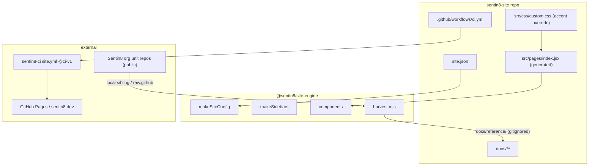
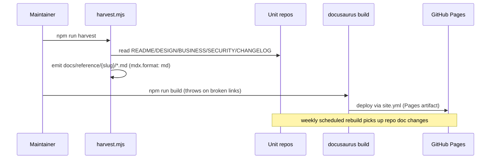

# Sentin8:Site - Detailed Design Document

> Audience: maintainers modifying this site. Overview: `README.md`;
> business view: `BUSINESS.md`. Program design of record:
> `design/sentin8-websites-design.md` (WEB) - this document covers the
> site-specific construction.

## 1. Scope & Context

**Owns:** the sentin8.dev content (landing, 19 service/starter pages,
apps, SDKs, security, developers, samples) and its build/deploy wiring.

**Does not own:** the engine (theme/components/factories -
`sentin8-site-engine`), vertical sites, or the unit repos' documentation
(harvested read-only).

## 2. Runtime Architecture

- `docusaurus.config.js` - one call: `makeSiteConfig(site)` (engine
  factory; Mermaid theme, dark-first, navbar dropdowns from
  `site.json.units/apps`, footer with all 8 family links).
- `sidebars.js` - `makeSidebars()` (engine): fully autogenerated;
  section order comes from the `_category_.json` files.
- `src/pages/index.jsx` - the data-driven landing (generated by the
  engine scaffolder; reads `site.json` directly).
- `docs/**` - hand-authored pages (MDX-capable); `docs/reference/**` is
  harvester output, gitignored, rebuilt on every build.
- Harvest resolution: local sibling folder first
  (`../../{repo}/`), then `raw.githubusercontent.com/Sentin8/{repo}/main/`
  - offline dev, public truth in CI.

## 3. Data Model

`site.json` is the only site-local data source:

| Field | Role |
|---|---|
| `units[17]` | platform services: `slug` (route id), `name`, `repo`, `org`, `summary`, `scopes` |
| `starters[2]` | cli + captain |
| `apps[2]` | dash, auth-ui |
| `sdks[2]` | rust (`sentin8-sdk`), flutter (`sentin8-flutter`) |
| `pillars[5]` | the SECURITY.md five pillars (landing strip) |
| `showcase[7]` | vertical cards → `{vertical}.dev` absolute links |
| `accent` | Royal Gold `#D4AF37` (platform) |

## 4. Content Pipeline

Harvested pages carry `mdx.format: md` frontmatter - maintainer docs
contain raw HTML/angle-bracket emails that MDX would reject; the `md`
format renders them verbatim while the Mermaid theme still draws every
diagram.

## 5. Cross-Cutting Concerns

- **Link discipline** - `onBrokenLinks: 'throw'`: a broken internal
  link is a build failure, never a silent 404.
- **Provenance** - every harvested subtree's index names its source
  repo; `custom_edit_url` points at the source file for "Edit this
  page".
- **No tracking** - static output, zero client-side third-party
  scripts; `Referrer-Policy: no-referrer` via headTags.
- **Deploy identity** - GitHub Pages via OIDC (`id-token: write`); no
  static secrets in CI.

## 6. Failure Modes & Recovery

| Failure | Behavior |
|---|---|
| Sibling repo missing a doc file | harvester warns and skips that page; index lists only what exists |
| Network fetch failure | harvester escalates: hard failure, build stops (docs never silently trail) |
| Broken internal link | build fails (`throw`) - fix before deploy |
| Engine pin drift | sites bump the git-tag pin deliberately (same discipline as SDK tags) |

## 7. Testing Strategy

- Build = the test: harvest + build with `onBrokenLinks: throw` on
  every push/PR (the `site.yml` lane).
- Engine unit tests (config/sidebar factories) live in
  `sentin8-site-engine` (`npm test`).

## 8. Invariants

1. `docs/reference/` is never committed - always regenerated.
2. Every unit in `site.json` has a hand-authored overview page under
   `docs/services/{slug}/` (or apps/sdk) before it appears in the
   navbar.
3. The canonical `SECURITY.md` claims are never paraphrased into
   stronger marketing on this site.

## 9. Open Questions

- OQ-1 analytics, OQ-2 playground, OQ-3 i18n, OQ-4 OpenAPI pages -
  tracked in the program design doc.

---

**Design attribution:** Sentin8:Site and its underlying concepts were designed by Hamid Jahanzad <Hamid@Jahanzad.com>.