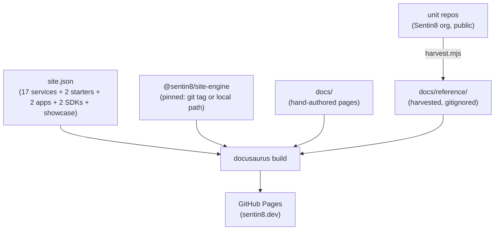

# Sentin8:Site - sentin8.dev

> The public platform website at [sentin8.dev](https://sentin8.dev):
> every platform service, app, and SDK explained for developers and
> users, with the security model front and center. Built on
> `@sentin8/site-engine` (Docusaurus v3). Design of record:
> `design/sentin8-websites-design.md` (WEB).

## 1. Summary

sentin8.dev is the platform's product + developer website: a landing
page detailing all 17 services, 2 starters, 2 apps, and 2 SDKs as card
grids; per-service pages with use cases and API surface tables; the
five security pillars; developer quickstarts; sample code; Remote UI
(RFW) explained; and a **Reference** section harvested at build time
from every unit repo's own `README.md`/`DESIGN.md`/`BUSINESS.md`/
`SECURITY.md` - the repositories stay the source of truth.

## 2. Motivation

The tree's ~98 public repos carry maintainer-grade docs (366 files, 334
Mermaid diagrams) with no curated public surface. Developers evaluating
the platform need the "what is this and how do I build on it" layer:
product overviews, use cases, API surfaces, security guarantees - and
they need it to never drift from the code, which the build-time
harvester guarantees by construction.

## 3. Architecture



## 4. Content map

| Route | Content |
|---|---|
| `/` | Hero · service cards (17) · apps · SDKs · starters · security pillars · vertical showcase (7 cards → `{vertical}.dev`) |
| `/docs/` | Platform overview |
| `/docs/security/` | The five pillars, fail-closed discipline, 8-step pipeline |
| `/docs/services/{svc}` | Per service: use cases · API surface table · events |
| `/docs/apps/{app}` · `/docs/sdk/{rust,flutter}` | Apps and SDKs |
| `/docs/developers/` · `remote-ui/` | Dev story · RFW contract |
| `/docs/samples/` | cURL / Rust / Dart first calls |
| `/docs/reference/{unit}/` | Harvested README/DESIGN/BUSINESS/SECURITY per unit |

## 5. Development

```bash
npm install     # installs @sentin8/site-engine (pinned)
npm run harvest # renders docs/reference/ from the sibling repos (offline)
npm start       # dev server
npm run build   # production build (fails on broken links)
```

Adding a unit: edit `site.json` → add a `docs/services/{slug}.md` page →
the harvester picks up the repo trio automatically.

## 6. Deployment

Push to `main` → `ci.yml` calls `Sentin8/sentin8-ci site.yml@ci-v1` →
harvest → build → deploy to GitHub Pages. A weekly schedule rebuilds so
sibling-repo doc edits land without a site commit. Custom domain
(`sentin8.dev`) via `static/CNAME` (operator DNS step: WEB-10).

## 7. Unresolved questions

See the design doc's open questions (OQ-1..4): analytics, live
playgrounds, i18n, OpenAPI pages.

---

**Architecture & Design:** Sentin8:Site and its underlying concepts were designed by [Hamid Jahanzad](https://www.linkedin.com/in/hamidjahanzad/).