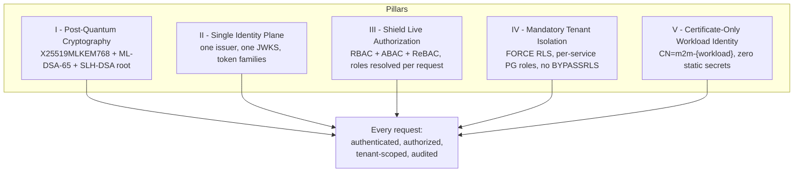
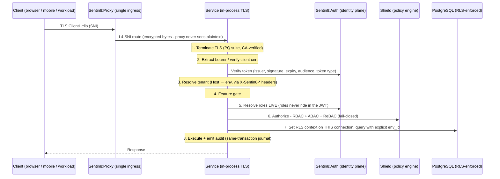

# SECURITY.md: Sentin8 Platform - Security Model & Post-Quantum Architecture

> **This document is canonical and identical across every repository of the
> Sentin8 tree.** It describes the security posture of the *platform*, not of
> any single service: every service - platform or vertical - inherits this
> model by construction, not by configuration.
>
> Audience: security engineers, auditors, compliance officers, architects, and
> anyone evaluating what Sentin8 guarantees. For per-service architecture read
> that service's `README.md`; for wire-level detail read its `DESIGN.md`.

---

## 1. Executive Summary - The Security Model in One Page

Sentin8 is a **post-quantum, zero-static-secret, live-authorization
platform**. It was designed for regulated, multi-tenant, multi-vertical
operation - verticals are independent compositions built by any team
(guarded money movement, hospitality management, trading, communication,
and others) - where the threat model includes
nation-state harvest-now-decrypt-later collection, insider privilege
escalation, and credential theft - not just opportunistic web attacks.

The model rests on **five pillars**:

1. **Post-quantum cryptography, exclusively.** Every TLS connection in the
   platform - client→ingress, proxy→service, service→service, service→data -
   negotiates **X25519MLKEM768** key exchange with **ML-DSA-65** certificate
   signatures, anchored by an **SLH-DSA-SHA2-128s** (hash-based) root CA.
   The default TLS mode is *exclusive*: **no classical fallback exists**.
   Recorded traffic is quantum-resistant today; there is nothing to
   "migrate later".
2. **One identity plane.** Sentin8:Auth is the only token issuer, the only
   JWKS authority, and the only authentication authority in the platform. No
   service mints its own sessions, tokens, or credentials - so there is no
   second issuer to compromise and no fragmented trust to reconcile.
3. **Live authorization - Shield.** Authorization is decided per request by
   one embedded policy engine (**Shield**) that unifies **RBAC, ABAC, and
   ReBAC**. Roles are **never embedded in tokens**: they are resolved live
   from the identity plane on every request. A demoted administrator loses
   access on the *next request* - not at token expiry, not at midnight.
4. **Mandatory tenant isolation in the database itself.** Every tenant table
   carries `ENABLE` + `FORCE ROW LEVEL SECURITY`; **no role on the cluster
   carries `BYPASSRLS`** - not the event relays, not the schedulers, not
   anyone. Services connect as OAuth-authenticated per-service roles scoped
   to their own database and schema. Isolation is not an application
   convention; it is enforced by PostgreSQL on every row read.
5. **Certificate-only workload identity - zero static secrets.** A workload's
   only identity is its Acme-issued client certificate (`CN=m2m-{workload}`)
   presented in the TLS handshake. There are **no client secrets, no static
   API keys, no password files** anywhere in the service-to-service plane. A
   stolen configuration file grants nothing; a stolen database dump decrypts
   nothing.

Wrapped around the pillars is a **fail-closed discipline**: an unresolvable
hostname is a `421`, not a guess; an unparsable policy set at boot is a
refused startup, not a warning; a role-resolution outage is a deny, not an
allow; an unauditable action is an action that never happened.



---

## 2. Security Architecture at a Glance

Every request into the platform walks the same eight-step pipeline. The
steps are mandatory and ordered; no handler may skip one:



The properties this buys:

- **The proxy never sees application plaintext.** It is an L4 SNI router;
  TLS terminates *inside* the owning service, in-process.
- **Context headers cannot be spoofed.** The TLS layer strips every
  client-supplied `X-Sentin8-*` header before injecting its own
  authoritative values; an unresolvable `Host` is rejected with
  `421 Misdirected Request`.
- **The decision is never stale.** Steps 5-6 consult live identity state and
  live policy data on every request.
- **The database is the last wall, not the only one.** Every handler also
  carries explicit `WHERE env_id = $N` clauses - RLS is the backstop,
  defense-in-depth is primary.

---

## 3. Pillar I - Post-Quantum Cryptography

### 3.1 The Algorithm Suite

| Layer | Algorithm | Standard | Security basis |
|---|---|---|---|
| TLS 1.3 key exchange | **X25519MLKEM768** (hybrid: classical X25519 ⊕ ML-KEM-768) | FIPS 203 | Lattice KEM + classical ECDH; breaking the session requires breaking **both** |
| Service & client certificate signatures | **ML-DSA-65** | FIPS 204 | Lattice signatures (Category 3) |
| Root CA signature | **SLH-DSA-SHA2-128s** | FIPS 205 | **Hash-based** - secure even if lattices fall |
| Token / claims signing (JWKS) | PQ signing key families, coordinated rotation | FIPS 204 lineage | JWTs, JAR request objects, JARM responses, SD-JWT credentials |
| Symmetric envelope encryption | **AES-256-GCM** (key-versioned) | FIPS 197 / NIST SP 800-38D | Secrets store, BFF session store |
| Disclosures & bindings | SHA-256, PKCE `S256`, RFC 9449 DPoP | - | Selective-disclosure digests, code challenges, proof-of-possession |
| MFA (TOTP) | HMAC-SHA1, RFC 6238 (30s step, 20-byte secrets, stored encrypted) | - | The RFC standard; secrets never stored in the clear |

Two deliberate design choices deserve emphasis:

- **The trust anchor is hash-based, not lattice-based.** SLH-DSA-SHA2-128s
  (the SPHINCS+ family) derives its security from hash functions alone. Even
  a future cryptanalytic breakthrough against lattice assumptions leaves the
  root CA sound. The root is signed rarely, so its slower signing cost is
  irrelevant - the conservative choice costs nothing.
- **The key exchange is a true hybrid.** X25519MLKEM768 combines classical
  X25519 with ML-KEM-768 such that an attacker must defeat both to recover
  session keys. In `exclusive` mode this hybrid is the *only* group offered -
  there is no classical-only downgrade to attack.

### 3.2 Exclusive by Default - No Classical Fallback

The platform's TLS posture is controlled by a single variable,
`SENTIN8_TLS_PQ_MODE`:

| Mode | Key exchange | TLS versions | Purpose |
|---|---|---|---|
| `exclusive` (**default**) | X25519MLKEM768 only | TLS 1.3 only | Full PQ; no fallback group exists to negotiate down to |
| `hybrid` | X25519MLKEM768 first, classical groups offered | TLS 1.3 only | PQ-preferred, legacy-client compatibility |
| `classical` | Classical groups only, no ML-KEM | TLS 1.2 + 1.3 | **Emergency rollback only** - explicit, loud, temporary |

The default posture means the classic downgrade attack - get the handshake
to agree on a classical group, record, decrypt later with a quantum computer
- has no surface. A client either speaks post-quantum or fails the
handshake.

**Harvest-now-decrypt-later is dead on arrival against Sentin8 traffic.**

### 3.3 The Certificate Authority - Sentin8:Acme

The platform runs its own RFC 8555 ACME certificate authority, because
public CAs cannot sign `{service}.{env}.{org}.{tld}` internal hostnames -
and because the post-quantum certificate ecosystem is young enough that the
platform refuses to wait for it:

- **Two-tier hierarchy** - SLH-DSA root → ML-DSA intermediate → leafs, for
  both server certificates (HTTPS on every domain) and client certificates
  (workload identity, below).
- **Trust distribution** - the root CA is installed into the OS trust store
  *and* the Chromium/NSS store at bootstrap; every process in the tree, and
  every headless browser test, verifies the same anchor.
- **External domains** - proxied to a public ACME provider; internal names
  never leave the boundary.
- **Admission control** - mint endpoints are shed-load protected: a fleet-wide
  cold start answers `503 + Retry-After` instead of silently timing out.
  Saturation is loud, deterministic, and self-draining - never a soft
  security failure.
- **No `danger_accept_invalid_certs`, anywhere.** Verification failure is a
  failure; there is no test-only bypass switch to leave switched on.

### 3.4 Memory-Safe Cryptography

The entire TLS stack is **pure Rust** - `rustls` over the Graviola provider,
no C, no assembly blobs, no cmake-built vendor code. The historical lesson of
OpenSSL-class CVEs (Heartbleed-class memory disclosure in the handshake
path) is addressed by language, not by patching discipline: the crypto layer
cannot have a buffer overflow because the language forbids it. `unsafe`
blocks in the security path would be a review-blocking defect.

---

## 4. Pillar II - The Identity Plane (Sentin8:Auth)

### 4.1 One Issuer or None

Sentin8:Auth is the platform's only issuer of tokens, the only JWKS
authority, and the only authentication authority. Every other service
verifies what it issues; no service mints sessions, API keys, service
credentials, or JWKS documents. The compromise question "which issuer was
forged?" has one answer and one place to harden, rotate, and audit.

### 4.2 Token Families - the Right Credential for the Right Job

| Family | Use | Security properties |
|---|---|---|
| **User access token** | Any authenticated human access | Shield-decided; scopes are a coarse pre-filter only |
| **ID token** | OIDC authentication | Issued by the single authority |
| **Refresh token** | Session continuity | Rotated and revocable; held server-side by the BFF |
| **M2M (workload)** | Machine-to-machine | Certificates are the workload identity; tokens, where used, are certificate-bound (RFC 8705 `cnf`) - a stolen token without the private key is useless |
| **API-client** | Third-party integrations | Scoped, registered, auditable |
| **Actor token** | Administrative impersonation | **Time-boxed and audited**; support actions are attributable |
| **Delegated token** | Cross-context trust via the Delegation Gateway | Carries an `act` chain claiming the originating user; downscoped per target service by the BFF - never broad-scope passthrough |

Two structural rules govern all families:

- **No realm tag.** A user is a user. What distinguishes a platform
  operator from a bank teller from a hotel guest is *RBAC assignment*, not a
  token flavor - so there is no "realm confusion" class of vulnerability.
- **No roles in the JWT.** The token carries identity and coarse `scope`
  only. Roles are resolved live at authorization time (§5). The `scope`
  claim is a pre-filter and an RLS context feed - **never the decision**.

### 4.3 Security Profiles - FAPI-Grade OAuth by Default

Sentin8:Auth enforces per-client **security profiles** - a named bundle of
required mechanisms, evaluated at the authorize, token, and introspection
endpoints. Profiles are data (rows in the auth store), not build flags, so a
regulated tenant can run `fapi_2_message_signing` while a partner runs a
baseline profile - on the same deployment.

| Profile | PAR | JAR | DPoP | mTLS | JARM | `iss` | Signed introspection (RFC 9701) |
|---|---|---|---|---|---|---|---|
| `standard` / `fapi_1_baseline` | - | - | - | - | - | - | - |
| `fapi_1_advanced` | **required** | **required** | mTLS **or** DPoP (sender-constraining) | | optional | **required** | - |
| `fapi_2` (default posture) | **required** | covered by PAR | **required** | optional | **required** | **required** | - |
| `fapi_2_message_signing` | **required** | covered by PAR | **required** | optional | **required** | **required** | **required** |

Enforcement details that make the profiles real rather than cosmetic:

- **PKCE `S256` is mandatory** on every profile; `plain` does not exist.
- **Response types are `code` only** - the hybrid flow (and its entire
  historical CVE family) is not implemented.
- **Client authentication methods are allow-listed per profile.** FAPI
  profiles admit only `tls_client_auth`, `self_signed_tls_client_auth`, or
  `private_key_jwt` - `client_secret_basic`/`client_secret_post` are
  rejected for confidential clients. A shared secret is not
  sender-specific; under FAPI the platform refuses to pretend otherwise.
- **Grant types are constrained per profile** - authorization-code +
  refresh + device-code (RFC 8628) + CIBA + token exchange (RFC 8693, the
  delegation grant).
- **PAR (RFC 9127)** pushes authorization parameters server-side, killing
  the parameter-tampering surface of the plain front-channel.
- **JAR/JARM** sign the request objects and authorization responses;
  RFC 9701 signs introspection responses - the `fapi_2_message_signing`
  tenant can prove, cryptographically, what the server said.

### 4.4 Sender-Constraining - a Stolen Token Is a Useless Token

Every access path is bound to a proof of possession:

- **DPoP (RFC 9449)** - per-request proof JWTs bound to the client's key and
  the HTTP method+URI; replay on another channel fails.
- **mTLS certificate binding (RFC 8705 `cnf`)** - the token is bound to a
  certificate; presentation without the private key fails.
- **HTTP message signatures (RFC 9421)** - signed requests for integrations
  that need them.

Combined with the BFF (§6.4), the consequence is structural: **token
exfiltration does not yield replayable access.**

### 4.5 Authentication Strength

- **Passkeys (WebAuthn)** - phishing-resistant credentials are a
  first-class sign-in path.
- **MFA (TOTP, RFC 6238)** - secrets are 20-byte random keys stored
  encrypted; enrollment is challenge-confirmed; disabling requires password
  re-confirmation.
- **Enterprise federation** - OIDC and SAML connections (SCIM 2.0 for
  user/group provisioning), so workforce identity lives where the
  enterprise controls it.
- **CIBA** - decoupled approval flows for devices and assistants.
- **Bot protection & lockout** - sliding-window rate limits per IP
  (default 10/min) and per email (default 5/min) return `429 + Retry-After`;
  after 5 consecutive failures the account locks (default 15 min), with
  state durable across restarts. Credential stuffing gets loud, slow, and
  expensive.
- **Back-channel logout (and webhooks)** - sessions die *at the server*,
  not when the browser next asks.

### 4.6 Selective Disclosure & Verifiable Credentials

Sentin8:Auth verifies **SD-JWT** (selective-disclosure JWT) presentations
for wallet-based sign-in and issuance: issuer-signature verification over
per-claim SHA-256 disclosure digests, key binding (`cnf.jwk` + optional
KB-JWT), and **Status List 2021** revocation checks (compressed bitstring,
cached). A relying party receives exactly the claims the user disclosed -
nothing more - and can prove non-revocation without an online call to the
issuer for every attribute.

---

## 5. Pillar III - Shield: One Authorization Engine, Three Models

**Shield** is the platform's embedded, declarative, fail-closed policy
engine - the single authoritative decision point in the pipeline. One
engine, three authorization models, evaluated together on every request:

| Model | Data | Mechanism |
|---|---|---|
| **RBAC** | Roles/groups (with nesting) in the identity plane | Role names resolved **LIVE** from Sentin8:Auth per request (short-TTL cache, env+subject keyed, invalidated by role-change events) - never read from the JWT |
| **ABAC** | Principal attribute rows (`policy_principal_attrs`), env-scoped | Attribute conditions in policy rules (risk tiers, clearances, time windows, device posture) |
| **ReBAC** | Relation tuples (`policy_relations`) | Entity-hierarchy edges - `document in folder in project owned by team of user` - size-capped, loaded as parent edges |

### 5.1 Live Role Resolution - Authorization That Cannot Go Stale

The classic JWT weakness is that embedded role claims freeze authorization
at issuance: a demoted admin stays an admin until the token expires.
Sentin8's answer is structural - **the JWT carries no roles**. On every
request Shield resolves the caller's roles from the identity plane
(re-verifying the raw bearer server-side; it never trusts a
caller-supplied role list). A role change takes effect on the *next
request*. Role-resolution failure is a **deny**, not an allow (fail-closed).

### 5.2 Policy-as-Data - Auditable, Versioned, Hot-Reloaded, Shadowable

- Policies, schemas, relations, and attributes are **rows** in RLS-protected
  tables, not compiled-in rules: `platform` rows ship from each service's
  registry at enrollment; `tenant` rows are authored by environment admins
  (strict mode: tenant sets require a schema).
- **Shadow mode**: a new policy set evaluates and logs
  `policy.would_deny` - production traffic shows you the blast radius -
  *before* a single `UPDATE` promotes it to `enforced`. Promotion and
  rollback are one statement, versioned and audited.
- **Hot reload**: policy changes stream to every service over the platform
  bus (one long-lived consumer per process); no restarts, no drift, no
  "forgot to redeploy the rules".
- **M2M parity**: token *type* never bypasses policy. A workload credential
  hits the same Shield evaluation as a human's.

### 5.3 Fail-Closed Semantics

| Condition | Result |
|---|---|
| No matching permit in an enforced set | **Deny** |
| Policy evaluation / cache / role-resolution error | **Deny** + audit |
| Unparsable policy text at boot | **Service refuses to start** |
| Set disabled or in `shadow` | Would-deny is logged; never silently allows |

Authorization in Sentin8 fails the way a bank vault fails: shut.

---

## 6. Pillar IV - Tenant Isolation & Data Defense

### 6.1 Row-Level Security Is Mandatory, Not Recommended

Every tenant table in every service carries:

```sql
ENABLE ROW LEVEL SECURITY;
FORCE ROW LEVEL SECURITY;   -- even the table owner is subject to policies
```

Policies match the globally-unique `env_id`, set per connection via the
tenant-context function on **the same connection the query runs on**
(transaction-local by construction). Two distinct scoping patterns are
provided and enforced: **visibility tiers** (`usr`/`env`/`public`) and
**holder scoping** (`customer_id`-held records).

### 6.2 No BYPASSRLS Exists - Anywhere

**No role on the cluster carries `BYPASSRLS`.** Not the platform relays,
not the schedulers, not the maintenance accounts. The `sentin8` superuser
exists for DDL/bootstrap only. Every runtime connection is:

- **OAuth-authenticated** (PostgreSQL 18) with per-service scopes,
- mapped to a **per-service role in that service's own database/schema
  only** (database-per-vertical, schema-per-service),
- RLS-subject, and
- additionally gated by explicit `WHERE env_id = $N` clauses in every
  handler (RLS is the backstop; the explicit clause is primary).

Cross-schema reads inside a vertical database are declared grants, never
blanket ones. A compromised service binary can, at worst, read its own
schema in its own tenants - lateral movement to another service's data fails
at the database, the last and hardest wall.

### 6.3 Secrets - Reference-Only, Envelope-Encrypted, Audited

- **Application tables store references** (`backend://path`), never
  credential material. A leaked database or backup contains **no usable
  provider keys, OAuth secrets, PAN, PIN, CVV, or tokens - by schema**.
- Values live in Sentin8:Secrets as **AES-256-GCM envelopes with a key
  version**, rotatable without downtime (rewrap + version-prune via
  scheduled maintenance).
- **Plaintext exists only inside request handling**, wrapped in a
  zeroize-on-drop value type; metadata projections can never serialize it.
- **Every read is audited** - machine resolves (M2M-scoped) and human
  reveals both write audit rows naming who, what, when. An unaudited reveal
  is not a reveal that can happen.

### 6.4 The BFF - Tokens Never Reach the Client

All browser/mobile traffic flows through Sentin8:BFF: OAuth tokens are held
**server-side** in an AES-256-GCM-encrypted session store; the client holds
a session cookie plus a CSRF token for mutations; refresh is rotated
transparently by the BFF. XSS cannot steal a token the page never had. The
BFF also downscopes delegated tokens per target service (`act` chain
preserved) - broad-scope passthrough is not a code path.

### 6.5 Auditability by Construction

Every service writes a **local audit journal row in the same transaction as
the domain change**, then pushes to the platform audit ingest API (M2M
scope-gated); the auditor stamps the reporting service from the *verified*
identity - self-reported attribution is impossible. An ingest outage parks
journal rows locally and retries - **an audit event is never lost to a
downstream blip**. Correlation IDs and idempotency keys thread every action
across services, so a forensic timeline reconstructs itself.

### 6.6 The Event Plane Is Authenticated Too

Every event on the platform bus is produced by a certificate-identified
workload (local outbox → produce API, idempotent by key), consumed through
per-workload ACLs, retried with backoff into a DLQ - never silently
dropped. A poisoned or forged event cannot enter the stream without a valid
workload identity, and replaying one cannot double-execute (idempotent
consumers, key-deduplicated).

---

## 7. Pillar V - Transport Security & the Single Ingress

### 7.1 One Door, One Guard

Every external connection enters through Sentin8:Proxy. It peeks the
ClientHello for SNI and either:

- **L4-pipes the encrypted bytes** to the owning service (application
  traffic), which terminates TLS in-process via the shared `sentin8-tls`
  library - the proxy never holds application plaintext; or
- **Bridges to L7** for the management plane only, where a Shield-evaluated
  route-path policy can block a request before any handler runs.

### 7.2 The `X-Sentin8-*` Trust Model

Tenant resolution is header-based - so the headers are a security boundary:

1. **Strip first.** The middleware removes *every* `X-Sentin8-*` header a
   client sent (`x-sentin8-env-id`, `x-sentin8-client-cert-*`,
   `x-sentin8-correlation-id`, …). A client cannot inject a tenant context
   or impersonate a caller workload.
2. **Resolve authoritatively.** The `Host`/SNI value resolves (TTL cache →
   Sys owner API `GET /v1/resolve/hostname`) to the real tenant mapping.
3. **Inject.** Only then are the authoritative headers written - including
   the CA-verified client certificate's subject, thumbprint, issuer, and
   chain for workload callers.
4. **Reject the unknown.** An unresolvable hostname is `421 Misdirected
   Request` - never a default tenant, never a guess.

The hostname resolver is **database-free by design**: vertical services
embedding `sentin8-tls` gain *zero* platform-database access - no DSN, no
role, no grants. A vertical can never become a data-plane pivot, even if
fully compromised.

### 7.3 Service-to-Service Calls

Every service→service call rides the same exclusive PQ TLS stack with the
caller's workload certificate in the handshake. The receiver CA-verifies the
chain, derives the caller identity from the certificate, and stamps it into
the audit trail. There is no plaintext hop, no internal-only trusted
network assumption, and no shared bearer token floating between services.

### 7.4 The Data Plane Is Certificate-Authenticated Too

- **PostgreSQL** - services authenticate via PostgreSQL 18's OAuth
  authentication with per-service scopes mapped to per-service database
  roles (§6.2).
- **Valkey** - runs `tls-auth-clients yes`: no certificate, no connection.
  The client certificate's CN *is* the ACL user; **there are no Valkey
  secrets anywhere in the platform**. ACL key patterns and command
  allowlists are provisioned per workload at enrollment; a single
  `m2m-registry-writer` identity is the only one able to write the
  workload-authorization registry, and no service holds it.

---

## 8. Threat Model - What Attacks Fail

| Attack | Why it fails on Sentin8 |
|---|---|
| **Harvest now, decrypt later** (recorded TLS) | Exclusive X25519MLKEM768 - there is no classical session to record |
| Quantum signature forgery | ML-DSA-65 leaves; hash-based SLH-DSA root - two independent quantum-resistant families in the chain |
| Stolen token replay | Sender-constraining (DPoP / RFC 8705 `cnf`) + tokens never leave the BFF |
| JWT role/claim tampering | Roles are not in the JWT; authorization resolves live from the identity plane |
| Privilege-escalation persistence | Live RBAC/ABAC/ReBAC - demotion is effective on the next request |
| Tenant context spoofing (header injection) | Strip-then-inject middleware; unresolvable host → `421` |
| SQL-level cross-tenant reads | `FORCE` RLS + no `BYPASSRLS` role on the cluster + per-service scoped roles |
| Lateral movement after one service is compromised | Certificate workload identity (no shared secrets to steal), per-service PG roles, database-per-vertical |
| Database/backup exfiltration | Secret-reference-only schema + AES-256-GCM envelope encryption |
| Credential stuffing / brute force | Sliding-window per-IP and per-email limits + durable account lockout |
| Phishing | Passkeys (WebAuthn) + FAPI-grade flows (PAR, `code`-only, PKCE S256) |
| OAuth parameter tampering / mix-up | PAR + JAR; single issuer; `iss` required under FAPI profiles |
| Introspection/response forgery | JARM + RFC 9701 signed introspection |
| Stealthy policy changes | Policy-as-data: versioned, shadow-mode preview, hot-reload, admin-audited |
| Availability-as-security (boot storms, saturation) | Admission-controlled certificate minting (`503 + Retry-After`), tier-gated boots, bounded retries with DLQ |
| Memory-safety CVEs in the crypto path | Pure-Rust TLS stack (rustls/Graviola); no C in the handshake path |
| Unauditable admin actions | Same-transaction audit journal + verified-identity attribution + time-boxed actor tokens |

---

## 9. Secure Defaults & Invariants

1. Post-quantum TLS is **exclusive by default**; rollback modes exist but
   are never defaults.
2. Certificates are the **only** workload identity; there are **no static
   M2M secrets** in the platform.
3. **One issuer** - any second token-minting path is a defect by definition.
4. **`FORCE ROW LEVEL SECURITY`** on every tenant table; **no `BYPASSRLS`
   role exists**.
5. Roles **never ride in tokens**; the `scope` claim is a pre-filter and RLS
   feed, **never the decision**.
6. Authorization is **fail-closed**: unknown → deny, error → deny, unparsable
   at boot → refuse to start.
7. Tenant context is **stripped-then-injected**; unresolvable hosts are
   rejected, never defaulted.
8. Secrets are **reference-only**; plaintext is zeroized on drop; every read
   is audited.
9. Tokens **never reach browsers**; the BFF is the only client-facing token
   holder.
10. No certificate-verification bypass exists in any code path
    (`danger_accept_invalid_certs` is absent by policy).
11. Client authentication secrets are rejected under FAPI profiles; only
    possession-based methods (`private_key_jwt`, mTLS) are admitted.
12. Every state-changing request is **audited in the same transaction** as
    the change it authorized.
13. No role on the cluster bypasses RLS - not relays, not schedulers, not
    maintenance.
14. Policy sets are **data** (versioned, shadowable, hot-reloaded) - never
    hidden in compiled code.

---

## 10. Cryptographic Algorithm Inventory

| Purpose | Algorithm / Mechanism | Reference |
|---|---|---|
| TLS key exchange | X25519MLKEM768 (hybrid) | FIPS 203 / TLS 1.3 group |
| Certificate signatures (leaf, intermediate) | ML-DSA-65 | FIPS 204 |
| Certificate signature (root CA) | SLH-DSA-SHA2-128s | FIPS 205 |
| JWT / JAR / JARM / SD-JWT signing | PQ key families in the JWKS, coordinated rotation | RFC 7515/7519 lineage; issuer JWKS |
| Proof of possession (tokens) | DPoP | RFC 9449 |
| Certificate-bound tokens | mTLS `cnf` binding | RFC 8705 |
| Signed HTTP requests | HTTP message signatures | RFC 9421 |
| Pushed authorization | PAR | RFC 9127 |
| Token exchange / delegation | RFC 8693 (`act` chain) | - |
| Signed introspection | JWT response | RFC 9701 |
| Selective disclosure | SD-JWT + Status List 2021 | draft-ietf-oauth-selective-disclosure-jwt |
| Code challenge | PKCE S256 | RFC 7636 |
| Device grant | Device code | RFC 8628 |
| Decoupled approval | CIBA | RFC 9126 |
| MFA | TOTP (HMAC-SHA1, 30 s step) | RFC 6238 |
| Phishing-resistant auth | WebAuthn passkeys | W3C WebAuthn |
| Envelope encryption | AES-256-GCM, key-versioned | NIST SP 800-38D |
| Disclosure digests | SHA-256 | FIPS 180-4 |
| Post-quantum TLS implementation | Pure Rust (rustls + Graviola provider) | - |

---

## 11. Verification & Secure Development

- **Policy changes cannot regress silently** - shadow mode previews every
  would-deny against production traffic before enforcement.
- **E2E tests exercise security exactly as an attacker would** - through the
  browser and the public API surface only. Tests never shortcut
  authorization with direct SQL or internal endpoints, so every green run
  re-verifies the real pipeline (authentication → Shield → RLS → audit),
  not a mocked one.
- **The whole crypto stack is memory-safe pure Rust** - the supply-chain
  surface for the handshake path is auditable in one language.
- **Boot is fail-closed** - invalid policy text, unreadable certificates,
  or unresolvable identity refuse startup; a half-initialized service never
  serves traffic.

---

## 12. Reporting a Vulnerability

Please report suspected vulnerabilities to the platform security maintainers
(see the contact in the repository `NOTICE`). Include reproduction steps,
affected components, and any packet captures or PoCs. We coordinate
disclosure, credit reporters, and treat reports as the highest-priority
input this document can receive.

---

**Design attribution:** sentin8 and its underlying concepts were designed by
Hamid Jahanzad <Hamid@Jahanzad.com>.