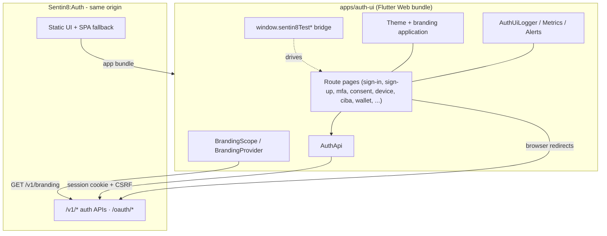
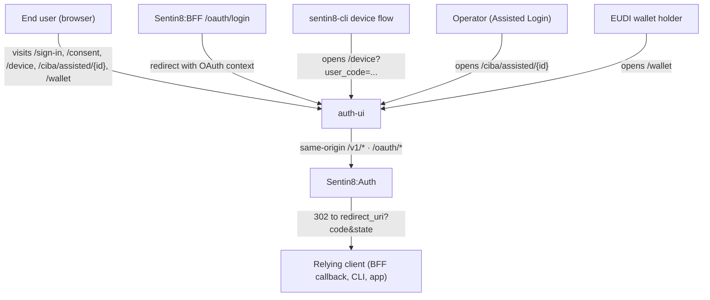
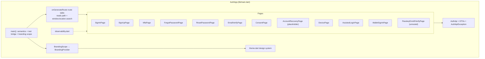
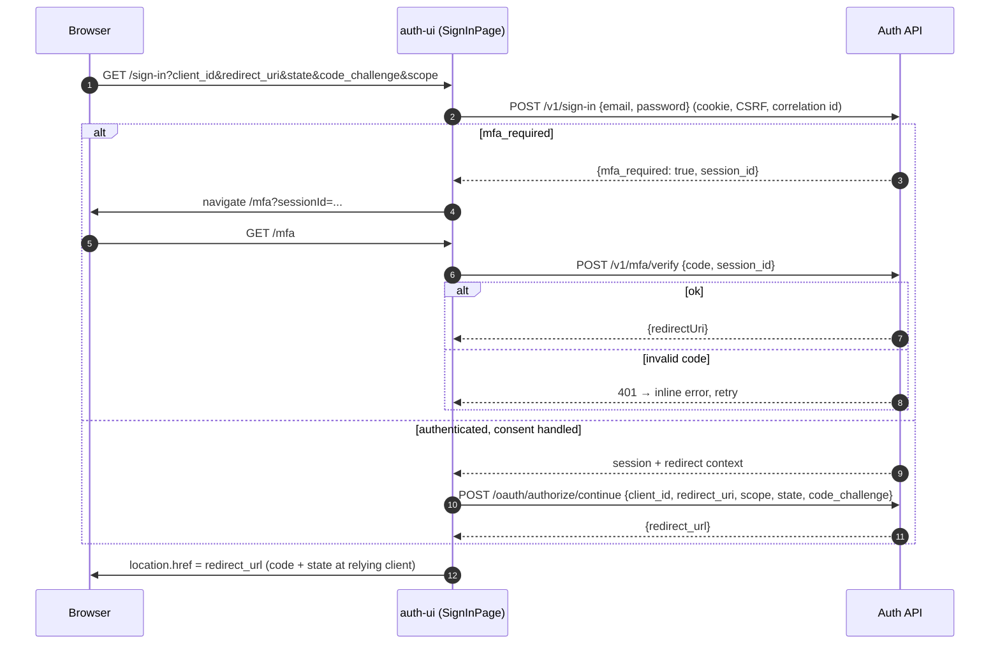
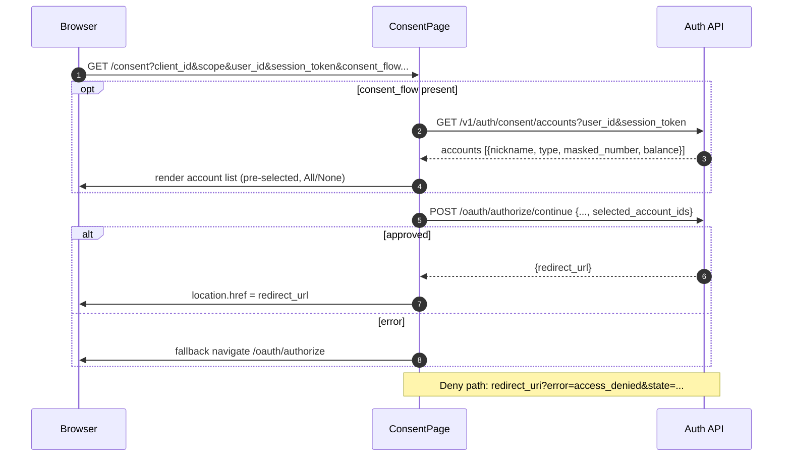
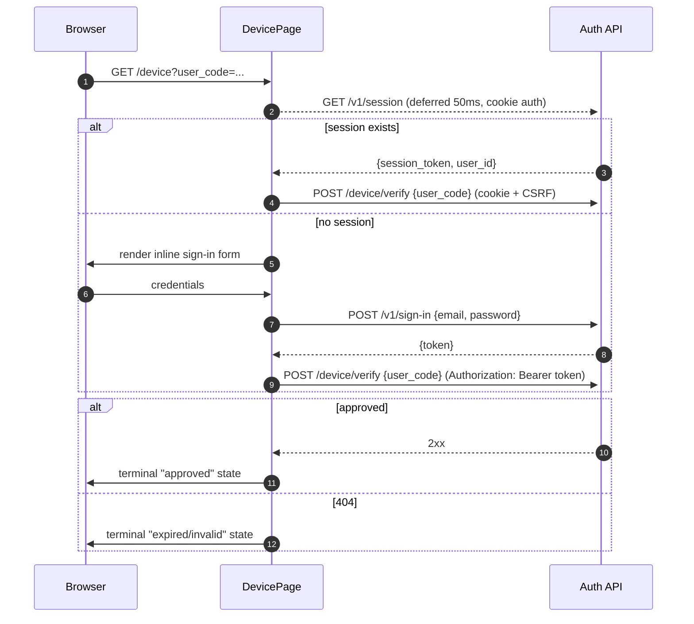
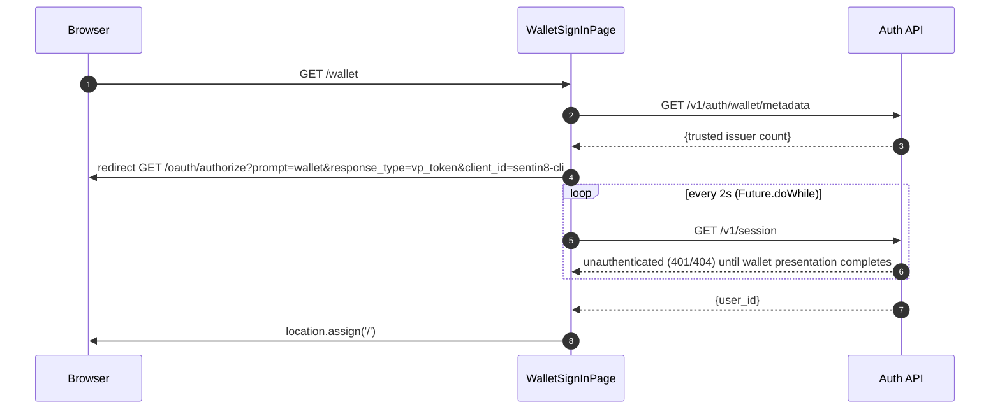
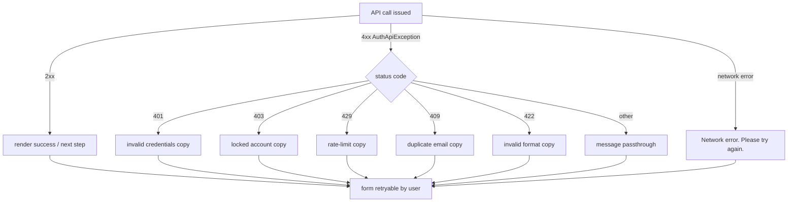
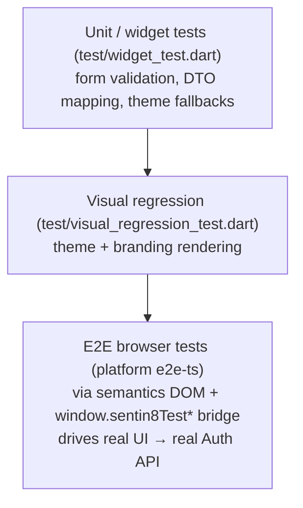

# DESIGN.md: Sentin8 Auth Hosted UI (auth-ui) - Detailed Design Document

> Audience: maintainers, reviewers, and architects modifying the hosted auth
> UI. For the overview read `auth-ui/README.md`; for the business view read
> `auth-ui/BUSINESS.md`. All endpoints and claims below describe Sentin8:Auth
> as implemented - the UI never calls another service.

## 1. Scope & Context

**Owns (UI responsibilities):**

- Rendering of all human-facing auth steps: sign-in, sign-up, MFA, password
  reset (request + confirm), email verification, OAuth consent with FDX
  account selection, RFC 8628 device approval, CIBA Assisted Login
  confirmation, EUDI wallet sign-in.
- Client-side design-system implementation (theme, branding application,
  logo fallback chain), per-page form validation and error rendering.
- Client-side observability: correlation ids, in-memory log ring buffer,
  flow metrics, alert thresholds.
- e2e automation bridge on `window` (`sentin8TestSignUp`, `sentin8TestSignIn`,
  `sentin8TestNavigate`) that drives the same widget code as user clicks.

**Does NOT own (delegated to Sentin8:Auth):**

- Authentication decisions, credential verification, MFA enforcement,
  lockout/rate-limit policy - the UI submits credentials and renders the
  result; the Auth service decides.
- Session durability - the session lives in the Auth cookie; the UI holds no
  durable credentials.
- OAuth authorization logic (PAR, PKCE minting, consent storage,
  `code` issuance) - the UI only round-trips context and follows redirects.
- Password-reset and email-verification token semantics - token generation,
  single-use enforcement, and expiry are Auth-owned.
- Branding storage and resolution (org base → env override) - Auth resolves
  and serves it; the UI consumes `GET /v1/branding`.

### 1.1 System Context

## 2. Runtime Architecture

### 2.1 Component View

### 2.2 Request Lifecycle - Sign-in with MFA and OAuth completion

### 2.3 Request Lifecycle - Consent with FDX account selection

### 2.4 Request Lifecycle - Device approval (RFC 8628)

### 2.5 Wallet sign-in polling lifecycle

## 3. Data Model

The UI is stateless on the server and owns no tables. Client-held ephemeral
state (all in-memory, never persisted):

| State | Holder | Lifetime | Purpose |
|---|---|---|---|
| Session token id (`_restoredSessionToken`) | `AuthApi` | page session | Arms `x-sentin8-csrf` on cookie-authenticated mutations |
| Correlation id (`a8u-<epoch>-<rand>`) | `observability.dart` | page session | Request tracing across pages of one session |
| Branding (`logoUrl, logoIconUrl, primaryColor, accentColor, fontFamily, themeMode, customCss, signInText, organizationName`) | `BrandingProvider` | page session | Theme + logo + sign-in text |
| OAuth context (`client_id, redirect_uri, state, code_challenge, scope, consent_required`) | constructor args + URL params | single page + query-string round-trip | Resume the authorization flow |
| Form state (inputs, errors, strength meter) | per-page `StatefulWidget` | page lifecycle | Input and error display |
| Logger ring buffer (500 entries) / metrics / alert windows | `observability.dart` | page session | In-memory diagnostics |

## 4. API Surface

The UI is a **consumer** of the Sentin8:Auth API. It originates calls to the
following surfaces (all same-origin; mutations carry `x-sentin8-csrf` when a
session token id is known; GETs do not):

| Endpoint | Use | Auth |
|---|---|---|
| `POST /v1/sign-in` {email, password} | credential sign-in | anonymous → cookie session |
| `POST /v1/sign-up` {email, password, first_name?, last_name?} | registration | anonymous |
| `GET /v1/session` | session probe (device, assisted, wallet polling) | cookie |
| `POST /v1/mfa/verify` {code, session_id} | TOTP step | session token |
| `POST /v1/password/reset-request` {email} | reset email send | anonymous (always-success response) |
| `POST /v1/password/reset-confirm` {token, password} | reset completion | anonymous token |
| `POST /v1/email/verify` {token} | email verification | anonymous token |
| `POST /oauth/authorize/continue` {..., selected_account_ids?} | mint authorization code | session + CSRF |
| `GET /v1/auth/consent/accounts?user_id&session_token` | FDX account list for consent | session token |
| `POST /device/verify` {user_code} | device-code approval | cookie+CSRF or Bearer |
| `GET /v1/ciba/assisted/{auth_req_id}` / `POST .../complete` | Assisted Login read/confirm | cookie+CSRF |
| `GET /v1/auth/wallet/metadata` | trusted issuer info for wallet UI | anonymous |
| `GET /v1/branding` | tenant branding | cookie, credentials include |

Client-side browser navigation surfaces (not API calls, part of flows):
`/oauth/authorize?...` (authorization request, PAR-conserving), final
`redirect_uri?code=&state=` (or `?error=access_denied`), in-app step URLs
(`/mfa?sessionId=`, `/consent?...`, `/sign-up?...`, `/device?user_code=`,
`/ciba/assisted/{id}`, `/wallet`).

Static hosting surface (Auth server): `ServeDir` over the built bundle with
SPA fallback to `index.html`, so any unknown path (e.g. deep link) renders the
matching Flutter route.

## 5. Cross-Cutting Concerns

- **Authentication/token verification**: delegated entirely to Sentin8:Auth -
  the UI sends no bearer tokens for same-origin calls; the cookie session is
  the principal. The only Bearer usage is `POST /device/verify` right after
  sign-in within DevicePage when no cookie session pre-exists.
- **CSRF**: `x-sentin8-csrf: <session token id>` armed in memory by
  `AuthApi` on mutations when the id is known.
- **Correlation / audit**: `x-sentin8-correlation-id` on every request,
  fresh per browsing session; server audit trail lives in Sentin8:Auth.
- **Enumeration protection**: forgot-password always renders success.
- **Error fidelity**: `AuthApiException` carries status + message; pages map
  401/403/409/422/429 to friendly copy; network failures are generic retries.
- **Branding resolution**: Auth resolves org-base → env-override; the UI
  falls back per-field (compiled default → branding value → bundled logo).
- **TLS posture**: served only from the Auth TLS origin (platform post-
  quantum TLS); no external CDN dependencies (CanvasKit is force-served from
  `/canvaskit/` on the same origin - air-gapped-safe loading).
- **Graceful degradation**: branding fetch failure never blocks rendering;
  consent account-list failure renders scope consent only.

## 6. Failure Modes & Recovery

- **Session probe failures**: `GET /v1/session` 401/404 is treated as "no
  session" (device/assisted flows then present sign-in inline) - never an
  error.
- **Reset-confirm 401** renders "Reset link expired or invalid" as a terminal
  state.
- **Consent fallback**: on `authorize/continue` failure the page navigates to
  `/oauth/authorize` with the round-tripped context so the authorization
  server re-derives the flow.
- **Wallet polling**: unauthenticated poll responses simply continue the
  `Future.doWhile` loop; only completion ends it.
- **Static-asset/SPA fallback**: any unknown route falls back to
  `index.html`; Flutter's default route renders sign-in.

## 7. Concurrency & Performance Model

- Single-isolate Flutter Web build (CanvasKit); no background workers.
- One active HTTP request family per user action; no connection pooling
  beyond the browser default.
- Polling: wallet sign-in polls `GET /v1/session` every 2 s bounded by
  `Future.doWhile` while unauthenticated - the only recurring request loop.
- Branding fetch is fire-and-forget; rendering never blocks on it.
- Release build (`flutter build web --release --dart-define=SENTIN8_VERSION`)
  with tree-shaken icons; assets limited to logo SVGs.

## 8. Invariants, Insecure-Defaults Rejected, Unsafe Rationale

1. Same-origin only: no API call ever targets another host; there is no
   configurable backend address.
2. Credentials (email/password) are confined to form state and one request
   body; nothing is cached or logged.
3. Durable sessions live only in the Auth cookie; no web-storage tokens.
4. CSRF is applied only to mutations and only when the token id is in memory.
5. OAuth context is never dropped across navigations; sign-up defers
   authorization to a fresh `/oauth/authorize` rather than fabricating a
   code-grant completion client-side.
6. Enumeration is never leaked (reset requests report unconditional success).
7. No `unsafe` Dart interop beyond documented `package:web` bindings; the
   WebAuthn interop pages (unrouted) use plain JS interop without unsafe
   casts, with base64url helpers implemented in Dart.

## 9. Testing Strategy

- Widget/unit layer: pure-Dart logic (password strength, DTO parsing, slug/UI
  state) and widget behavior.
- E2E layer: Playwright drives ARIA-labeled DOM (semantics enabled at
  startup); `sentin8TestSignIn/SignUp/Navigate` trigger the same code paths as
  button clicks - no direct API calls from tests.
- Deliberately not tested here: Auth server behavior (Auth's own test suite),
  platform TLS (platform-level), browser matrix beyond the platform's e2e
  targets.

## 10. Open Questions

- The unrouted passkey pages (`PasskeyEnrollPage`, `PasskeyVerifyPage`) define
  WebAuthn wiring that is not reachable; reaching them requires a routing +
  enrollment UX decision.
- `AccountRecoveryPage` awaits a backend recovery endpoint contract before it
  can do more than explain MFA authenticator recovery.
- Enterprise SSO entry remains a stub; a real SAML/OIDC initiation flow needs
  sign-in page integration.
- `customCss` tenant field has no rendering pathway yet; applying it safely
  (sanitization story) is unresolved.
- A sign-out affordance would require UX placement + CSRF semantics on the
  hosted UI that no current flow exercises.

---

**Design attribution:** sentin8:auth-ui and its underlying concepts were designed by Hamid Jahanzad <Hamid@Jahanzad.com>.

