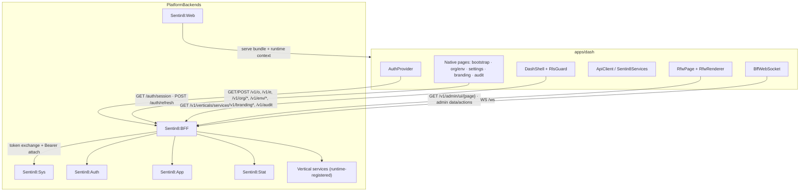
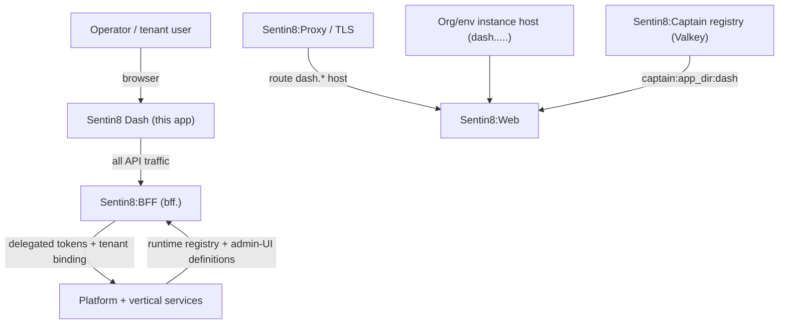
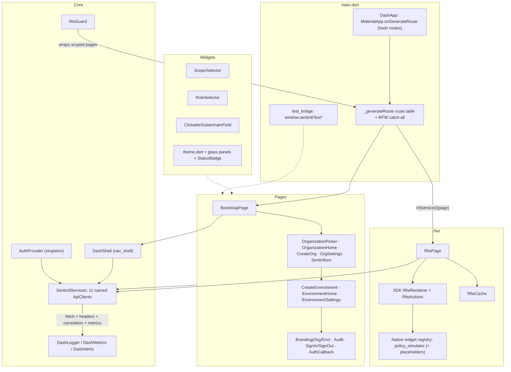
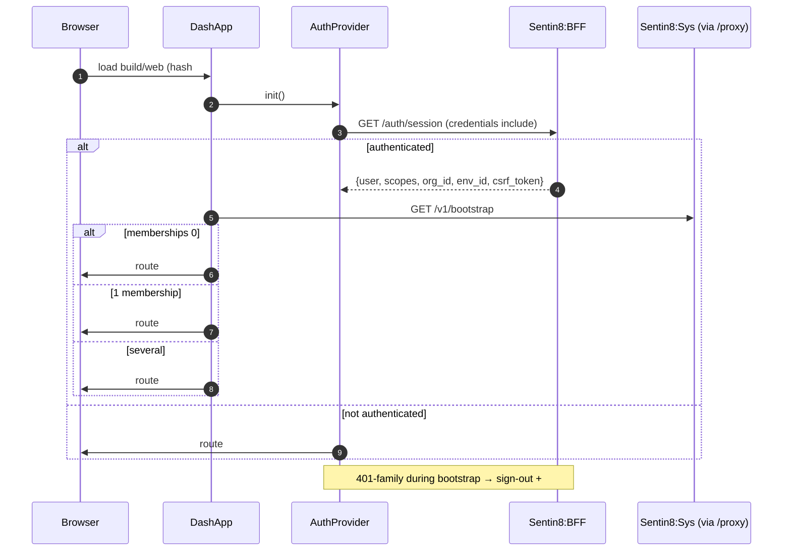
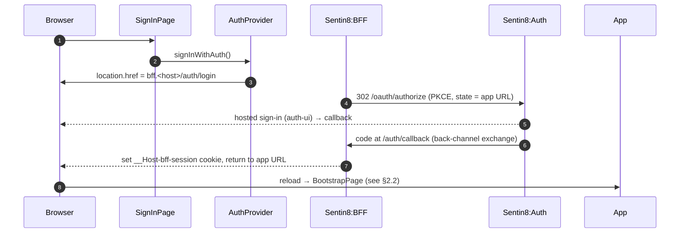
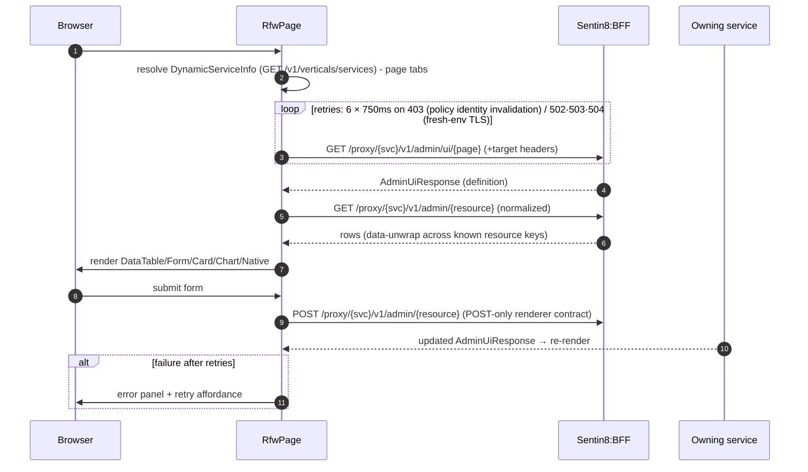
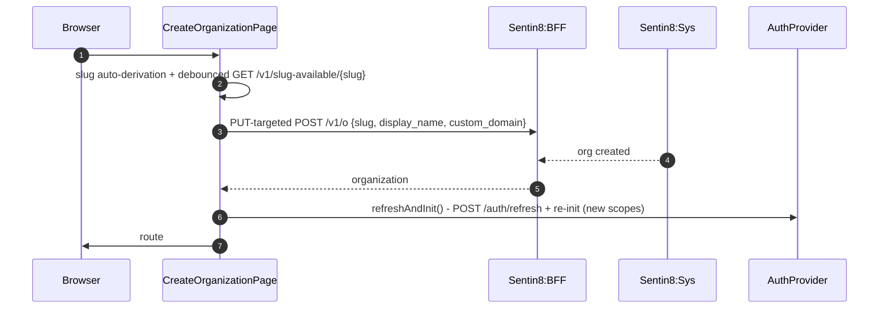
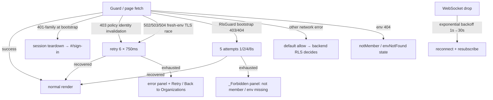
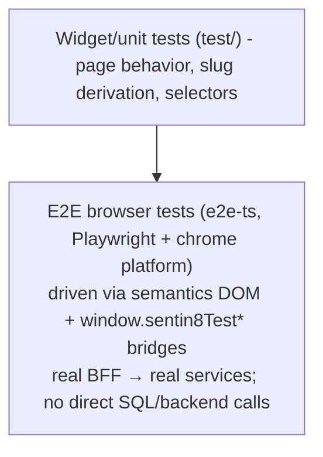

# DESIGN.md: Sentin8 Dash - Detailed Design Document

> Audience: maintainers, reviewers, and architects modifying the operator
> console. For the overview read `dash/README.md`; for the business view read
> `dash/BUSINESS.md`. Everything below describes the app as implemented; the
> platform-side services (BFF, Sys, Web, Auth) are referenced only by
> contract.

## 1. Scope & Context

**Owns (client responsibilities):**

- The console shell: dynamic navigation, breadcrumbs, scope tabs, user menu,
  rail collapse persistence.
- Session UX: bootstrap, login/sign-up redirects to the BFF, sign-out,
  post-lifecycle scope refresh.
- Organization and environment lifecycle screens: creation (slug derivation,
  availability checks, domain editing), settings, member viewing, branding
  management (org + env + merged preview), audit viewing.
- **Generic Remote UI (RFW) hosting**: definition loading, rendering, data
  actions, navigation, and native-widget hosting for every registered
  service's admin pages.
- Client-side gating UX (`RlsGuard`), live updates over WebSocket, client
  observability, and the e2e automation bridge.

**Does NOT own (delegated):**

- Authentication, OAuth/PKCE, token issuance and transparent refresh -
  Sentin8:BFF + Sentin8:Auth.
- Organization/env domain data, memberships, service toggles, vertical
  registry, audit store - Sentin8:Sys.
- Enforcement of authorization (RLS + Shield policy) - every backend service.
- Admin UI definitions and admin data endpoints - each service exposes its
  own `/v1/admin/*`.
- Static hosting and multi-instance routing - Sentin8:Web + Sentin8:Captain
  registry.
- Notification delivery, stat aggregation, logging storage - their owning
  services.

### 1.1 System Context

## 2. Runtime Architecture

### 2.1 Component View

### 2.2 Request Lifecycle - Session bootstrap and first-run routing

### 2.3 Request Lifecycle - Login via BFF redirect

### 2.4 Request Lifecycle - RFW admin page render + action

### 2.5 Request Lifecycle - Organization creation

## 3. Data Model

The console holds no server data of its own. Client-held state:

| State | Holder | Lifetime | Purpose |
|---|---|---|---|
| Auth state (`isAuthenticated, token('bff-session') marker, userId, organizationId, environmentId, scopes, featureVersion`) | `AuthProvider` | tab session | Session-driven gating and shell identity |
| CSRF token | `AuthProvider` → `ApiClient` | tab session | `X-BFF-CSRF` on mutations |
| Derived URLs (`_bffBaseUrl = https://bff.<host>`, `_sentin8Domain`) | `AuthProvider` | tab session | Single backend authority |
| Service catalog (`VerticalService` list + pages) | fetched by shell/RFW | render scope | Dynamic nav + tab bar |
| RFW definitions (`AdminUiPage`/`AdminUiResponse`) | `RfwCache` (SDK) | page session | Page-definition reuse |
| Nav collapse boolean | `localStorage['dash.rail.collapsed']` | persistent | Shell ergonomics |
| Correlation id (`dsh-<epoch>-<rand>`) | `observability.dart` | tab session | Request tracing |
| Logger ring (1000) / metrics / alert windows | `observability.dart` | tab session | In-memory diagnostics |

Platform-scoped RFW routes use the platform system org/env ids
(`00000000-0000-0000-0000-000000000001/2`) as target context.

Data sources consumed (read models, all via BFF proxy): orgs, orgs' envs,
memberships + user enrichment, branding (org/env/merged), vertical services,
audit entries, app store listings/instances, scope catalog, bootstrap
memberships, readiness/health.

## 4. API Surface

All calls go to the BFF: session routes and `/proxy/{service}/...`. Mutations
carry `X-BFF-CSRF`; scoped calls carry `X-BFF-Target-Env-Id` or
`X-BFF-Target-Org-Id` and duplicate it into `?target_env_id=`/`?target_org_id=`.

**Session (BFF, browser fetch):**

| Endpoint | Use |
|---|---|
| `GET /auth/session` | bootstrap session (`user, scopes, org_id, env_id, csrf_token`) |
| `GET /auth/login` | redirect into OAuth PKCE flow |
| `GET /auth/sign-up` | redirect into sign-up flow |
| `POST /auth/refresh` | refresh session + re-init (scope pickup after org/env creation) |
| `POST /auth/sign-out` | end session, redirect `#/sign-in` |
| `WS /ws` | live domain-event channel (§5) |

**Through `ApiClient` → `/proxy/{service}`:**

| Service | Endpoints used |
|---|---|
| sys | `GET /v1/bootstrap` · `GET/POST /v1/o` · `GET/PUT/DELETE /v1/org/{id}` · `GET /v1/e?org_id=` · `POST /v1/e` · `GET /v1/env/{id}` · `DELETE /v1/env/{id}` · `PUT /v1/env/{id}/services` · `GET /v1/org/{id}/memberships` · `GET /v1/slug-available/{slug}` · `GET /v1/verticals/services` · `GET/PUT /v1/org/{id}/branding` · `GET/PUT /v1/env/{id}/branding` · `GET /v1/env/{id}/branding/merged` · `GET /v1/audit` · `GET /v1/readiness` · `GET /v1/health` · `GET /v1/scopes/catalog` |
| auth | `GET /v1/admin/users/{userId}` · `GET /v1/admin/audit` (fallback) |
| app | `GET/POST /v1/app/store/listings` · `PUT /v1/app/store/listings/{id}` · `DELETE /v1/app/store/listings/{id}` · `GET /v1/app/admin/instances?envId=` · `GET /v1/app/admin/instances/{id}` · `DELETE /v1/app/admin/instances/{id}` · `POST /v1/app/setup` |
| any service (RFW) | `GET /v1/admin/ui/{page}[?type=]` · `GET/POST /v1/admin/{resource}` (+ absolute `/v1/...`) |
| stat (unwired widget) | `GET /v1/data/traffic` |
| per-service health (unwired page) | `GET /v1/health` |

**Client routes (hash):** `#/` · `#/bootstrap` · `#/sign-in` · `#/sign-out` ·
`#/org` · `#/org/create` · `#/auth/callback` · `#/home?org=` · `#/home?env=` ·
`#/org/create` · `#/env/create?org=` · `#/settings?org|env=` ·
`#/sentin8ors?org=` · `#/branding?org|env=` · `#/audit?env=` · RFW catch-all
`#/{service}/{page?}` with `overview` default and extra props
(`listing_id, instance_id, app_id, app_instance_id, type`); unresolved routes →
`NotFoundPage`.

**Emits:** none - the console is a consumer; domain events are emitted by the
services it operates (observed client-side over `/ws`).

## 5. Cross-Cutting Concerns

- **Authentication/token verification**: browser holds only the HttpOnly BFF
  session cookie; the BFF performs backend PKCE/exchange and transparent
  refresh. No token is ever readable from the app.
- **Tenant resolution**: per-request `X-BFF-Target-Env-Id`/`Target-Org-Id`
  (mutually exclusive, env preempts) + duplicated query params; the BFF binds
  tenant via RFC 8693 token exchange before proxying.
- **CSRF**: `X-BFF-CSRF` from the session payload on every mutation.
- **Authorization UX**: `RlsGuard` gate order G0 session → G1 org membership
  (bootstrap, 5-settle-window retries) → G2 env fetch (3 retries;
  404 = blocked) → G3 feature map (missing key defaults enabled). Client
  guards never replace backend enforcement; ambiguous failures default to
  allowing the render so backend RLS renders what the caller may see.
- **Realtime**: `BffWebSocket` to `/ws` with subscribe message
  `{'action':'subscribe','types':[...]}`; consumed events: `sentin8:sys.org.created/updated`
  (org picker), `sentin8:sys.env.created/updated` (org home),
  `sentin8:stat.traffic.snapshot` (metrics, unwired). Reconnect: 1 s → 2^n,
  capped at 30 s after 5 failures. *Note:* `/ws` is documented as the chat
  tier; the documented domain-event tier is SSE `/subscribe`, which dash does
  not use yet (see Open Questions).
- **Correlation**: `x-sentin8-correlation-id` on every request; errors also
  surfaced through in-memory metrics/alerts.
- **Post-only mutations (RFW)**: form submissions are POSTs; update/delete
  semantics ride POST-alias routes per the renderer contract.
- **TLS/hosting posture**: served by Sentin8:Web behind the proxy (SPA
  fallback, asset streaming, `GET /v1/app/runtime/context`); single build per
  platform; no CDN fonts requirement beyond graceful fallback (Quicksand via
  bundled loader behavior with platform fallbacks).
- **i18n / a11y**: English-only strings; semantics enabled for ARIA-driven
  automation and assistive tech.

## 6. Failure Modes & Recovery

- **Session expiry mid-use**: proxied calls transparently refresh server-side
  in the BFF; client-visible 401s surface as `ApiException`.
- **Post-lifecycle scope lag**: `refreshAndInit()` guarantees new org/env
  grants are picked up before routing into them.
- **Identity propagation window**: bootstrap/guard settle-window retries cover
  role/cache propagation after creation flows.
- **Static hosting**: SPA fallback serves every deep link; Sentinel
  web-registry miss on a hostname is a Sentin8:Web concern, not the app's.

## 7. Concurrency & Performance Model

- Single-isolate Flutter Web; no background workers.
- Request load is naturally low (console usage); no pooling beyond browser.
- Recurring work: WebSocket reconnect loop only (no polling timers in active
  pages).
- Caches: `RfwCache` for admin-UI definitions; service catalog fetched per
  shell render; no optimistic updates (server truth per action).
- Build profile: `flutter build web --release --no-tree-shake-icons` via the
  root `build-flutter` target; tests run against Chrome
  (`make test-flutter`).

## 8. Invariants, Insecure-Defaults Rejected, Unsafe Rationale

1. Only `https://bff.<current host>` is ever addressed; no other backend.
2. `X-BFF-Target-Env-Id` and `X-BFF-Target-Org-Id` are never sent together.
3. Every mutation carries `X-BFF-CSRF`; session token never leaves HttpOnly
   cookie storage.
4. No service/vertical name is compiled into routes, widgets, or clients -
   everything is runtime metadata.
5. RFW admin mutations are POSTs; renderer never issues direct
   `DELETE`/`PUT` to services.
6. Client gates are advisory; enforcement is always backend RLS + Shield.
7. No `provider`-package state injection despite the dependency (direct
   singleton access) and no use of the `http` package for BFF traffic (browser
   `fetch` guarantees cookie + CORS semantics).
8. No unsafe/Dart-FFI usage; browser bindings via `package:web` only.

## 9. Testing Strategy

- The app-level suite covers page rendering and widget logic (`flutter test
  --platform chrome` via `make test-flutter`).
- E2E journeys (sign-in, org/env creation, listing creation via RFW, sign-out)
  operate exclusively through the UI and BFF proxy, mirroring the platform's
  e2e testing rules.
- Deliberately not covered here: BFF/service behavior, backend authorization
  matrix, vertical admin-page content (each service's own tests + RFW contract
  tests).

## 10. Open Questions

- **Unreachable code cluster**: the go_router-era router/app/middleware, the
  duplicate shell pages, the native app-store/instance/setup/health pages, and
  the metrics table are compiled but not routed. Delete-in-favor-of-RFW or
  promote-to-native is an unresolved product/architecture decision.
- **Event channel mismatch**: dash consumes domain events over `/ws`, which
  the BFF contract assigns to chat; migrating live updates to SSE
  `/subscribe` (and reserving `/ws` for chat) is pending.
- **Unused dependencies** (`provider`, `http`) and dead statics
  (`DefaultBaseUrl`, org/env funnel metrics) should be removed or wired.
- **Theme consolidation** with `sdk/flutter/sentin8` (dash currently hides the
  SDK's tokens) - unify tokens/buttons/tables into the SDK.
- **Idempotency keys** for mutating console operations (org/env creation,
  listing install) are not client-generated; the platform's idempotency story
  for BFF proxies is pending.
- **Unbranded web manifest** leftovers and the branding theme-mode default
  inconsistency between the two env branding editors.
- **Invite/user-settings stubs** need their end-to-end product design
  (membership invitation API + user-profile destination).

---

**Design attribution:** sentin8:dash and its underlying concepts were designed by Hamid Jahanzad <Hamid@Jahanzad.com>.

