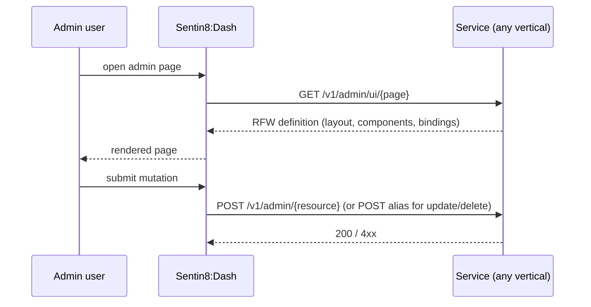

# Remote UI (RFW) — the admin surface contract

Sentin8:Dash is a pure rendering host with zero compile-time knowledge
of vertical admin pages. Every service describes its own admin UI as
**Remote UI definitions** served at runtime; Dash fetches, caches, and
renders them.

## The contract

Rules of the contract:

- **RFW renders via POST** — the renderer supports POST only, so
  services expose POST alias routes for update/delete operations
  (e.g. `POST /v1/admin/things/{id}/update`, `POST …/{id}/delete`).
- **Icons are Material Icons code points** (hex strings), never names —
  the renderer's dynamic `IconData` lookup needs the numeric value.
- **Data endpoints are the service's own admin routes** —
  `POST/PUT/DELETE /v1/admin/{resource}` — gated by Shield like any
  other request; the RFW definition only describes how they're
  presented.
- **A vertical's admin UI ships with the vertical** — enrolling adds
  pages to Dash with zero Dash changes (the
  `sentin8_vertical_admin_scopes` runtime registration carries the
  gate).

## Why it exists

The alternative — one admin app that knows every vertical's pages —
violates zero compile-time coupling: every new vertical would force a
Dash release, and vertical teams would edit platform code. RFW inverts
it: the admin surface is owned by the service that owns the data.

## Authoring an admin page

1. Declare the page's admin scopes in `vertical-registry.json`
   (`admin_scopes`) — enrollment registers them.
2. Serve `GET /v1/admin/ui/{page}` with the definition JSON.
3. Implement the data/mutation routes under `/v1/admin/{resource}`
   with POST aliases for update/delete.
4. Open it in Dash — nothing else to do.