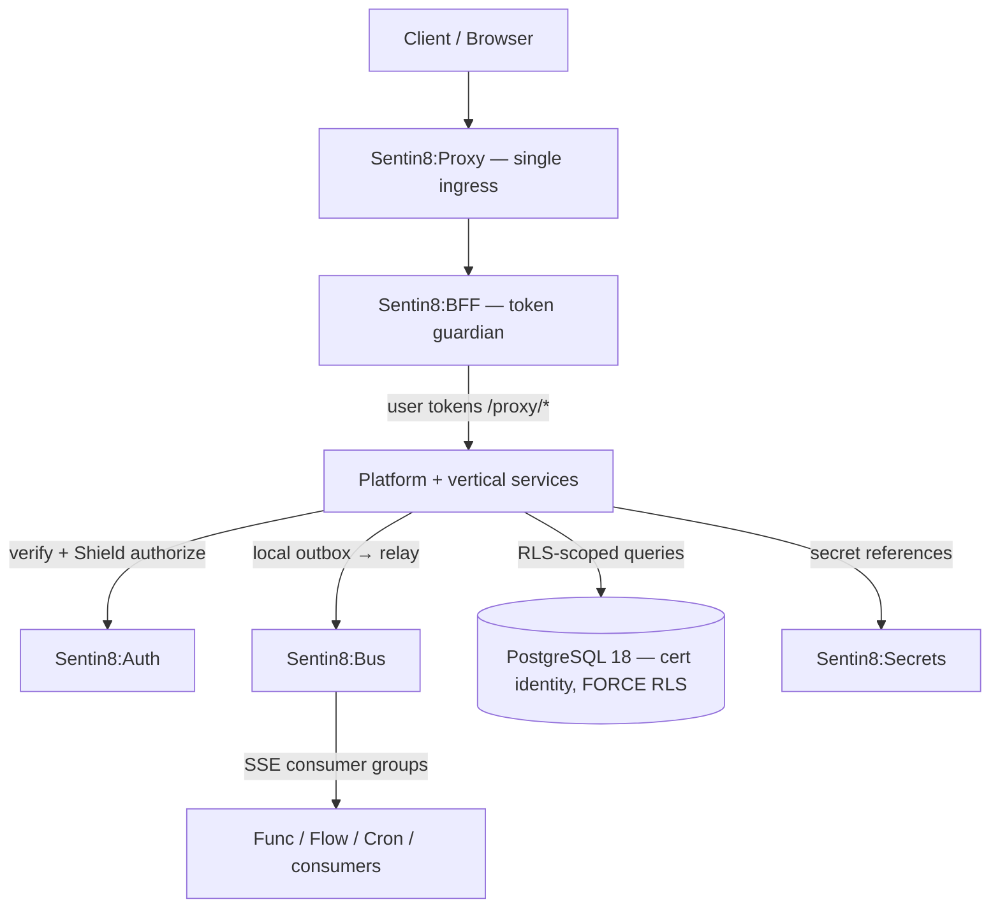

# Sentin8 — the platform

Sentin8 is a **post-quantum, zero-static-secret platform for regulated
multi-vertical software**: finance, hospitality, capital markets,
trading, billing, email — every domain composes the same 17 platform
services, one identity plane, and one security model.

## What the platform provides

- **17 platform services** — identity, certificates, ingress, events,
  data, storage, messaging, secrets, metrics, execution (WASM +
  workflows + scheduling), AI, control plane, app store, BFF, web
  hosting.
- **2 starters** — `sentin8-cli` (bootstrap, enrollment) and
  `Sentin8:Captain` (process supervision, rolling upgrades).
- **2 SDKs** — the Rust workspace facade (`sentin8::*`, pinned git
  tags) and the Flutter package (bootstrap, BFF client, shell, theme).
- **Verticals** — bank8, hotel8, exchange8, trade8, bill8, email8 live
  today (health8 in design); each with its own services, apps, SDK,
  and website at `{vertical}.dev`.

## The architecture in one picture

Every request runs the **8-step authorization pipeline** (extract
bearer → verify → resolve tenant → feature gate → Shield authorize →
set RLS context → execute → audit). There is no per-service token
check: authorization is decided live by Shield against roles resolved
from the identity plane — a demoted administrator loses access on the
*next request*.

## Verticals

| Vertical | Domain | Website |
|---|---|---|
| Bank8 | Banking, payments, open banking (FDX) | [bank8.dev](https://bank8.dev) |
| Hotel8 | Hospitality — PMS, POS, distribution, loyalty | [hotel8.dev](https://hotel8.dev) |
| Exchange8 | Capital markets — ME, OMS, SOR, clearing | [exchange8.dev](https://exchange8.dev) |
| Trade8 | Trading — desk, router, risk, feeds | [trade8.dev](https://trade8.dev) |
| Bill8 | Billing & payments for platforms | [bill8.dev](https://bill8.dev) |
| Email8 | Email — MTA, store, access, webmail | [email8.dev](https://email8.dev) |
| Health8 | Health (in design) | — |

## Where to go next

- **[Security](/docs/security)** — the five pillars, in depth.
- **[Services](/docs/services/auth)** — every platform service, its use
  cases, and its API surface.
- **[Developers](/docs/developers)** — the single-repo dev story:
  clone one repo, `cargo build`, done.
- **[Remote UI](/docs/developers/remote-ui)** — how admin UIs are
  rendered with zero compile-time coupling.
- **[Samples](/docs/samples)** — code against the platform from cURL,
  Rust, and Dart.