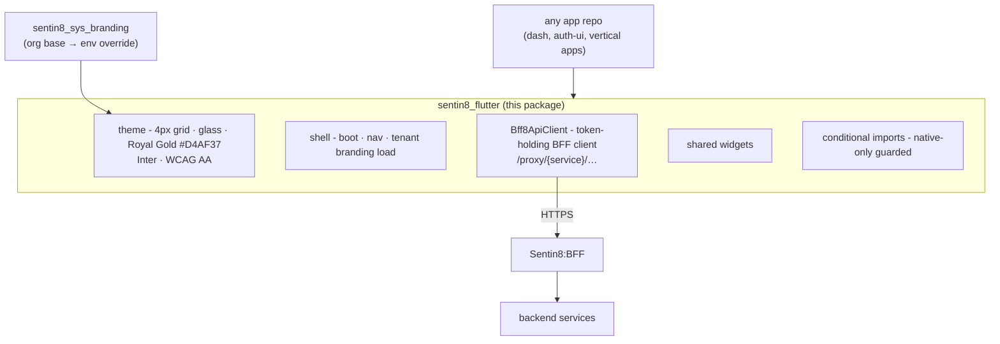
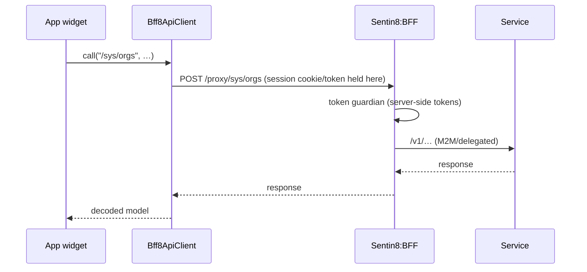

# sentin8-flutter - Detailed Design Document

> Wire-level construction of the platform Flutter package. Overview in
> `README.md`; business framing in `BUSINESS.md`.

## 1. Scope & Context

`sentin8_flutter` is the ONE shared Flutter package for the whole tree
(platform + vertical apps): the design system, the shell/bootstrap
layer, and the ONLY sanctioned backend path (`Bff8ApiClient`). Apps
import modules; they never copy-paste infra and never call backend
services directly.

## 2. Module Map

| Module | Role |
|---|---|
| `theme/` | The design system implementation: grid, panels, accent, typography, accessibility floor. Tenant branding (`sentin8_sys_branding`) overrides at load: org base → env override, non-empty wins. |
| `shell/` | Boot sequence, navigation shell, session bootstrap - apps start from here. |
| `bff/` | `Bff8ApiClient`: the token-holding client; all traffic → `Bff8ApiClient → Sentin8:BFF /proxy/{service}/…`. The standalone direct-HTTP SDK pattern is deprecated. |
| `widgets/` | Shared components; Material Icons by code point (hex strings), not names. |
| conditional imports | `*.web.dart` / `*.io.dart` pairs - native-only features (e.g. platform channels) never compile into the web build and vice versa. |

## 3. Backend Traffic Contract

Tokens never reach the client storage layer: the BFF holds OAuth
material server-side; the package's client carries only the session.

## 4. Invariants

1. **One package** - no app re-implements theme/boot/BFF-client.
2. **No direct backend calls from apps** - every request exits through
   `Bff8ApiClient`; a direct-HTTP import is a defect.
3. **Design system by construction** - off-grid/off-palette styling
   fails review, not just taste.
4. **Web builds stay web-safe** - native-only code hides behind
   conditional imports.
5. **Icons are code points** - Material Icons hex strings, never
   font-name lookups.

## 5. Testing Strategy

- Widget tests per shared component (golden-safe where layout-critical).
- BFF-client tests: request shaping, error mapping - against a mocked
  BFF, never a live fleet.
- App repos own their journey tests; the package owns only its units.
  Web builds exercise the web halves of every conditional import.

## 6. Open Questions

- Icon font subsetting strategy for packaged web builds.
- Deeplink/universal-link conventions for vertical apps landing in the
  shell.

---

**Architecture & Design:** sentin8:flutter and its underlying concepts were designed by [Hamid Jahanzad](https://www.linkedin.com/in/hamidjahanzad/).

