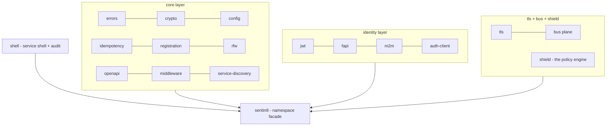

# Rust SDK - the `sentin8` facade

One cargo workspace, one facade crate, every shared plane:



## How services consume it

Every repo pins the SDK as a single git dependency:

```toml
[dependencies]
sentin8 = { git = "https://github.com/Sentin8/sentin8-sdk.git", tag = "sdk-v0.4.0" }
```

and imports through the namespace facade only:

```rust
use sentin8::shell;          // service shell + audit
use sentin8::shield;         // embedded policy engine
use sentin8::bus::outbox;    // local outbox + relay
use sentin8::tls;            // PQ-TLS termination
use sentin8::middleware;     // valkey_client(workload), etc.
```

## Crate map

| Import path | Plane |
|---|---|
| `sentin8::config` | config derivation + `pg_pool::connect` (cert-presenting factory) |
| `sentin8::jwt` · `fapi` · `m2m` | token families, FAPI profiles, workload identity |
| `sentin8::tls` | X25519MLKEM768 + ML-DSA-65 termination, header injection |
| `sentin8::bus` | contracts + client + membus + outbox |
| `sentin8::shield` | RBAC + ABAC + ReBAC policy engine (live role resolution) |
| `sentin8::shell` | 8-step authorization pipeline + audit journal |
| `sentin8::rfw` | Remote UI definitions |

Per-service SDK crates (`{svc}-client`/`{svc}-contracts`) live in each
service's repo behind mini-facades (`sdk/` directory, package
`sentin8-{svc}-sdk`) - shared-plane linkage decides what stays in the
workspace (SDD boundary).

## Deep dive

[SDK reference section](/docs/reference/sdk/) - harvested from
`Sentin8/sentin8-sdk` (architecture, the full crate map, wire-level
detail).