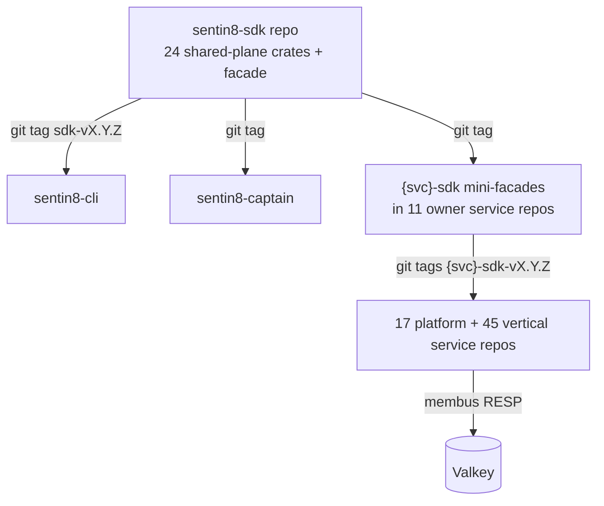
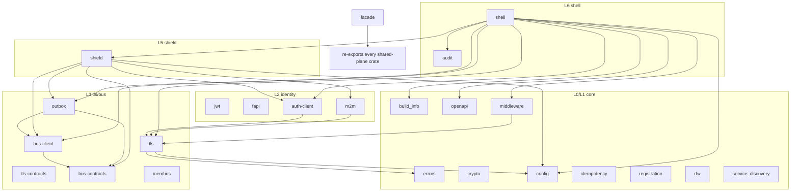
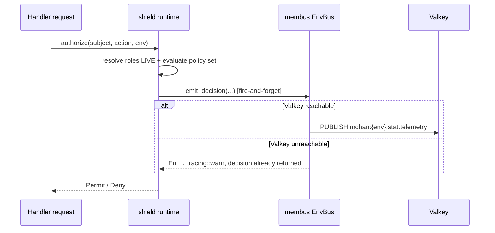
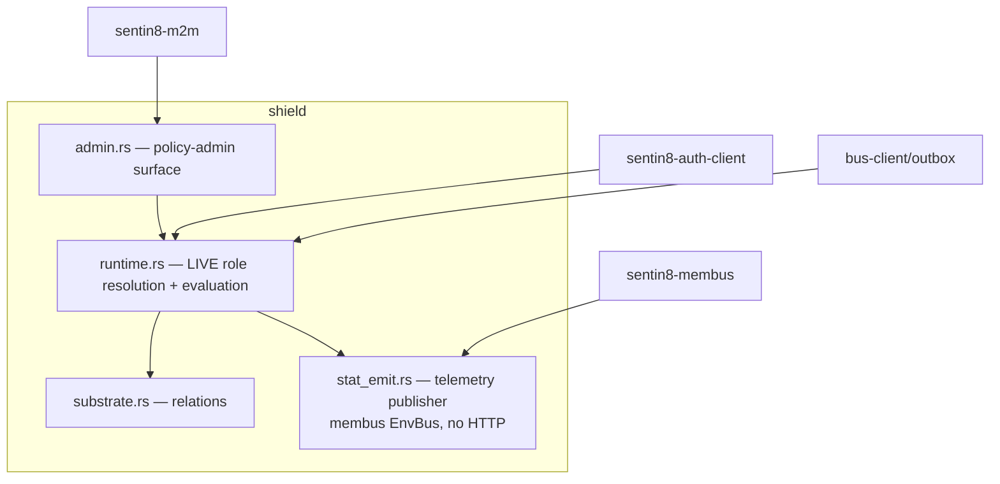
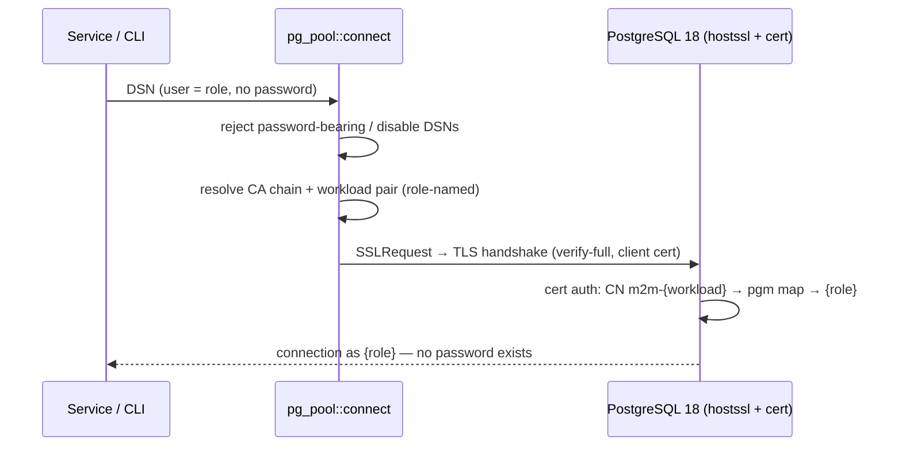
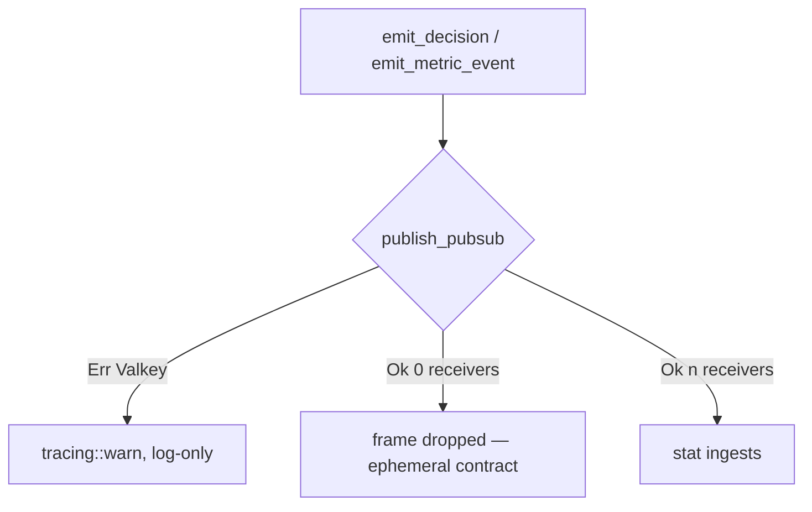
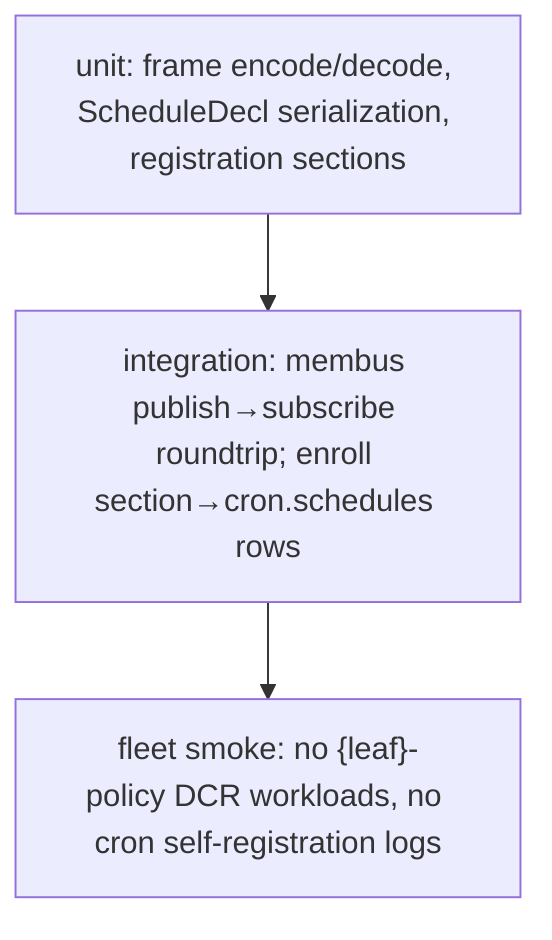

# DESIGN.md: sentin8-sdk — Detailed Design Document

> Audience: maintainers, reviewers, and architects modifying the shared
> library workspace. For overview read `README.md`; for business
> capabilities read `BUSINESS.md`. Design of record:
> `../../design/sentin8-sdk-dependency-cleanup-design.md` (SDD) — this
> document implements its §2 and §3 for the SDK repo.

## 1. Scope & Context

### 1.1 What the SDK repo owns

- **24 shared-plane crates** (SDD §2.1): core ×10 (errors, crypto, config,
  build-info, idempotency, registration, rfw, openapi, middleware,
  service-discovery), identity ×4 (jwt, fapi, m2m, auth-client), tls ×2
  (tls, tls-contracts), bus ×4 (bus-contracts, bus-client, membus, outbox),
  shield ×1, shell ×2 (shell, audit), facade ×1 (`sentin8`).
- **The telemetry helper** — shield's `stat_emit` module generalized to
  the shared `stat.telemetry` MemBus publish path used by shield
  (policy decisions + shared metric emission) and by services emitting
  metric frames directly (auth/ai/app/email8-mta class).
- **`ScheduleDecl`** in `core/registration` — the declarative schedules
  section consumed by `sentin8-cli vertical enroll`.

### 1.2 What it explicitly does NOT own

- Service-scoped SDK crates — every `{svc}-client`/`{svc}-contracts`
  crate lives in its owner service repo behind a mini-facade
  (`sdk/`, package `sentin8-{svc}-sdk`).
- Service binaries, service registration files, vertical knowledge of
  any kind (architecture-principles §4.14).
- Scheduled work execution — Cron's ticker owns firing; the SDK only
  declares the schema for enrollment.

### 1.3 System context



### 1.4 Container view



## 2. Runtime Architecture

### 2.1 The telemetry publish path (replaces the stat-client edge)

`shield/src/stat_emit.rs` — public API unchanged, transport changed:

| Function | Before | After |
|---|---|---|
| `init_stat_emitter_for_service(service)` | builds `StatClient` + `{leaf}-policy` M2M DCR | builds `MemBus::for_env` handle for the `stat.telemetry` family |
| `emit_decision(service, subject, action, enforced, reason, set)` | `collect_fire_and_forget` HTTP | `EnvBus::publish_pubsub` frame |
| `emit_metric_event(service, name, metrics, props)` | HTTP | `publish_pubsub` frame |

The frame payload is flat JSON matching stat's ingest contract
(`EventEnvelope` fields: `client_id` = service, `client_type` = `"server"`,
`property_slug` = short name, `event_name`, `metrics`, `props`,
`subject_id?`, `timestamp`). Publish failure → log-only (tracing::warn),
never fatal — the decision path is unaffected by a Valkey outage.

### 2.2 Request lifecycle — policy decision emission



### 2.3 Component view — shield after the change



## 3. Data Model

The SDK repo owns no tables. It defines the wire types consumed at enroll
time (`core/registration`):

```rust
pub struct ScheduleDecl {
    pub schedule_type: &'static str,
    pub cron_expression: &'static str,  // 5-field
    pub timezone: &'static str,         // default "UTC"
    pub target_config: serde_json::Value,
    pub max_retries: u32,
}
```

`Registration.schedules: &[ScheduleDecl]` — serialized by
`--print-registration --section=schedules`; the CLI upserts
`cron.schedules` rows (env-scoped, `schedule_type` unique per
(env, domain)).

### 3.1 MemBus frame (telemetry class)

```text
channel:  mchan:{env_id}:stat.telemetry
envelope: et  = sentin8:stat:telemetry:emitted
          ts  = unix_micros
          cid = correlation_id (when known)
          by  = producer service short name
          sq  = per-(service, family) sequence
          p   = JSON EventEnvelope fields (flat)
```

## 4. API Surface

Public crate APIs are unchanged except:

- **facade**: the service modules (`flow`, `cron`, `stat`, `storage`,
  `func`, `db`, `ai`, `sys`, `app`, `bff`, `secrets`) and the legacy
  hand-rolled `AuthClient`/`Db8Client` types delete. `sentin8::auth`
  keeps `client`/`jwt`/`m2m`/`fapi`; `sentin8::tls`, `sentin8::bus`
  keep their shape.
- **shield**: `stat_emit` functions keep signatures; the transport is
  internal.
- **registration**: gains `ScheduleDecl` + `Registration.schedules` +
  `--section=schedules` output.

No endpoint changes; the SDK ships no servers.

## 5. Cross-Cutting Concerns

- **Authentication**: `m2m` + `auth-client` unchanged — cert-bound
  (RFC 8705) cached token sourcing; the SDK itself performs no DCR for
  telemetry (MemBus needs none — tenant isolation by key derivation).
- **Outbox relay rate-limit discipline (WARN-5)**: a retryable produce
  failure (429/5xx/transport) sets the row's `next_retry_at` (Bus's 429
  body carries `retry-after: 60`; other retryables take the 2s tick) and
  the drain predicate skips rows whose `next_retry_at` is in the future.
  A burst backlog then drains at the Bus rate limit instead of burning
  the 10-attempt budget against it; permanent 4xx keeps parking
  immediately. The `next_retry_at` column ships in the shared
  `outbox_table_sql` DDL (greenfield — no migration).
- **Tenant resolution**: unchanged; telemetry frames carry no env in the
  payload — the channel key derives from the `EnvBus` binding.
- **Idempotency**: MemBus `sq` per-(service, family) sequence for
  dedupe/gap detection.
- **Audit**: unchanged — the shell's audit push loop (§6.8 journal→Sys)
  is untouched.
- **TLS**: `sentin8-tls` post-quantum posture unchanged.
- **PostgreSQL certificate identity (group DESIGN.md §3.2)**:
  `core/config`'s `pg_pool` module is the fleet's ONE connection factory —
  every service pool AND the CLI/operator tooling route through it.
  `connect_options_for` builds the transport: `ssl_mode(VerifyFull)`
  (forced; `sslmode=disable` rejected — no plaintext listener exists),
  the published Acme root+intermediate chain as `ssl_root_cert`, and the
  workload's m2m client pair (`ssl_client_cert_from_pem` /
  `ssl_client_key_from_pem`) resolved by ROLE name — `sentin8_*_service`
  roles read the pair named after the binary/workload identity, the DDL
  role `sentin8` reads the fixed `postgres-ops` infra pair. A DSN whose
  userinfo carries a password is REJECTED at construction: the plane is
  passwordless by design, and a half-converted DSN is a configuration
  error, not a degraded mode. sqlx compiles TLS support via the
  `tls-rustls-ring` feature (without it sqlx links NO TLS backend and
  every TLS DSN fails with "server does not support TLS").



## 6. Failure Modes & Recovery



- **Valkey down**: log-only; no retry queue (loss-tolerant class by
  contract — "non-important updates").
- **No live subscriber**: frame gone (Pub/Sub contract); stat outage =
  telemetry loss, never a decision failure.
- **Pool/conn**: `EnvBus` clones the shared multiplexed command
  connection — no per-emit connection churn.

## 7. Concurrency & Performance Model

- Init-once: `OnceLock<Option<Arc<EnvBus>>>` replaces the old
  `OnceLock<Option<Arc<StatClient>>>` — emit path remains lock-free.
- Emit is fire-and-forget on the shared command connection; no dedicated
  subscriber connections on the producer side.
- Hot paths (policy evaluation) unchanged; emission adds one RESP PUBLISH
  (~µs class) per decision/event.

## 8. Invariants, Insecure-Defaults Rejected, Unsafe Rationale

- **SDD-1**: placement by shared-plane linkage; the shared plane links no
  service-scoped client — a future need is a design defect, route through
  MemBus/domain events.
- **SDD-6**: facade never re-exports a mini-facade.
- **CERTFREE-1 (identity/m2m → workload-identity)**: the platform M2M plane
  carries NO token. The crate's job narrows to certificate identity
  management: mint-if-missing from Acme (bootstrap-enrollment channel),
  persist the `{workload}.crt/.key` pair (0700/0600), and provide the
  cert-presenting HTTP client builders consumers dial each other with.
  The token source, DCR helper, credential cache (`dcr_*.json`), boot
  probe, scope-drift re-registration, and 401 self-heal machinery are
  DELETED (their synchronization burden — cache vs `oauth_clients` vs
  JWT — was the recurring DB-reset 401 storm's root cause; the TLS
  handshake already proves possession on every call). Authorization
  inputs travel via the enroll-published `m2m:workloads` Valkey hash
  (workload → {vertical, service_type, scopes, enabled}), boot-loaded +
  TTL-cached by every service, fed into Shield `RequestCtx` and Bus's
  VDC-2 vertical gate; revocation = `enabled=false`, observed within the
  cache TTL. JWTs remain for user/delegated flows; DCR remains for
  interactive + out-of-band tenant clients.
- No `unsafe` in the SDK plane (`facade` forbids it; membus uses only
  safe RESP APIs).
- Rejected: durable Streams for telemetry (imposes retry/DLQ semantics on
  a loss-tolerant class); stat-client with a "disabled" flag (keeps the
  DAG inversion the cleanup removes); feature-gated facade (one ring,
  facade with service knowledge); keeping the M2M token as a "second
  proof" (it was the storm's root cause and adds no strength beyond the
  handshake's possession proof).

## 9. Testing Strategy



- Unit: `stat_emit` frame shape; `schedules` section serialization;
  facade re-export surface (compile test).
- Integration: membus roundtrip in the SDK workspace tests; CLI enroll
  provisioning covered in `sentin8-cli`'s tests.
- Deliberately NOT tested here: stat ingest correctness (stat repo),
  cron firing (cron repo), BFF web/mobile ingest (unchanged contract).

## 10. Open Questions

- Frame-schema registry for payload validation at decode — deferred.
- Pin-freshness automation for per-service sdk tags — aggregation CI.

---

**Design attribution:** sentin8 and its underlying concepts were designed by Hamid Jahanzad <Hamid@Jahanzad.com>.

