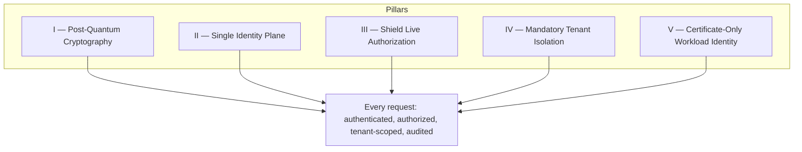
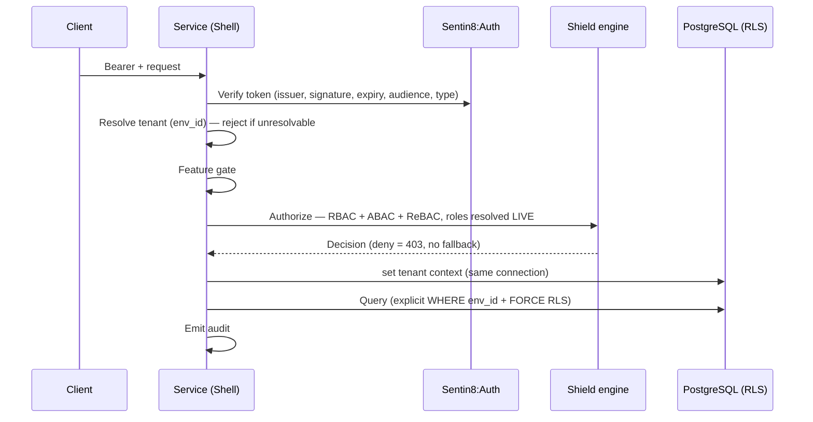

# Security model

> This page mirrors the canonical `SECURITY.md` — identical across every
> repository of the tree. The repos stay the source of truth; this page
> renders the same guarantees.

Sentin8 is a **post-quantum, zero-static-secret, live-authorization
platform**. It was designed for regulated, multi-tenant, multi-vertical
operation where the threat model includes nation-state
harvest-now-decrypt-later collection, insider privilege escalation, and
credential theft — not just opportunistic web attacks.

## The five pillars

### I — Post-quantum cryptography, exclusively

Every TLS connection — client→ingress, proxy→service,
service→service, service→data — negotiates **X25519MLKEM768** key
exchange with **ML-DSA-65** certificate signatures, anchored by an
**SLH-DSA-SHA2-128s** (hash-based) root CA. The default TLS mode is
*exclusive*: **no classical fallback exists**. Recorded traffic is
quantum-resistant today.

### II — One identity plane

Sentin8:Auth is the only token issuer, the only JWKS authority, and
the only authentication authority. No service mints its own sessions,
tokens, or credentials — there is no second issuer to compromise and no
fragmented trust to reconcile.

### III — Live authorization (Shield)

Authorization is decided per request by one embedded policy engine —
**Shield** — unifying RBAC, ABAC, and ReBAC. Roles are **never embedded
in tokens**: they are resolved live from the identity plane on every
request. A demoted administrator loses access on the *next request* —
not at token expiry, not at midnight.

### IV — Mandatory tenant isolation in the database itself

Every tenant table carries `ENABLE` + `FORCE ROW LEVEL SECURITY`; **no
role on the cluster carries `BYPASSRLS`** — not the relays, not the
schedulers, not anyone. Services connect as certificate-authenticated
per-service roles scoped to their own database and schema. **No
database passwords exist anywhere.** Isolation is enforced by PostgreSQL
on every row read.

### V — Certificate-only workload identity

A workload's only identity is its Acme-issued client certificate
(`CN=m2m-{workload}`) presented in the TLS handshake. There are **no
client secrets, no static API keys, no password files** anywhere in the
service-to-service plane. A stolen configuration file grants nothing; a
stolen database dump decrypts nothing.

## Fail-closed discipline

Wrapped around the pillars:

- An unresolvable hostname is a **421**, not a guess.
- An unparsable policy set at boot is a **refused startup**, not a
  warning.
- A role-resolution outage is a **deny**, not an allow.
- An unauditable action is **an action that never happened**.

## The 8-step authorization pipeline

## Scope discipline

Scopes are granular and standardized:
`{vertical}:{service}:{resource}:{action}` (e.g.
`bank8:ledger:postings:write`). No broad `{service}:admin` scopes exist.
The JWT `scope` claim is a **pre-filter and RLS context feed, never the
decision** — Shield decides against live-resolved roles.

## Read the full canonical document

The complete `SECURITY.md` (31 KB, mirrored in every repository) is
rendered under each service's **Reference** section — see
[Sentin8:Auth reference](/docs/reference/auth/) or the
[Sentin8:SDK reference](/docs/reference/sdk/). Each vertical's
website carries the same model with its domain-specific posture on top:
[bank8.dev/security](https://bank8.dev/docs/security),
[hotel8.dev/security](https://hotel8.dev/docs/security).