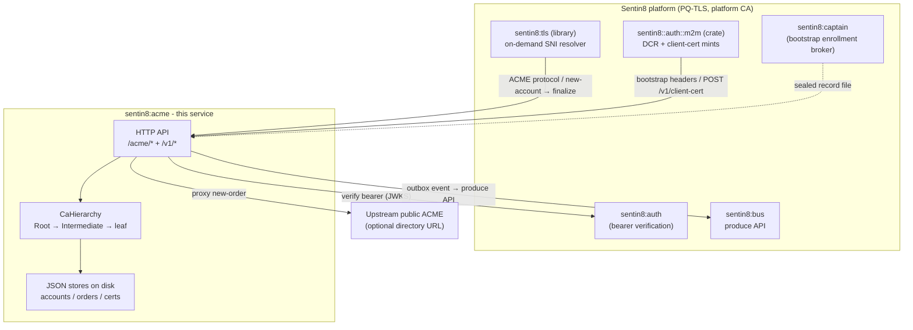
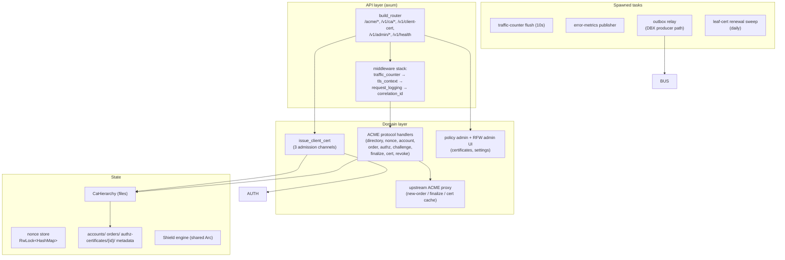
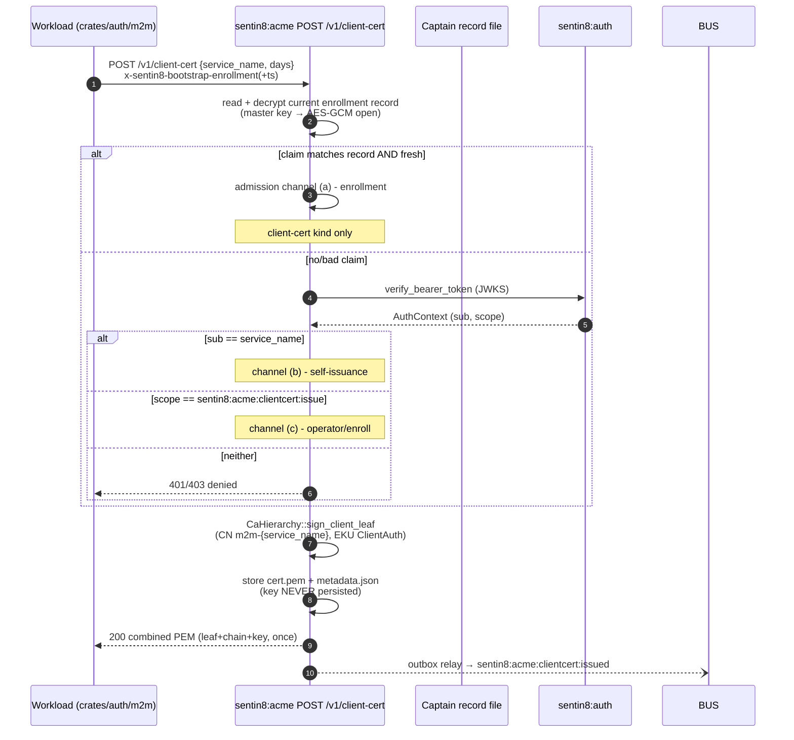
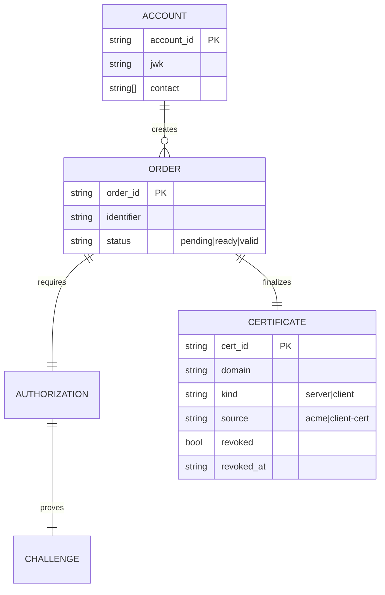
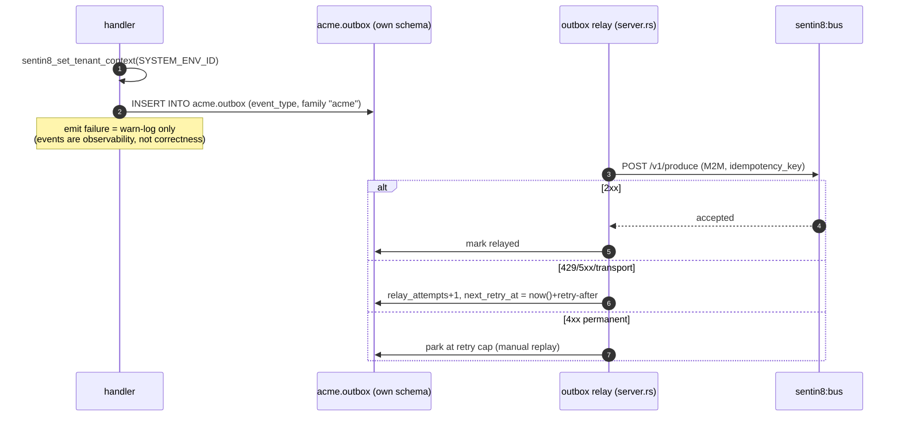
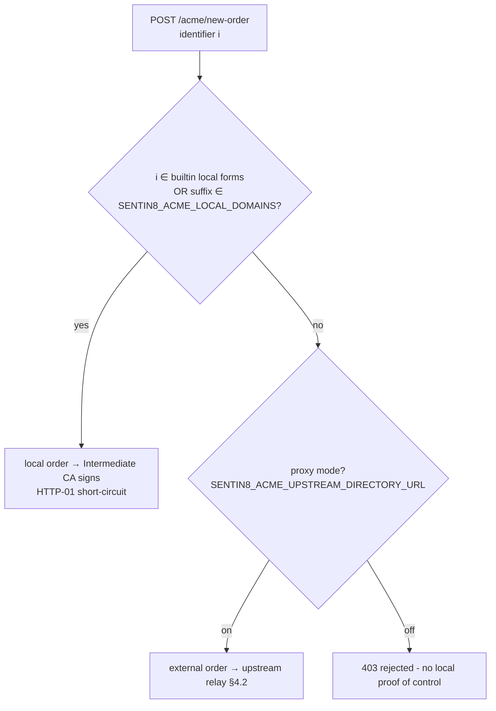
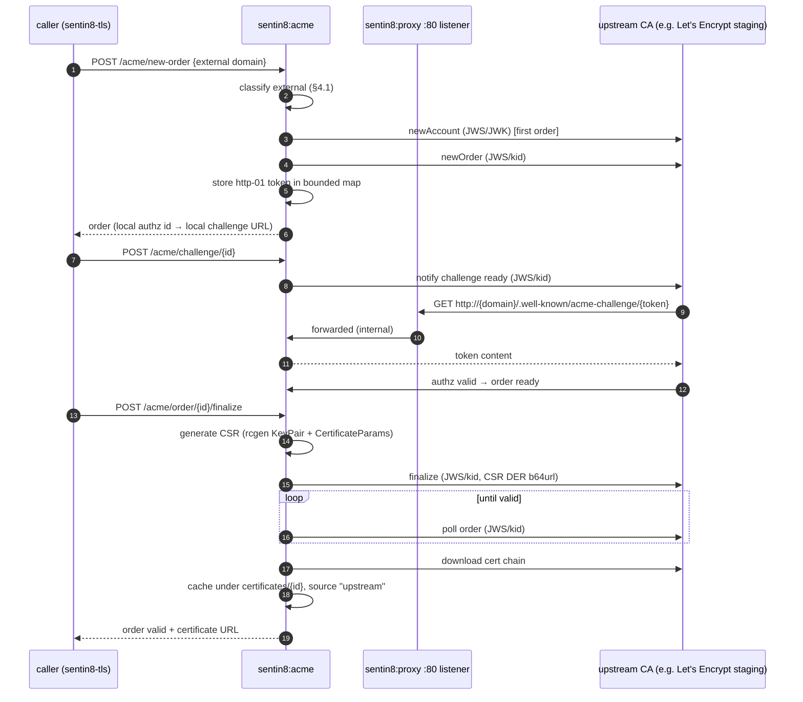
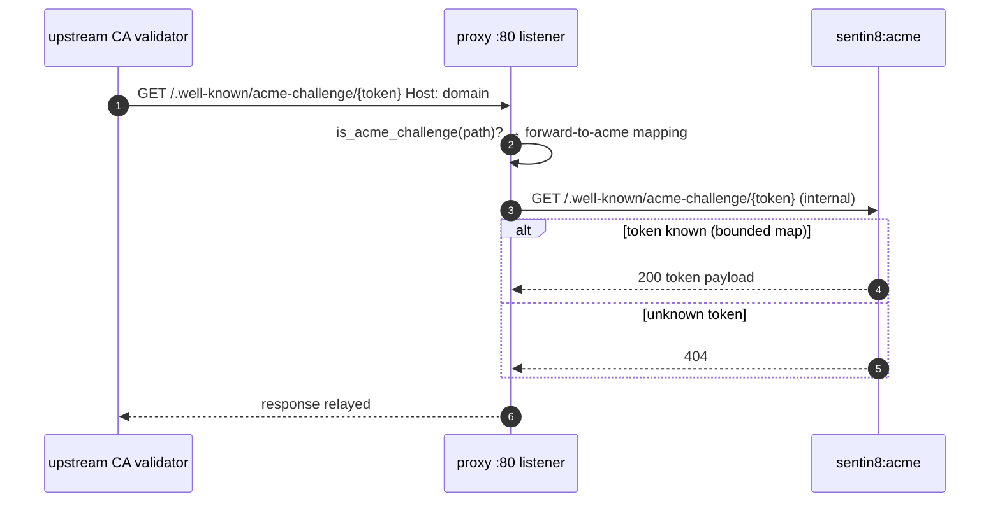
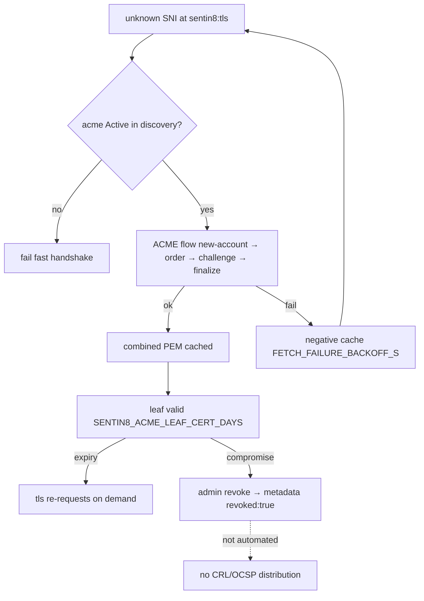
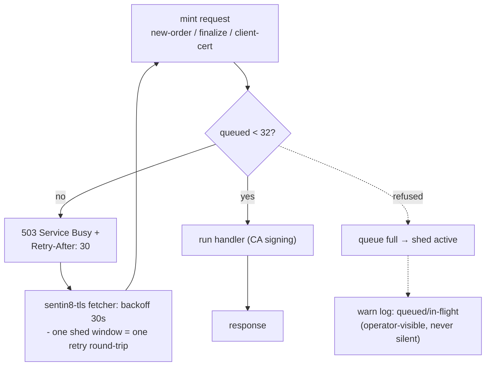

# Sentin8:Acme - Detailed Design Document

## 1. Scope & Context

Sentin8:Acme owns the platform's post-quantum certificate authority:

- **Owns**: the Root/Intermediate CA hierarchy (on-disk, `$SENTIN8_ACME_DATA_DIR`),
  all ACME (RFC 8555) protocol state (accounts, orders, authorizations,
  challenges), issued leaf certificates + their metadata, the mTLS client-cert
  issuance endpoint (`POST /v1/client-cert`), the public CA download endpoints,
  and the certificate revocation metadata.
- **Does NOT own**: tenant identity (Sentin8:Auth verifies bearers), the
  DCR thumbprint binding (workloads register their cert thumbprints with
  Sentin8:Auth directly), the inbound-issuer role for upstream ACME
  (proxy-only against the configured upstream directory), CRL/OCSP
  distribution (not implemented), and Bus's internal durability (event
  delivery rides the local-outbox + produce-API path - acme's only table
  is its own `acme.outbox`). The :80 HTTP-01 ingress is owned by
  Sentin8:Proxy (which forwards challenge requests to acme).

Trust boundary: everything inside the ACME subgraph shares the process
security context (CA private keys, 0600). Callers reach acme only over
PQ-TLS terminated in-process by `sentin8-tls`; the CA private-key directory
is deliberately never exposed to other services' environments
(`SENTIN8_ACME_DATA_DIR` is not in the captain's env propagation list).

## 2. Runtime Architecture

**Boot sequence** (`server.rs::serve`): `CaHierarchy::ensure` (load or
generate) → trust-store install (OS + NSS, best-effort) → PG pool connect
(PG 18 check) → self-issue the bootstrap server cert for
`acme.ops.sys.{SENTIN8_DOMAIN}` (+ captain local-IP SAN) → Shield
`boot_full` (refuse-to-start on invalid policy text) → traffic-counter
flush loop → outbox-relay spawn → `Sentin8Tls::builder().bootstrap_cert(...)`
→ `tls.serve`.

**Outbox relay - the DBX producer path.** Acme boots custom (not via the
shell), so `server.rs` spawns the shared outbox relay itself
(`sentin8::bus::outbox::spawn_relay`) with a `build_with_dcr` client for
the workload `sentin8:acme` (scope `sentin8:bus:produce`). **The Bus base
URL and the auth issuer are DERIVED, never hardcoded**: both fall back to
`sentin8::config::Sentin8Config::from_env()` (`sentin8_bus_url()` →
`https://bus.ops.sys.{SENTIN8_DOMAIN}`, `sentin8_auth_issuer()`), the same
derivation the shell boot uses for every service. There is no port
constant and no loopback IP anywhere in acme's Bus/Auth client paths - a
hardcoded `127.0.0.1:{port}` fallback is a defect class (the port is
captain-assigned per boot; a stale constant silently targets a dead
listener and the relay retries forever while rows pile up). The relay is
fail-open per the outbox pattern: a Bus outage or DCR failure only pauses
the push - rows persist in `acme.outbox` and the 5s safety poll retries.

**Request lifecycle - mTLS client-cert issuance (the security-critical
family):**

Failure branch: invalid `service_name` → 400; bearer verify failure → 401;
sub/scope mismatch → 403; issuance failure → 500 (caller retries on next
boot).

## 3. Data Model

Durable domain state is on the filesystem. Acme owns exactly ONE database
table - its own outbox (`acme.outbox`, the DBX producer durability for its
own events); the producer path is strictly local-outbox + Bus produce API
(architecture-principles §6.7 - no direct `bus.inbox` writes, no grants on
Bus's internal durability).

Filesystem layout under `$SENTIN8_ACME_DATA_DIR`:

| Path | Content | Protection |
|------|---------|------------|
| `ca/root-ca.key`, `intermediate-ca.key` | CA private keys (SLH-DSA-PQ) | 0600, never distributed |
| `ca/root-ca.crt`, `intermediate-ca.crt` | public CA certs | OS + NSS trust store install |
| `accounts/{uuid}.json` | ACME accounts | service-only |
| `orders/{uuid}.json`, `orders/authz-{uuid}.json` | order/authz/challenge state | service-only |
| `certificates/{cert-id}/cert.pem`, `key.pem`, `metadata.json` | leaf + key + metadata | keys 0600 |
| `upstream-account.json` | upstream ACME account key + kid (ES256) | 0600 |
| `.run/bootstrap-enrollment.json.enc` (captain-owned) | sealed enrollment claim | AES-256-GCM sealed, 0600 |

**Owned table - `acme.outbox`** (the service's ONLY table; FORCE-RLS'd on
`env_id`, drained by the local post-commit relay): `id` PK, `env_id`,
`event_type`, `stream_family`, `payload`, `publisher_id_token`,
`publisher_subject`, `relayed`, `relayed_at`, `relay_attempts`,
`next_retry_at` (the relay-visible backoff anchor - set by every failed
produce attempt: Bus's `retry-after` hint or the short-tick default;
`NULL` = immediately schedulable; the drain predicate skips rows whose
`next_retry_at` is in the future), `created_at`. Retry budget
`relay_attempts < 10` → exhausted rows park in place for manual
inspection/replay (never silently dropped).

### Database identity

Acme is a **bootstrap-tier service** - and the bootstrap tier rides the
same certificate identity as every other service (group DESIGN.md §3.2;
the old SCRAM-tier distinction is retired with the passwords):

- PG role: `sentin8_acme_service`, declared in acme's own
  `--print-registration --section=pg_roles` and created PASSWORDLESS by
  `vertical enroll`/`platform.sql`. The same pass writes the `pgm`
  identity-map row binding acme's workload CN (`m2m-acme` - the
  certificate `make infra-tls` pre-mints offline) to the role; the TLS
  handshake's `cert` auth decides the connection. There is no SCRAM
  hash to converge or drift.
- Privileges: USAGE on `public` (RLS helpers + the
  `sentin8_boot_policy_load` function) and DML on acme's OWN
  `acme.outbox` only - `cross_schema_grants` is EMPTY in the
  self-registration (the produce API replaced the direct `bus.inbox`
  INSERT path; no producer holds grants on Bus's internal
  durability tables, principles §6.7). Acme never reads another
  service's tables.
- DSN source: `SENTIN8_ACME_DATABASE_URL` (operator env; passwordless -
  the connection factory resolves the workload pair by role name).
- Failure posture: if the role, its identity-map row, or the workload
  pair is missing, acme exits at boot (fail fast). See §6.

## 4. API Surface

| Audience | Endpoint | Gate | Emits |
|----------|----------|------|-------|
| public (RFC 8555) | `GET /acme/directory` | none | - |
| public | `GET/HEAD /acme/new-nonce` | none (single-use in-memory nonce) | - |
| public | `POST /acme/new-account` | JWK in body | `sentin8:acme:account:created` |
| public | `POST /acme/new-order` | none (local/external classified by domain) | `sentin8:acme:order:created` |
| public | `GET /acme/authz/{id}` | none | - |
| public | `POST /acme/challenge/{id}` | HTTP-01 check (local short-circuit) | - |
| public | `GET /acme/order/{id}` | none | - |
| public | `POST /acme/order/{id}/finalize` | authz `valid` enforced (local orders) | `sentin8:acme:order:finalized` |
| public | `GET /acme/cert/{id}` | none | - |
| public | `GET /.well-known/acme-challenge/{token}` | none (upstream HTTP-01 token echo) | - |
| public | `POST /acme/revoke-cert` | none (event-only path) | `sentin8:acme:certificate:revoked` |
| public | `GET /v1/ca/root.crt`, `/v1/ca/intermediate.crt` | none | - |
| workload | `POST /v1/client-cert` | bootstrap enrollment **or** `sub == service_name` **or** scope `sentin8:acme:clientcert:issue` | `sentin8:acme:clientcert:issued` |
| admin | `/v1/admin/policy-sets…`, `/v1/admin/relations…`, `/v1/admin/attributes…` | bearer + Shield (`sentin8:acme:admin` / policy scopes) | - |
| admin | `GET /v1/admin/ui/{page}`, `GET /v1/admin/{resource}`, `POST /v1/admin/certificates/{id}/revoke` | Shield | - |
| health | `GET /v1/health` | none | - |

**Event flow (local outbox → Bus → trigger):**

Consumers: none registered (`event_triggers: &[]`) - acme events are
observability/audit signal.

### 4.1 Domain classification policy (DEVDOM-1)

Every order is classified **local** or **external** at `POST /acme/new-order`
time. The decision is a pure function of the identifier and two config
sources - never of DNS resolution (no network on the order path, no
TOCTOU between classification and signing):

1. **Built-in local forms**: `localhost`, `*.localhost`, `*.local`, and
   RFC 1918 loopback/private IP literals (`127.*`, `10.*`, `192.168.*`,
   `172.16.*`–`172.31.*`).
2. **Operator-declared local domains**: any suffix listed in
   `SENTIN8_ACME_LOCAL_DOMAINS` (comma-separated, e.g.
   `local.sentin8.dev,local.ibank.dev`). A domain equal to or ending with
   `.{suffix}` classifies local. This is the dev-loop escape hatch: the
   operator points a public wildcard zone (e.g.
   `*.local.sentin8.dev` → `127.0.0.1`) at the dev box and declares the
   zone local - platform hostnames under it are signed by the platform
   CA directly, with HTTP-01 short-circuited, regardless of upstream
   proxy mode.

Rules that follow classification:

- **Mixed orders are rejected** (`400 urn:…:malformed`) - a certificate
  must not mix platform-CA-signed and upstream-signed names; the trust
  chains are disjoint.
- **Local orders** are signed directly by the Intermediate CA at finalize,
  after their HTTP-01 challenge short-circuits to `valid`.
- **External orders** are relayed to the upstream ACME provider when
  proxy mode is on (`SENTIN8_ACME_UPSTREAM_DIRECTORY_URL` non-empty), and
  **rejected** otherwise - an external name has no local proof of control,
  so signing it would mint a publicly-trusted-looking identity from an
  untrusted request (CA-integrity hole: acme's Root sits in the OS + NSS
  trust stores of every dev box).
- Classification is decided once per order and stored in the order record;
  the finalize path re-derives and re-checks it (defense in depth).

### 4.2 Upstream ACME relay (DEVDOM-2)

External orders are fulfilled by a **real RFC 8555 client** running in
acme's process (shared `upstream` module) against the configured public
CA directory. There is no pass-through of caller JSON to the upstream -
acme terminates the platform's own simplified protocol and speaks
standards-compliant ACME outbound:

- **Account**: ES256 account key generated once, persisted at
  `upstream-account.json` (`upstream_account_path()`, 0600) alongside its
  kid; registered against the upstream `newAccount` endpoint on first
  external order (contact from `SENTIN8_ACME_UPSTREAM_CONTACT`).
- **Every request is JWS-signed** (RFC 8555 §6.2: ES256, `kid` or
  embedded JWK for the initial newAccount, nonce from a fresh
  `newNonce` fetch, `url` header matching the target, `Content-Type:
  application/jose+json`).
- **Orders**: `newOrder` for the identifier; the upstream's authz list is
  inspected to find the **http-01** challenge, whose token is stored
  in-memory (bounded map) and served back to the internet by the proxy's
  HTTP-01 listener (§4.3).
- **Finalize**: acme generates a real PKCS#10 CSR (rcgen `KeyPair` +
  `CertificateParams::serialize_request`, CN/SAN = the ordered domain,
  key owned by acme - never the caller's placeholder), submits it, polls
  until `valid`, then downloads the cert chain and caches it under
  `certificates/{id}` with `source: "upstream"`.
- **TLS to the upstream**: a dedicated reqwest client built on the
  **hybrid** PQ provider (`SENTIN8_TLS_PQ_MODE=hybrid` composition - the
  platform's exclusive provider speaks only X25519MLKEM768, which public
  ACME endpoints don't offer; the relay must negotiate classical
  classical TLS 1.3 to reach them). The client verifies the upstream
  against the system roots, optionally pinned to
  `SENTIN8_ACME_UPSTREAM_CA_PEM`.

Failure branches: upstream 4xx `malformed`/`unauthorized` → mapped to a
`400` with the upstream problem detail (no retry - permanent);
`badNonce` (200 with problem doc) → refetch nonce and resend once;
transport/5xx → `502` + the relay stays retryable (order record keeps
status `pending`; the caller's finalize re-drives it). Cert download
failure after `valid` → `502` + order record keeps `certificate` set so
the next finalize completes it.

### 4.3 HTTP-01 challenge serving

Local orders short-circuit (§4.1). External orders prove control via the
REAL HTTP-01 flow: the upstream fetches
`http://{domain}/.well-known/acme-challenge/{token}` on port **80**.
Sentin8:Proxy owns every ingress port, so the proxy binds an optional
plain-HTTP listener (`SENTIN8_PROXY_HTTP_PORT`, default 80) whose ONLY
purpose is `/.well-known/acme-challenge/*` - everything else is a fixed
`404`. The listener forwards challenge requests to acme, which echoes the
token content (`token = base64url(sha256(domain + '.' + token))`-style
echo is NOT used; acme serves the token payload as-is for the relay
because it is the authorizing party - it stored the upstream's token at
newOrder time). Requests are unauthenticated by design (RFC 8555 §8.1).

Prerequisite for external issuance: the operator's public domain must
actually resolve to the dev box AND port 80 must be reachable from the
internet (the wildcard-zone trick covers name resolution; reachability
is physical). Test upstreams (Let's Encrypt **staging** -
`https://acme-staging-v02.api.letsencrypt.org/directory`) avoid
production quota burns.

## 5. Cross-Cutting Concerns

- **Authentication**: three independent admission channels for client-cert
  mints (enrollment, self-issuance, operator scope); admin endpoints verify
  via the shared auth client (JWKS cached) then evaluate Shield.
- **Tenant resolution / RLS**: single-tenant platform service - all writes
  set the SYSTEM env context explicitly in an explicit transaction.
- **TLS posture**: in-process PQ termination via `sentin8-tls`; the
  bootstrap cert is self-issued from its own CA at boot (chicken-and-egg
  break); SNI `acme.ops.sys.{SENTIN8_DOMAIN}`.
- **Audit**: mints at the enrollment channel are logged at `warn` (always
  visible in the audit trail); events to `inbox` carry actor/service ids.
- **Rate limiting**: none implemented (nonce store enforces single-use
  nonces only).
- **Graceful drain**: `Sentin8Tls::serve` graceful shutdown (drains
  in-flight connections on SIGTERM).

## 6. Failure Modes & Recovery

- **CA loss**: `ca/` is preserved across database resets; a deleted CA dir
  is regenerated - every previously issued leaf then fails validation until
  re-issued (fail-closed, trust anchor is the source of truth).
- **PG role missing / password drift**: acme exits at boot with the
  password-auth error. This is a fleet-wide outage seed, not a local
  degradation: without acme, every service's `sentin8-tls` cannot resolve
  leaf certs, all `https` health probes fail, and the captain kill-loop
  gives up on the whole fleet. The role is created by `platform.sql`
  (bootstrap-tier SCRAM seed) and re-verified idempotently - a role whose
  SCRAM hash predates the operator DSN is reseeded at bootstrap so a
  database-only reset can never strand the role.
- **Enrollment claim staleness**: the record file is read fresh per
  request; the env copy is only a fallback; both fail-closed.
- **Upstream proxy outage**: new-order/finalize → 502; cert download served
  from the local cache.
- **Outbox emit failure**: warn + drop (at-least-once not required - events
  are advisory).
- **Outbox relay unreachable Bus**: the relay backs off and retries (2s
  then 5s cadence); rows accumulate in `acme.outbox` with
  `relay_attempts` capped. The Bus base URL is the config-derived
  platform domain (`https://bus.ops.sys.{SENTIN8_DOMAIN}`), so this path
  only fails while Bus itself is down or the DCR token source is not yet
  activated - never because of a wrong address. Recovery is automatic
  once Bus responds (the safety poll drains the backlog).

### 6.1 Mint admission control - bounded queue + load shed (ACME-PREF)

A fleet-wide cold start re-dials EVERY service's cert fetch at once; the
mint path (`new-order` → `finalize`, several CA-signing round-trips per
mint) is CPU-bound rcgen work. Unbounded, a storm saturates the mint path
until callers time out silently - which cascades: captain's probe
watchdog counts the dead handshakes, mass-kills the just-started victims,
and each respawn re-enters the storm. The shed answers overload UP FRONT
with a clear refusal instead of a silent timeout:

- **Exempt paths (never shed)**: `/v1/health`, CA downloads
  (`/v1/ca/*.crt`), cert downloads (`/acme/cert/{id}`) - cheap reads, and
  the recovery path itself must never be shed.
- **Constants** (pinned by a test): `MAX_QUEUED_MINTS = 32`,
  `SHED_RETRY_AFTER_S = 30` (matches `sentin8-tls`'s
  `FETCH_FAILURE_BACKOFF_S` so one shed window equals one client retry
  round-trip - no thundering re-entry), `MAX_CONCURRENT_MINTS = 16`.
- The refuse answer is deliberately a **503 with `Retry-After`**, never a
  hang: the fetcher's failure path is deterministic and its negative
  cache prevents hot-looping, so a shed window self-drains instead of
  holding handshakes hostage.
- Observability: every refused request warn-logs the queue depth and
  in-flight count - the shed is always auditable, never silent.

## 7. Concurrency & Performance Model

- Single axum server task (in-process TLS); per-request handlers are
  stateless apart from the nonce `RwLock<HashMap>` and the CA hierarchy
  loaded once into `AppState`.
- Certificate minting is CPU-bound but bounded: the mint endpoints share
  ONE admission queue (`shed::MintLimiter`, ACME-PREF §6.1) - bursts
  queue up to 32 deep, then refuse deterministically (503 + Retry-After)
  instead of stacking unbounded handler tasks and starving the process's
  other duties (outbox relay pool, health, admin). Health/CA/cert reads
  bypass the limiter entirely.
- Traffic counter flush every 10s to Valkey (`stat:metrics` channel).
- On-demand SNI issuance blocks one handshake task (bounded 15s poll,
  concurrent fetches deduped) - the negative cache prevents hot-looping.
- Outbox relay: local `acme.outbox` drain via the shared relay (LISTEN
  wakeup + 5s safety tick); `next_retry_at` paces per-row retries after
  a failed produce (Bus's `retry-after` hint or the 2s short tick) so a
  saturated Bus never burns the retry budget on hot-loop.

## 8. Invariants, Insecure-Defaults Rejected, Unsafe Rationale

1. **CA private keys never leave the data dir** - only public certs are
   served; `SENTIN8_ACME_DATA_DIR` is never propagated to other services.
2. **Client-cert private keys are never persisted server-side** - the
   combined PEM is returned exactly once.
3. **Enrollment channel can mint client certs only** (`kind: "client"`),
   never server leafs - the CN prefix is the scope boundary.
4. **The enrollment claim is verified against the CURRENT captain record**
   read fresh from disk per request - never against a spawn-time env copy.
5. **Fail-closed CA resolution** - no unauthenticated minting; no
   `danger_accept_invalid_certs` anywhere; callers trust only the platform
   Root CA.
6. Keys on disk are 0600; the trust-store install is best-effort and never
   gates startup.
7. **Bootstrap-tier DB identity is declared, not assumed** - acme's PG
   role (`sentin8_acme_service`) is declared in its own `pg_roles`
   registration and created with the bootstrap-tier SCRAM password by
   `platform.sql`; acme must never silently fall back to the shared dev
   role, and must never declare another service's role.
8. **Mint overload sheds UP FRONT, never silently** - when the mint
   queue is full, acme answers 503 + `Retry-After: 30` (the pinned
   backoff window) rather than accepting work it cannot run in time;
   health/CA/cert reads are never shed; every refusal is warn-logged.
9. **Classification is offline and deterministic** - `is_local_domain` is a
   pure function of the identifier + config (builtin forms +
   `SENTIN8_ACME_LOCAL_DOMAINS` suffixes). Never a DNS lookup.
10. **The platform CA never signs an unproven external domain.** An external
    identifier with proxy mode off is rejected at new-order. With proxy
    mode on, the platform CA still never signs it - the upstream CA
    does, after HTTP-01 succeeds against the proxy's :80 listener. The
    local finalize path re-checks the order's authz is `valid` before
    signing (defense in depth).
11. **Upstream identity is acme's, not the caller's.** The upstream account
    key + kid are persisted in acme's data dir (0600); the CSR submitted
    upstream is generated by acme (rcgen `KeyPair`), its key owned by
    acme - callers never influence the upstream identity.
12. **badNonce is a retryable protocol event, not an error** - the relay
    refetches a nonce and replays the request once before surfacing
    failure.

## 9. Testing Strategy

| Layer | Coverage | Not covered (by design) |
|-------|----------|------------------------|
| Unit/integration (`tests/integration.rs`) | CA generation + reload stability, leaf signing, local-domain classification (builtin + `SENTIN8_ACME_LOCAL_DOMAINS` suffixes), finalize's authz-valid enforcement, challenge-token serving route, upstream JWS envelope shape + RFC 7638 thumbprint, upstream relay against a mock RFC 8555 server (JWS validation, badNonce replay, cert download + caching), admin-UI certificate listing + revocation metadata, proxy-mode detection, settings rendering, mint-shed state machine (budget → full → refused → drained; constants pinned) | Live Let's Encrypt flows (external network), the proxy's :80 listener wiring (proxy repo's tests) |
| E2E (`e2e-ts`) | TLS-terminated flows through proxy, RFW admin round-trip | Upstream public-ACME provider (external network) |

Test pyramid: unit (CA hierarchy, domain classification) → integration
(temp-dir CA + stores) → e2e (browser + platform stack). No DB-backed tests
(no owned tables).

## 10. Open Questions

- CRL/OCSP distribution for revocation visibility outside the admin UI is
  covered by the event path for a private CA whose roots live in the OS trust
  store of every fleet node.
- Upstream `dns-01` challenges are not implemented - the relay carries
  `http-01` only; a `dns-01` relay would require a DNS-provider API
  integration and is deferred.

> Automated leaf renewal is internal: the in-process renewal sweep drives
> the cadence - acme links no scheduler client and makes no cross-service
> calls (SDD §2.5, foundational-service rule).

---

**Design attribution:** sentin8:acme and its underlying concepts were designed by Hamid Jahanzad <Hamid@Jahanzad.com>.

