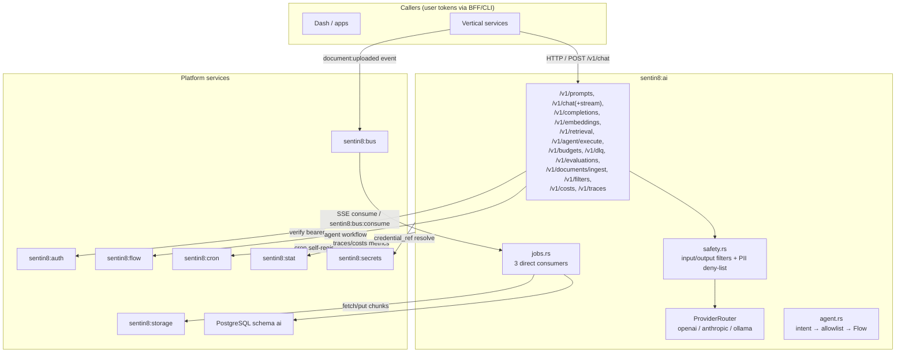
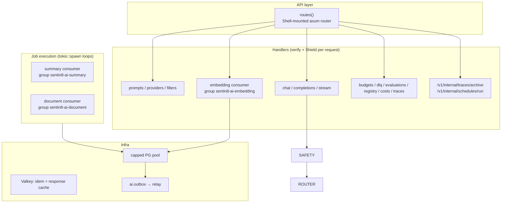
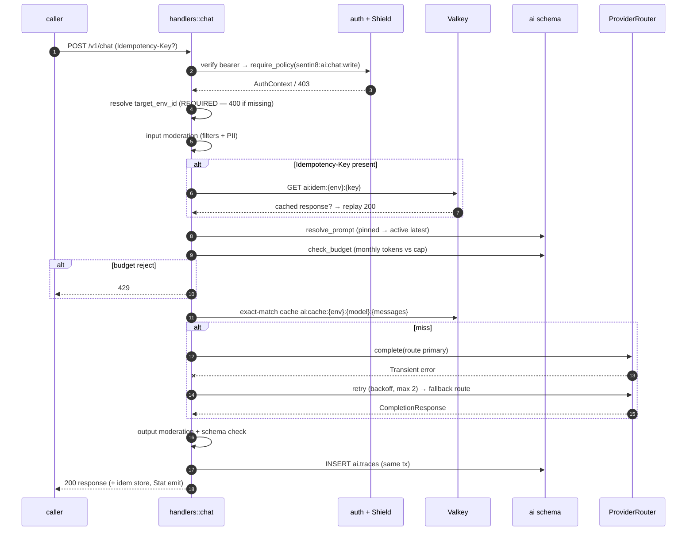
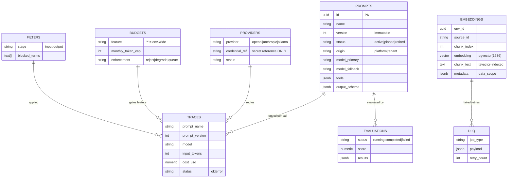
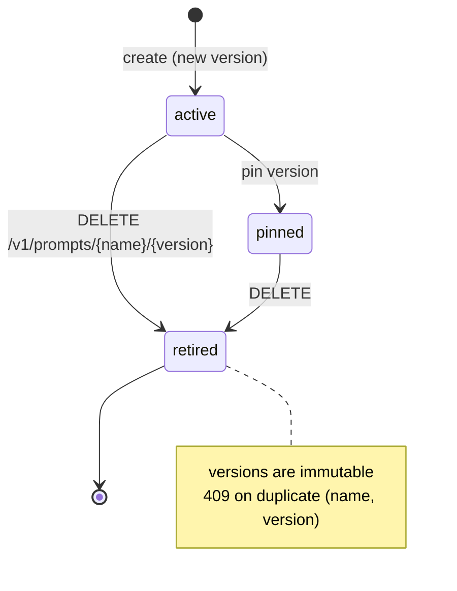
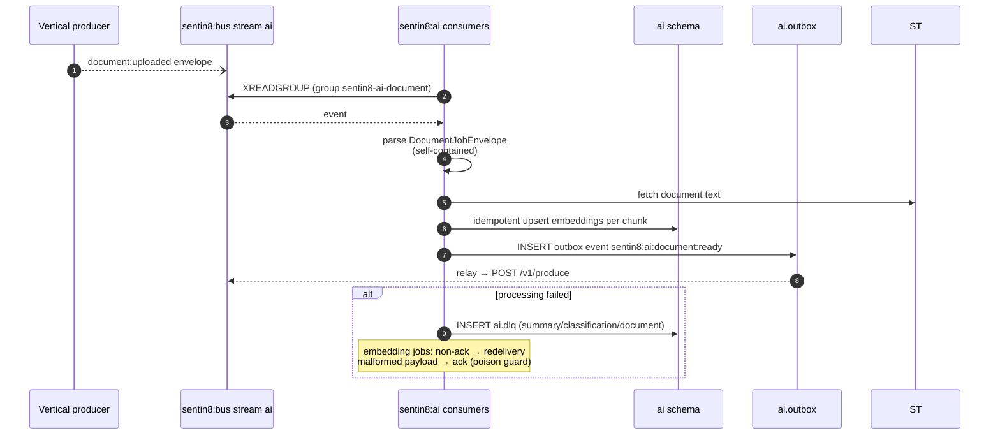
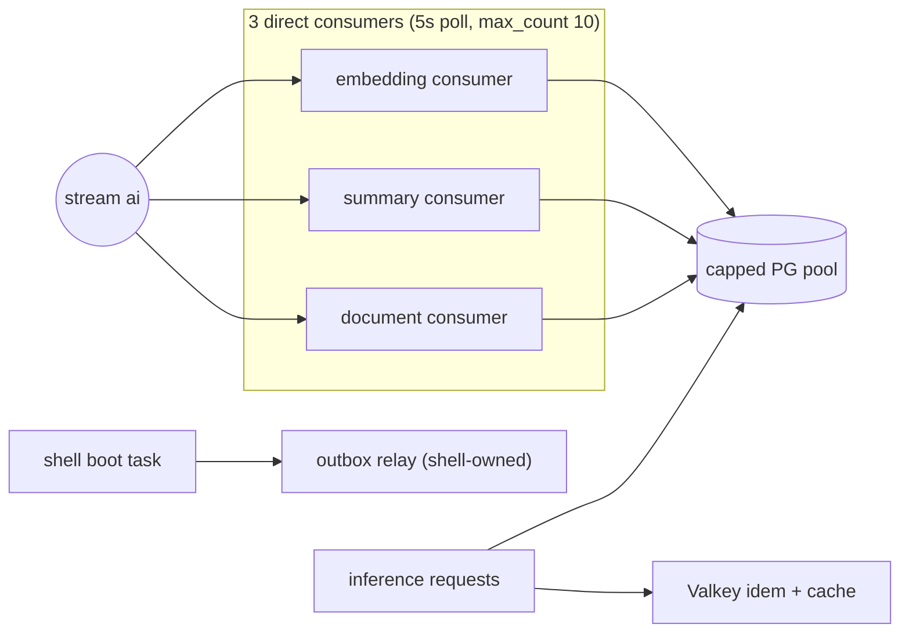
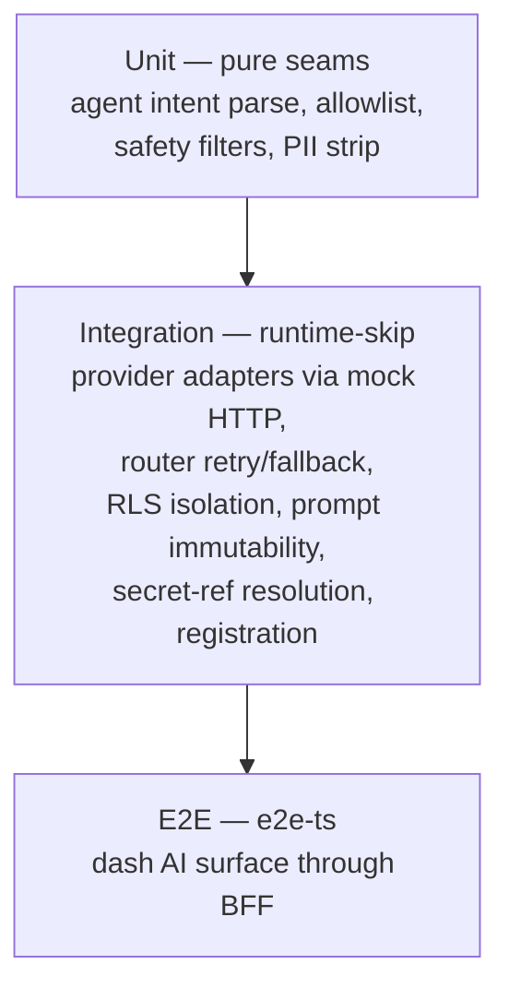

# DESIGN.md: Sentin8:AI — Detailed Design Document

## 1. Scope & Context

Sentin8:AI owns the platform's AI plane: prompt assets (versioned,
immutable), provider routing (openai / anthropic / ollama adapters),
synchronous inference (buffered + streamed), vector + keyword retrieval,
async AI jobs (embeddings, summaries, classifications, document
pipelines), budgets, evaluations, output filters, traces/costs, and its
dead-letter queue.

- **Owns** (schema `ai`, database `sentin8`): `prompts`, `providers`,
  `embeddings`, `traces`, `embedding_registry`, `dlq`, `budgets`,
  `evaluations`, `filters`, `outbox` (DBX), `audit_journal` (DBX); the
  stream family `ai`; the three direct-consumer groups on it.
- **Does NOT own**: model credentials (secret **references** resolved via
  Sentin8:Secrets / env backend), workflow execution (Sentin8:Flow),
  scheduling (Sentin8:Cron), document blobs (Sentin8:Storage), spend
  analytics (Sentin8:Stat), identity (Sentin8:Auth).



## 2. Runtime Architecture



**Request lifecycle — buffered inference (`POST /v1/chat`):**



Error branches: terminal provider error (4xx/auth/schema) → 422; retries
exhausted → 502; moderation failure → 422 with filter name.

## 3. Data Model



- **RLS**: every table `ENABLE`+`FORCE`, per-op policies keyed on
  `sentin8_current_env_id() = env_id`; outbox/journal policies additionally
  require `sentin8_context_initialized()`.
- **State machines**: prompt lifecycle —



- **Secrets**: `providers.credential_ref` holds a secret *reference* —
  material never lands in application tables (resolved via Secrets or the
  env backend `SENTIN8_AI_PROVIDER_KEY_*`).
- **Indexes**: HNSW cosine on `ai.embeddings.embedding` (pgvector-guarded),
  GIN on `to_tsvector('simple', chunk_text)`, partial unrelayed indexes on
  `outbox`/`audit_journal`; helper `ai.ai_monthly_tokens(env, feature)`.

## 4. API Surface

Groups (every route: bearer verify → Shield `require_policy`, target env
required for data surfaces, no in-handler scope checks):

| Group | Endpoints | Gate action | Events |
|-------|-----------|-------------|--------|
| prompts | `POST/GET /v1/prompts`, `DELETE /v1/prompts/{name}/{version}` | `ai:prompt:write` / `ai:prompt:read` | `sentin8:ai:prompt:updated` |
| inference | `POST /v1/chat`, `/v1/completions`, `/v1/chat/stream` (ndjson) | `ai:chat:write` / `ai:completion:write` | trace rows + Stat |
| vectors | `POST /v1/embeddings`, `POST /v1/retrieval`, `/v1/documents/ingest`, `GET/PUT /v1/registry` | `ai:embedding:write` / `ai:retrieval:read` | `sentin8:ai:document:ready` |
| ops | `/v1/budgets/{feature}`, `/v1/dlq[/replay]`, `/v1/evaluations/run`, `/v1/costs`, `/v1/traces` | prompt scopes | `sentin8:ai:{job_type}:job` (replay) |
| agents | `POST /v1/agent/execute` | `ai:chat:write` | Flow workflow + audit journal |
| internal | `/v1/internal/traces/archive` (Cron proxy-back), `/v1/internal/schedules/run` (stale re-embed scan) | `ai:embedding:write` | archive events |
| admin/RFW | `/v1/admin/ui/{page}`, `/v1/admin/{resource}`, shared policy admin | Shield | — |
| health | `GET /v1/health` | none | — |

**Event flow (outbox → Bus → trigger):**



Registration-declared triggers: `*:document:uploaded` → document-pipeline;
`sentin8:ai:trace:archive` (cron `ai-trace-archive`); 
`sentin8:ai:embedding:stale` (cron `ai-reembed-stale`).

## 5. Cross-Cutting Concerns

- **Auth**: every route `verify_bearer_token` → Shield `require_policy`
  (live roles/scopes from auth); step 5 is the only gate — no handler
  scope checks.
- **Tenant resolution**: `target_env_id` query REQUIRED on admin/data
  endpoints (no fallback to token env — rejects with 400).
- **RLS context**: transaction-local `sentin8_set_tenant_context` on the
  caller's env inside each write transaction; trace insert shares the
  request's transaction.
- **Idempotency**: `ai:idem:{env}:{key}` (24h TTL) replays full response
  for retried inference calls; job consumers dedupe on `job_id`.
- **Moderation**: input stage before provider call; buffered output stage
  after; streaming moderation on an accumulated buffer per delta
  (mid-stream violation aborts with an error frame).
- **Budgets**: env-wide `'*'` fallback + per-feature caps; `reject` →
  429, `degrade`/`queue` → cost-labelled traces (`{feature}:cost-{mode}`).
- **Audit journaling**: agent executions, DLQ writes, and every inference
  land in `ai.audit_journal` (pushed to the shared audit ingest). The
  inference row carries cache provenance — `cache: "hit"|"miss"` plus the
  prompt-hash key that produced it — so a cache replay is distinguishable
  from a fresh generation in audit.
- **Graceful drain**: shell-owned graceful shutdown; relay fail-open.

## 6. Failure Modes & Recovery

```mermaid
flowchart TD
    A[Provider call] --> B{Transient? 429/5xx/timeout}
    B -- yes --> C[retry backoff 100ms·2^n, max 2]
    C --> D{retries left?}
    D -- yes --> B
    D -- no --> E[fallback route model_fallback]
    E -- fails --> F[502 to caller]
    B -- terminal 4xx/auth/schema --> G[422 no retry]
    J[Async job failure] --> K{job kind}
    K -- embedding --> L[non-ack → redelivery]
    K -- summary/classification/document --> M[ai.dlq row]
    M --> N[manual POST /v1/dlq/{id}/replay]
    N --> O[re-emit job event + delete row]
```

- **Valkey down**: idempotency + cache degrade to direct execution
  (best-effort paths never fail the request).
- **Bus down**: outbox relay persists rows in `ai.outbox` (5s safety
  poll); consumer loops retry their connections.
- **Stat/Flow/Cron/Storage outages**: log-only degradations (trace row
  still carries spend; agent returns `workflow_id: None`; cron
  registration skipped; archive retains hot rows).
- **Credential loss**: secret ref unresolvable → provider disabled at
  routing time (422 to caller, no crash loop).

## 7. Concurrency & Performance Model



- Pool capped (`sentin8_config::pg_pool::connect`, max 3 default) —
  inference trace writes and job upserts share the cap; budget check runs
  once per logical request.
- Retrieval `top_k` clamped 1–100; archives bounded (`LIMIT 10000`);
  trace lists 1–500; DLQ listing 200.
- Hot paths cached: exact-match response cache (1h TTL; the key covers env,
  model, messages, temperature, max_tokens, and the tool set — hashed to a
  bounded sha256 prompt-hash, so a near-hit can never replay a response
  generated under different sampling params); embeddings via HNSW; keyword
  via GIN tsvector.

## 8. Invariants, Insecure-Defaults Rejected, Unsafe Rationale

1. **Prompt versions immutable** — an update creates a new version; 409 on
   duplicate `(env_id, name, version)`; `origin platform` rows are
   enroll-owned, `tenant` rows never touched by enroll.
2. **`target_env_id` REQUIRED** on data endpoints — no silent fallback to
   the token env (cross-tenant read guard).
3. **Credential references only** — provider keys never stored in
   `ai.providers`; resolution order: Secrets ref → env backend.
4. **Filters run both directions** (input + output) with a persistent PII
   deny-list; output moderation cannot be skipped by model_override.
5. **Budget checks precede provider spend** — a rejected request never
   reaches a provider.
6. **DLQ replay is manual** — failed jobs never auto-retry past the
   consumer redelivery; malformed payloads are acked (poison-pill guard).
7. Traces insert in the same transaction as the response decision — a
   trace row exists for every completed or failed inference.
8. No `unsafe` blocks in the service.

## 9. Testing Strategy



- `tests/integration.rs` (14 tests): adapters (openai/anthropic/ollama
  mock round-trips), error taxonomy (429 transient, 401 terminal), retry +
  fallback routing, DB RLS isolation, version immutability, filter load
  per env, chunk persistence, credential-ref resolution, registration
  identity/scopes, policy boot.
- Deliberately not unit-tested: provider HTTP correctness (mocked), Stat
  emission, cron registration (e2e/platform layer).

## 10. Open Questions

- SSE transport for `POST /v1/chat/stream` is already aligned: the transport
  rule (principles §4.7a) governs, not a per-endpoint choice.
- Token-accurate streaming accounting adopts the approximation the
  normalization already performs (estimate from the terminal frame).
- Embedding model versioning is live (AI-2): `ai.embeddings.model_version`
  stamps every write with the registry-active version (`ai_version_for`);
  the Cron `model_migration` sweep (`POST /v1/internal/schedules/run`)
  re-enqueues jobs for rows trailing the registry — the dual-read
  discriminator. Per-model DIMENSIONS remain a pgvector-typmod concern:
  changing the pinned dimension is a greenfield re-init (the registry row
  + version sweep govern which rows are current).

---

**Design attribution:** sentin8:ai and its underlying concepts were designed by Hamid Jahanzad <Hamid@Jahanzad.com>.

