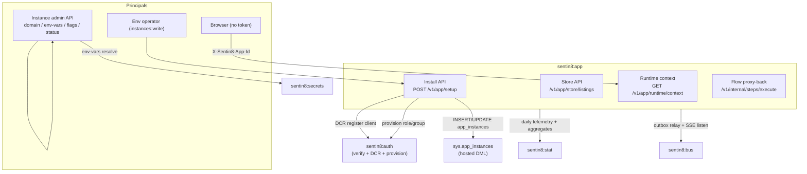
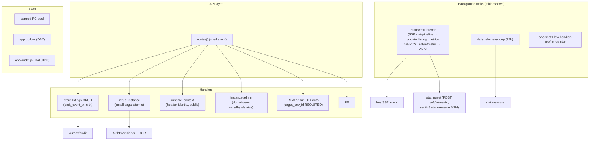
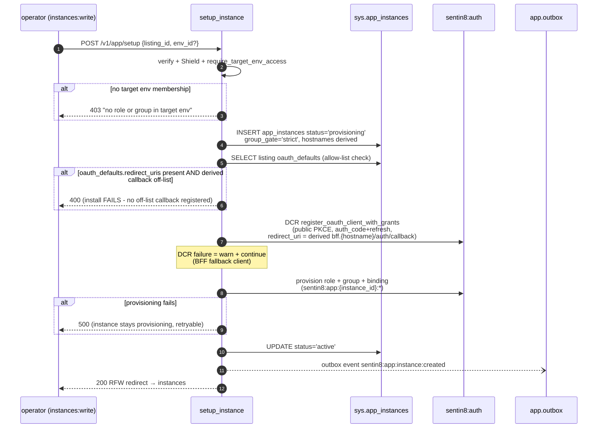
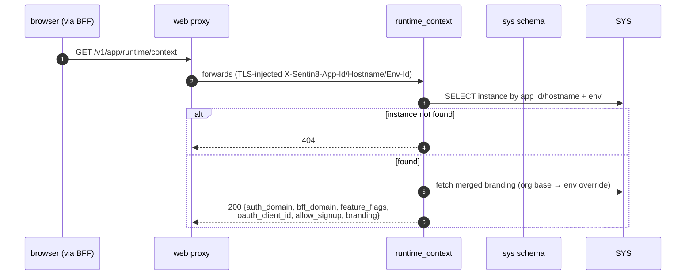
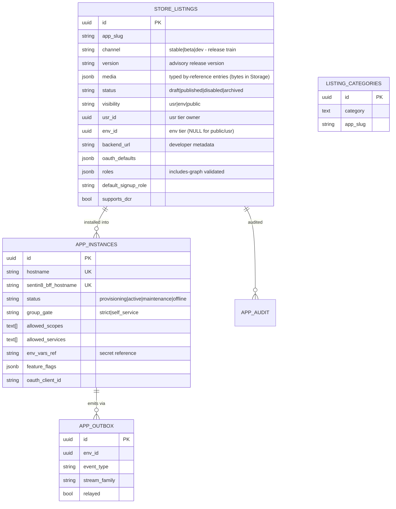
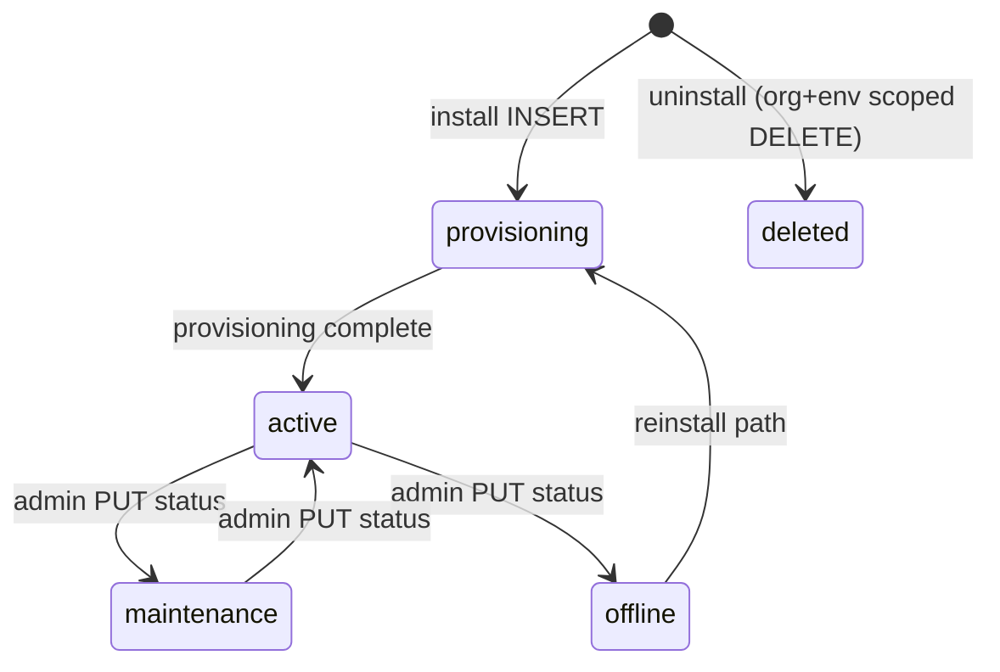
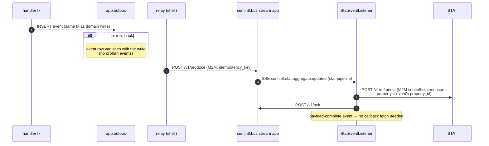
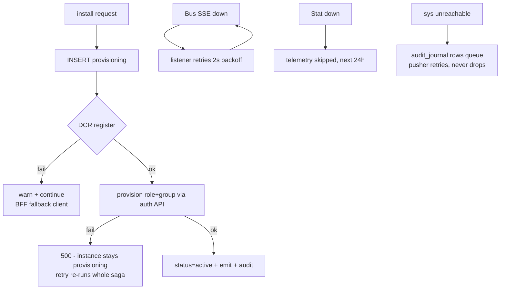
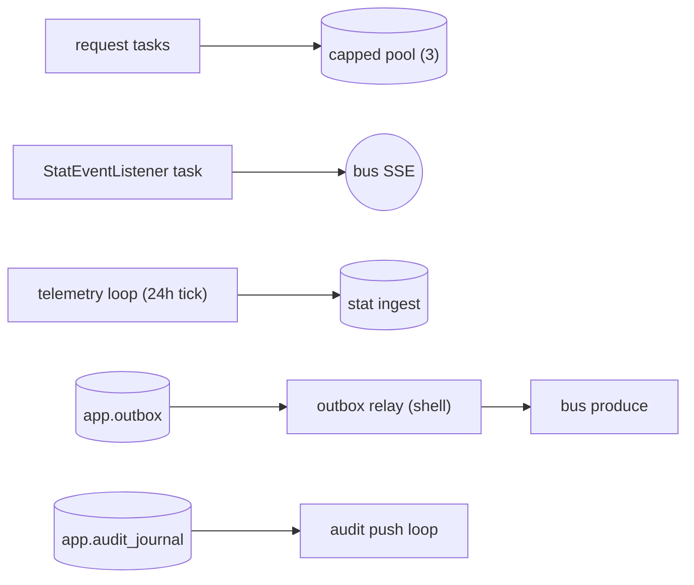
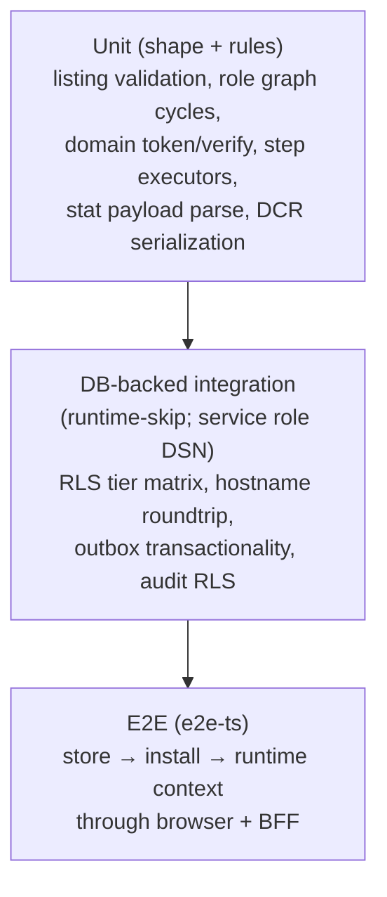

# DESIGN.md: Sentin8:App - Detailed Design Document

## 1. Scope & Context

Sentin8:App owns the app marketplace and the app-instance runtime surface:

- **Owns** (schema `app`): `store_listings` (visibility-tiered store
  catalog), `audit_events`, plus the DBX producer tables `outbox` and
  `audit_journal`. It also owns **instance lifecycle writes** to
  `sys.app_instances` (declared cross-schema DML grant - app is the
  instance owner by design; sys owns the table and reads it for the
  resolver).
- **Does NOT own**: identity/roles/groups (provisioning verbs ride auth's
  API), OAuth clients (DCR registration with auth, `oauth_client_id`
  stored), hostname→instance resolution (sys's resolver + TLS read
  `sys.app_instances`), branding truth (merged read from `sys.branding`),
  analytics properties (Stat's API), workflow execution (Flow).

## 2. Runtime Architecture

**Request lifecycle - install (`POST /v1/app/setup`, the atomic path):**

Failure branches: missing target env → 400; no RBAC membership → 403;
listing not published → 404; duplicate hostname → 409; derived
`https://bff.{hostname}/auth/callback` not in the listing's
`oauth_defaults.redirect_uris` allow-list → 400 (the listing
author decides where post-login redirects may land; without the key the
derived callback is the default first-party posture). `oauth_defaults`
lives on `app.store_listings`, not on `sys.app_instances`.

**Runtime context (public, header-identity):**

## 3. Data Model

- **Visibility-scoped RLS on `store_listings`** (visibility tiers):
  `public` → everyone; `env` → `env_id = current`; `usr` → owner subject
  or env-admin; all gated on `sentin8_context_initialized()`. Writes:
  owner or bypass. The `org` tier does not exist - org-wide reach is
  achieved via `public` or per-env installs.
- **Instance state machine** (`sys.app_instances.status`, maintained by
  app):

- **Listing state machine**: `draft → published → (disabled | archived)`;
  `visibility` immutable once published/disabled; delete is soft archive.
- **Secrets**: `env_vars_ref` stored by reference; the resolve endpoint
  returns the value once and never logs it.
- **Ownership note**: `sys.app_instances` is Sys-owned DDL with app as the
  declared DML owner - the only sanctioned cross-schema write grant
  (instance provisioning is app's domain by design).

## 4. API Surface

| Audience | Endpoint | Gate | Emits |
|----------|----------|------|-------|
| store | `POST/GET/PUT/DELETE /v1/app/store/listings[/{id}]` | Shield `app:store:admin` / `app:store:read` (RLS visibility under read) | `sentin8:app:listing:created\|updated\|archived` |
| setup | `POST /v1/app/setup`, `GET /v1/app/setup/{id}/status` | `app:instances:write` / read | `sentin8:app:instance:created` |
| runtime | `GET /v1/app/runtime/context` | **public** (TLS-injected instance headers) | - |
| admin | `/v1/app/admin/instances/{id}/(domain\|env-vars\|feature-flags\|status)`, `GET …/oauth-client`, `GET …/env-vars/resolve` | `app:instances:admin` | `instance:domain:updated`, `envvars:updated/resolved`, `featureflags:updated`, `status:updated` |
| uninstall | `POST /v1/admin/instances/uninstall` | Shield + target env RBAC | `sentin8:app:instance:uninstalled` |
| RFW | `GET /v1/admin/ui/{page}`, `GET /v1/admin/{resource}` | any of `store:read/store:admin/sys:admin/org:admin/env:admin` | - |
| internal | `POST /v1/internal/steps/execute` | Flow M2M bearer (`sentin8:app:steps:execute`-profile) | - |
| health | `GET /v1/health` | none | - |

**Event flow (outbox → Bus → trigger):**

## 5. Cross-Cutting Concerns

- **Auth**: shared `AuthClient` (5-min JWKS/discovery caches) + Shield on
  every guarded route; runtime context is intentionally unauthenticated -
  the TLS-injected instance headers are the caller identity.
- **Tenant resolution + RLS**: context set on the same connection inside
  one explicit transaction; uninitialized context sees nothing
  (fail-closed).
- **Idempotency**: install is retryable (provisioning verbs are
  idempotent); DCR re-registers on retry. Aggregate events are
  at-least-once (Bus SSE) - a redelivered event may double-apply a
  metric within the day-bucket (accepted for usage analytics; Stat's
  ingest dedupes per event id).
- **Rate limiting**: none (BFF/edge responsibility).
- **Audit journaling**: `app.audit_journal` rows written same-tx, pushed
  to the shared audit ingest; pushed flag marks completion; retries never
  drop rows.
- **Graceful drain**: shell-owned (SIGTERM → drain in-flight).
- **TLS**: in-process PQ termination via `sentin8-tls`; callbacks use the
  derived platform hostname.

## 6. Failure Modes & Recovery

- Install is atomic in `sys.app_instances` but the HTTP provisioning calls
  are intentionally NOT transaction-wrapped (auth's tables) - retry
  resumption is idempotency-based.
- Event emission: in-tx for listing mutations (commit-atomic); best-effort
  post-tx for instance events.
- Runtime-context proxy target down → 502 surfaced to the app shell (web
  maps it verbatim).

## 7. Concurrency & Performance Model

- Pool shared by store reads, install saga, RFW data; heavy paths (listing
  lists) are single-query + RLS filtered.
- The stat listener is the only continuously consuming task; reconnect
  backoff 2s; ACK per message.
- Runtime context is read-per-request (no cache) - it is the app's
  first-paint call; single indexed hostname lookup.

## 8. Invariants, Insecure-Defaults Rejected, Unsafe Rationale

1. **Tokens never reach the client** - runtime context returns metadata
   only; OAuth flows ride the BFF.
2. **Visibility tiers enforced by RLS, not handler filters** - a
   `usr`/`env` listing is invisible (404) outside its tier; env-admin
   override is explicit (`sentin8_is_env_admin()`).
3. **`visibility` immutable after publish** - 400 on change (listing
   audience can't be silently widened).
4. **Role graph integrity** - `default_signup_role` must be a declared
   role; includes-graph is cycle-checked before save.
5. **Env vars are references** - resolved values are returned once, never
   logged, never stored plaintext.
6. **target_env_id required + RBAC-in-target check** on admin/setup
   surfaces - no cross-env writes without membership.
7. **Install hostnames derived deterministically** - default
   `{app_slug}.{env_slug}.{org_domain}`, BFF always `bff.{hostname}`;
   custom domains verified via TXT token before activation.
8. `group_gate='strict'` is fixed at install (fail-closed app-group gate;
   platform surfaces use self_service explicitly).
9. No `unsafe` blocks in the service.

## 9. Testing Strategy

- ~69 tests across 8 files; integration connects as the real
  `sentin8_app_service` role (NOBYPASSRLS) with sys-role fixtures -
  RLS tier assertions include the uninitialized-context fail-closed case.
- Deliberately not covered in-service: Stat property creation against the
  live service (error-path tests only), full Flow saga execution
  (platform e2e), browser flows.

## 10. Open Questions

- KYC/document Flow steps are stubs by contract; the delegation is: capture =
  Storage upload (presigned PUT + `X-Content-Sha256`), verification = a Flow
  workflow whose step proxy-calls the app's internal verify endpoint. The stub
  step definitions stay; only the target wiring changes.
- `stat_integration` property/M2M creation is library surface not yet wired;
  call the helper from `setup_instance`'s provision path.

---

**Design attribution:** sentin8:app and its underlying concepts were designed by Hamid Jahanzad <Hamid@Jahanzad.com>.

