# Sentin8:Auth - Detailed Design Document

> Audience: maintainers, reviewers, and architects modifying the service.
> For the overview read `README.md`; for the functionality read
> `BUSINESS.md`. Every normative mechanism below names the RFC/OpenID
> specification it implements; the full register with links is **§12
> Standards Reference Register**.

## 1. Scope & Context

Sentin8:Auth is the platform's **single identity plane**: the only issuer
of every token family, the only JWKS authority, the DCR registrar, the
RBAC substrate (roles, groups, nesting, membership provisioning API),
consent grants, sessions, MFA/passkeys, SSO federation, webhooks, and the
OID4VCI/SD-JWT wallet surface.

- **Owns** (schema `auth`): identity + credentials (users, sessions, app
  passwords, MFA factors/challenges, WebAuthn challenges, reset/verify
  tokens, enterprise connections, SSO sessions), OAuth clients (incl. DCR
  records, federated credentials, M2M thumbprints), M2M scope grants, RBAC
  (roles, user_roles, groups, group_members, group_roles, role_nesting),
  consent grants (FAPI 2.0), wallet credentials + regulatory overlays +
  security profiles, actor tokens, webhook endpoints/outbox/attempts,
  signing keys, and the DBX producer tables (`outbox`, `audit_journal`,
  `post_outbox`).
- **Does NOT own**: org/env business records (sys provisions those and
  calls back via the provisioning API), tenant app instances, Shield
  policy storage (sys's `policy_sets` is the substrate; auth runs an
  engine on it), invitations (proxied to sys), e-signature (QES owned by
  the core platform's Sentin8:Sign service - `signature_request` returns
  NOT IMPLEMENTED until that integration lands).

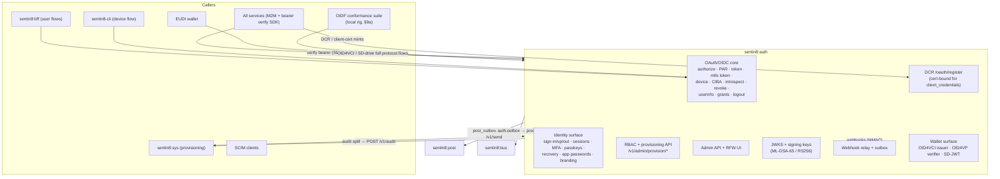

**Trust boundary note.** Every caller sits behind Sentin8:Proxy TLS
termination; `sentin8-tls` injects the `X-Sentin8-*` context headers
(client-supplied copies stripped). Auth reads tenant context ONLY from
those headers - never from client-controllable request data (RFC 6819
§4.1.6 - request-parameter injection).

## 2. Runtime Architecture

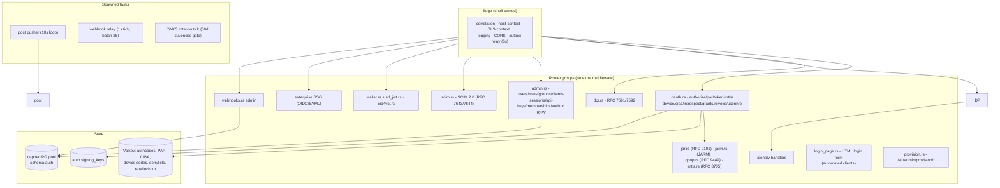

**Request lifecycle - authorization-code token issuance (FAPI 2.0
posture, platform profile):**

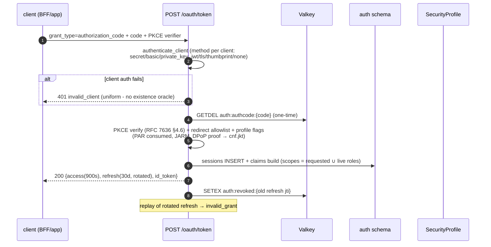

**M2M issuance (cert-bound, RFC 8705 - the out-of-band tenant path; the
platform internal path is token-free, §4.3f):**

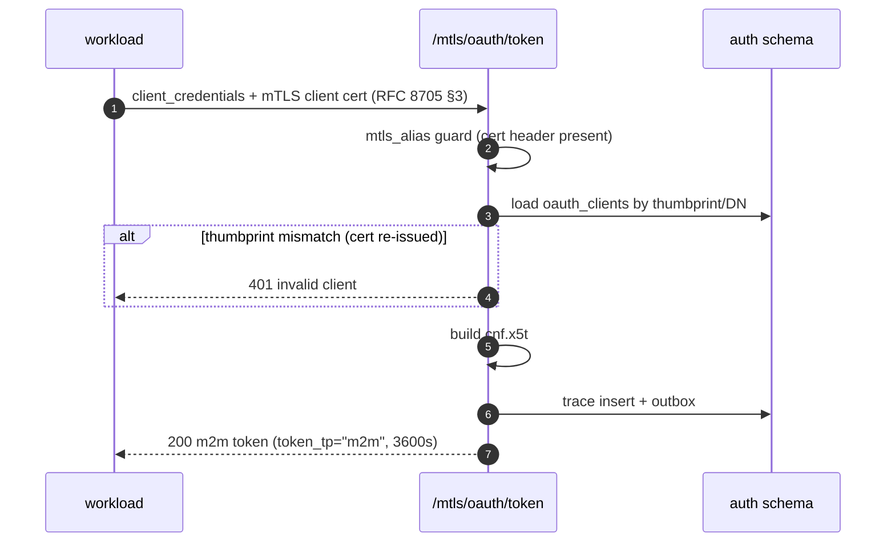

## 3. Data Model

```mermaid
erDiagram
    USERS ||--o{ SESSIONS : "holds"
    USERS ||--o{ USER_ROLES : "assigned"
    USERS ||--o{ GROUP_MEMBERS : "member of"
    USERS ||--o{ APP_PASSWORDS : "owns"
    USERS ||--o{ MFA_FACTORS : "enrolled"
    USERS ||--o{ ACTOR_EVENTS : "actor/target"
    ROLES ||--o{ USER_ROLES : "grants"
    ROLES ||--o{ GROUP_ROLES : "via groups"
    GROUPS ||--o{ GROUP_MEMBERS : "contains"
    GROUPS ||--o{ GROUP_ROLES : "binds"
    OAUTH_CLIENTS ||--o{ CLIENT_ROLES : "assigned"
    OAUTH_CLIENTS ||--o{ FEDERATED_CREDENTIALS : "federates"
    OAUTH_CLIENTS ||--o{ GRANTS : "consented"
    USERS ||--o{ CREDENTIALS : "wallet"
    USERS ||--o{ ENTERPRISE_CONNECTIONS : "SSO"
    WEBHOOK_ENDPOINTS ||--o{ WEBHOOK_OUTBOX : "queues"
    WEBHOOK_OUTBOX ||--o{ WEBHOOK_ATTEMPTS : "logs"
    USERS {
        uuid id PK
        string email
        string status "active|suspended|archived|locked"
        bool mfa_enabled
    }
    SESSIONS {
        string token_id UK
        string status "active|revoked|expired"
        timestamptz expires_at
    }
    OAUTH_CLIENTS {
        string client_id UK
        string token_endpoint_auth_method
        text[] grant_types
        string tls_client_auth_subject_dn "RFC 8705 §2"
        string self_signed_tls_client_auth_thumbprint "RFC 8705 §2.3"
        bool consent_required
        bool dpop_exempt
    }
    MFA_FACTORS {
        string factor_kind "totp|webauthn|backup_code"
        bytea secret_cipher "AES-256-GCM sealed"
        string status "pending|active|disabled"
    }
    CREDENTIALS {
        string format "sd_jwt"
        string status "active|revoked"
        jsonb cnf_jwk
    }
    SECURITY_PROFILES {
        string scope "platform|org|env"
        string profile "fapi_2|…"
        bool require_dpop
        int max_token_lifetime
    }
```

- **RLS**: FORCE RLS on all tenant tables (env policies; junctions carry
  their own `env_id` for direct RLS; `role_nesting` gated on the parent
  role's env). **No-RLS exceptions** (platform-internal): `m2m_dcr_credentials`
  (auth's own workloads only), `m2m_scope_grants` (anonymous DCR endpoint
  evaluates server-side), `webhook_attempts` (relay-written), and
  `actor_revocations` (`USING (true)` - revocation is jti-scoped, not
  env-scoped). Context setting is `async` + `.await`ed and
  transaction-local on the SAME connection as the query (§5).
- **State machines**:

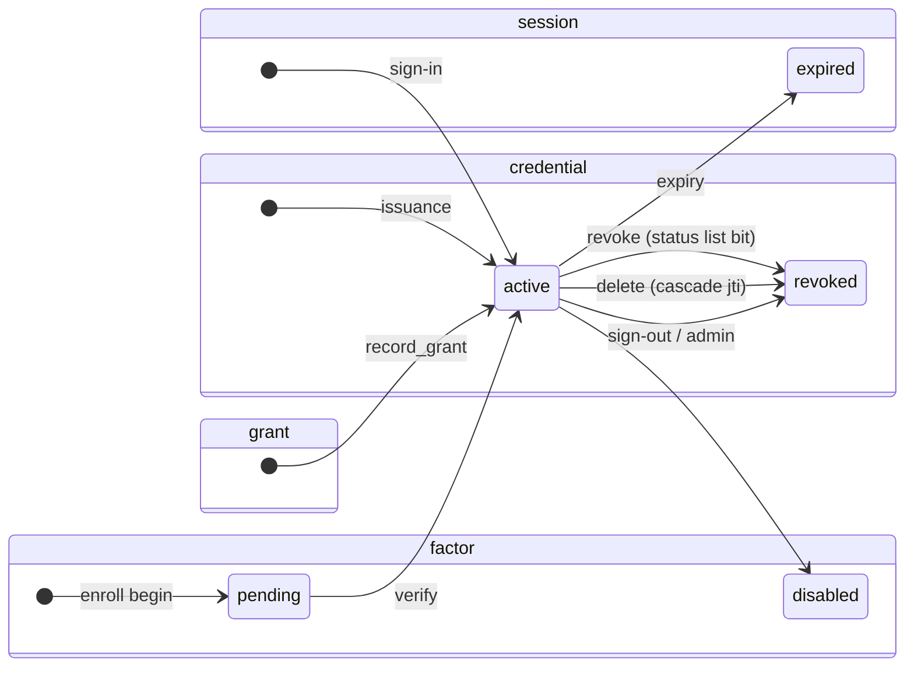

- **Secrets posture**: TOTP secrets, webhook secrets, client secrets are
  encrypted (`secret_cipher` BYTEA / hash); signing keys persisted
  AES-sealed under the master key; **secret references only** - no
  plaintext secrets in any table (credential-theft class, RFC 6819 §4.4).
- **OIDC claim data (§9a.4)**: the `users` table carries `phone` and the
  postal-address columns (`street_address`, `locality`, `region`,
  `postal_code`, `country`) - written through the admin user surface,
  read at the ID-token/userinfo mint gated on the consented
  `phone`/`address` scopes. The OIDC `address` claim is the spec's JSON
  object assembled at mint time.
- **Seeds**: platform admin user + role/nesting catalog + `dash` (public
  PKCE, dpop_exempt) + `sentin8-cli` (device flow) clients. The
  `sentin8:sys:admin` role's OWN permissions are exactly
  `['sentin8:sys:admin']` (the `is_platform_admin` marker scope); all
  other scopes come from NESTED service-admin roles. The seed NEVER
  empties that permission set - the bootstrap admin would lose platform
  admin on a fresh install.

## 4. API Surface

The complete route inventory with per-family spec anchors lives in §10.
In brief:

| Audience | Group | Gate |
|----------|-------|------|
| public | `/.well-known/*`, `/oauth/*` protocol endpoints, `/v1/sign-in\|up\|out`, `/v1/health` | session/cookie or client auth per flow; bot protection + lockout on sign-in (RFC 6749 §10.4) |
| mTLS | `/mtls/oauth/token`, `/mtls/oauth/revoke` | cert-presence guard (RFC 8705 §5) |
| workload | `POST /oauth/register` (DCR, RFC 7591) | interactive clients open; client_credentials-only requires mTLS cert scope-proof (§8) |
| delegated | `POST /delegate/access-token` | verified M2M bearer + `sentin8:delegate:read` + cnf match (RFC 8693) |
| wallet | `/oauth/credential`, `/oauth/deferred_credential`, `/oauth/nonce`, `/oauth/notifications`, `/oauth/vp/response`, `/oauth/credentials/*` | bearer/DPoP + proof verification (OID4VCI §7.2) / VP verified (SD-JWT) |
| consent | `/v1/auth/consent/*` | session-validated; proxied to owning vertical |
| admin | `/v1/admin/*` + RFW UI | `route_guard` + Shield |
| provisioning | `/v1/admin/provision/*` | admin bearer + target-env header, idempotent upserts |
| SCIM | `/scim/v2/*` | `sentin8:scim:read`/`write` (RFC 7644 §2.2) |
| recovery | `/v1/password/reset(+confirm)`, `/v1/email/verify(+confirm)` | none (enumeration-safe, token-gated confirm) |

**OpenAPI spec.** The single source of truth for the served surface is
the `#[utoipa::path]` annotations + the `#[openapi(paths(...))]` list in
`src/openapi.rs`; `docs/openapi.json` is the dumped artifact via
`--print-registration --section=openapi` (regenerated, never hand-edited).
The generic Shield handlers bind annotated wrappers in `src/policy_docs.rs`
and the RFW POST-aliases bind `src/rfw_aliases.rs`.

**Tenant-aware issuer on every token mint (OIDC Core §3.1.3.7).** `iss`
is `https://auth.{env-domain}` - the tenant's own auth host, where the
env domain is **opaque** (never structurally parsed). Discovery resolves
it from the TLS-injected `X-Sentin8-Hostname` (`resolve_issuer`); every
mint site resolves the same way so a tenant's tokens carry the tenant's
issuer. Token verification admits the `https://auth.*` issuer family
(the JWT signature - Auth is the single issuer - is the trust anchor;
the `iss` form is a sanity gate, never domain-coupled to the platform
TLD).

**Drift guard.** `tests/openapi_drift.rs` asserts BOTH directions - every
served route appears in the compiled spec and every spec pair is served -
via the shared shell helper (`sentin8::shell::drift_guard`). The spec
carries 185 operations (the 150-op floor is pinned by
`spec_carries_the_full_documented_surface`); runs require the sourced
root env + `SQLX_OFFLINE=true` (a bare `cargo test` cannot resolve the
TLS-only PostgreSQL - the 164 `connection requires a valid client
certificate` query errors are the wrong-env symptom).

**Event flow (outbox → Bus):**

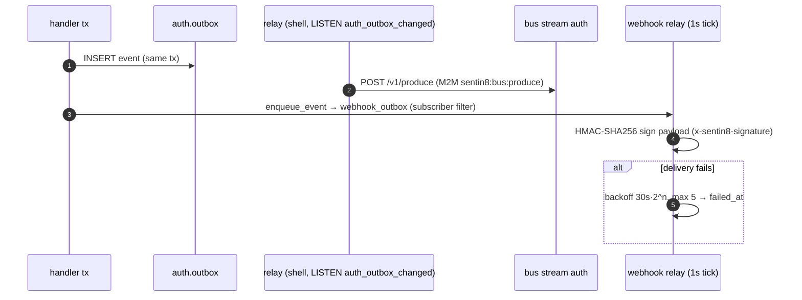

Event family `auth`; names
`sentin8:auth:{user,role,group,client,credential,apikey,session,membership,dcr,connection,mfa,passkey,actortoken,securityprofile,webhook,grant,ciba}:{action}`
- payload-complete envelopes. Session revocations emit
`sentin8:auth:session:revoked` `{subject_id, env_id, session_id,
revoked_by, reason}` - the BFF session-reaper consumes them (continuous
access evaluation). Grant lifecycle emits `sentin8:auth:grant:created`
(`{grant_id, client_id, user_id, env_id, scope, state,
selected_account_ids}`) - the authorization server is the seed of
open-banking grant truth; revocation emits
`sentin8:auth:grant:revoked`.

## 5. Cross-Cutting Concerns

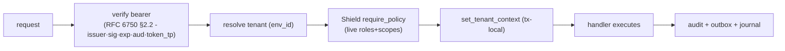

- **Token verification** is SDK-reused by every service
  (`sentin8::auth::client`) - auth is the only JWKS authority (RFC 7517
  key set, RFC 7518 JWA).
- **Sender-constrained tokens.** DPoP (RFC 9449): proof validation
  (htm/htu/iat/nonce/ath) with jti replay protection (SETNX keyed on
  thumbprint·jti, §8); `cnf.jkt` on access tokens; `dpop_exempt`
  per-client flag. mTLS (RFC 8705): `cnf.x5t#S256` cert-binding. Both
  specs are implemented END-TO-END - nothing half-way.
- **Rate limiting / bot protection**: IP 10/min, email 5/min sliding
  windows; 5 failures → durable `locked` status (config TTL); dummy
  bcrypt compare on unknown accounts (no email enumeration, RFC 6749
  §10.4 / RFC 6819 §4.5.2).
- **FAPI 2.0 posture**: platform profile enforces PAR (RFC 9126) + JARM
  + DPoP (RFC 9449) + issuer parameter (RFC 9207) + 900s max token
  lifetime + refresh rotation; env/org profiles override
  (`security_profiles`).
- **Introspection honesty**: `none`-auth clients hard-rejected;
  `application/token-introspection+jwt` signed responses (RFC 9701)
  per profile; plain JSON (RFC 7662) otherwise.
- **Back-channel logout** (OIDC Back-Channel Logout): logout tokens
  carry `events`/`sid`, NO `nonce` (per spec), fan-out to registered
  `backchannel_logout_uri`.
- **No-store on token endpoints** (RFC 6749 §5.1, RFC 7662 §4,
  RFC 8705 §5): middleware enforces `no-store`/`no-cache` on
  `/oauth/{token,introspect,revoke}` + `/mtls/*`.

### 4.3f Token-free platform M2M - the certificate is the service identity

Platform workloads authenticate with **no token at all**: the caller presents
its Acme-issued client certificate (`CN=m2m-{workload}`) in the TLS
handshake, `sentin8-tls` CA-verifies it and injects
`X-Sentin8-Client-Cert-Subject` / `-Thumbprint` headers (client-supplied
copies stripped), and the receiving service trusts those headers exactly as
it trusts `X-Sentin8-Env-Id` - the TLS layer is the authentication. Auth's
role in platform M2M shrinks to **issuing identity material (the
certificate, via Acme) and provisioning the authorization record (the
grant rows, via `vertical enroll`)**. No M2M JWT is minted, fetched,
cached, or verified for platform service→service calls.

**Why (the defect class this closes):** the M2M token was a second identity
surface that had to stay synchronized with the certificate identity across
three stores (SDK credential cache → `oauth_clients` → JWT claims). A
database reset desynchronized them by construction - cached `client_id`s
outlived their rows - producing the fleet-wide
`M2M token fetch failed: status 401` storm after every reset. A token is
also a redundant proof: the TLS handshake ALREADY establishes exclusive
possession of the certificate's private key on every call; a bearer minted
from that same possession adds no strength, only state.

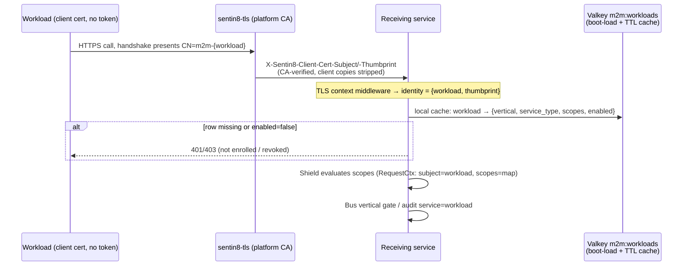

**The authorization record travels as the registry map.** `sentin8-cli
vertical enroll` provisions `auth.m2m_scope_grants` and publishes a
Valkey `m2m:workloads` hash -
`{workload} → {vertical, service_type, scopes[], enabled}` - and every
service boot-loads it and TTL-caches it (the platform's mandated pattern:
owner data is seeded on cold start / cache miss, never read on the request
path). This answers the three consumers the token previously fed:

| Consumer | Was (token claim) | Now (map field) |
|---|---|---|
| Shield `RequestCtx` (scope-gated rules) | `scope` | `scopes` (roles: none - M2M workloads never had role assignments) |
| Bus event-ownership gate | `vertical` | `vertical` (produce + consume identity checks) |
| Audit `service` stamp / Sys tenant-snapshot | `sub` (opaque hex) / `service_type` | CN directly / `service_type` |

**Revocation** is the map's `enabled` flag: `vertical enroll` (or the admin
surface) flips it, every service's cache observes it within the TTL, and the
workload's calls are refused. This is *more immediate* than the token path
(a minted token lives to expiry regardless). Handshake-level certificate
revocation (a stolen cert's *validity*) remains a follow-up .

**Security posture:** per-call proof-of-possession (the token was a pure bearer
at the target) and fleet-wide revocation. The multi-tenant boundary does not move:
tenancy was never carried by machine identity - the request's env
is authoritative for M2M, and RLS + explicit `env_id` clauses + Shield
remain the tenant gates. Two risks are ACCEPTED-AND-FILED:

- **The map's write surface is authorization escalation.** Any process
  with Valkey write access can `HSET m2m:workloads` itself any scope set.
  Countermeasure: Valkey ACLs - m2m: * writes
  restricted to the operator/enroll writer identity; services hold a
  read-only reader identity.
- **Certificate lifetime bounds the theft window.** 30-day default mint
  with load-path NotAfter verification and auto re-mint,
  alongside's CRL.
- Per-instance distinguishability collapses to the workload name (two
  instances share `{workload}.crt`) - accepted; audit identifies
  workloads, never instances.

**Invariants : **

- The certificate is the *only* platform-workload credential: no secret, no
  bearer, no assertion. The `m2m-` CN prefix is minted exclusively by
  Acme's guarded issuance channels (bootstrap enrollment - pinned to the
  declared set by; self-issuance `sub == service_name`; the
  enroll operator scope).
- The TLS-injected headers are trustworthy because (a) `sentin8-tls`
  injects them only after CA verification, (b) client-supplied copies are
  stripped before the app sees them, and (c) they exist only on
  TLS-terminated platform hops.
- A workload can only ever exercise scopes its map entry allows (Shield
  evaluates from the map; policy rules are unchanged).
- `oauth_clients` and DCR survive for interactive clients (auth-code,
  device flow, BFF apps, dash) and out-of-band tenant clients
  (`client_secret_basic`/`private_key_jwt` per RFC 7523/RFC 7591) - Auth
  remains the single identity plane for every HUMAN-facing flow; the
  token-free plane covers machine-to-machine platform calls only.
- **Rejected:** keeping the token as "extra" (it was the storm's root
  cause and adds no proof beyond the handshake); services reading
  `auth.m2m_scope_grants` directly (§4.7 - the map is the transport, no
  cross-schema grants); a live Auth resolve API per request (per-request
  dependency, banned by the runtime discipline).

**What is deleted for the platform path:** `/mtls/oauth/token`
`client_credentials` use by platform workloads; the `sentin8-m2m` token
source, DCR helper, credential cache, boot probe, and 401 self-heal
machinery; `build_with_dcr` background DCR retries in bus-client; every
service's boot-time DCR block; the `cli-producer` / `cli-delegator` /
`bff-delegator` token workloads (the CLI and BFF present certificates);
BFF's env-credential fallback. Delegated tokens keep their `cnf`
cert-binding (unchanged) - BFF presents its certificate and receives a
delegated JWT (RFC 8693); only the *workload's own* M2M JWT disappears.

## 6. Failure Modes & Recovery

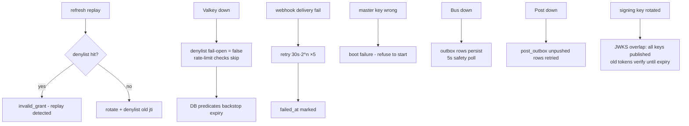

- **JWKS rotation**: insert-new-key overlap (all persisted keys published
  in the RFC 7517 set); old tokens verify until expiry.
- **Session expiry**: enforced by predicates; no sweeper (rows are
  harmless after expiry).
- **DCR storm protection**: anonymous DCR gated by `m2m_scope_grants`
  (service must be enrolled) + cert channel possession proof. Platform
  workloads never DCR and never fetch tokens (§4.3f) - a DB reset can no
  longer strand cached `client_id`s; a missing grant row surfaces as a
  named workload refusal (`workload not enrolled`) from the registry map,
  fixed by enrollment.
- **Token-free M2M failure modes (§4.3f)**: certificate missing at boot →
  Acme mint (bootstrap channel, declared-set-pinned) → retry with backoff;
  map row missing/disabled → 401/403 until enroll/revocation is reverted;
  Valkey down at boot → services start with the last cache file / an empty
  map and refuse unenrolled workloads fail-closed; map edit → next TTL
  refresh reflects it.

## 7. Concurrency & Performance Model

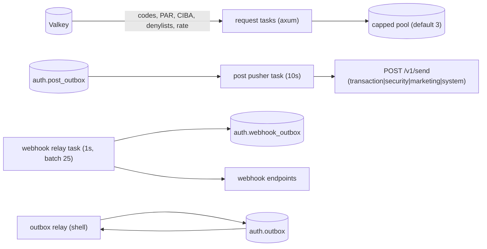

- Sign-in hot path: 2 PG round-trips + 3 Valkey ops (rate, lockout,
  session); JWKS cached in every consumer SDK.
- Token minting: one signing op (ML-DSA-65 or RS256 per profile, §9a.9);
  key material cached in process.
- Webhook relay batches 25 per tick to bound endpoint fan-out.
- **Post pusher identity is process-lifetime.** The `auth-post`
  `TokenSource` is resolved once and reused across passes; a 401 triggers
  the m2m crate's single-flight self-heal - never a per-pass
  `register_or_load_m2m_client` rebuild (a per-pass rebuild would run two
  PQ TLS handshakes + two token POSTs every 10s whose transient
  allocations ratchet glibc arenas).

### 7.1 Invalidation triggers on access-grant mutations (policy family)

Identity-cache invalidation (`sentin8:auth:membership:created|deleted`
on the SYSTEM-env `policy` stream; policy consumers (every service's M2M
workload) are registered in the SYSTEM env - that is the transport, not a
policy choice). The shell outbox relay holds exactly one M2M workload
(SYSTEM-env, `sentin8:bus:produce`), and Bus's produce gate
(`env_id does not match the authenticated tenant`) rejects any row whose
`env_id` differs from the token's env: **tenant-env outbox rows can never
reach the `policy` stream**. Therefore every mutation that grants or
revokes access emits, in the SAME transaction as the domain change, a
SYSTEM-env row (family `policy`, event
`sentin8:auth:membership:created`/`deleted`, payload
`{"env_id": <tenant env>, "user_id": <subject>}`) - the tenant-env
fan-out row for domain consumers stays, on the `auth` family. Covered
mutations: sign-up closure provisioning, admin group member add/remove,
and the cross-service provisioning endpoint. Emission is best-effort: an
RLS/failure drop logs and degrades to the RoleResolver TTL. The tenant
context on the emitting transaction is switched to SYSTEM for the
invalidation INSERT (`set_config` is transaction-local) and restored for
any subsequent tenant-plane statement.

## 8. Invariants, Insecure-Defaults Rejected, Unsafe Rationale

1. **Single identity plane** - no other service mints tokens/JWKS; the
   provisioning API is the only cross-service write path to `auth.*`.
2. **M2M is certificate-bound by default** (RFC 8705) - a stolen token
   without the key is useless; DCR for `client_credentials` requires the
   mTLS cert channel (no dev fallback).
3. **`scope` is not the decision** - handlers never re-check scopes; step
   5 resolves live identity (§5 pipeline).
4. **Refresh rotation + jti denylist** (FAPI-mandated rotation) - replay
   within TTL is detectable; fail-open only on cache outage (expiry
   predicates backstop).
5. **No existence oracle** - uniform `invalid_client`; dummy bcrypt on
   unknown accounts.
6. **Tenant-scoped uniqueness** - emails/roles/groups unique per
   `(env_id, …)`; sessions carry `token_id` UNIQUE.
7. **Actor tokens are time-boxed and audited** - TTL clamp ≤ 3600s,
   `auth.actor_events` + jti revocation table.
8. **Keys persisted + encrypted**; wrong/rotated master key refuses boot.
9. No `unsafe` in the service; manual ML-DSA-65 signing wrapped in the
   crypto provider boundary.
10. **No per-pass identity churn.** Long-lived background pushers bind
    their M2M `TokenSource` for the process lifetime (§7).
11. **Invalidation rows carry SYSTEM env** (§7.1) - a tenant-env row is
    silently dropped by RLS at emit time and denied at the Bus produce
    gate - both fail closed.
12. **Auth reads `sys.app_instances` only through Sentin8:App's owner
    API** (no cross-schema grants).
13. **DPoP jti replay cache is keyed on thumbprint·jti** with bounded TTL
    (RFC 9449 §4.4 - jti single-use per window). A global jti cache (no
    key-owner binding) would let one client suppress another's proofs.
14. **Uniform HTTP error shapes on OAuth endpoints** (RFC 6749 §5.2) -
    client-auth failures return `401 invalid_client` with a single JSON
    body shape; protocol errors never leak method-oracle detail.
15. **RFC 9207 issuer parameter enforced end-to-end.** `iss` rides the
    authorization response when the profile demands `require_iss` AND is
    validated to echo the discovery issuer.
16. **DCR secrets are never logged or echoed back** outside the initial
    registration response (RFC 7591 §5.3.1); management reads return
    metadata WITHOUT the secret.

## 9. Testing Strategy

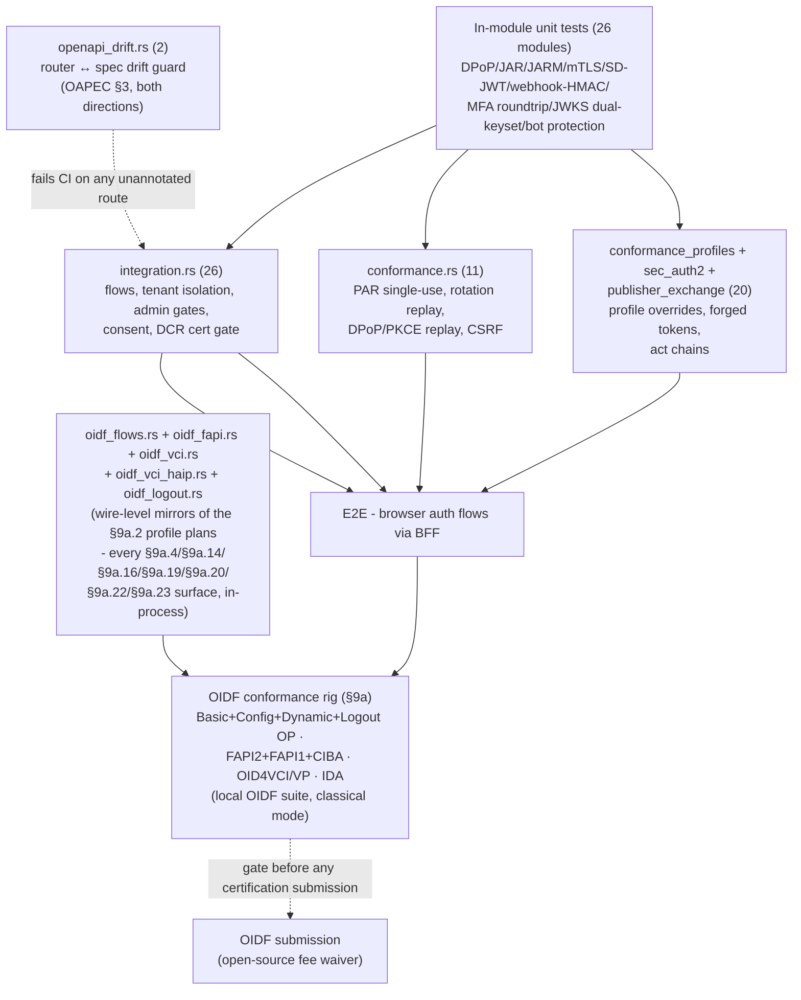

- OpenID certification live flows run against a dedicated local
  conformance rig (§9a) - the OIDF suite's own tests are not part of the
  in-service test binary. The rig is the pre-certification gate: every
  profile in §9a must be green locally before a certification submission
  is prepared.
- **The in-process rig mirror (`tests/oidf_*.rs`,).** `sentin8-auth-oidf`
  is the source of truth for WHAT the certification campaigns test; the
  Rust layer asserts every campaign-observable wire BEHAVIOR directly
  (§9a.4 discovery honesty, §9a.14 request-object mandate table, §9a.16
  message-signing posture, §9a.19 attestation auth, §9a.22 reject
  channels, §9a.23 logout error surface) WITHOUT the suite, the rig, or a
  browser - in-process on the same router the fleet boots. The rig run
  remains the certification gate; the mirror keeps every campaign-covered
  behavior regression-green in seconds (a rig run takes ~3.5h; the mirror
  is `cargo test`) so a wire change that would fail the rig fails CI
  FIRST. The mapping from rig modules → mirror tests is §9b.
- Deliberately not covered in-service: real IdP SSO round-trips, PQ TLS
  transport (platform-level).

## 9b. In-process rig mirror - the Rust coverage map

`sentin8-auth-oidf` (the §9a.2 harness) is the truth for what the OIDF
certification campaigns exercise; every profile plan's module families map
to the in-process tests below. Campaign rules carried into Rust:
**no-skip** (every capability the discovery document advertises must
behave - §9a.10) and **warning-zero** semantics (each assertion asserts
the ROOT behavior a suite WARNING would surface - §9a.11).

| Profile plan (suite) | Module family / rule | Rust test layer (`tests/`) |
|---|---|---|
| `oidcc-basic-certification-test-plan` | prompt=none/login, max_age, scope→claims, userinfo GET/POST both, session-less authorize | `oidf_flows.rs` + `conformance.rs` (`conf_prompt_none_silent_authentication`) |
| - (Basic, §9a.11/) | ID-token claims ride the §5.5 claims SELECTION only; `acr_values` echo; code 60s lifetime + burned-code revocation cascade | `oidf_flows.rs` |
| - (§9a.4 honesty) | discovery ↔ behavior parity (advertised algs/methods ARE verifiable; S256-only; claims/scope families served) | `oidf_flows.rs` + `conformance.rs` (`conf_discovery_advertisement_matches_behavior`) |
| `oidcc-config-certification-test-plan` | discovery completeness block (CIBA + backchannel-logout + claims params) | `oidf_flows.rs` (`oidf_config_discovery_completeness`) |
| `oidcc-dynamic-certification-test-plan` | RFC 7591 DCR: `invalid_redirect_uri` (fragment), `invalid_client_metadata` (bad sector), metadata persistence (id/userinfo alg, subject_type pairwise), RFC 7592 COALESCE update + delete 204; WebFinger | `oidf_flows.rs` + `conformance_profiles.rs` |
| `oidcc-rp-initiated-logout-certification-test-plan` | state echo on registered landing; unregistered → the error PAGE (§9a.23); id_token_hint verification; no-hint fallback | `oidf_logout.rs` + `sec_auth2.rs` (`sec_auth2_logout_redirect_allowlist`) |
| (Back-Channel Logout) | logout token shape: `events`+`sid`, no `nonce`; fan-out POST | `backchannel_logout.rs` unit tests + `oidf_logout.rs` |
| `fapi2-security-profile-final-test-plan` (dpop/mtls cells) | PAR+DPoP pre-binding (§9a.21), jkt mismatch → `invalid_dpop_proof` (§9a.22), require-DPoP gate + cert substitute, userinfo exactly-one-proof (§9a.22), hybrid response-type rejects, JARM-wrapped vs plain-query error channels (§9a.16(h)/9a.22), FAPI response_mode=query reject, refresh unconditional (OC-27b) | `oidf_fapi.rs` (fapi_2 profile row + `required_flags`) |
| `fapi1-advanced-final-test-plan` | request-object mandates exp/nbf/nonce + alg-none forbidden (§9a.14), code↔jwt pairing, permissive assertion-aud forms (alias/PAR/token/issuer array), presented-cert cnf binding (§9a.12), `s_hash` | `oidf_fapi.rs` (fapi_1_advanced) + `conformance.rs` |
| `fapi2-message-signing-final-test-plan` | strict-aud (issuer-exact assertion, §9a.16(b)), PAR unsigned-push reject (§9a.16(g)), JAR freshness mandates (§9a.16(f)), PS256 accepted (§9a.16(d)), RS256 request-object reject | `oidf_fapi.rs` (fapi_2_message_signing) |
| `fapi-ciba-id1-test-plan` (poll/ping cells) | signed request object mandatory + claim validation (CIBA §7.1 §9a.15), exactly-one-hint, poll auth_req_id single-use/expiry, binding_message enforce, ping notification contract | `oidf_fapi.rs` (fapi_ciba row) + `ciba.rs` unit tests |
| `oid4vci-1_0-issuer-test-plan` | metadata (`credential_configurations_supported` + nonce/batch), §8.1 nonce first-proof GETDEL, unknown config/identifier errors (§7.4 shape), batch N→N, invalid proof | `oidf_vci.rs` + `oid4vci.rs` unit tests |
| `oid4vci-1_0-issuer-haip-test-plan` | `OAuth-Client-Attestation`(+PoP) auth: trust-anchor pin, iss/sub/expiry checks, PoP jti replay, discovery attestation advertisement (§9a.19), credential-response ECDH-ES encryption | `oidf_vci_haip.rs` + `client_attestation.rs`/`jwe.rs` unit tests |
| `oid4vci-1_0-wallet-test-plan` | credential-offer landing → authorize redirect state echo (`VCIVerifyIssuerStateInAuthorizationRequest`, §9a.20) | `oidf_vci.rs` |
| Cross-plan | the alias-serialization/no-state-change rules and suite-driver specifics stay HARNESS-ONLY (fixtures/runner.ts) - not server behavior. | (deliberately not mirrored) |

Deliberate suite-side sanctions the mirror does NOT reproduce (client /
rig artifacts, not server behavior - the rig spec files document them):
ES256-client RS256-negative SKIPPED cells, the multi-DPoP JVM header
collapse, the HAIP refresh-token untestable skip, and the two-visit/review
screenshot placeholder mechanics. The SERVER-side negative each of those
hides IS mirrored (`ensure_signed_request_object_*`, userinfo
multiple-DPoP 400, FAPI unconditional refresh).

## 10. Route Inventory (protocol-family grouped, spec-anchored)

The authoritative, machine-checked list is the router (`src/server.rs`) +
the drift guard. This table adds the RFC/spec anchor per family - each
link resolves in §12.

| Family | Routes | Spec anchors |
|---|---|---|
| Discovery | `/.well-known/openid-configuration`, `/.well-known/oauth-authorization-server`, `/.well-known/jwks.json`, `/.well-known/webfinger`, `/.well-known/openid-credential-issuer`, `/.well-known/openid-credential-verifier`, `/openapi.json` | OIDC Discovery §2/§3, RFC 8414, RFC 7517, RFC 7033, OID4VCI §11.2, OID4VP §11 |
| Authorization | `/oauth/authorize` (GET), `/oauth/authorize/continue`, `/oauth/login` (GET+POST), `/oauth/par` (POST), `/oauth/vp/response` (POST), `/v1/auth/wallet/metadata` (GET) | RFC 6749 §4.1, RFC 7636, RFC 9126, RFC 9101, JARM, OID4VP §5, OID4VCI §13.3 |
| Token / introspection / revocation | `/oauth/token`, `/oauth/introspect`, `/oauth/revoke`, `/mtls/oauth/token`, `/mtls/oauth/revoke` | RFC 6749 §3.2/§6, RFC 7662 + RFC 9701, RFC 7009, RFC 8705, RFC 8693, RFC 8628 (incl. `/oauth/device`+`/device/verify`), CIBA poll grant |
| Userinfo / logout | `/oauth/userinfo` (GET+POST), `/oauth/logout`, `/oauth/backchannel-logout` | OIDC Core §5.3.1, OIDC RP-Initiated Logout, OIDC Back-Channel Logout |
| CIBA | `/oauth/bc-authorize`, `/v1/ciba/{approve,assisted/*}` | CIBA §4-§7, RFC 7523 |
| Grants | `/oauth/grants`, `/oauth/grants/{id}` (GET/PATCH/DELETE) | FAPI 2.0 Grant Management |
| DCR | `/oauth/register`, `/oauth/register/{client_id}` (GET/PUT/DELETE) | RFC 7591, RFC 7592 |
| OID4VCI | `/oauth/credential`, `/oauth/deferred_credential`, `/oauth/nonce` (GET+POST), `/oauth/notifications`, `/oauth/credentials`, `/oauth/credentials/issue`, `/oauth/credentials/status/{id}`, `/oauth/credentials/revoke/{id}` | OID4VCI §7-§13, Status List, SD-JWT VC §5 |
| Identity | `/v1/sign-in\|up\|out`, `/v1/session`, `/v1/branding`, `/v1/password/reset(+confirm)`, `/v1/email/verify(+confirm)`, `/v1/mfa/*`, `/v1/passkey/*`, `/v1/me/app-passwords` | RFC 6238, RFC 4648, WebAuthn |
| SSO federation | `/v1/sso/{id}/authorize\|callback`, `/v1/saml/metadata\|acs/{id}` | OIDC Core (federation), SAML 2.0 |
| SCIM | `/scim/v2/Users[/{id}]`, `/scim/v2/Bulk`, `/scim/v2/Groups`, `/scim/v2/ServiceProviderConfig`, `/scim/v2/ResourceTypes` | RFC 7643 + RFC 7644 (Bulk §3.7) |
| Admin / Shield / security | `/v1/admin/*` (+RFW UI), `/v1/admin/policy-sets[...]`, `/v1/admin/{relations,attributes}`, `/v1/security-profile`, `/v1/admin/security[...]` | Shield policy plane; RFW (platform §4.15) |
| Internal | `POST /v1/internal/keys/rotate` | cron proxy-back, §8 |
| Edge middleware | `route_guard` (admin backstop), `token_no_store_middleware` | RFC 6749 §5.1, RFC 7662 §4, RFC 8705 §5 |

## 11. Key & Signature Strategy (per-profile)

| Concern | Rule | Spec anchor |
|---|---|---|
| Key families | `["MLDSA65","RS256","ES256"]`; signing = ML-DSA-65 (PQ `exclusive` default) or RS256 (`classical`); ES256 verification-only | RFC 7518, ML-DSA (COSE/JOSE drafts) |
| Rotation | insert-new-key overlap; daily timer 30-day staleness gate + cron proxy-back `force` bypass | RFC 7517 (all keys in the set during overlap) |
| At-rest encryption | AES-256-GCM under the platform master key; wrong key refuses boot | secret-references-only rule |
| Per-tenant publication | JWKS endpoint is env-FAMILY filtered via the resolved security profile | OIDC Core §3.1.3.7 |
| Proof types | ES256 JWS for wallet proofs (raw r‖s), RS256 for client assertions, PS256 (RSASSA-PSS) supported verify side | RFC 7515, RFC 7518 §3.5, RFC 7638 |

## 12. Standards Reference Register

Every standard the service implements, with links. §-numbers in the
sections above refer to these documents.

### Core OAuth 2.0 family (IETF)

| Spec | Title | Anchor | Where in auth |
|---|---|---|---|
| [RFC 6749](https://datatracker.ietf.org/doc/html/rfc6749) | The OAuth 2.0 Authorization Framework | §3-§6 (endpoints/grants), §5.1 (no-store), §5.2 (auth errors), §10.4 (stuffing) | everything under `/oauth/*` |
| [RFC 6750](https://datatracker.ietf.org/doc/html/rfc6750) | Bearer Token Usage | §2.2 (verification) | bearer extraction and verification |
| [RFC 7009](https://datatracker.ietf.org/doc/html/rfc7009) | Token Revocation | §2.1 | `/oauth/revoke` + grant cascade |
| [RFC 7636](https://datatracker.ietf.org/doc/html/rfc7636) | PKCE | §4.1-§4.6 | S256-only code challenges |
| [RFC 8628](https://datatracker.ietf.org/doc/html/rfc8628) | Device Authorization Grant | §3.1-§3.5 | `/oauth/device`, `/device/verify` |
| [RFC 8693](https://datatracker.ietf.org/doc/html/rfc8693) | Token Exchange | §2.1/§4.1 | `grant_type=token-exchange`, `delegation.rs` |
| [RFC 9126](https://datatracker.ietf.org/doc/html/rfc9126) | Pushed Authorization Requests | §2-§4 | `/oauth/par` |
| [RFC 9101](https://datatracker.ietf.org/doc/html/rfc9101) | JWT Secured Authorization Request (JAR) | §4-§5 | `jar.rs` request objects |
| [RFC 9207](https://datatracker.ietf.org/doc/html/rfc9207) | Authorization Server Issuer Identification | §2-§3 | `iss` response parameter |
| [RFC 9396](https://datatracker.ietf.org/doc/html/rfc9396) | Rich Authorization Requests | §2 | `authorization_details` |
| [RFC 8707](https://datatracker.ietf.org/doc/html/rfc8707) | Resource Indicators | §2/§3 | `resource` → `audience` |
| [RFC 9449](https://datatracker.ietf.org/doc/html/rfc9449) | DPoP | §4-§7.2 | `dpop.rs`; `DPoP` scheme on userinfo/credential |
| [RFC 8705](https://datatracker.ietf.org/doc/html/rfc8705) | mTLS Client Auth + Certificate-Bound Tokens | §2-§5 | `mtls.rs`, `/mtls/*` aliases, `cnf.x5t#S256` |
| [RFC 9421](https://datatracker.ietf.org/doc/html/rfc9421) | HTTP Message Signatures | §2 | `http_signatures.rs` (FAPI2-MS) |
| [RFC 9530](https://datatracker.ietf.org/doc/html/rfc9530) | HTTP Message Digest Fields | §2 | content digests for signatures |
| [RFC 9701](https://datatracker.ietf.org/doc/html/rfc9701) | JWT Introspection Response | §3-§4 | signed introspection |
| [RFC 7662](https://datatracker.ietf.org/doc/html/rfc7662) | Token Introspection | §2.1-§4 | JSON introspection + no-store |
| [RFC 7515](https://datatracker.ietf.org/doc/html/rfc7515) | JWS | §4/§5 | all token signing |
| [RFC 7517](https://datatracker.ietf.org/doc/html/rfc7517) | JWK / JWK Set | §4 | `/.well-known/jwks.json` |
| [RFC 7518](https://datatracker.ietf.org/doc/html/rfc7518) | JWA | §3.4/§3.5 | RS256 + PS256 |
| [RFC 7523](https://datatracker.ietf.org/doc/html/rfc7523) | JWT Client Authentication | §2-§3 | `private_key_jwt` client assertions |
| [RFC 7638](https://datatracker.ietf.org/doc/html/rfc7638) | JWK Thumbprint | §3 | `cnf.jkt` (DPoP) |
| [RFC 8414](https://datatracker.ietf.org/doc/html/rfc8414) | AS Metadata | §2-§3 | `/.well-known/oauth-authorization-server` |
| [RFC 7033](https://datatracker.ietf.org/doc/html/rfc7033) | WebFinger | §4-§10 | `webfinger.rs` |
| [RFC 8252](https://datatracker.ietf.org/doc/html/rfc8252) | OAuth for Native Apps | §2.1/§7/§8.1 | loopback + custom-scheme redirects |
| [RFC 7591](https://datatracker.ietf.org/doc/html/rfc7591) | Dynamic Client Registration | §2-§3/§5 | `dcr.rs` register |
| [RFC 7592](https://datatracker.ietf.org/doc/html/rfc7592) | DCR Management | §2-§5 | `dcr.rs` manage |
| [RFC 6819](https://datatracker.ietf.org/doc/html/rfc6819) | OAuth 2.0 Threat Model | §4.1.6/§4.4/§4.5.2 | request injection, credential theft, stuffing |
| [RFC 9436](https://datatracker.ietf.org/doc/html/rfc9436) | Identity Chaining | reference | delegated-identity framing |
| [RFC 5280](https://datatracker.ietf.org/doc/html/rfc5280) | X.509 PKI | §4.1 | x5c leaf cert walk (key attestation) |
| [RFC 6238](https://datatracker.ietf.org/doc/html/rfc6238) | TOTP | §4/§5.1 | `mfa.rs` |
| [RFC 4648](https://datatracker.ietf.org/doc/html/rfc4648) | Base32/64 | §6 | TOTP secret encoding |

### OpenID Foundation specs

| Spec | Link | Where in auth |
|---|---|---|
| OIDC Core | [openid.net/specs/openid-connect-core-1_0.html](https://openid.net/specs/openid-connect-core-1_0.html) | authorize/token/userinfo/id_token/claims |
| OIDC Discovery | [openid.net/specs/openid-connect-discovery-1_0.html](https://openid.net/specs/openid-connect-discovery-1_0.html) | `/.well-known/openid-configuration` |
| OIDC RP-Initiated Logout | [openid.net/specs/openid-connect-rpinitiated-1_0.html](https://openid.net/specs/openid-connect-rpinitiated-1_0.html) | `/oauth/logout` |
| OIDC Back-Channel Logout | [openid.net/specs/openid-connect-backchannel-1_0.html](https://openid.net/specs/openid-connect-backchannel-1_0.html) | logout tokens + fan-out |
| JARM | [openid.net/specs/oauth-v2-jarm.html](https://openid.net/specs/oauth-v2-jarm.html) | signed response modes |
| CIBA | [openid.net/specs/openid-client-initiated-backchannel-authentication-core-1_0.html](https://openid.net/specs/openid-client-initiated-backchannel-authentication-core-1_0.html) | `/oauth/bc-authorize` poll/ping |
| FAPI 2.0 Security Profile | [openid.net/specs/fapi-2_0-security-profile.html](https://openid.net/specs/fapi-2_0-security-profile.html) | platform default posture |
| FAPI 2.0 Message Signing | [openid.net/specs/fapi-2_0-message-signing.html](https://openid.net/specs/fapi-2_0-message-signing.html) | RFC 9421 + RFC 9701 posture |
| FAPI 1.0 Advanced | [openid.net/specs/openid-financial-api-part-2.html](https://openid.net/specs/openid-financial-api-part-2.html) | `fapi_1_advanced` profile |
| FAPI 2.0 Grant Management | [openid.net/specs/fapi-grant-management.html](https://openid.net/specs/fapi-grant-management.html) | `/oauth/grants` + `grant_id` |
| OID4VCI | [openid.net/specs/openid-4-verifiable-credential-issuance-1_0.html](https://openid.net/specs/openid-4-verifiable-credential-issuance-1_0.html) | `oid4vci.rs` issuer surface |
| OID4VP | [openid.net/specs/openid-4-verifiable-presentations-1_0.html](https://openid.net/specs/openid-4-verifiable-presentations-1_0.html) | `wallet.rs` verifier surface |
| SD-JWT VC | [draft-ietf-oauth-sd-jwt-vc](https://www.ietf.org/archive/id/draft-ietf-oauth-sd-jwt-vc-05.html) | credential format (`vct`) |
| SD-JWT | [draft-ietf-oauth-selective-disclosure-jwt](https://www.ietf.org/archive/id/draft-ietf-oauth-selective-disclosure-jwt-14.html) | `sd_jwt.rs` |
| OAuth Status List | [draft-ietf-oauth-status-list](https://www.ietf.org/archive/id/draft-ietf-oauth-status-list-14.html) | credential status lists |
| eKYC-IDA | [openid.net/specs/openid-connect-ida-1_0.html](https://openid.net/specs/openid-connect-ida-1_0.html) | `verified_claims` |
| OID4VCI linkability (RFC 9901) | [rfc-editor.org/rfc/rfc9901.html](https://www.rfc-editor.org/info/rfc9901) | hour-rounded iat/exp |
| CIMD (experimental) | [draft-ietf-oauth-client-id-metadata-document](https://www.ietf.org/archive/id/draft-ietf-oauth-client-id-metadata-document-00.html) | `experimental.rs` |
| WebAuthn | [www.w3.org/TR/webauthn-3](https://www.w3.org/TR/webauthn-3/) | passkeys |

### Workforce / enterprise

| Spec | Link | Where in auth |
|---|---|---|
| SCIM 2.0 Core Schema | [RFC 7643](https://datatracker.ietf.org/doc/html/rfc7643) | user/group schema |
| SCIM 2.0 Protocol | [RFC 7644](https://datatracker.ietf.org/doc/html/rfc7644) | `/scim/v2/*` incl. Bulk §3.7 |
| SAML 2.0 (metadata/ACS) | [OASIS SAML v2.0](https://docs.oasis-open.org/security/saml/v2.0/) | enterprise connections |

## 9a. OIDF Certification Program (conformance rig)

Sentin8:Auth is certified through the OpenID Foundation conformance
suite (gitlab.com/openid/conformance-suite). The suite is open source
and free to run; certification fees are waived for this project under
the OIDF open-source project certification policy. The program covers
every profile the platform implements except two deliberate exclusions.

### 9a.1 Certification scope (target state)

| Profile family | Certifiable profiles | Suite posture |
|---|---|---|
| OIDC Core | Basic OP, Config OP, Dynamic OP | code flow + discovery + DCR; the deprecated response types are excluded (below) |
| OIDC Logout | RP-Initiated Logout, Back-Channel Logout | both endpoints implemented; Front-Channel Logout is an exclusion |
| FAPI 2 | Security Profile OP, Message Signing OP | the platform-default `fapi_2` profile |
| FAPI 1 | Advanced OP (final) | `fapi_1_advanced` profile |
| FAPI-CIBA | Poll mode, Ping mode | `bc-authorize` + CIBA grant + ping delivery |
| OID4VCI | Issuer | wallet credential-issuance surface |
| OID4VP | Verifier | wallet presentation surface |
| Identity Assurance (eKYC-IDA) | OP | `claims`/`verified_claims` at authorize |

**Deliberate exclusions (design decisions, never to be reintroduced):**

- **Implicit OP / Hybrid OP** - the implicit and hybrid response types
  are deprecated by OAuth 2.1 and forbidden by FAPI.
  `response_types_supported` is exactly `["code"]` and the authorize
  handler rejects any other value.
- **Front-Channel Logout** - third-party iframes are a tracking surface
  and silent-failure mode; logout signaling is back-channel only.

### 9a.2 Local conformance rig (how the tests run)

The certification pipeline is fully local and reproducible. No OIDF
account or payment is needed until a certification submission is filed.

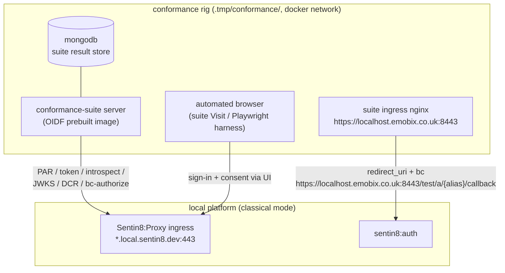

**Rig mechanics:**

1. **Suite stack** - the OIDF `docker-compose-prebuilt.yml` (mongo +
   server + nginx) runs under `.tmp/conformance/` with
   `BASE_URL=https://localhost.emobix.co.uk:8443`, pinned via
   `IMAGE_TAG`; `localhost.emobix.co.uk` resolves to 127.0.0.1 in
   `/etc/hosts`.
1b. **Suite ingress TLS (no cert warnings)** - the rig serves the suite
   ingress from a **platform-CA server leaf**: `--ensure-infra-tls`
   mints `conformance-suite-server.crt/.key` (CN `conformance-suite`,
   SAN `localhost.emobix.co.uk`), `make conformance-up` copies the pair
   into the compose build context, and the compose nginx service
   bind-mounts them over the image's self-signed paths (no image
   rebuild).
2. **Certification environments - profile-per-env .** Each test
   family runs against its OWN environment (and its own suite alias) so
   every env's security-profile row is permanent - the whole battery
   (`npm run test` / `make conformance-all`) runs the families in
   sequence with NO seed-order coupling, and two profiles could later
   run concurrently (the suite serializes per alias; distinct aliases
   de-conflict):

   | env (org `conformance-local`) | suite alias | profile |
   |---|---|---|
   | `cert` | `sentin8-local` | `standard` |
   | `cert-fapi2` | `sentin8-fapi2` | `fapi_2` |
   | `cert-f2m` | `sentin8-f2m` | `fapi_2_message_signing` |
   | `cert-fapi1` | `sentin8-fapi1` | `fapi_1_advanced` |
   | `cert-ciba` | `sentin8-ciba` | `fapi_ciba` |
   | `cert-vci` | `sentin8-vci` | `vci` |
   | `cert-haip` | `sentin8-haip` | `vci_haip` |

   The seed (`conformance-seed.sh`) parameterizes the env slug + alias
   (`CONFORMANCE_ENV_SLUG` / `CONFORMANCE_ALIAS`, deriving
   `auth.<slug>.conformance-local.<domain>` + the callback
   `/test/a/<alias>/callback`) and writes **per-env** seed-out files
   (`.tmp/conformance/seed-out/<slug>.txt` + `cert-user-<slug>.env`) -
   the flat `seed-out.txt` keys (`client_id(basic)`) would collide
   across envs. Platform-side NOTHING changes: the profile resolves
   per-request from `X-Sentin8-Env-Id` (TLS host-context resolve →
   `sys.environments` by slug), the issuer is host-derived, and Valkey
   keys carry the env in record VALUES (UUID identifiers) - no
   collision across parallel envs. Host DNS resolves the wildcard
   `*.local.sentin8.dev`; the suite container needs one `extra_hosts`
   line per env host (`conformance/docker-compose.yml`), pinned to the
   host-gateway IPv4. One user per env (own email - the shared-email
   rate buckets stay per-env users). One test user with a known
   password per env, seeded through the platform API only (no direct
   SQL). The legacy single-env form (env `cert`, alias `sentin8-local`,
   flat seed-out) remains the DEFAULT for the standard family.
3. **Suite-visible posture (classical mode)** - the rig environment
   sets `SENTIN8_TLS_PQ_MODE=classical` (TLS 1.2/1.3 + RSA/ECDSA certs,
   JWT signing RS256) because the suite's Java client cannot speak the
   platform's post-quantum-only TLS or verify ML-DSA-65 JOSE. The
   production posture (exclusive PQ) is unchanged; classical mode is the
   suite-compatible lens over the same protocol logic.
4. **Conformance clients** - registered through the DCR endpoint (for
   Dynamic OP runs) or admin API: `client_secret_basic`,
   `client_secret_post`, `private_key_jwt` (RFC 7523), `tls_client_auth`
   (RFC 8705), and a public PKCE client, each with the suite callback
   `https://localhost.emobix.co.uk:8443/test/a/{alias}/callback`.
5. **Browser automation** - the suite's browser-interaction tests are
   driven with a scripted test user (the harness in `sentin8-auth-oidf/`).
6. **Result capture** - runs export into `.tmp/conformance/results/`;
   the gate is zero FAILED / INTERRUPTED / SKIPPED / WARNING (§9a.11).

### 9a.3 Profile-by-profile implementation state

| Capability | Status | Spec anchor |
|---|---|---|
| Discovery (`/.well-known/openid-configuration`) | implemented | OIDC Discovery §3 + §9a.4 |
| Basic OP (code + PKCE S256, ID token with `nonce`/`auth_time`/`at_hash`/`c_hash`/`s_hash`) | implemented | OIDC Core §3.1 |
| OIDC scope-based claims (`email`/`profile`/`phone`/`address`) | implemented | OIDC Core §5.4 |
| Config OP (discovery completeness) | implemented | OIDC Discovery + Core |
| Dynamic OP (DCR + management + WebFinger) | implemented | RFC 7591/7592 + Discovery §2.1 |
| RP-Initiated Logout | implemented | OIDC RP-Initiated Logout |
| Back-Channel Logout | implemented | OIDC Back-Channel Logout |
| `prompt=none/login/consent` + `max_age` re-auth | implemented | OIDC Core §3.1.2.1 |
| FAPI 2 Security Profile (PAR + DPoP + JARM + `iss` + rotation) | implemented | FAPI 2.0 SP + RFC 9126/9449/9207 |
| FAPI 2 Message Signing | implemented | FAPI 2.0 MS + RFC 9421 + RFC 9701 |
| FAPI 1 Advanced (PAR + JAR + mTLS + JARM + `iss`) | implemented | FAPI 1.0 Advanced + JARM `s_hash` |
| FAPI-CIBA poll mode | implemented | CIBA §5.2 |
| FAPI-CIBA ping mode | implemented | CIBA §5.3 |
| OID4VCI issuer | implemented | OID4VCI §7-§13 |
| OID4VP verifier | implemented | OID4VP §11 + §5 |
| eKYC-IDA (claims / verified_claims) | implemented | eKYC-IDA §5.5 + §5 |
| JAR `request_uri` | implemented | RFC 9101 §5 |
| CIBA signed request objects | implemented | CIBA §7.1 |
| OID4VCI issuance nonce | implemented | OID4VCI Final §8.1 |
| Status lists | implemented | Status List (bits/lst, signed `status-list+jwt`) |

### 9a.4 Discovery honesty fields

The discovery document carries the required-when-supported /
recommended fields (advertised only when actually supported):

- **The OIDC + wallet scope families are advertised and served**:
  `scopes_supported` is the OIDC base (`openid profile email phone
  address offline_access`) PLUS the OID4VCI credential scopes (the
  issuer's native `credential:*` configurations) and the OIDF
  wallet-catalog scopes (`eudi.pid.1` family, `openid.example.cert.1`)
  the wallet plan drives - every scope advertised is mintable
  end-to-end (the §9a.10 no-skip rule). `claims_supported` lists the
  full claim set: `sub`, `iss`, `aud`, `exp`, `iat`, `auth_time`,
  `nonce`, `at_hash`, `c_hash`, `name`, `given_name`, `family_name`,
  `email`, `email_verified`, `phone_number`, `phone_number_verified`,
  `address`, `verified_claims`.
- `token_endpoint_auth_signing_alg_values_supported` (required when
  `private_key_jwt` is advertised - RFC 7591 §2)
- `claims_parameter_supported: true` + `claims_supported`
- `backchannel_logout_supported: true` +
  `backchannel_logout_session_supported`
- `revocation_endpoint_auth_methods_supported`,
  `introspection_endpoint_auth_methods_supported`
- CIBA: `backchannel_authentication_endpoint`,
  `backchannel_token_delivery_modes_supported: ["poll","ping"]`,
  `backchannel_authentication_request_signing_alg_values_supported`,
  plus `urn:openid:params:grant-type:ciba` in `grant_types_supported`
- OAuth 2.1 posture: `code_challenge_methods_supported` is `S256`
  only; PKCE stays mandatory for public clients (RFC 8252 §8.1).

### 9a.5 Certification runbook (per profile)

The rig collateral lives in **`sentin8-auth-oidf/conformance/`**; the
group Makefile exposes `make conformance-up / conformance-down /
conformance-purge / conformance-seed`. `make start-conformance` starts
the platform in the rig posture (classical TLS, FAPI cipher profile,
RFC 8705 self-signed client-cert surface) WITHOUT mutating `../.env`.

1. Start the platform in the rig posture (`make start-conformance`) and
   `make conformance-up`.
2. `make conformance-seed` - provisions the certification tenant (org
   `conformance-local`, env `cert`, test user, suite clients via DCR
   with the suite callback) through the platform API only.
3. Create the test plan in the suite: OIDC Basic → Config → Dynamic;
   Logout RP-Initiated + Back-Channel; FAPI 2: Security Profile →
   Message Signing; FAPI 1: Advanced; CIBA: Poll → Ping; OID4VCI
   issuer; OID4VP verifier; IDA - alias `sentin8-local`, the cert
   env's discovery URL.
4. Run each test; the suite's browser automation completes sign-in via
   the HTML login page (§9a.8) with the seeded test user.
5. All tests must be PASSED / WARNING / REVIEW (no FAILED, no
   INTERRUPTED, and **no SKIPPED** - §9a.10).
6. Export logs to `.tmp/conformance/results/`, then `make
   conformance-down`.

### 9a.10 No-skip rule (conformance coverage)

**A skipped conformance test is a failed conformance test.** The suite
SKIPPED a test exactly when the discovery document declined to advertise
a capability it tests. Advertising a capability away is hiding a
coverage hole behind discovery honesty - the platform's rule is the
inverse: **implement the capability, advertise it, let the suite test
it**. Concretely: every scope in `scopes_supported` must be mintable
end-to-end, every `claims_supported` entry must be producible by at
least one scope, and a new suite skip is triaged as a defect with the
same priority as a FAILED result. The rig seed (§9a.5 step 2) therefore
also provisions the data the advertised claims need (the cert user
carries a phone number and a postal address).

### 9a.6 Sequence - a suite browser interaction (authorize round-trip)

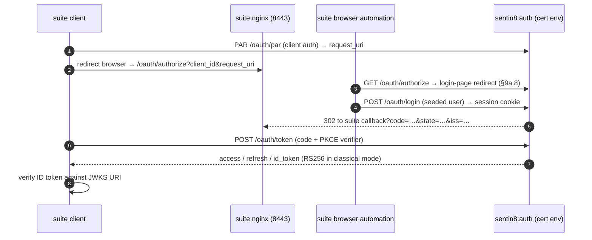

### 9a.7 Wire-level certification surfaces

**JAR `request_uri` (RFC 9101 §5.2.1).** When the authorize request
carries `request_uri` (and it is NOT a PAR urn), the AS fetches the
request-object JWT from the URI - `https` scheme only, response body
size-capped, 10s timeout - then runs the same verification path as the
inline `request` parameter: unverified decode, `validate_jar_claims`,
`exp` freshness (±10 min), signature against the client's registered
`jwks`/`jwks_uri`. The fetched JWT overlays inline params identically.

**Unsigned request objects (`alg: none`, RFC 9101 §5).** The value-form
(inline `request` parameter) request object MAY be unsigned: the
integrity story is the TLS transport plus the AS's own client
authentication binding. The shared client-JWT verifier short-circuits on
`alg: none`; discovery advertises `none` in
`request_object_signing_alg_values_supported` (§9a.4 honesty:
advertised = served). Fetched-by-URI request objects keep the
https-only + signed rules.

**CIBA signed request objects (CIBA §7.1).** `bc-authorize` accepts a
`request` JWT (or `request_uri` fetch, same mechanics as above) signed
by the client's registered keys, carrying the CIBA parameters (`scope`,
`client_notification_token`, `request_mode`, `login_hint`,
`binding_message`, `requested_expiry`, `exp`). Signed wins over form
parameters; verification is the same verifier as JAR's.

**OID4VCI issuer (SD-JWT VC profile, OID4VCI §7-§13).** Standard
endpoint shapes over the existing SD-JWT/KB-JWT/Status-List core, all
issuer-hosted on auth:

- `/.well-known/openid-credential-issuer` - metadata:
  `credential_issuer`, `credential_configurations_supported` (one entry
  per credential type auth mints, each with `format`/`scope`/
  `cryptographic_binding_methods_supported`/
  `credential_signing_alg_values_supported`/`vct` and
  `proof_types_supported.jwt` incl. `key_attestations_required` - the
  field rides INSIDE the jwt proof-type entry per the Final App. D
  schema), `nonce_endpoint` (§8.1), `batch_credential_issuance` (§7.3).
- `POST /oauth/nonce` + `GET` - issuance c_nonce, TTL 300s in Valkey;
  the FIRST proof of a request GETDELs it (invalid/replayed nonce →
  `400 invalid_nonce` error envelope); batch members carry the same
  nonce without re-consumption.
- `POST /oauth/credential` - issuance request (§7.2). Two configuration
  forms: `credential_configuration_id` (a metadata key) or the §7.2.1
  `credential_identifier` (references a credentials row previously
  issued to the caller - unknown ids reject
  `400 unknown_credential_identifier`; unknown configuration ids reject
  `400 unknown_credential_configuration`). Configuration resolution
  happens BEFORE the scope check; the access token must then carry the
  configuration's advertised `scope`. Proofs map `{"jwt":[...]}` with
  the draft-11 single `proof` accepted (one-of); N proofs mint N
  credentials (§7.3) sharing ONE status list with random distinct
  indices (herd privacy). Sender-constrained tokens ride `Bearer`/`DPoP`
  schemes: a DPoP-bound token requires its own RFC 9449 proof
  (`htu`/`ath`/`cnf.jkt`) verified ONCE per request. Resource-side
  callers presenting a PLATFORM WORKLOAD CERTIFICATE (the `-tls`
  m2m plane - Shield's RoleResolver verifying a forwarded bound token
  against userinfo) satisfy the sender constraint per RFC 8705 §3: the
  TLS client certificate IS a sender constraint, so a
  cert-presenting verification request is admitted for BOTH
  `cnf.x5t#S256`-bound and `cnf.jkt`-bound tokens without the caller
  holding the mint key (DPoPRS-1).
- **Proof verification (wallet key binding).** The `openid4vci-proof+jwt`
  carries its key in the JWS header `jwk` (or the draft-11 payload
  `cnf.jwk`); `aud` = issuer, `iat` fresh (±5 min). When the
  configuration requires key attestation (App. D), the proof header's
  `key_attestation` JWT (`typ key-attestation+jwt`) must itself
  verify: its signing key is read from EXACTLY ONE trusted source - the
  attestation's inlined `jwk` header member, or the x5c leaf
  certificate's SubjectPublicKeyInfo (a minimal RFC 5280 §4.1 DER walk
  extracts the SPKI; no x509 crate dependency). A tampered attestation
  (the suite's FailOnInvalidKeyAttestationSignature family) rejects with
  `400 invalid_proof`; an attestation with neither key form also
  rejects.
- Response: DC+SD-JWT object entries (`{"credentials": [{"format":
  "dc+sd-jwt", "credential": ...}]}`) - the minted JWS carries typ
  `dc+sd-jwt`, the trailing SD-JWT separator, hour-rounded `iat`/`exp`
  (RFC 9901 linkability), `cnf.jwk` = the proof key, and a `status`
  claim pointing at the shared status list (signed `status-list+jwt`
  served per group). Immediate or `transaction_id` + HTTP 202 for
  deferred issuance. Issuer metadata is also published as signed
  metadata (`openidvci-issuer-metadata+jwt`, Accept-negotiated) and
  mirrored on the RFC 8414 alias.
- `POST /oauth/deferred_credential` - poll a `transaction_id` →
  credential once minted (§10).
- `POST /oauth/notifications` - wallet events recorded against the
  credential record (§12.2).
- Credential errors render the Final §7.4 JSON shape
  (`invalid_proof` / `invalid_nonce` /
  `unknown_credential_configuration` /
  `unknown_credential_identifier` /
  `invalid_credential_request`) on every failure path.

**OID4VP verifier (OID4VP §11).** `/.well-known/openid-credential-verifier`
publishes the verifier metadata (redirect_uris, presentation definitions
supported, client_id schemes). The existing wallet sign-in endpoint
accepts a standard `presentation_definition` (or by reference:
`presentation_definition_uri`) alongside the SD-JWT VP handling; the
request object binding (`client_id`, `client_id_uri_scheme`) follows
OID4VP §5.

**eKYC-IDA `verified_claims` (eKYC-IDA §5).** The `claims` request
parameter (`id_token`/`userinfo` sub-objects, `essential` flags) is
accepted at authorize and applied at the ID-token/userinfo mint as a
claim SELECTION (never widening - a claim the consented scope did not
grant stays absent). When the request selects `verified_claims` (or the
user holds an active wallet credential of the matching type), the
ID token/userinfo carries `verified_claims` built from the credentials
store: `verification` (trust framework, evidence, time) + `claims`
(the verified subset). `claims_supported` lists `verified_claims`;
discovery advertises `claims_parameter_supported: true`.

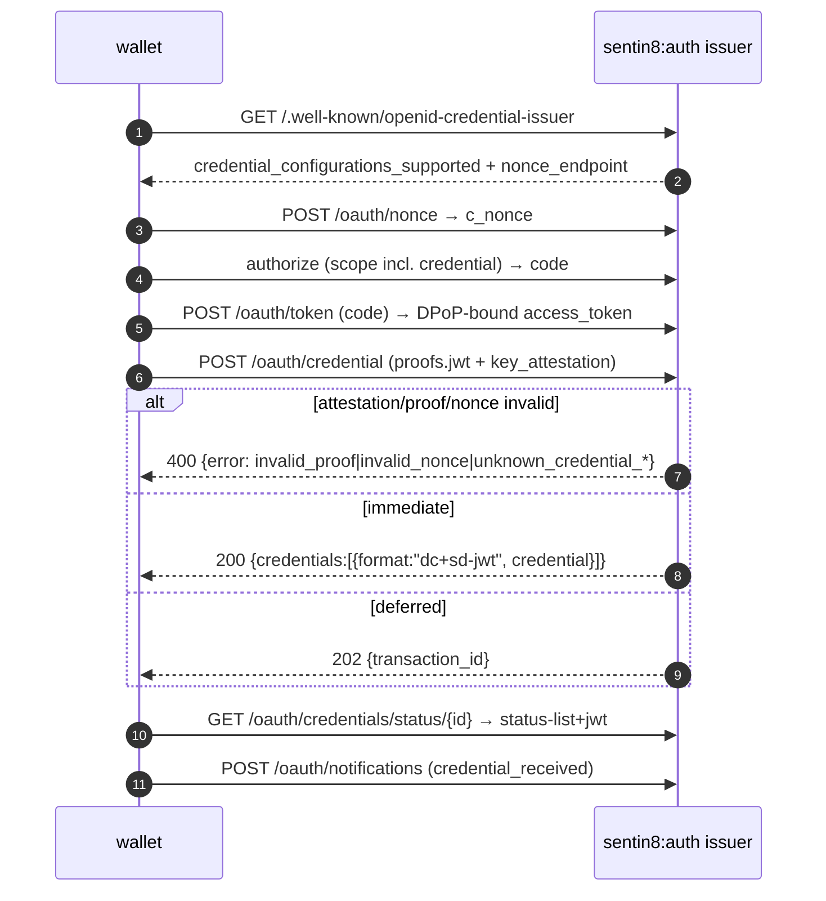

### 9a.8 Server-rendered HTML login page (automated-client surface)

The hosted UI at `/sign-in` is the full Flutter auth-ui (canvas SPA) -
the product surface for humans. Canvas apps expose no DOM input
elements, so DOM-driven automation (the OIDF conformance suite's browser
runner, Selenium-class RPs, CI clients) cannot complete the interactive
login. Auth therefore serves a **server-rendered HTML login page**
(`/oauth/login`, GET+POST) as a first-class surface for automated
clients - the human flow stays on the Flutter UI.

### 9a.9 Per-tenant JWT signing algorithm (security-profile plane)

The signing algorithm is a profile decision, not a deployment constant:
`signing_alg` on the resolved security profile selects ML-DSA-65 (PQ
`exclusive`) or RS256 (`classical`); the JWKS endpoint publishes the
env-FAMILY filtered key set (ML-DSA tenants see ML-DSA keys, classical
tenants see RSA). Discovery advertises the ACTIVE family's
`id_token_signing_alg_values_supported` (§9a.4 honesty). ES256 remains
verification-only (wallet proofs, third-party assertions).

### 9a.11 Warning-zero posture (suite WARNING classes → root fixes)

**The rig's gate is zero WARNING entries**, not sanctioned warnings. The
12-WARNING class taught the mechanism: live-DB RLS drift
(`auth_oauth_clients_delete_policy` missing after an early manual table
rebuild) made RFC 7592 DELETEs 404 on every Dynamic-OP module; the fix
was reconciling the init.sql policy to the provisioned DB - not
tolerating warnings. Every future WARNING is triaged the same way: find
the root defect the suite observed, fix it, re-run.

### 9a.12 mTLS client authentication + sender constraint (FAPI2-SP mtls cell)

`tls_client_auth` (RFC 8705 §2) binds the client to its certificate's
subject DN; `self_signed_tls_client_auth` (RFC 8705 §2.3) binds it to
the certificate thumbprint. Sender-constrained tokens carry
`cnf.x5t#S256`; the mtls token/revoke aliases verify the presented
certificate matches the client record (a re-issued cert = 401).

### 9a.14 FAPI 1 Advanced final (plain_fapi / private_key_jwt / pushed / JARM)

The full `fapi1-advanced-final-test-plan` is GREEN: (a) the fapi TLS
cipher profile (`SENTIN8_TLS_CIPHER_PROFILE=fapi`); (b) PAR JAR-only
push - response_type/client_id/redirect_uri/response_mode resolve from
the request object (`invalid_request_object` for scope-less objects +
nested request_uri per JAR §6.2 + audience-ARRAY/endpoint-audience
client assertions per RFC 7523/9126); (c) presented-cert cnf binding at
the token mint (RFC 8705 §3); (d) JARM signed with the PROFILE alg +
host-resolved iss + JARM-wrapped deny (`access_denied`); (e) no-store on
the mtls-aliased token/introspect/revoke.

**The `response_mode=query` mandate (fapi postures).** Under
`fapi_1_advanced` / `fapi_2` / `fapi_2_message_signing` the
authorization response is encoded in the FRAGMENT or via
`response_mode=jwt` (JARM) ONLY - an explicit `response_mode=query`
presented inline on /oauth/authorize (or resolved authoritative from a
JAR/PAR-stored object) rejects with the profile's wrapped-error channel
BEFORE any code/session work: `error=invalid_request`, JARM-wrapped
when the posture mandates JARM, plain url-query `error=` otherwise
(the suite's RejectAuthCodeInUrlQuery +
CheckAuthorizationResponseWhenResponseModeQuery cells). The standard
family (and every non-FAPI posture) keeps `query` as its default mode -
this is strictly the FAPI response-surface rule.

**The request-object mandate set is PROFILE-DERIVED (the one
mechanism).** Every signed-push claim rule resolves from
`FapiSecurityFlags` (src/fapi.rs `required_flags()`) - the per-posture
mandate table - NOT from per-module call-site branches:

| Posture | exp | nbf | nonce | alg=none | Sources |
|---|---|---|---|---|---|
| `standard` | optional | optional | scope-gated | allowed | RFC 9101 plain form |
| `fapi_1_advanced` | REQUIRED | REQUIRED | REQUIRED (openid scope) | forbidden | Part2 §5.2.2-1/13/17 + Baseline §5.2.2.2 |
| `fapi_2` | REQUIRED | REQUIRED | scope-gated | forbidden | PARS+DPoP posture |
| `fapi_2_message_signing` | REQUIRED | REQUIRED | scope-gated | forbidden | freshness binding |
| `fapi_ciba` | (CIBA §7.1 validator owns the object rules - separate path) | | | forbidden there | §9a.15 |
| `vci`/`vci_haip` | optional | optional | scope-gated | allowed | wallet-initiated unsigned objects |

`verify_jar_request` consumes `&FapiSecurityFlags` (no ad-hoc
booleans); `nonce` is mandatory exactly when the mandate says so AND
the effective scope carries `openid` (OIDC Core §3.1.2.1). The
discovery/request-claim rules the suite's
without-exp/without-nbf/without-nonce/with-exp-over-60/with-nbf-over-60
negatives all read THIS table - a new claim mandate is a one-line flag
change in `required_flags()`, never a new call-site branch. The two
ad-hoc `require_exp`/`fapi2_posture` booleans are retired.

**FAPI refresh-token issuance (OC-27b).** Under every FAPI posture the
authorization-code grant issues a REFRESH TOKEN unconditionally (FAPI
1.0 Advanced/FAPI 2.0 clients are sender-constrained confidential
clients - the OIDF refresh-token modules expect one without a
scope-preamble `offline_access` request; the suite's own WARNING text
names this: "not to FAPI clients"). The `offline_access`-gate stays
for the standard family (the RFC 6749 grant policy).

### 9a.15 FAPI CIBA ID1 (poll + ping, static_client / private_key_jwt)

The full `fapi-ciba-id1-test-plan` is GREEN: (a) bc-authorize contract -
RFC 6749 JSON error shape, signed request object MANDATORY with full
claim validation (iss==client_id, aud ∈ {issuer, token_endpoint,
bc-authorize}, exp/iat/nbf windows, jti non-empty; alg none/HS/RS256
rejected), exactly-one hint, client_assertion_type exactness; (b) grant
semantics - client-match gate BEFORE status gates, consumed status on
reuse (`invalid_grant`), expired_token for TTL-outs, 256-bit auth_req_id
entropy; (c) ping delivery - `client_notification_token` presence
signals ping, ping POST does NOT follow redirects (CIBA §10.2),
backchannel endpoint lookups run under the SYSTEM env RLS context; (d)
holder-of-key - the presented client certificate's thumbprint binds to
the grant at bc-authorize and the poll must present the SAME cert
(`invalid_grant` otherwise); (e) approval via `POST /v1/ciba/approve`
(ping-aware, session-bound).

### 9a.16 FAPI 2.0 Message Signing (final plan, dpop + mtls cells)

The full `fapi2-message-signing` plan is GREEN (2026-10-25, run14:
111 module-instances across both cells = 97 PASSED / 10 REVIEW
by-design screenshot confirms / 3 SKIP-SANCTIONED RS256-negatives
(ES256-clients) / 1 FAIL-SANCTIONED multi-DPoP JVM collapse;
zero warnings): (a) the plan's "request
signing" (`fapi_request_method=signed_non_repudiation`) is the SIGNED
REQUEST OBJECT (JAR), NOT RFC 9421 HTTP signatures -
`fapi_2_message_signing` posture keeps `require_http_signatures: false`;
(b) strict-aud profile-scoped - FAPI 2.0 postures require
client-assertion `aud` == issuer EXACTLY (string; single-member issuer
array tolerated; endpoint-forms + 2-member array rejected) while FAPI 1
Advanced keeps the permissive RFC 7523/9126 endpoint/ARRAY set; (c) PAR
`dpop_jkt` pre-binding (RFC 9449 §10.1) - `JarClaims.dpop_jkt` captured
from the request object before the DPoP gate (JAR value wins over the
form), persisted in the PAR record, enforced at token (thumbprint
mismatch → `invalid_dpop_proof`); (d) PS256 (RSASSA-PSS, RFC 7518 §3.5)
verified through the `rsa` crate's PSS primitive in BOTH the raw-JWS and
the JWT arms (one PSS implementation; salt = SHA-256 digest size per
RFC 7518 §3.5; wire-proven: a salt=32 PS256 client assertion with
registered jwks pushes PAR 201, and a 222-byte max-salt assertion - the
non-RFC form - is rejected, as are unregistered-key assertions per
RFC 7523 key registration) - closing the "advertised-but-unverifiable"
honesty gap; (e) the multi-DPoP
negative is suite JVM-collapse-skip (two proofs become one wire header;
the wire 2-line case is proven at the proxy level); (f) the request
object's freshness claims are MANDATORY under the message-signing
posture - a signed (`alg` != none) object without `exp` or `nbf`
rejects `invalid_request_object` (iat rides as produced by every
signer; the suite's production objects ship exp + nbf) (the non-repudiation freshness
binding: a signature whose validity window an attacker cannot shorten
is meaningless under FAPI2-MS; the plain RFC 9101 form keeps exp
RECOMMENDED - the alg-none unsigned object keeps its TLS-integrity
story and the claims stay optional); the freshness windows mirror the
exp slack - a `nbf`/`iat` more than 60s in the future, or a stale
`nbf` more than 10 minutes in the past, rejects; (g) the PAR push
under the MS posture MUST carry a signed request object - an
unsigned/no-object push rejects `400 invalid_request` (.3's
error code; the by-value/authorize form uses `invalid_request_object`);
(h) the error-redirect CHANNEL follows the module family's owning
suite check class, not the object's `response_mode` claim: the
missing-PAR reject = the JARM-wrapped `response=<JWT>`
(ExtractJARMFromURLQuery's flow) while the response-type reject = the
plain url-query `error=` (DetectWhetherErrorResponseIsInQueryOrFragment
reads `error` from the callback query directly; a JARM there logs
'unexpected parameters'); (i) the client-assertion ALG MANDATE
(FAPI 2.0 BSA/BE): client assertions and JAR request objects accept
ES256/PS256 ONLY - an RS256-signed assertion rejects `401
invalid_client` under the FAPI2 postures ('fapi_2' and
'fapi_2_message_signing'), and discovery advertises the env-resolved
`token_endpoint_auth_signing_alg_values_supported` as `[PS256, ES256]`
there (RS256 drops with it; FAPI 1 Advanced keeps the full
`[active, RS256, PS256, ES256]` set where RS256 remains valid). The
suite's RS256-negatives ("requires RSA keys... If your server does
not support PS256 then this will not prevent you certifying") run
against a multi-key client (the seed provisions an ES256 and an
RSA/PS256 key in the same jwks doc - the suite signs the negative
with the RSA key while the positives keep ES256) and resolve with the
AS's reject.

### 9a.17 OIDC Core Config + Dynamic OP certification

Both plans are GREEN with zero warnings: (a) discovery completeness -
registration_endpoint, userinfo_signing_alg_values_supported, subject
types, grant types (+implicit non-FAPI), id_token_signing algs (+none
non-FAPI), mtls_endpoint_aliases omission; (b) RFC 7591 client metadata
persistence - id_token/userinfo_signed_response_alg + subject_type +
sector_identifier_uri stored at DCR, RFC 7592 update COALESCE merge,
honored at code exchange; (c) DCR RFC 6749/7591 JSON error shapes
(`invalid_redirect_uri` for fragments; `invalid_client_metadata` for bad
sector URIs); (d) ext-jwks rotation retry - failed client-assertion
verification over a jwks_uri client invalidates the Valkey cache and
refetches ONCE (client-key rotation no longer trips the negative TTL
cache); (e) warning-zero: the 12-WARNING class was an OP defect
(live-DB RLS drift on `auth_oauth_clients_delete_policy`), fixed by
reconciling the init.sql policy.

### 9a.18 OID4VCI Issuer certification

The full `oid4vci-1_0-issuer-test-plan` (14 modules: metadata+signed,
four happy-flow cells, batch-issuance, five fail-negatives including
key-attestation and both unknown-config/identifier forms) is GREEN (14
PASSED / zero warnings): the §9a.7 OID4VCI surfaces ARE the implemented
state - nonce endpoint + first-proof GETDEL consumption, batch N→N with
one shared status list (random distinct indices), key-attestation
verification against exactly one trusted key (inline jwk OR x5c-leaf
SPKI), configuration resolution BEFORE scope check, §7.2.1 identifier
form with RLS-scoped existence validation, and Final §7.4 error JSON on
every failure path. Rig wiring: the plan config carries BOTH nested
`vci.key_attestation_jwks` (the suite's dot-path lookup) and top-level
`vci_key_attestation_jwks` (the PRIVATE signer jwks); the attester
keypair carries an x5c chain (the suite requires x5c on the attestation
signing key). **The status-list token header carries BOTH `jwk` AND
`x5c`** (the hybrid embedded-key + chain form): the suite's
`VerifyStatusListTokenSignatureUsingEmbeddedJwk` verifies from the
EMBEDDED `jwk` only (it reads neither `x5c` nor JWKS-by-`kid`), while
the HAIP plan's `ValidateStatusListTokenX5cCertificateChain` requires
the `x5c` chain - one header carries both members so both verifiers
pass on the same token. Note: the suite's "Try Client1's DPoP key with Client2's
access token" step is a NEGATIVE probe - the RFC 9449-correct 401
(cnf.jkt mismatch) is the expected verdict.

### 9a.19 OID4VCI HAIP certification - attestation-based client authentication

**Spec: OAuth 2.0 Attestation-Based Client Authentication (draft-ietf-
oauth-attestation-based-client-auth, the suite's `OAuth2-ATCA07`
requirements).** The `oid4vci-1_0-issuer-haip` plan runs the issuer
surface with `client_auth_type=client_attestation`: the client
authenticates with an ATTESTATION CHAIN, not a shared secret. This
extends the token-endpoint authenticator (not the credential surface -
the §9a.7 proof/keyAttestation paths are unchanged).

**Wire contract (headers, not form parameters):**

- `OAuth-Client-Attestation: <attestation JWT>` - `typ
  oauth-client-attestation+jwt`; the JWS header carries an `x5c` chain
  (the attester's certificate chain); claims: `iss` = the attester's
  identifier (the trust-policy issuer), `sub` = the client_id being
  authenticated, `iat`/`nbf`/`exp` freshness, `cnf.jwk` = the client's
  PROOF key (the key the client signs with).
- `OAuth-Client-Attestation-PoP: <pop JWT>` - `typ
  oauth-client-attestation-pop+jwt`; claims: `iss` = the client's
  instance key identifier, `aud` = the issuer
  (`resolve_issuer`, host-resolved), `iat`/`nbf`/`exp`, `jti`
  (single-use), and `challenge` when the server advertises an
  `attestation_challenge_endpoint` (auth does NOT advertise one - the
  challenge check self-skips).

**Trust model.** The attestation's x5c chain must chain to the env's
configured trust anchor: `security_profiles.kv` carries
`client_attestation_trust_anchor_pem` (PEM of the attester CA/leaf) and
`client_attestation_issuer` (the expected `iss`). Both are resolved
through the SAME per-tenant profile plane as every other posture knob
(§9a.9), gated behind `profile='vci_haip'` + an explicit
`allow_client_attestation` flag. The attestation's signature verifies
against the x5c LEAF key (the draft's self-contained verify path); the
POP's signature verifies against the ATTESTED key (`cnf.jwk`) - so the
PoP proves possession of exactly the key the attestation binds.

**Discovery honesty (draft §5 metadata):** when the resolved profile
enables attestation auth, discovery gains `attest_jwt_client_auth` in
`token_endpoint_auth_methods_supported` (plus the revocation/
introspection method lists that share the authenticator), and
`client_attestation_signing_alg_values_supported: ["ES256"]` +
`client_attestation_pop_signing_alg_values_supported: ["ES256"]`.

**Profile plumbing:** `security_profiles` gains `profile='vci_haip'`
(the same flag-shape family as `vci`) with `allow_client_attestation`,
`client_attestation_trust_anchor_pem` (kv text), and
`client_attestation_issuer` (kv text). The authenticator accepts
attestation headers when the RESOLVED ENV PROFILE enables them
(regardless of the client's registered method string, which carries
`attest_jwt_client_auth` for the suite's registration checks); the FAPI
method allow-list (`fapi.rs`) admits `attest_jwt_client_auth` under the
vci profiles. PoP `jti` replay rides the established single-use cache
(`auth:capop:{jti}`, SETNX with the exp-bounded TTL) - the draft's
§6.2 replay rule, keyed globally-but-exp-bounded per the draft (the pop
iss value is client-instance-scoped by construction).

**Error shapes:** a failed attestation/PoP answers `401 invalid_client`
(uniform, §8) - the suite's negative cells
(FailOnInvalidClientAttestationPopSignature,
FailOnMismatchedClientAttestationPopKey, FailOnInvalidClientAttestation
Signature, FailOnClientAttestationNoSub, FailOnClientAttestationExpInPast)
read it as the OAuth error shape.

**Plan census (suite 5.3.3, VCIIssuerTestPlanHaip):** 63 module-variants
= 21 classes × variant slices - 57 plain
(`vci_credential_encryption=plain`) + 3 encrypted
(`=encrypted`) + 3 variant-less runner entries. The rig's runner create
carries each module's resolved values
(`GET /api/plan/<id>.modules[].variant` → `POST /api/runner?variant=<json>`
with an EMPTY body - a JSON body answers 400).

**Encrypted-slice capability (OID4VCI §12.2.4 credential
encryption - implemented).** The issuer metadata publishes
`credential_response_encryption` (`alg_values_supported:
["ECDH-ES"]`, `enc_values_supported: ["A256GCM"]`,
`encryption_required: false`) and `credential_request_encryption`
(`jwks` + `enc_values_supported` + `encryption_required` - no
`alg_values_supported` in the request block, the errata schema
shape). The credential request accepts an encrypted body (compact
JWE, ECDH-ES + A256GCM, 5-part OR the 4-part variant with the GCM
tag merged into the ciphertext segment) and a JSON body carrying
`credential_response_encryption {enc, jwk}` where the key-agreement
alg rides the JWK (`jwk.alg`) rather than the top level. The
response returns the credentials object as a compact JWE
(`Content-Type: application/jwt`) under the wallet's key. Key
derivation is RFC 7518 §4.6.1 ConcatKDF - the single-step hash
form (`SHA-256(counter ‖ Z ‖ OtherInfo)`), NOT HKDF - with the
`enc` value as AlgorithmID for direct key agreement. Unsupported
alg/enc answers `400 invalid_encryption_parameters` (the suite's
FailOnUnsupportedEncryptionAlgorithm +
VCIValidateCredentialErrorResponse), validated BEFORE any mint.

**HAIP x5c chain (certified).** The issuer's ES256 keystore key
carries a self-issued X.509 certificate (minted at keystore load,
published as the JWK `x5c` member); the credential SD-JWT and the
status-list token embed it (no `jwk` member in HAIP certificate
mode - `sign_value_typed_x5c`). When the environment profile seeds
`issuance_leaf_pem` + `issuance_chain_pem` (the deployment
issuance-CA's leaf signed on the issuer's own ES256 key), those
ride the x5c chain instead and the relying-party trust anchor is
the CA - the OIDF rig mints that CA itself and pins it as
`credential.trust_anchor_pem` / `status_list_trust_anchor_pem`.
Every encrypted-slice module of the HAIP family PASSES (the
family is zero-warning green); the non-`oid4vci` modules the HAIP
plan template ships (FAPI2 remnants) are out of scope for this
cell - the fapi2-security spec owns them.

## 13. Open Questions

- Continuous access evaluation: session/token revocations already push
  `sentin8:auth:session:revoked` to the BFF session-reaper so cached
  sessions die immediately; risk-signal gating of NEW token issuance is
  the next layer on top of live authorization.
- Hardware-backed key attestation: the WebAuthn `attestation` conveyance
  preference is the seam; the OID4VCI App. D attestation verify accepts
  software-key attestations today (x5c self-consistency); trust
  anchoring beyond that is an issuer policy.
- Handshake-level certificate revocation and Valkey ACLs
   are platform-level follow-ups owned outside this service.
- Multi-region active-active issuer deployment is a non-goal until
  multi-region exists; the JWKS overlap-rotation design is region-safe.
- SCIM `/Bulk` is live (RFC 7644 §3.7): a thin wrapper over the per-user
  SQL paths (≤100 ops; `failOnErrors` stops the batch). The precondition
  consumer exists - BFF's delegated SCIM proxy is the enterprise IdP
  path.

---

**Architecture & Design:** sentin8:auth and its underlying concepts were designed by [Hamid Jahanzad](https://www.linkedin.com/in/hamidjahanzad/).
### 9a.20 OID4VCI wallet-plan issuer surface - credential-offer landing

The OIDF wallet plan (`oid4vci-1_0-wallet-test-plan`) exercises the WALLET
role against our issuer: the suite builds the OID4VCI credential offer
from its own default catalog and opens `vci.credential_offer_endpoint`
(BY_VALUE: the offer JSON rides the `credential_offer` query param) in
the browser. The issuer-side surface:

- `GET /oauth/credential-offer?credential_offer=<urlencoded offer>&<fixed
  client params>` - the offering landing handler. It parses the offer
  (credential_issuer, credential_configuration_ids, grants.authorization
  _code.issuer_state), resolves the bound client + redirect_uri + scope
  from the pass-through query parameters the harness embeds in
  `vci.credential_offer_endpoint` (UriComponentsBuilder preserves them),
  and 302-redirects into the standard authorize flow with
  `state=<issuer_state>` + `issuer_state=<issuer_state>` (the suite's
  `VCIVerifyIssuerStateInAuthorizationRequest` requires the request to
  echo its generated state).
- The rest of the flow is the proven stack: the harness browser completes
  the sign-in bridge, the suite callback receives `code` + matching state,
  the wallet authenticates (`private_key_jwt`), and the credential
  request family runs over the §9a.19 surfaces (catalog configs, dpop,
  attested proofs, encryption).

The issuer advertises the OIDF wallet catalog (eu.europa.ec.eudi.pid.1,
nobinding, attestation/jwt.keyattest variants) in
`credential_configurations_supported` - `scope` per configuration; the
minted `vct` is the configuration's designator (`urn:eudi:pid:1`).

The harness supplies the wallet config surface: `server.jwks` (the
issuer's live JWKS for LoadServerJWKs), `credential.signing_jwk` (the
rig-minted issuance leaf on the issuer's ES256 key - HAIP 6.1.1
no-self-signed), the published wallet `client.jwks` (public-only - the
plan's EnsureJwksHasNoPrivateOrSymmetricKeyMaterial), and the
`client_attestation` block (`issuer` + `trust_anchor` +
`attester_jwks` private keys mirroring the registration).

### 9a.21 DPoP sender-constraint journey - PAR lifecycle & the jkt chain

The HAIP plan's fapi2-security-profile modules exercise the full RFC 9449
§10.1 sender-constraint journey: the key that signed the PAR request's
DPoP proof must be the key that signs the token endpoint's proof. The
journey spans THREE server surfaces (PAR push, browser authorize/consent
journey, token exchange) - the binding must survive the browser hops
where neither the client nor the SPA re-derives it.

**Authorization-journey lifecycle (PAR is multi-read, one-shot on
OUTCOME):**

- `POST /oauth/par` stores the verified param record at
  `auth:par:{key}` (600s TTL, RFC 9126 §4 AS-decided expiry) with the
  request's SENDER-CONSTRAINT resolved in priority order: the pre-bound
  `dpop_jkt` (form field or the JAR object's member) MUST equal the
  live proof's thumbprint when both exist (mismatch = 400
  invalid_dpop_proof); when no value is pre-bound, the PAR's own
  verified DPoP proof thumbprint becomes the binding.
- `resolve_par_request` is a MULTI-READ: the SPA's login visit AND the
  consent re-entry both hit `/oauth/authorize?request_uri=...`, and
  each resolution overlays the record's params (incl. `dpop_jkt` and
  the `par_key` copy) onto the request. RFC 9126 single-USE is honored
  on the AUTHORIZATION OUTCOME, not on the first read: after ANY code
  is issued for the interaction, `mark_par_used` sets
  `auth:par-used:{key}` (600s) and further resolutions return none -
  the reuse-after-completion negatives (FAPI2 rejected-request-uri
  class) fail with the standard invalid_request error path, while the
  two-visit flow keeps working.
- The authorize handler copies the resolved `dpop_jkt` onto the
  interaction params and ALSO stashes it under
  `auth:authz-jkt:{state}` (600s) - the interaction memo.

**The binding's ride through the browser journey (the invariant the
memo exists for):** the code record is written by the CONTINUE
endpoints (`/oauth/authorize/continue`, consent continue), which
receive their `dpop_jkt` in priority order (1) the SPA's relayed
parameter (may be absent or EMPTY - the SPA echoes only what its UI
URL carried and the consent hop may strip it), (2) the authorize
params carried on the continue request, (3) the interaction memo
`auth:authz-jkt:{state}`. Empty strings NEVER bind - every carry-in
is trimmed, empty-filtered (`code_record_jkt`), THEN the memo
fallback applies. The code record's `dpop_jkt` member is absent (no
`null` member) when no binding resolved - the exchange treats absent
as unbound, never as a bound-but-empty value.

**Token exchange (RFC 9449 §10.1):** when the code record carries a
`dpop_jkt`, the live proof's thumbprint MUST equal it - mismatch
answers `400 invalid_dpop_proof` (.1). A proof from an
UNBOUND key on an unbound record mints a token bound to the live
proof's key (`token_type: DPoP` either way). The pre-bound value wins
over the live proof for the minted `cnf.jkt` (the request's key
holder is the party the authorization bound).

**PAR replay posture (the pairing with the code gate):** the code
record carries the interaction's `par_key`; the authorize/continue
code-writers call `mark_par_used` right after the Valkey
`auth:authcode:{code}` write succeeds. Combined with the burned-code
gate at exchange (code single-use), the platform guarantees: one
authorization interaction → at most one code → at most one token
grant, with the browser journey free to re-resolve the PAR any number
of times BEFORE the outcome.

### 9a.22 Authorization-endpoint rejects - the OAuth error-redirect posture & the require-dpop gate (FAPI2-SP negatives)

The FAPI2-SP module family under the HAIP plan contains five
authorization-endpoint negative/expectation modules whose compliant
outcome is an ERROR REDIRECT (or the object-precedence echo), not an
inline JSON body:

- **The reject shape.** Every authorization-endpoint reject reached
  AFTER the client + redirect_uri are validated, 302s to the client's
  redirect_uri as the OAuth error response (RFC 6749 §4.1.2.1): `error`,
  `error_description`, and the interaction's `state` (when one was
  resolved). The DEFERRED-gate pattern: the PAR-mandatory violation
  (`require_par` without a request_uri) and the response_type
  restriction resolve at the same post-validation site. An inline 4xx
  body is neither an error redirect nor an error page - the
  suite's error-expecting modules read the CALLBACK (`EnsureInvalidRequestError`).
  When the redirect_uri is not (yet) validated - a missing/unknown
  client - the inline 400 stays (no open redirect).
- **The PAR-urn-resolution reject (`invalid_request_uri`).** A
  `request_uri` that does not resolve (unknown urn or expired/retired
  PAR record) rejects as a 302 error REDIRECT to the (validated)
  redirect_uri with `error=invalid_request_uri` once the query's
  client + redirect_uri are verified - the target client PUSHED the
  request_uri itself, so its registered redirect_uri is the RFC 9126
  §4.1.3 error destination; the suite's request_uri-negative family
  (attempt-to-use-expired-request_uri, attempt-reuse-request_uri,
  request-uri-is-bound-to-client) reads `error` from the CALLBACK
  (EnsureInvalidRequestUriError - exact `invalid_request_uri`; the
  3-way permitted sets {invalid_request, invalid_request_uri,
  access_denied}) and renders the ExpectInvalidRequestUriErrorPage
  placeholder from the landed callback. An inline 400 there leaves the
  browser on the AS origin with a JSON body - neither an error message
  to the client nor an error page (the hollow-REVIEW class this closes).
  When the query's client_id/redirect_uri are THEMSELVES invalid, the
  inline 400 stays (no redirect to an unvalidated target). The
  different-client violation (the urn resolves for another client)
  rejects the same channel with `error=invalid_request_uri` (permitted
  by the bound-to-client module's 3-way set; the resolution result and
  the client-binding check share one site so the redirect decision
  happens exactly once, after redirect_uri validation).
- **The PKCE reject family rides the same channels.** A missing
  `code_challenge` (the profile mandates PKCE) or a non-S256
  `code_challenge_method` (the `plain` method is out of posture) defers
  to the same post-validation site: `error=invalid_request` redirect,
  JARM-wrapped (`response=<JWT>`) when the profile requires JARM and the
  request carried `response_mode=jwt` (the PKCE-negative family reads the
  callback with EnsurePARInvalidRequestError - the plain form there
  logs the 'unexpected parameters' warning, the wrapped form decodes).
  Wire-proven: par-ensure-pkce-required + par-plain-pkce-rejected PASS in
  both cells.
- **Campaign terminal state (2026-10-26).** Both f2 plans run
  terminal-ZERO-WARNING-ZERO-REVIEW green against the same deployed
  binary: fapi2-message-signing run16 = 117 module-instances (116 PASSED
  + 1 FAIL-SANCTIONED multi-DPoP JVM collapse) and fapi2-security run7 =
  89 module-instances (88 PASSED + the same sanctioned FAIL) - the
  request_uri-negative family (reuse/expired/bound-to-client), the PKCE
  negatives, and every error-page placeholder class resolve PASSED with
  zero warnings; the seed publishes RSA-PS256 keys (single-key JWKS per
  client) so the suite's RS256-negatives RUN (the alg-mandate rejects
  RS256-signed material) instead of skipping.
- **The missing-redirect_uri adoption (RFC 6749 §4.1.2.1).** An
  authorization request that OMITS `redirect_uri` does not fall into the
  inline-400 class when the client has EXACTLY ONE registered
  redirect_uri: the AS adopts that registered URI for the request (and
  therefore for the error redirect) - RFC 6749 §4.1.2.1: "if multiple
  redirection URIs have been registered ... a redirection URI ... MUST
  NOT be used" - with a single registration the URI is unambiguous, and
  the OIDF dynamic-registration family (ensure-redirect-uri-in-request,
  ensure-registered-redirect-uri) resolves error outcomes through the
  callback. Zero or multiple registrations keep the inline 400 (the
  target URI would be an assumption). The adoption happens BEFORE the
  registered check in both authorize handlers, so every downstream
  validation error (response_type, PAR, PKCE, scope, JAR) redirects to
  the adopted URI with `error` + `state`. The conformance rig resolves
  the two error-page expectation classes against this posture
  (`sentin8-auth-oidf` fixtures/runner.ts): the FIRST suite-callback
  landing is trusted to resolve the redirect-surface class
  (EnsureInvalidRequestError); a placeholder still pending on the second
  observation uploads a real screenshot of the landed page (the
  ensure-request-object-with-redirect-uri / ensure-redirect-uri variants
  demand the error-page image itself), and an inline error page is
  captured as a real screenshot. Full Dynamic-OP plan 1Q5QEdutLpTgh:
  23/23 terminal (16 PASSED / 7 REVIEW by-design), zero warnings.
- **FAPI2-SP response_type restriction.** A PAR-mandating profile
  restricts the authorization request to the RESPONSE TYPE `code`
  ONLY (FAPI2-SP-FINAL-5.2.2-1): the hybrid forms (`code id_token`,
  `code token`, `code id_token token`) and the bare `id_token`/`token`
  forms - in profile for plain OIDC - reject with
  `unsupported_response_type` redirect under FAPI2-SP.
- **JAR state precedence (RFC 9101 - the object IS the request).**
  The request object's `state` claim is THE state: an outside value
  that differs is IGNORED (the callback echoes the object's state);
  an object WITHOUT state completes with NO state in the callback
  (`AuthorizeParams.state` is empty → the callback omits the
  parameter). The state-conflict negatives
  (different-state-inside-and-outside, state-only-outside-not-used)
  accept this - the suite's VerifyNoStateInAuthorizationResponse /
  CheckStateInAuthorizationResponse classes.
- **The redirect_uri match rule - exact registered string (the
  query-ADDED reject).** A presented `redirect_uri` that differs from
  the registered string ONLY by a query extension (`<callback>?foo=bar`
  vs the registered bare `<callback>`) is NOT a registered URI: the
  authorize redirect check compares the presented value against the
  registered array EXACTLY (RFC 6749 §3.1.2.3 - simple string
  comparison; NO query-addition, no normalization). The FAPI1
  query-suffix LENIENCY (8.x + the suite's AddRedirectUriQuerySuffix
  cell) is a STATIC-PLAN surface only - the dynamic-registration
  family (oidcc-redirect-uri-query-added) asserts the AS does not call
  a uri that was never registered (`url_query: {foo:bar, code, state}`
  was the pre-fix capture). The reject defers to the same
  post-validation site: `error=invalid_request` redirect (inline 400
  when the base URI itself is unknown - no open redirect).
- **The require_dpop resource-surface rules (RFC 9449 §7.1 wire
  discipline).** (a) EXACTLY ONE proof per request: a resource request
  (userinfo) carrying MORE THAN ONE `DPoP` header rejects `400
  invalid_request` ('multiple DPoP proofs') - the suite's
  dpop-negative cell ('Try with more than one DPoP in the header',
  EnsureHttpStatusCodeIs400or401/.1; the 200-on-duplicate was the
  live-found gap); (b) a proof REMOVED from a bound request rejects
  401 (the sender constraint still applies); (c) `ath` bound to the
  access token (the proof must carry the token's hash).
- **The require-dpop gate (holder-of-key).** Under
  `require_dpop=true` (the FAPI2-SP/sender-constrain=dpop posture), a
  token-exchange WITHOUT a live DPoP proof AND without a pre-bound
  code-record `dpop_jkt` cannot satisfy the sender-constraint: it
  rejects `400 invalid_dpop_proof` (.1: sender-constrained
  authorization requires proof of possession). The mTLS-presented
  certificate IS the sender constraint (RFC 8705 §3): when the token
  exchange presents a client certificate (the proxy's thumbprint
  context) the DPoP gate is satisfied by the cert - the cert-bound cnf
  mint takes over (no jkt, `Bearer`). A client whose registered auth
  method is the certificate (self_signed/tls_client_auth) or whose
  exchange presents ANY thumbprint is unaffected.
- **The revocation cascade on the resource surface.** The code-replay
  revocation (RFC 6749 §4.1.2 - `crate::grants::revoke_by_id` on the
  detected replay) must hold EVERYWHERE the grant's tokens speak: the
  credential endpoint enforces `is_token_revoked` + `is_grant_revoked`
  the same way userinfo does - after the replay revocation the FIRST
  token (the replay's sibling) stops authorizing resources (the suite
  reuses the code 1s later, then calls the resource with the FIRST
  token and expects 4xx).

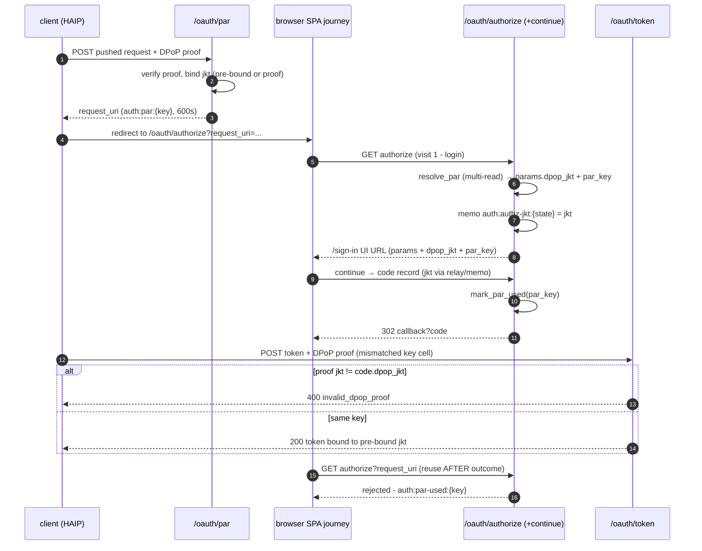

### 9a.23 Logout error surface - the unregistered post_logout_redirect_uri page (OIDC RP-Initiated Logout)

The suite's `oidcc-rp-initiated-logout-bad-post-logout-redirect-uri`
module (`ExpectPostLogoutRedirectUriNotRegisteredErrorPage`) demands
that the OP **show an error page saying the request is invalid as the
`post_logout_redirect_uri` is not a registered one** - a real, visible
rejection, not a silent fallback. The pre-9a.23 posture redirected an
unregistered `post_logout_redirect_uri` (when the parameter was
PRESENTED) to the bare `/sign-in` SPA: the page said nothing, the
suite's browser interaction placeholder
(`post_logout_redirect_uri_not_registered_error`) never resolved, and
the module stalled in WAITING until the harness's visit cap called it
INTERRUPTED.

**Target state.** When a `post_logout_redirect_uri` is PRESENTED but
refused (not registered for the identified client, or no client
identified), `/oauth/logout` serves a **server-rendered error page**
(the same JS-free posture as §9a.8: stable element ids, no JS) with an
HTTP 200 and the body text `Invalid request - the
post_logout_redirect_uri is not registered for this client`. When the
parameter is absent/empty (a session-scoped logout with no landing
target) the clean 302 → `/sign-in` fallback stays (open-redirect
defense unchanged). The error page is a TERMINAL response: it clears
the session cookie exactly as the redirect path does (the logout side
effect completes), so a browser landing on it is logged out AND
informed.

The harness (sentin8-auth-oidf fixtures/runner.ts) recognizes the
auth-served error page by its URL (`/oauth/logout-error` path or the
`?`-carried marker) and uploads a real screenshot of it - the module's
placeholder resolves with the page visible.

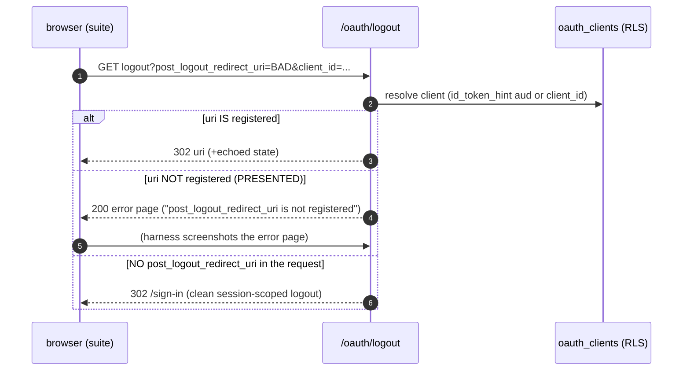

### 9a.24 Delegated (and service-projection) mints sign the TENANT family

Every mint path that produces a token a DOWNSTREAM service must verify
through the tenant-plane filtered JWKS (§9a.9) resolves the target
tenant's `signing_alg` and signs with `sign_value_alg(claims, family)`
- including `POST /delegate/access-token` (the delegated token's env is
`req.env_id`, normally a NON-system target env) and the
session-cluster data-plane projections (`/v1/session/...` service
tokens + `delegated_from_publisher`). The family-blind
`SigningKeys::sign()` (process-active key) is reserved for tokens that
never cross a tenant-plane JWKS boundary. Rationale: the JWKS endpoint
publishes ONLY the verifier's resolved family (`from_keys_family`),
so a token signed by the other family - even with a valid signature -
is unverifiable for every resource server the tenant-plane lookup
serves (`key {kid} not found in JWKS` → 401). The delegated token's
`aud` is the target resource indicator and its `env_id` is the target
env; both sides of the contract (mint family, published family) MUST
resolve through the same `resolve_security_profile_for_env` seam so a
mint never races a profile row it did not consult.

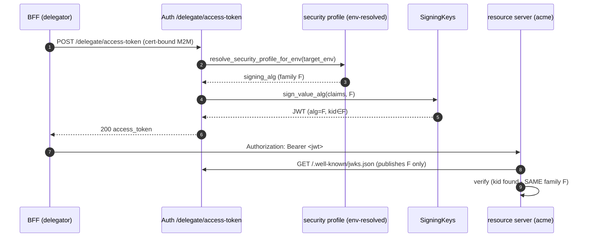

**The resolution projection (§9a.24b).** userinfo's delegated branch
resolves the act user's live `roles`/`scopes` but only projects them
when `platform_claims` holds (system-env token OR non-FAPI caller
profile). A delegated token's `env_id` is the TARGET tenant env, so a
Shield role resolver's resolution (the mechanism `evaluate_full` uses
to build `ctx.scopes`) received `roles: None, scopes: []` under a FAPI
profile - the empty live set OVERWROTE the verified JWT scope seed and
the scope-mirror fail-closed every delegated mutation (the 2026-10-28
e2e invitation 403). The projection also rides when the CALLER is a
certificate identity: the TLS-injected `m2m-*` subject + non-empty
thumbprint (the SAME signal the DPoP gate trusts in DPoPRS-1 -
Shield resolvers, BFF session enrichment, and the auth→sys proxy all
authenticate by certificate, never a DPoP proof). A browser-borne DPoP
proof caller keeps the OIDC standard-claims surface.

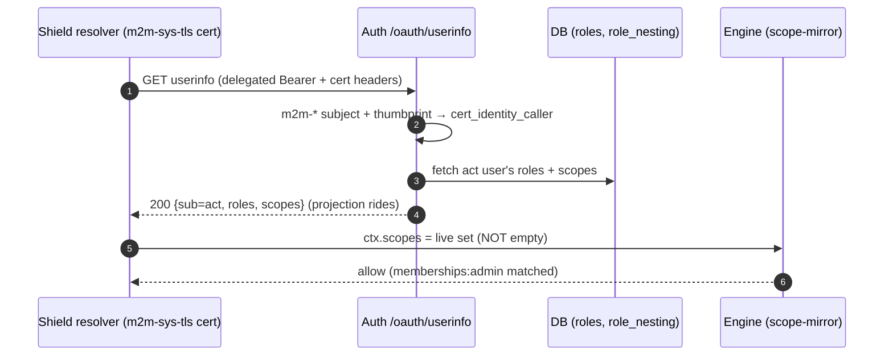

