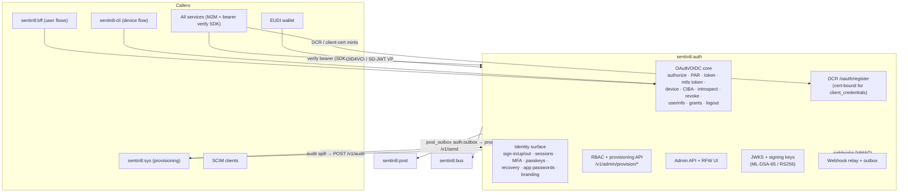
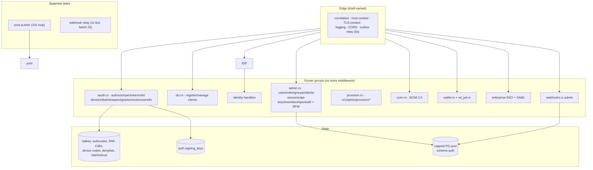
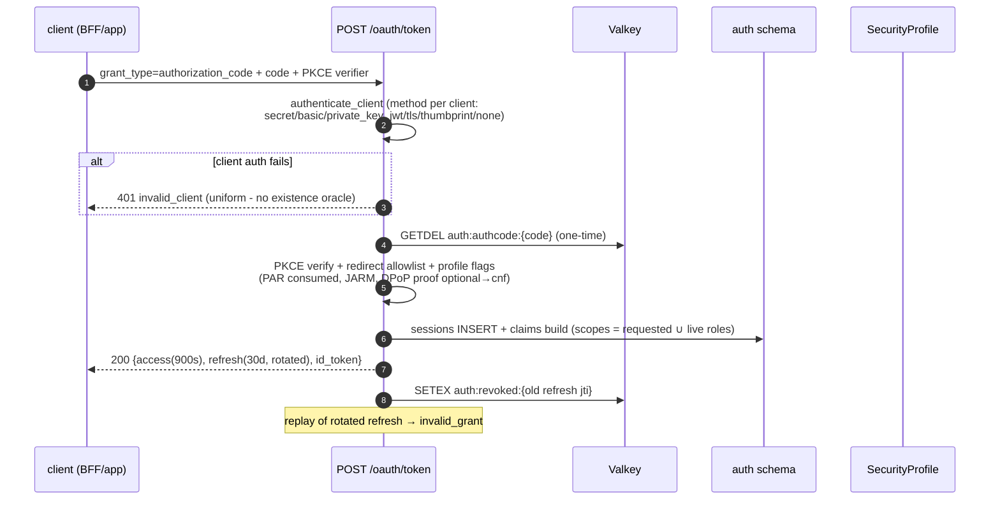
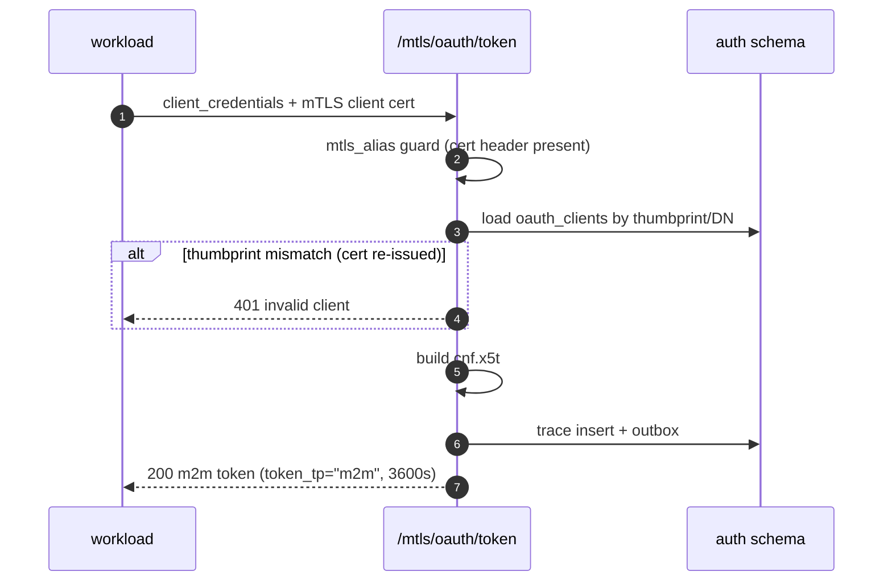
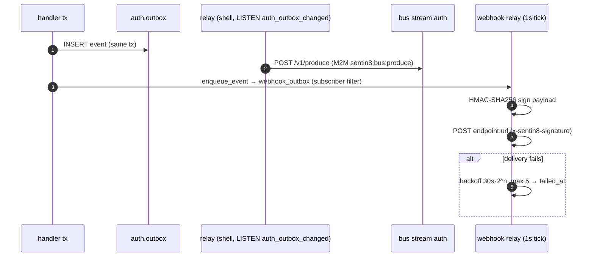
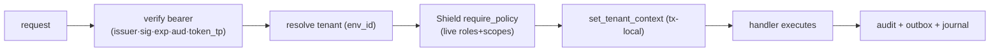
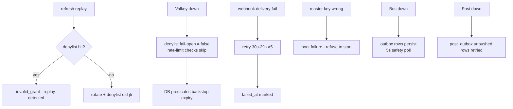
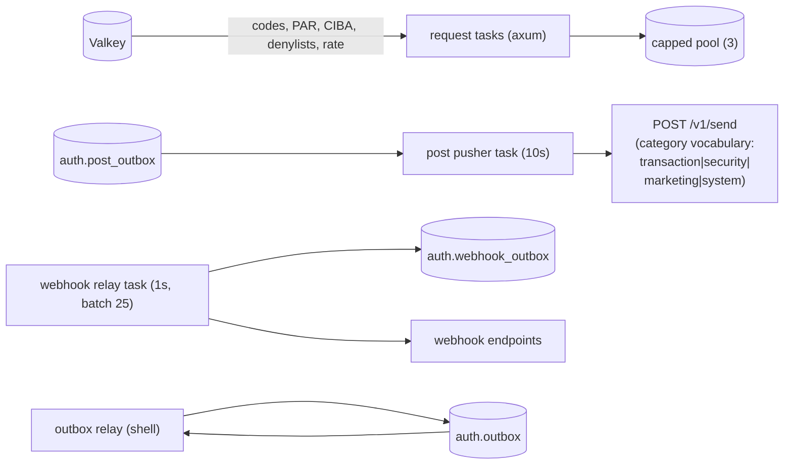
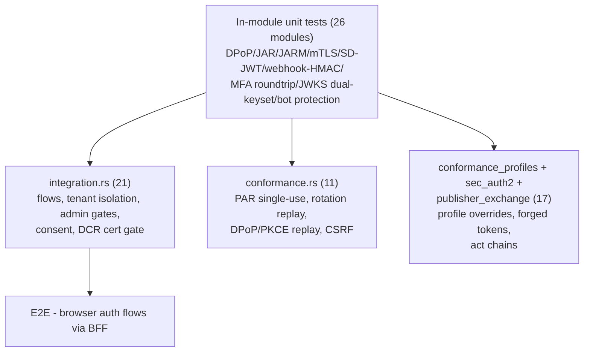

# DESIGN.md: Sentin8:Auth - Detailed Design Document

## 1. Scope & Context

Sentin8:Auth is the platform's **single identity plane**: the only issuer
of every token family, the only JWKS authority, the DCR registrar, the
RBAC substrate (roles, groups, nesting, membership provisioning API),
consent grants, sessions, MFA/passkeys, SSO federation, webhooks, and the
OID4VCI/SD-JWT wallet surface.

- **Owns** (schema `auth`): identity + credentials (users, sessions, app
  passwords, MFA factors/challenges, WebAuthn challenges, reset/verify
  tokens, enterprise connections, SSO sessions), OAuth clients (incl. DCR
  records, federated credentials, M2M thumbprints), M2M scope grants, RBAC
  (roles, user_roles, groups, group_members, group_roles, role_nesting),
  consent grants (FAPI 2.0), wallet credentials + regulatory overlays +
  security profiles, actor tokens, webhook endpoints/outbox/attempts,
  signing keys, and the DBX producer tables (`outbox`, `audit_journal`,
  `post_outbox`).
- **Does NOT own**: org/env business records (sys provisions those and
  calls back via the provisioning API), tenant app instances, Shield
  policy storage (sys's `policy_sets` is the substrate; auth runs an
  engine on it), invitations (proxied to sys), e-signature (QES delegated
  to bank8-payments - `signature_request` returns NOT IMPLEMENTED).



## 2. Runtime Architecture



**Request lifecycle - authorization-code token issuance (FAPI 2.0
posture, platform profile):**



**M2M issuance (cert-bound, the platform identity path):**



## 3. Data Model

```mermaid
erDiagram
    USERS ||--o{ SESSIONS : "holds"
    USERS ||--o{ USER_ROLES : "assigned"
    USERS ||--o{ GROUP_MEMBERS : "member of"
    USERS ||--o{ APP_PASSWORDS : "owns"
    USERS ||--o{ MFA_FACTORS : "enrolled"
    USERS ||--o{ ACTOR_EVENTS : "actor/target"
    ROLES ||--o{ USER_ROLES : "grants"
    ROLES ||--o{ GROUP_ROLES : "via groups"
    GROUPS ||--o{ GROUP_MEMBERS : "contains"
    GROUPS ||--o{ GROUP_ROLES : "binds"
    ROLE_NESTING {
        uuid parent_role_id PK
        uuid child_role_id PK
    }
    OAUTH_CLIENTS ||--o{ CLIENT_ROLES : "assigned"
    OAUTH_CLIENTS ||--o{ FEDERATED_CREDENTIALS : "federates"
    OAUTH_CLIENTS ||--o{ GRANTS : "consented"
    USERS ||--o{ CREDENTIALS : "wallet"
    USERS ||--o{ ENTERPRISE_CONNECTIONS : "SSO"
    WEBHOOK_ENDPOINTS ||--o{ WEBHOOK_OUTBOX : "queues"
    WEBHOOK_OUTBOX ||--o{ WEBHOOK_ATTEMPTS : "logs"
    USERS {
        uuid id PK
        string email
        string status "active|suspended|archived|locked"
        bool mfa_enabled
    }
    SESSIONS {
        string token_id UK
        string status "active|revoked|expired"
        timestamptz expires_at
    }
    OAUTH_CLIENTS {
        string client_id UK
        string token_endpoint_auth_method
        text[] grant_types
        string tls_client_auth_subject_dn
        string self_signed_tls_client_auth_thumbprint
        bool consent_required
        bool dpop_exempt
    }
    MFA_FACTORS {
        string factor_kind "totp|webauthn|backup_code"
        bytea secret_cipher "AES-encrypted"
        string status "pending|active|disabled"
    }
    CREDENTIALS {
        string format "sd_jwt"
        string status "active|revoked"
        jsonb cnf_jwk
    }
    SECURITY_PROFILES {
        string scope "platform|org|env"
        string profile "fapi_2|…"
        bool require_dpop
        int max_token_lifetime
    }
```



- **RLS**: FORCE RLS on all tenant tables (env policies; junctions carry
  their own `env_id` for direct RLS; `role_nesting` gated on the parent
  role's env). **No-RLS exceptions** (platform-internal): `m2m_dcr_credentials`
  (auth's own workloads only), `m2m_scope_grants` (anonymous DCR endpoint
  evaluates server-side), `webhook_attempts` (relay-written), and
  `actor_revocations` (`USING (true)` - revocation is jti-scoped, not
  env-scoped).
- **State machines**:

```mermaid
stateDiagram-v2
    direction LR
    state session { [*] --> active: sign-in<br/>active --> revoked : sign-out / admin<br/>active --> expired : expiry }
    state factor { [*] --> pending: enroll begin<br/>pending --> active: verify<br/>active --> disabled }
    state grant { [*] --> active: record_grant<br/>active --> revoked: delete (cascade jti) }
    state listing2 {
    }
```

- **Secrets posture**: TOTP secrets, webhook secrets, client secrets are
  encrypted (`secret_cipher` BYTEA / hash); signing keys persisted
  AES-sealed under the master key; no plaintext secrets in any table.
- **Seeds**: platform admin user + the platform role/nesting catalog +
  `dash` (public PKCE, dpop_exempt) + `sentin8-cli` (device flow) clients.

## 4. API Surface

| Audience | Group | Gate |
|----------|-------|------|
| public | `/.well-known/*`, `/oauth/authorize(+continue)`, `/oauth/par`, `/oauth/token`, `/oauth/device`+`/device/verify`, `/oauth/userinfo`, `/oauth/logout`, `/v1/sign-in\|up\|out`, `/v1/branding`, `/v1/health` | session/cookie or client auth per flow; bot protection + lockout on sign-in |
| mTLS | `/mtls/oauth/token`, `/mtls/oauth/revoke` | cert-presence guard; client auth per DCR method - retained for out-of-band/tenant clients only; **platform workloads never fetch tokens (§4.3f)** |
| workload | `POST /oauth/register` (DCR) | interactive clients open; **client_credentials-only requires mTLS cert** + CN ∈ `m2m_scope_grants` + scopes ⊆ grant - retained for out-of-band tenant clients; platform workloads never DCR (§4.3f) |
| delegated | `POST /delegate/access-token` | verified M2M bearer + `sentin8:delegate:read` + cnf match |
| wallet | `/oauth/credentials*`, `/oauth/vp/response`, `/v1/auth/wallet/metadata` | bearer / VP verified (SD-JWT key binding + status list) |
| consent | `/v1/auth/consent/*` | session-validated; proxied to owning vertical |
| admin | `/v1/admin/{users,roles,groups,oauth-clients,api-keys,sessions,memberships,invitations,audit}` + RFW UI | `route_guard` + `require_sentin8or_access(_write)` + Shield |
| provisioning | `POST /v1/admin/provision/{role,role_nesting,group,group_role,group_member,user_role}` | admin bearer + `x-sentin8-target-env-id` header (env-scoped), idempotent upserts |
| SCIM | `/scim/v2/Users`, `/scim/v2/Groups`, metadata | `sentin8:scim:read`/`write` |
| security | `/v1/security-profile`, `/v1/admin/security` | admin bearer |
| webhooks | `/v1/admin/webhooks/{endpoints,outbox,attempts}` | Shield |
| health | `/v1/health` | none |

**Event flow (outbox → Bus):**



Event family `auth`; names `sentin8:auth:{user,role,group,client,credential,apikey,session,membership,dcr,connection,mfa,passkey,actortoken,securityprofile,webhook,grant,ciba}:{action}` - payload-complete envelopes. Session revocations
(`sign-out`, OAuth refresh-token revoke, password reset, admin terminate) emit
`sentin8:auth:session:revoked` - payload-complete envelope `{subject_id,
env_id, session_id, revoked_by, reason}` (continuous access evaluation,
README §7): the BFF session-reaper subscription (bff DESIGN §10) consumes the
`auth` family (group `bff-session-reaper`) and kills every cached BFF session
for the subject, so role/consent changes take effect immediately instead of at
the store TTL.

Grant lifecycle (FAPI 2.0 Grant Management, grants.rs): every standing
authorization emits its transition. Code issuance records/merges the grant
(`record_grant` at the authorization-code exchange) and emits
`sentin8:auth:grant:created` - payload `{grant_id, client_id, user_id,
env_id, scope, state, selected_account_ids}` where `state` is the client's
opaque OAuth state (the consent handle a vertical's consent flow packed into
PAR) and `selected_account_ids` are the accounts the customer selected on a
hosted consent screen. Downstream consent authorities (e.g. Bank8:FDX's
provider plane, fdx DESIGN §1) seed their data-holder grant ledgers from this
event - the authorization server is the seed of open-banking grant truth.
Grant revocation emits `sentin8:auth:grant:revoked`
(`{grant_id, user_id, client_id}`).

## 5. Cross-Cutting Concerns



- **Token verification** is SDK-reused by every service
  (`sentin8::auth::client`) - auth is the only JWKS authority.
- **Rate limiting / bot protection**: IP 10/min, email 5/min sliding
  windows; 5 failures → durable `locked` status (config TTL); dummy bcrypt
  compare on unknown accounts (no email enumeration).
- **DPoP**: proof validation (htm/htu/iat/nonce/ath) with jti replay
  protection (SETNX 300s); `cnf.jkt` on access tokens; clients opt out via
  `dpop_exempt`.
- **FAPI 2.0 posture**: platform profile enforces PAR + JARM + DPoP +
  RFC 9449 issuer binding + 900s max token lifetime + refresh rotation;
  env/org profiles override (`security_profiles`).
- **Introspection honesty**: `none`-auth clients hard-rejected;
  JWT-introspection responses signed per profile.
- **Back-channel logout**: logout token issued to registered
  `backchannel_logout_uri` per client.

### 4.3f Token-free platform M2M (CERTFREE-1) - the certificate is the service identity

Platform workloads authenticate with **no token at all**: the caller presents
its Acme-issued client certificate (`CN=m2m-{workload}`) in the TLS
handshake, `sentin8-tls` CA-verifies it and injects
`X-Sentin8-Client-Cert-Subject` / `-Thumbprint` headers (client-supplied
copies stripped), and the receiving service trusts those headers exactly as
it trusts `X-Sentin8-Env-Id` - the TLS layer is the authentication. Auth's
role in platform M2M shrinks to **issuing identity material (the
certificate, via Acme) and provisioning the authorization record (the
grant rows, via `vertical enroll`)**. No M2M JWT is minted, fetched,
cached, or verified for platform service→service calls.

**Why (the defect class this closes):** the M2M token was a second identity
surface that had to stay synchronized with the certificate identity across
three stores (SDK credential cache → `oauth_clients` → JWT claims). A
database reset desynchronized them by construction - cached `client_id`s
outlived their rows - producing the fleet-wide
`M2M token fetch failed: status 401` storm after every reset. A token is
also a redundant proof: the TLS handshake ALREADY establishes exclusive
possession of the certificate's private key on every call; a bearer minted
from that same possession adds no strength, only state.

```mermaid
sequenceDiagram
    participant W as Workload (client cert, no token)
    participant TLS as sentin8-tls (platform CA)
    participant S as Receiving service
    participant V as Valkey m2m:workloads<br/>(boot-load + TTL cache)
    W->>TLS: HTTPS call, handshake presents CN=m2m-{workload}
    TLS->>S: X-Sentin8-Client-Cert-Subject/-Thumbprint<br/>(CA-verified; client copies stripped)
    Note over S: TLS context middleware → identity = {workload, thumbprint}
    S->>V: local cache: workload → {vertical, service_type, scopes, enabled}
    alt row missing or enabled=false
        S-->>W: 401/403 (not enrolled / revoked)
    end
    S->>S: Shield evaluates scopes (RequestCtx: subject=workload, scopes=map)
    S->>S: Bus vertical gate / audit service=workload
```

**The authorization record travels as the registry map.** `sentin8-cli
vertical enroll` already provisions `auth.m2m_scope_grants` and publishes
`captain:*` Valkey keys; it additionally publishes a `m2m:workloads` hash -
`{workload} → {vertical, service_type, scopes[], enabled}` - and every
service boot-loads it and TTL-caches it (the platform's mandated pattern:
owner data is seeded on cold start / cache miss, never read on the request
path - §4.14/§6.6). This answers the three consumers the token previously
fed:

| Consumer | Was (token claim) | Now (map field) |
|---|---|---|
| Shield `RequestCtx` (scope-gated rules) | `scope` | `scopes` (roles: none - M2M workloads never had role assignments) |
| Bus VDC-2 event-ownership gate | `vertical` | `vertical` (produce + consume identity checks) |
| Audit `service` stamp / Sys tenant-snapshot | `sub` (opaque hex) / `service_type` | CN directly / `service_type` |

**Revocation** is the map's `enabled` flag: `vertical enroll` (or the admin
surface) flips it, every service's cache observes it within the TTL, and the
workload's calls are refused. This is *more immediate* than the token path
(a minted token lives to expiry regardless) and is bounded by the cache
TTL. Handshake-level certificate revocation (a stolen cert's *validity*)
remains a follow-up (CERTFREE-2) - a pre-existing gap, not a regression.

**Security posture vs the token design (2026-10-07 review):** the move is a
net improvement - per-call proof-of-possession (the token was a pure bearer
at the target; `verify_cert_binding` was a stub) and fleet-wide revocation
where none existed for M2M JWTs. The multi-tenant boundary does not move:
tenancy was never carried by machine identity (WARN-21: the request's env
is authoritative for M2M), and RLS + explicit `env_id` clauses + Shield
remain the tenant gates. Two new risks are ACCEPTED-AND-FILED:

- **The map's write surface is authorization escalation.** Any process
  with Valkey write access can `HSET m2m:workloads` itself any scope set,
  and the 30s TTL propagates it fleet-wide - a primitive the
  signature-verified token design denied (scopes were minted from a DB row
  Auth signed). Countermeasure: Valkey ACLs (CERTFREE-4) - m2m:* writes
  restricted to the operator/enroll writer identity; services hold a
  read-only reader identity.
- **Certificate lifetime bounds the theft window.** The 365-day default
  mint + no expiry check in the load path (a day-366 fleet brick) is
  tightened to a 30-day default with load-path NotAfter verification and
  auto re-mint (CERTFREE-5), alongside CERTFREE-2's CRL.
- Per-instance distinguishability collapses to the workload name (two
  instances share `{workload}.crt`) - accepted; audit identifies
  workloads, never instances.

**Invariants (CERTFREE-1):**

- The certificate is the *only* platform-workload credential: no secret, no
  bearer, no assertion. The `m2m-` CN prefix is minted exclusively by
  Acme's guarded issuance channels (bootstrap enrollment - pinned to the
  declared set by CERTFREE-3; self-issuance `sub == service_name`; the
  enroll operator scope).
- The TLS-injected headers are trustworthy because (a) `sentin8-tls`
  injects them only after CA verification, (b) client-supplied copies are
  stripped before the app sees them, and (c) they exist only on
  TLS-terminated platform hops - the same trust model `X-Sentin8-Env-Id`
  already carries.
- A workload can only ever exercise scopes its map entry allows (Shield
  evaluates from the map; policy rules are unchanged).
- `oauth_clients` and DCR survive for interactive clients (auth-code,
  device flow, BFF apps, dash) and out-of-band tenant clients
  (`client_secret_basic`/`private_key_jwt` per registration) - Auth
  remains the single identity plane for every HUMAN-facing flow; the
  token-free plane covers machine-to-machine platform calls only.
- **Rejected:** keeping the token as "extra" (it was the storm's root
  cause and adds no proof beyond the handshake); services reading
  `auth.m2m_scope_grants` directly (§4.7 - the map is the transport, no
  cross-schema grants); a live Auth resolve API per request (per-request
  dependency, banned by the runtime discipline).

**What is deleted for the platform path:** `/mtls/oauth/token`
`client_credentials` use by platform workloads; the `sentin8-m2m` token
source, DCR helper, credential cache, boot probe, and 401 self-heal
machinery (the crate shrinks to certificate mint-if-missing, renamed for
its real job); `build_with_dcr` background DCR retries in bus-client; every
service's boot-time DCR block; the `cli-producer` / `cli-delegator` /
`bff-delegator` token workloads (the CLI and BFF present certificates);
BFF's env-credential fallback. Delegated tokens keep their `cnf`
cert-binding (unchanged) - BFF presents its certificate and receives a
delegated JWT as today; only the *workload's own* M2M JWT disappears.

## 6. Failure Modes & Recovery



- **JWKS rotation**: insert-new-key overlap (all persisted keys published);
  no scheduled rotation task - old tokens verify until expiry.
- **Session expiry**: enforced by predicates; no sweeper (rows are
  harmless after expiry).
- **DCR storm protection**: anonymous DCR gated by `m2m_scope_grants`
  (service must be enrolled) + cert channel possession proof. Platform
  workloads never DCR and never fetch tokens (§4.3f) - a DB reset can no
  longer strand cached `client_id`s; a missing grant row surfaces as a
  named workload refusal (`workload not enrolled`) from the registry map,
  fixed by enrollment.
- **Token-free M2M failure modes (§4.3f)**: certificate missing at boot →
  Acme mint (bootstrap channel, declared-set-pinned) → retry with backoff;
  map row missing/disabled → 401/403 until enroll/revocation is reverted
  (the map is the authorization record); Valkey down at boot → services
  start with the last cache file / an empty map and refuse unenrolled
  workloads fail-closed (enrolled workloads ride the persisted cache
  copy); map edit → next TTL refresh reflects it.

## 7. Concurrency & Performance Model



- Sign-in hot path: 2 PG round-trips + 3 Valkey ops (rate, lockout,
  session); JWKS cached 5 min in every consumer SDK.
- Token minting: one signing op (ML-DSA-65); key material cached in
  process.
- Webhook relay batches 25 per tick to bound endpoint fan-out.
- **Post pusher identity is process-lifetime.** The `auth-post`
  `TokenSource` is resolved once and reused across passes (audit-pusher
  pattern, `crates/audit` §6.8): the cached token covers ~10 passes
  before the 60s-before-expiry refresh, and a 401 triggers the m2m
  crate's single-flight self-heal (re-issue + re-DCR, 60s cooldown) -
  never a per-pass `register_or_load_m2m_client` load + credential
  probe + fresh mTLS client. A per-pass rebuild would run two PQ TLS
  handshakes + two token POSTs every 10s whose transient allocations
  ratchet glibc arenas (observed idle RSS growth ~2 MB/min, AGENTS
  target-state rule: no transitional churn paths).

### 7.1 Invalidation triggers on access-grant mutations (policy family)

Identity-cache invalidation (policy runtime's recognized triggers:
`sentin8:sys:identity:updated`, `sentin8:auth:membership:created|deleted`
- sentin8-policy runtime.rs `invalidation_env_id`) rides the SYSTEM-env
`policy` stream because policy consumers (every service's M2M workload)
are registered in the SYSTEM env - that is the transport, not a policy
choice. The shell outbox relay holds exactly one M2M workload
(SYSTEM-env, `sentin8:bus:produce`), and Bus's produce gate
(`env_id does not match the authenticated tenant`) rejects any row whose
`env_id` differs from the token's env: **tenant-env outbox rows can
never reach the `policy` stream**. Therefore every mutation that grants
or revokes access emits, in the SAME transaction as the domain change,
a SYSTEM-env row (`SENTIN8_SYSTEM_ENV_ID`, family `policy`, event
`sentin8:auth:membership:created`/`sentin8:auth:membership:deleted`,
payload `{"env_id": <affected tenant env>, "user_id": <subject>}`) -
env to sweep rides the payload (the tenant-env fan-out row for domain
consumers stays, on the `auth` family). Covered mutations: sign-up
closure provisioning (`auto_add_to_app_groups`, one invalidation per
env touched), admin group member add/remove, and the cross-service
provisioning endpoint `provision_group_member`. Emission is
best-effort: an RLS/failure drop logs and degrades to the RoleResolver
30s TTL. The tenant context on the emitting transaction is switched to
SYSTEM for the invalidation INSERT (`set_config` is transaction-local)
and restored for any subsequent tenant-plane statement - policies on
`auth.outbox` match `env_id = current`, so the row must be written
under the env it carries.

## 8. Invariants, Insecure-Defaults Rejected, Unsafe Rationale

1. **Single identity plane** - no other service mints tokens/JWKS; the
   provisioning API is the only cross-service write path to `auth.*`
   (cross-schema INSERTs retired).
2. **M2M is certificate-bound by default** - a stolen token without the
   key is useless; DCR for `client_credentials` requires the mTLS cert
   channel (no dev fallback).
3. **`scope` is not the decision** - handlers never re-check scopes; step
   5 resolves live identity.
4. **Refresh rotation + jti denylist** - replay within TTL is detectable;
   fail-open only on cache outage (expiry predicates backstop).
5. **No existence oracle** - uniform `invalid_client`; dummy bcrypt on
   unknown accounts.
6. **Tenant-scoped uniqueness** - emails/roles/groups unique per
   `(env_id, …)`; sessions carry `token_id` UNIQUE.
7. **Actor tokens are time-boxed and audited** - TTL clamp ≤ 3600s,
   `auth.actor_events` + jti revocation table.
8. **Keys persisted + encrypted**; wrong/rotated master key refuses boot.
9. No `unsafe` in the service; manual ML-DSA-65 signing wrapped in the
   crypto provider boundary.
10. **No per-pass identity churn.** Long-lived background pushers bind
    their M2M `TokenSource` for the process lifetime; identities are
    re-established by the token-source self-heal on 401, not by
    rebuilding clients every pass (DESIGN §7).
11. **Invalidation rows carry SYSTEM env.** An access-grant mutation's
    invalidation row is written under the SYSTEM tenant context with
    `env_id = SENTIN8_SYSTEM_ENV_ID`; a tenant-env row is silently
    dropped by RLS at emit time (policy `outbox_insert`: `env_id =
    current`) and denied at the Bus produce gate - both fail closed
    (DESIGN §7.1).
12. **Auth reads `sys.app_instances` only through Sentin8:App's owner
    API.** The sign-up closure provisioning needs the env's
    customer-mode (allow_signup) instance ids: the former direct-table
    read violated DBX §6.6a (auth held no grant on `sys.app_instances`
    after the sys.* grant retirement - the read failed RLS-grantless
    and "provisioned NO permission closure" on every customer-env
    sign-up). Target state: `auto_add_to_app_groups` calls Sentin8:App
    `GET /v1/app/instances/customer-mode?env_id=…` (M2M workload
    `auth-sys`, scope `sentin8:app:instances:read`, env-bound) - the
    owner never shares tables (DESIGN §7.1).

## 9. Testing Strategy



- Deliberately not covered in-service: OpenID certification live flows
  (external conformance suites), real IdP SSO round-trips, PQ TLS
  transport (platform-level).

## 10. Open Questions

- SAML flows beyond metadata/ACS are a declared non-goal for the platform IdP
  (enterprise SSO is served by OIDC federation).
- Status List keeps the per-credential bit (standard model: verifiers fetch
  the credential status); fleet-wide aggregation is out of scope.
- Webhook delivery gains a DLQ replay surface mirroring post's `replay_dlq`
  shape (`POST /v1/admin/webhooks/attempts/{id}/replay`).
- Push-based identity invalidation is already implemented as events
  (`sentin8:sys:identity:updated`); role resolvers subscribe instead of
  relying only on TTL polling.

> JWKS rotation is internal: a daily in-process timer (03:00, 30-day
> staleness gate) calls the in-process rotate path directly - auth links
> no scheduler client and makes no cross-service calls (SDD §2.5, root
> service rule).

---

**Design attribution:** sentin8:auth and its underlying concepts were designed by Hamid Jahanzad <Hamid@Jahanzad.com>.

