# Sentin8:BFF - Detailed Design Document

## 1. Scope & Context

Sentin8:BFF is the **Delegation Gateway and token guardian**: the single
backend-for-frontend through which every browser app reaches platform
services. It owns the web session lifecycle (encrypted server-side token
storage), the `/proxy/{service}/...` data path, the three transport tiers
(HTTP/2 mutations + SSE subscriptions + chat WebSocket), the two delegation
paths (platform-admin RFC 8693 delegation to a target env, and customer
CIBA delegation for assisted login / decoupled approval), and the SCIM
proxy.

- **Owns** (schema `bff`): `dcr_clients` (per-auth-domain DCR client
  registry for app-instance OAuth clients). Session state is deliberately
  **not** in PostgreSQL - sessions live in Valkey (`bff:session:{session_id}`)
  as AES-256-GCM envelopes. Stat tagging configuration rides
  `sys.app_instances` (sys-owned; read context-first).
- **Does NOT own**: identity (Sentin8:Auth issues/verifies every token),
  tenant records (`sys.environments`/`sys.organizations` - read-only,
  context-first), app instances and scope whitelists (`sys.app_instances`),
  domain events (the BFF produces none - it consumes and relays), Shield
  policy storage (it boots an engine and evaluates only the
  `/bff/action/{action}` registry surface).

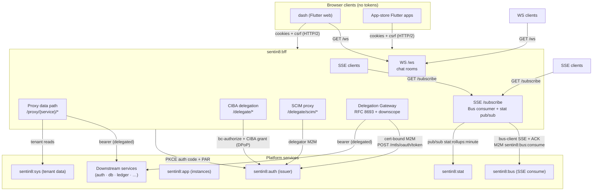

Trust boundaries: everything inside `sentin8:BFF` holds session secrets
and cert-bound M2M identities; the browser holds only opaque cookies and
never receives a token (the CIBA delegation token response is the one
contractual exception - it is the customer's own delegated credential,
delivered to the delegating staff app).

## 2. Runtime Architecture

| Component | File | Role |
|---|---|---|
| Config | `config.rs` | Port, Valkey URL, encryption key, session TTLs (idle 7d / absolute 30d), CSRF toggle, OAuth client id, shared Auth SDK client. |
| Session store | `session.rs` | AES-256-GCM encrypt/decrypt, Valkey `bff:session:{id}`, cookie builders, app-binding check. |
| Auth flow | `handlers.rs` | PKCE login/sign-up/callback, session metadata, sign-out, refresh, multi-session listing/revocation (`/v1/auth/sessions`), Shield-gated service actions, health/readiness. |
| Proxy | `proxy.rs` | Catch-all `/proxy/{service}/*`: session validation → CSRF → token resolution (transparent refresh / delegation / RFC 8693 exchange) → forward. |
| CIBA + SCIM | `ciba.rs` | `POST /delegate/start|poll|status|send-link`; six SCIM handlers with the delegator M2M token. |
| Subscription tier | `subscribe/*` | SSE handler, Bus consumer per session, subscription mutations, delegation poll push, stat pub/sub,
session-reaper Bus subscription (`auth` family, group `bff-session-reaper` -
kills cached sessions on `sentin8:auth:session:revoked`), telemetry stub. |
| Chat tier | `chat/*` | `/ws` WebSocket, conversation rooms, ping loop. |
| Tenant resolution | `tenant.rs` | Header-first context, service identity + backend URL resolution, scope whitelist cache (5-min TTL). |
| Stat tagging | `tagging.rs` | `ServerTagger` trait (`NoopTagger` default / `StatTagger`), fire-and-forget. |
| Key rotation | `key_rotation.rs` | KeyRing blob format `v1:{key_id}:{hex}` with retained old keys. |
| DCR client | `dcr.rs` | RFC 7591 register/update/delete client (compiled, available for future wiring - boot-time DCR rides `sentin8::auth::m2m`). |

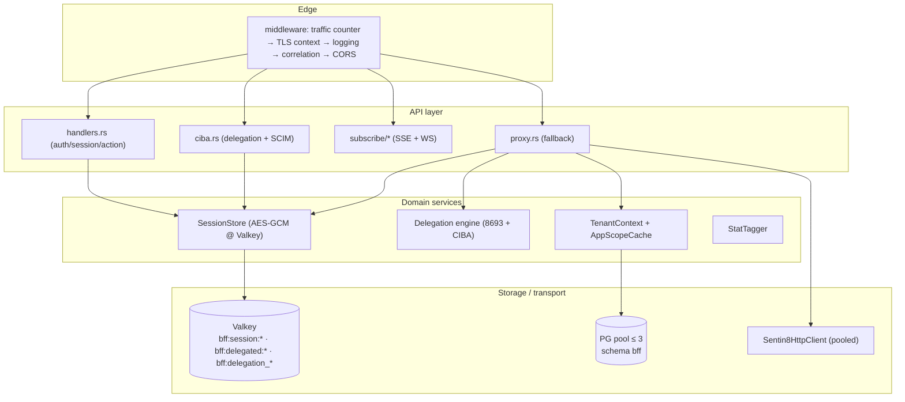

### Request lifecycles

**Proxy mutation (the dominant family):**

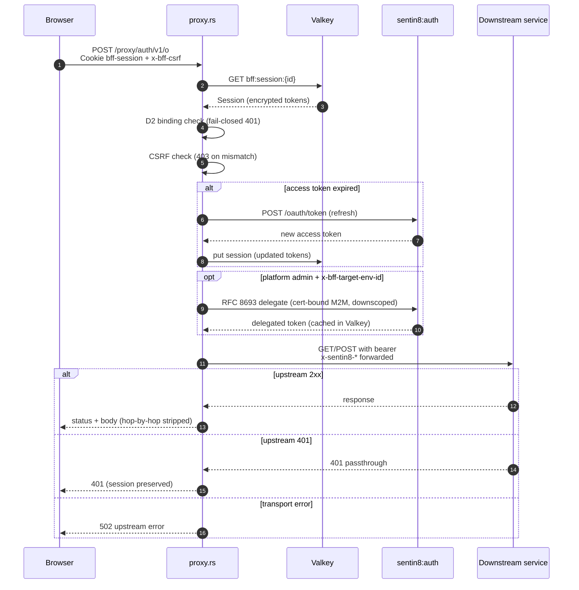

**OAuth login → session establishment:**

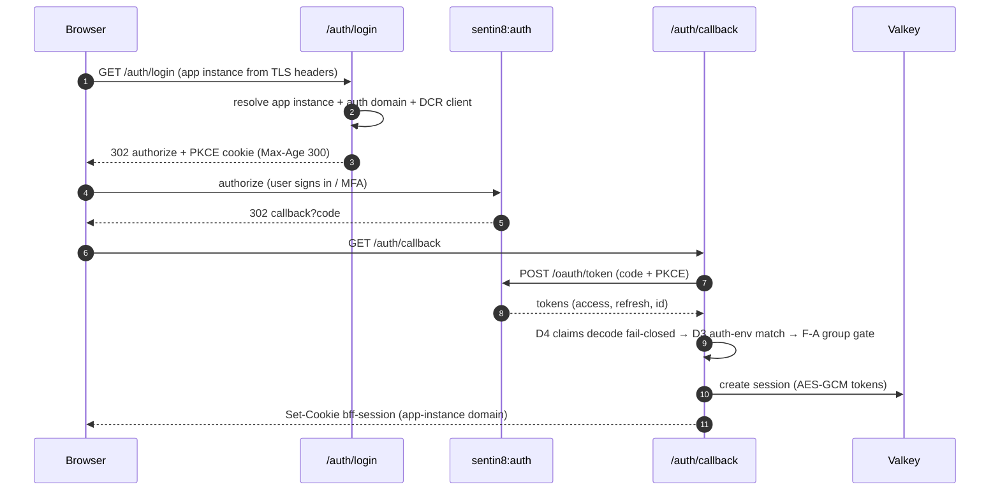

**SSE subscription family:**

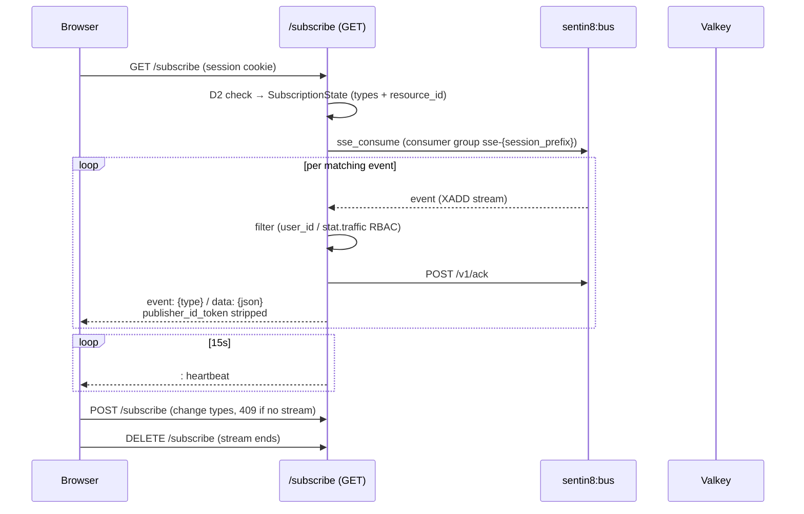

## 3. Data Model

The BFF's own schema is minimal - the session store is deliberately in
Valkey, and the tenant/app-instance data it reads belongs to sys.

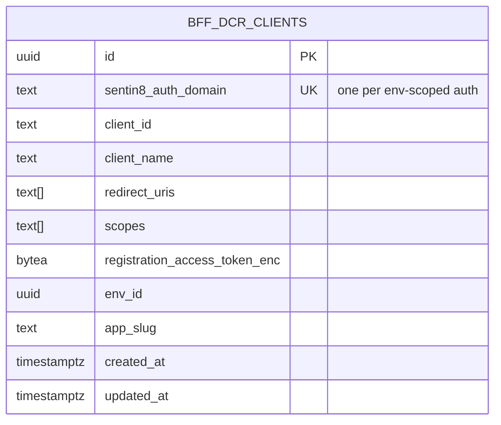

- `bff.dcr_clients` - per `sentin8_auth_domain` OAuth client used by the
  CIBA backchannel (app-instance client, public PKCE). `env_id` scopes the
  row; the proxy's per-app scope/service whitelists live on
  `sys.app_instances` and are read context-first.
- **Valkey keys** (not tables, but part of the durable model):
  `bff:session:{session_id}` (session JSON, TTL = idle TTL),
  `bff:delegated:{session_id}:{env_id}:{service}` (RFC 8693 token cache,
  TTL = token expiry), `bff:delegation_authreq:{delegation_id}`
  (`auth_req_id`, TTL = `expires_in`),
  `bff:delegation_token:{id}` + `bff:delegation_token:{id}:meta`
  (approved customer delegation + metadata).

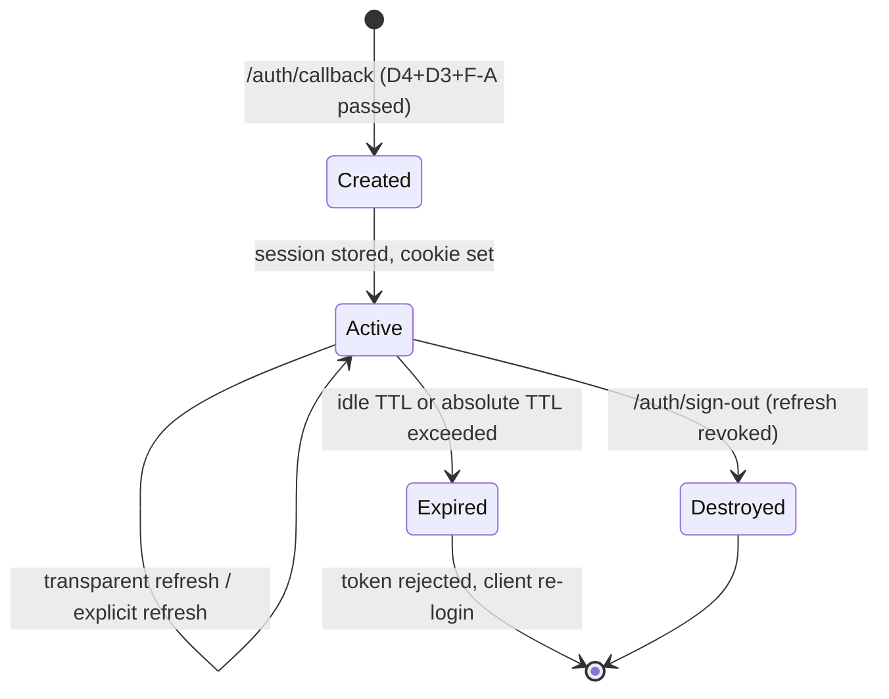

## 4. API Surface

### Public (pre-login)

| Endpoint | Gate | Notes |
|---|---|---|
| `GET /auth/login`, `GET /auth/sign-up` | none | Redirect to env-scoped Auth authorize, PKCE verifier cookie. |
| `GET /auth/callback` | code exchange | D4 fail-closed claims decode, D3 auth-env match, F-A app-group gate. |
| `GET /v1/health`, `GET /readiness`, `GET /metrics` | none | Liveness (build hash), Valkey ping, static gauges. |

### Session (cookie + D2 binding)

| Endpoint | Gate | Emits |
|---|---|---|
| `GET /auth/session` | session cookie | metadata + csrf token only - never tokens. |
| `POST /auth/sign-out` | session cookie | refresh revoked at `/oauth/revoke`; session destroyed; both cookies cleared. |
| `POST /auth/refresh` | session cookie | token/scope/expiry updated in place. |
| `POST /bff/action/{action}` | session + Shield `evaluate_full` + `service_actions` registry lookup | registry-defined downstream call. |
| `ANY /proxy/{service}/{*rest}` | session + D2 + CSRF (mutations) + delegation logic | upstream call; transparent refresh; Stat tagging. |
| `GET /v1/auth/sessions` | session cookie | caller's active sessions (same `user_id`): `{session_id, created_at, last_seen, current}`; bounded SCAN (`list_session_ids(1000)`). |
| `GET /v1/auth/sessions/{id}` | session cookie | one session detail; 404 when missing or owned by another user (no existence oracle). |
| `DELETE /v1/auth/sessions/{id}` | session cookie + CSRF | destroy record + revoke its stored refresh token at Auth `/oauth/revoke`; 404 predicate as above. |
| `DELETE /v1/auth/sessions` | session cookie + CSRF | revoke all the caller's sessions **except the current one** (destroy + refresh revoke each). |

### Delegation (staff → customer/env)

| Endpoint | Gate | Flow |
|---|---|---|
| `POST /delegate/start` | staff BFF session | `POST /oauth/bc-authorize` at the customer auth; `act` claims from the session, never the body. |
| `POST /delegate/poll` | - | CIBA grant + DPoP proof; caches the approved customer token. |
| `GET /delegate/status` | - | cached token + meta. |
| `POST /delegate/send-link` | - | stub (logs + acknowledges). |
| `/delegate/scim/users…` (6 verbs) | delegator M2M (`sentin8:scim:read/write`) | proxied to `{auth}/scim/v2/Users`. |

### Subscriptions

`GET /subscribe` (SSE; session + D2), `POST /subscribe` (change; 409 when
no live stream), `DELETE /subscribe`; `GET /ws` (chat WebSocket; session +
D2 on upgrade). The BFF emits the internal push types
`sentin8:delegation:result`, `sentin8:delegation:expired`,
`sentin8:bff:session:expired` and relays convention-valid Bus events
(`{vertical}:{service}:{resource}:{operation}`) through the per-service
stream-family map.

### Event flow (consume path - the BFF produces no domain events)

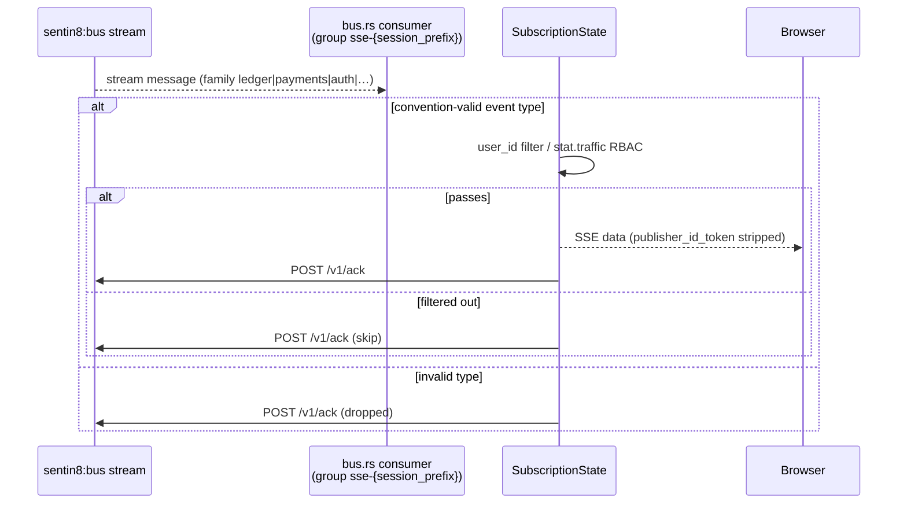

## 5. Cross-Cutting Concerns

- **Authentication**: the browser holds only the `bff-session` cookie
  (`HttpOnly; Secure; SameSite=None`, domain scoped to the app instance by
  stripping the leading `bff.`; ≥4 labels required, otherwise exact-host).
  The BFF verifies nothing from the client except the session - bearer
  verification of the stored tokens happens server-side when forwarded.
- **Tenant resolution + RLS context**: TLS-injected `X-Sentin8-*` headers
  first (hostname fallback only behind `SENTIN8_BFF_HOSTNAME_FALLBACK`);
  `org_id` is never accepted from clients - it is derived from `env_id` in
  a context-first transaction (`sentin8_set_tenant_context` → query →
  rollback, one connection).
- **CSRF**: mutations require `x-bff-csrf` equal to the session's stored
  token (toggle `csrf_enabled`, default on) → 403 on mismatch.
- **Cert-bound M2M**: the delegator identity is minted via DCR at boot
  (fast path loads the credential file; failure spawns a 30×/3s retry
  task); every delegation call goes to `/mtls/oauth/token` with the
  client-cert thumbprint presented - RFC 8705 sender-constraining is
  enforced by auth, not by the BFF.
- **Idempotency**: session writes are keyed by `session_id` (last-write
  wins); delegation caches are keyed by
  `{session_id}:{env_id}:{service}` / `{delegation_id}` - re-polls reuse
  the same key without duplicate side effects downstream.
- **Audit journaling**: `/audit` is a P0 log-only sink; the BFF writes no
  `audit_events` rows itself (all domain audit rides the owning services).
- **TLS posture**: PQ provider installed before any outbound call;
  inbound termination in-process via `Sentin8Tls` (same posture as every
  service); the proxy forwards a fixed header allowlist - arbitrary client
  headers are not re-emitted by construction.
- **Graceful drain**: `Sentin8Tls::serve` handles shutdown; background
  tasks (Bus consumers, stat pub/sub, delegation polls) are spawned
  fire-and-forget and die with the process.

## 6. Failure Modes & Recovery

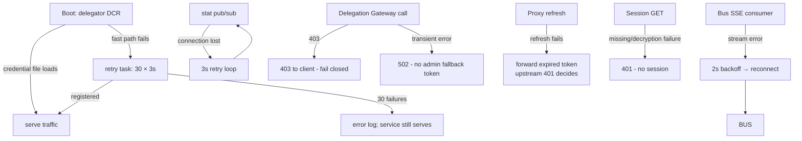

- **Session loss** (Valkey restart): the cookie points at a missing
  session → 401; the browser re-runs the login flow. No server-side
  re-materialization exists.
- **Delegation expiry**: cached CIBA tokens carry `expires_at`; an expired
  or absent delegation on the proxy path → 403
  ("delegation expired or not approved"), never a fallthrough to the
  staff token.
- **Delegation poll task**: bounded (60 polls × interval); terminal states
  (`approved`/`denied`/`expired`/`failed`) are pushed over SSE once.
- **Upstream failures**: unresolved backend → 502
  ("could not resolve backend for service"); transport error → 502 with
  detail; everything else passes through untouched.
- **Readiness** reflects Valkey health (`not_ready` on ping failure) while
  the service keeps serving; captain-level readiness gates registration.

## 7. Concurrency & Performance Model

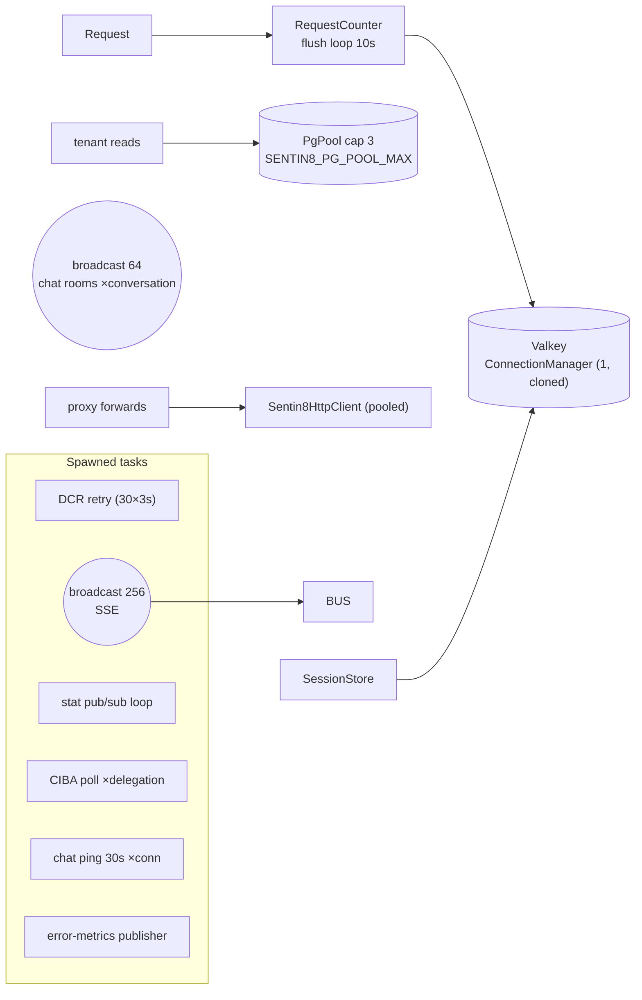

- **One Valkey connection manager** shared by sessions, delegation caches,
  SSE consumer, and stat pub/sub (cloned per use); session get/put are
  O(1) `get`/`set_ex`.
- **Pool cap 3** (platform rule) - the BFF's DB reads are small
  (tenant resolution, whitelist cache, SSE RBAC, service-action registry).
- **Shared pooled HTTP client** for all proxy forwards (a per-request
  client caused socket-exhaustion 502s); body cap 10 MB.
- **Backpressure**: SSE broadcast channel 256 (`Lagged` skips events
  rather than disconnecting the session), chat rooms channel 64; Bus
  consume uses per-family loops so a slow family cannot starve others.
- **Hot caches**: scope whitelist (5-min TTL), delegated tokens (TTL =
  token expiry), JWKS/discovery inside the shared Auth SDK (5-min).

## 8. Invariants, Insecure-Defaults Rejected, Unsafe Rationale

1. **Tokens never reach the browser.** Sessions store encrypted token
   blobs; `/auth/session` returns metadata + CSRF token only; the Bus
   relay strips `publisher_id_token` before forwarding. (The CIBA
   delegation token response is the delegated customer credential itself -
   delivered once to the delegating staff app, cached only in Valkey.)
2. **Fail-closed binding.** D2 (session ↔ application) must match or both
   be absent; D3 (token auth-env ↔ app instance) mismatches reject at the
   callback; D4 (undecodable claims) yields no session. A request that
   cannot resolve a tenant context is rejected, never defaulted.
3. **Delegation has no fallback.** Gateway 403 → 403 to the client;
   transient errors → 502; a failed delegation never silently forwards
   the staff token.
4. **Cert-bound M2M only.** The delegator token source is always
   `/mtls/oauth/token`; the RFC 8705 thumbprint must be presented or auth
   rejects the mint. `DELEGATOR_SCOPES`
   (`sentin8:delegate:read sentin8:scim:read sentin8:scim:write
   sentin8:sys:instances:read`) is the single source of truth shared by
   the DCR registration and the token request (debug-asserted equal).
5. **App-BFF service blocklist.** App BFFs never proxy `auth`, `app`,
   `sys`, or `tls` (those surfaces are reached by the browser through the
   platform flows, not the generic proxy).
6. **org_id never trusted from the wire** - always resolved server-side
   from `env_id` under a context-first transaction.
7. **Cookie scoping.** The session cookie domain is the app instance's
   domain (never the platform root), preventing cross-app replay;
   non-conforming hosts get an exact-host cookie.
8. **No `unsafe` code.** Encryption is AES-256-GCM via the shared crypto
   crate; key material comes from `SENTIN8_BFF_ENCRYPTION_KEY` (the
   built-in development default is rejected operationally - production
   must set a real key; the KeyRing rotation module exists for re-wraps).
9. **Multi-session revocation keeps the current session.**
   `DELETE /v1/auth/sessions` and `/sessions/{id}` destroy only records
   whose `user_id` equals the caller's (`user_id` ownership predicate,
   404 otherwise - no cross-user destroy) and always preserve the
   caller's current session id; each destroyed record's encrypted
   refresh token is revoked at Auth so no orphaned live grant survives
   the store delete.
9. **RLS on `bff.dcr_clients` is a current gap** (no ENABLE/FORCE policy in
   `init.sql`); access is single-role server-side only, and the platform's
   mandatory-RLS rule requires the policy to be added.

## 9. Testing Strategy

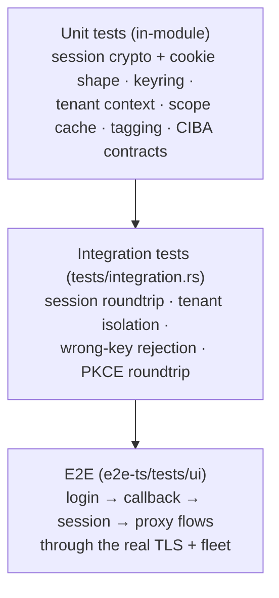

- **Unit layer** (46 tests across modules): encryption roundtrips, wrong-key
  rejection, cookie builders, tenant header parsing, whitelist semantics,
  KeyRing blobs, CIBA request/response contracts, Stat tagging behavior.
- **Integration layer**: session lifecycle against Valkey, tenant
  isolation, deterministic key derivation. DB/Valkey-backed tests
  self-skip when the services are unreachable (platform testing strategy).
- **Deliberately NOT tested here**: full OAuth dance (needs the live auth
  issuer), Bus SSE delivery (e2e), TLS termination (platform TLS suite),
  delegation end-to-end (lifecycle e2e).

## 10. Open Questions

- The telemetry fan-out task implements its consumer against
  `stat:rollups:minute` (Valkey pub/sub) instead of per-session Stat SSE -
  fewer connections, same data, reusing the existing subscribe spawn pattern.
- Transparent refresh converges on the shared FAPI client with DPoP (the
  process DPoP key already exists); the plain-POST path remains only as the
  pre-DPoP-bootstrap fallback.
- `bff.dcr_clients` gains the standard ENABLE/FORCE RLS policy set on
  `env_id`, generated the same way the other tenant tables' policies are.
- The session path wires the KeyRing at session-write time (encrypt with the
  current `date_key_id`, decrypt trying `all_keys` - both implemented) plus a
  background re-wrap task (batch 100, mark by key id).

---

**Design attribution:** sentin8:bff and its underlying concepts were designed by Hamid Jahanzad <Hamid@Jahanzad.com>.

