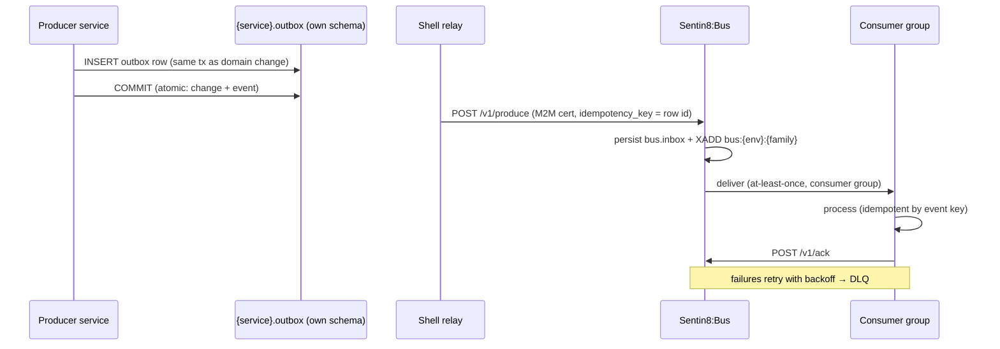

# Sentin8:Bus — Durable Event Backbone

The event plane: durable, audited, replayable domain events over
Valkey Streams with consumer groups, a dead-letter queue, and the
platform's local-outbox producer contract. "Event first, API second" —
when one service needs another to do work, the event is the default
answer.

## Use cases

- **Domain events** — a posting commit, a reservation change, a
  trade execution publishes `vertical:service:resource:operation` and
  every interested service consumes independently.
- **Trigger chains** — events drive WASM functions (Func), workflow
  instances (Flow), deferred schedules (Cron), and direct in-service
  consumers — the platform's serverless execution model.
- **Identity propagation** — `identity:updated` /
  `policy:updated` events flush every service's authorization caches
  fleet-wide in seconds.
- **Env-init** — a new tenant environment emits `service:updated` and
  each vertical service performs its own per-tenant initialization
  (seeding accounts, registering providers) with zero platform
  coupling.
- **Backpressure & retries** — at-least-once delivery with idempotency
  keys; failed deliveries retry with backoff, then land in the DLQ for
  manual replay — never silently dropped.

## Producer contract (local outbox)

## API surface

| Group | Endpoints | Gate |
|---|---|---|
| Produce | `POST /v1/produce`, `POST /v1/produce/batch` | workload cert; `sentin8:bus:produce` |
| Consume (SSE) | `GET /v1/consume/{family}` (SSE stream) | workload cert; `sentin8:bus:consume` |
| Consume (HTTP) | `GET /v1/events/{family}` | `sentin8:bus:consume` |
| Ack | `POST /v1/ack` | `sentin8:bus:consume` |
| DLQ | `GET /v1/dlq`, `POST /v1/dlq/{id}/replay` | `sentin8:bus:dlq:read`/`:replay` |
| Admin (RFW) | `/v1/admin/ui/*`, stream inspection | Shield admin scopes |

## Event naming

`vertical:service:resource:operation`, colon-separated, no dots —
aligned with the OAuth scope convention
(`bank8:ledger:account:updated`, `hotel8:pms:reservation:created`).
Payloads are self-contained envelopes: `event_type`, `env_id`,
`subject_id`, `correlation_id`, `idempotency_key`, and the full domain
snapshot the consumer needs — the less a consumer must call back, the
fewer internal APIs exist.

## Deep dive

Full maintainer documentation in the [Bus reference section](/docs/reference/bus/) —
harvested from `Sentin8/sentin8-bus` at build time.