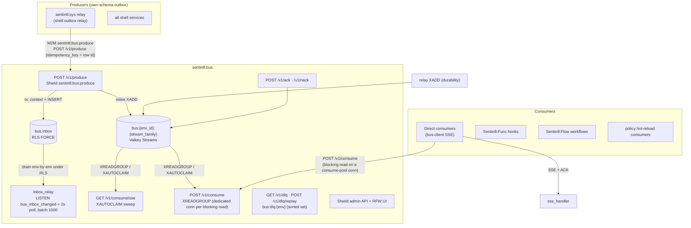
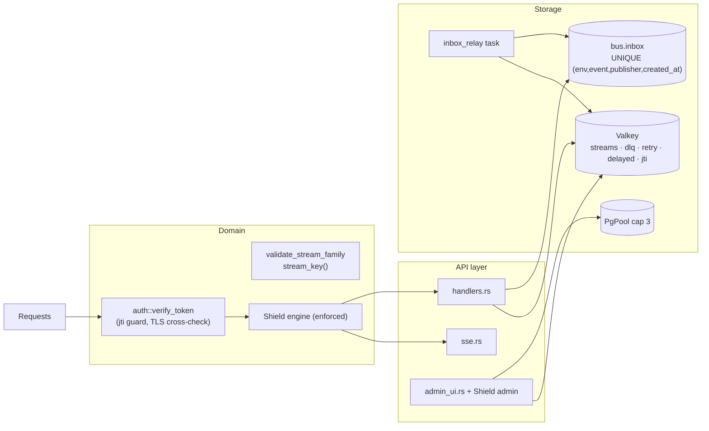
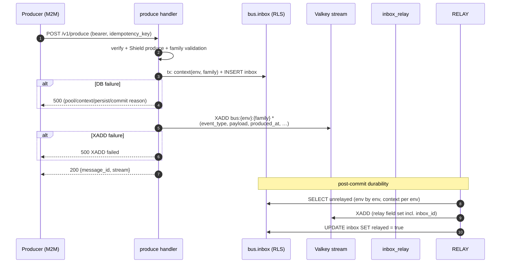
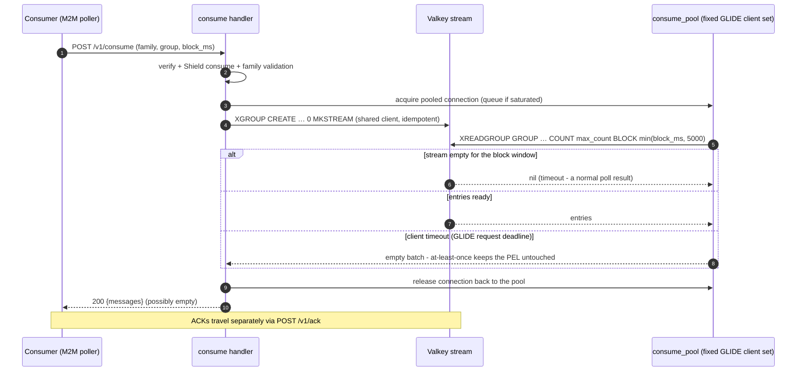
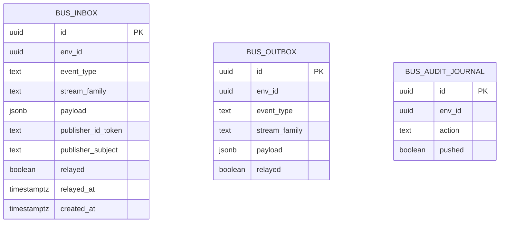
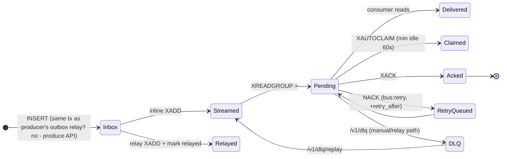
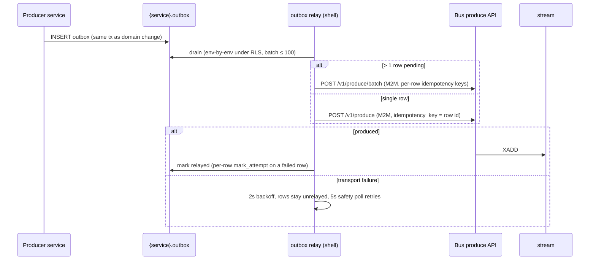
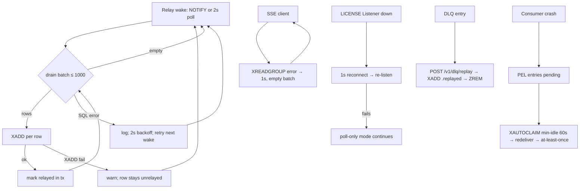
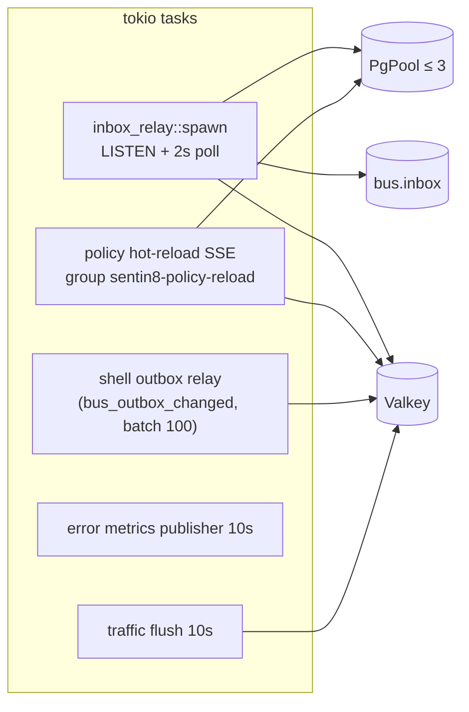
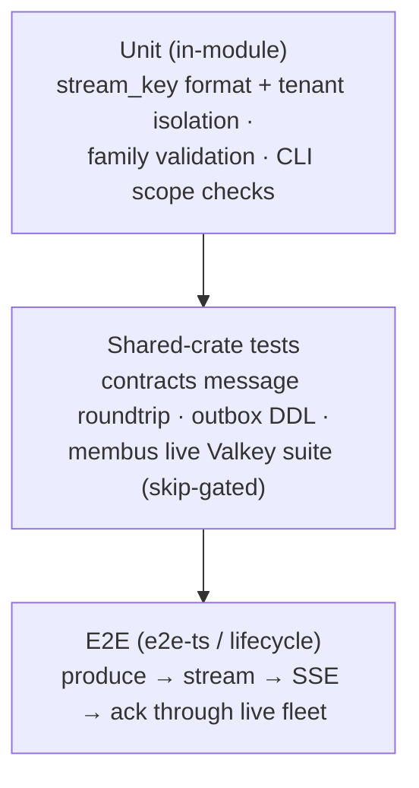

# Sentin8:Bus - Detailed Design Document

## 1. Scope & Context

Sentin8:Bus is the platform's durable event fabric: the produce/consume
API over Valkey Streams (single or batched - `POST /v1/produce` and
`POST /v1/produce/batch` share one single-produce core), the inbox that
guarantees bus-side durability of every accepted event, the SSE consume
surface for direct consumers, the DLQ + replay surface, and the Shield
policy-admin surface. Producers write
their own `{service}.outbox` and call the produce API; the bus
persists to `bus.inbox`, XADDs to `bus:{env_id}:{stream_family}`, and
relays any missed rows from the inbox.

- **Owns** (schema `bus`): `inbox` (bus-internal durability), `outbox`
  (bus's own DBX producer table - for events the bus service itself
  emits), `audit_journal` (local journal), the `bus:{env}:{family}`
  stream namespace, the DLQ/delayed/retry keys, and the `bus:jti:{jti}`
  replay guard.
- **Does NOT own**: producers' outboxes (each service owns its own schema's
  table), trigger registration (declared by verticals in
  `vertical-registry.json`), business payloads, and WebSocket chat
  (a `ws.rs` module exists in the source tree but is not routed -
  WebSocket is reserved for chat on the BFF).

Trust boundary: `bus.inbox` is bus-internal - no producer holds grants on
it. Every tenant boundary is the stream key suffix (`{env_id}`) plus RLS
on the persistence side.

## 2. Runtime Architecture

| Module | Role |
|---|---|
| `handlers.rs` | Produce/consume/ack/nack/DLQ/streams/lag/schedule/metrics + `validate_stream_family` + `stream_key` + **event-type ownership gate** (`event_vertical_prefix()` - see VDC §VDC.4). |
| `inbox_relay.rs` | Bus-internal durability: LISTEN/NOTIFY (`bus_inbox_changed`) + 2s safety poll; drain batch 1000; startup drain-until-empty. The LISTEN connection is built from `sentin8_config::pg_pool::connect_options_for(database_url)` - the same certificate-presenting `PgConnectOptions` as the service pool (`PgListener::connect` on a raw DSN would present no client certificate and be refused by the TLS-only `cert`-auth plane, silently degrading the relay to poll-only at every boot). |
| `sse.rs` | `GET /v1/consume/sse`: dedicated connection per client, `XGROUP CREATE … "$"`, 5s `XAUTOCLAIM` sweep (min-idle 60s, COUNT 20), `XREADGROUP COUNT 10 BLOCK 10s`, 15s heartbeat, pending-depth warn > 100. |
| `consume_pool.rs` | The blocking-consume connection pool: a fixed set of GLIDE clients reserved per `POST /v1/consume` call for the lifetime of its `XREADGROUP … BLOCK` - blocking reads never share the shared command client (the same discipline `sse.rs` and the SDK `StreamSubscriber` enforce; BUSCONNP-1). |
| `auth.rs` | Bearer verify (JWKS) + token-tp filter (`access|m2m|delegated`) + jti replay guard + audience check + TLS-header cross-check (skipped for delegated). |
| `admin_ui.rs` | RFW pages (overview, streams, consumers, metrics, dlq, policy) + data endpoints (SQL inbox, SCAN+XINFO consumers, ZRANGE dlq). |
| `policy.rs` / `registration.rs` / `config.rs` / `openapi.rs` | Shield bridge + hot reload; self-description; env config; OpenAPI. |

**Produce lifecycle** (the only write family):

**VDC event-ownership gate** (design/sentin8-vertical-data-plane-contract.md
§VDC.4): the first colon-segment of every `event_type` names the owning
vertical. The produce path verifies `event_vertical_prefix(event_type)`
equals the authenticated producer's M2M token `vertical` claim (embedded
by Auth at issuance from the `auth.m2m_scope_grants` row's vertical stamp,
upserted by `vertical enroll`). Mismatch or missing claim → **403
fail-closed**. Platform producers carry `vertical = "sentin8"`. Consumption
is unrestricted - the gate is produce-side provenance only.

At-least-once semantics: an accepted produce lands on the stream inline
and again via the relay (different field sets, same logical event);
consumers dedupe on `idempotency_key`.

**HTTP consume lifecycle** (`POST /v1/consume` - the blocking read runs
on a dedicated pooled connection, BUSCONNP-1):

The failure branch is deliberate: a timed-out blocking read returns an
**empty batch, never an error** - the PEL holds nothing (nothing was
delivered), so the caller simply re-polls. The dedicated connection is
released either way; a saturated pool queues the acquire (bounded by
the pool size - a storm of 1s pollers cannot multiply into unbounded
Valkey connections the way a client-per-request design would).

## 3. Data Model

- `bus.inbox` - durability record; `UNIQUE (env_id, event_type,
  publisher_subject, created_at)` is the structural duplicate backstop;
  partial indexes on `relayed = false` (by created_at, by family, by
  publisher). RLS FORCE with select/insert/update policies on
  `(context_initialized, env_id)`. INSERT + NOTIFY trigger
  (`bus_inbox_changed`). Only `sentin8_bus_service` has DML (no DELETE).
- `bus.outbox` / `bus.audit_journal` - generated DBX tables; the shared
  shell relay drains `bus.outbox` to the produce API (idempotency key =
  row id); `audit_journal` is a retry journal (pushed flag).
- Cross-tenant reads are impossible for the service role: every read is
  either context-set (RLS) or via the SECURITY DEFINER
  `public.sentin8_outbox_unrelayed_envs('bus')` helper (env UUIDs only).

**Valkey model:**

| Key | Type | Contents |
|---|---|---|
| `bus:{env_id}:{stream_family}` | stream | `event_type, payload, env_id, created_at, produced_at, produced_by, correlation_id, idempotency_key, publisher_subject[, publisher_id_token]`; relay adds `inbox_id`. |
| `bus:dlq:{env_id}` | sorted set | member = DLQ entry JSON, score = numeric order; `replay_dlq` XADDs `{event_type}.replayed` + `ZREM`s. |
| `bus:retry:{env_id}` | sorted set | `nack` entries with `retry_at` score. |
| `bus:delayed:{env_id}` | sorted set | scheduled entries with `delivery_at` score (`/v1/scheduled` lists due entries). |
| `bus:jti:{jti}` | string | `SETNX` + `EXPIRE` replay guard (non-M2M tokens). |
| consumer groups | stream groups | `{sub}.{consumer_group}`, created idempotently (`BUSYGROUP` ignored). |

## 4. API Surface

| Endpoint | Audience | Gate | Notes |
|---|---|---|---|
| `POST /v1/produce` | producers (M2M) | Shield `sentin8:bus:produce` | 200 `{message_id, stream}`; body `env_id` must equal token env (403). VDC-2 event-ownership: the event type's FIRST colon segment must equal the producer token's `vertical` claim (mint-stamped from `auth.m2m_scope_grants`); user tokens carry no claim → fail-closed 403 `event_ownership`. |
| `POST /v1/produce/batch` | producers (M2M) | Shield `sentin8:bus:produce` | N ≤ 100 events in ONE call; per-row results in request order - a failed row carries `error` and no `message_id`, siblings are unaffected (rows are independent, not a transaction). |
| `POST /v1/consume` | consumers | Shield `sentin8:bus:consume` | `XGROUP CREATE … 0 MKSTREAM`; reads new entries. The blocking `XREADGROUP` executes on a dedicated pooled connection (`consume_pool.rs`) - never on the shared command client (BUSCONNP-1); `block_ms` is server-capped at 5000 (a longer request is truncated, not rejected - the caller observes the cap as a sooner empty batch). |
| `POST /v1/ack`, `POST /v1/nack` | consumers | Shield `sentin8:bus:consume` | NACK enqueues `bus:retry:{env}` (+`retry_after_secs`, default 30). |
| `GET /v1/consume/sse` | direct consumers | scope check `sentin8:bus:consume` (+ token via `?token=`) | XAUTOCLAIM sweep + heartbeat; ACK via API. |
| `GET /v1/dlq`, `POST /v1/dlq/replay` | admins | Shield `sentin8:bus:admin` | replay XADDs `{event_type}.replayed` with `replayed_from_dlq`. |
| `GET /v1/streams`, `GET /v1/streams/{family}/lag`, `GET /v1/metrics` | consumers/admins | Shield (consume/admin) | SCAN-based; lag from `XINFO GROUPS`. |
| `POST /v1/schedule`, `GET /v1/scheduled` | producers/consumers | Shield produce/consume | delayed-delivery sorted set. |
| `GET /v1/admin/ui/{page}`, `GET /v1/admin/{resource}` | admins | `has_any_scope(bus:read|bus:admin|bus:consume|bus:produce|sys:admin|sys:org:admin|sys:env:admin|env:admin)` | `target_env_id` required (400). |
| Shield admin API (`/v1/admin/policy-sets|relations|attributes…`) | admins | Shield policy-admin surface | shared `sentin8::policy::admin`. |
| `GET /v1/health` | - | none | status + build hash. |

### The produce env contract (tenancy per request)

For M2M (and delegated) tokens the **request's** `env_id` is authoritative:
the stream key `bus:{env_id}:{family}`, the per-family rate bucket, and the
audit row follow it. Tenancy travels per request (the outbox relay drains
env-by-env and produces tenant-family rows its system-env token could never
claim); ownership stays per identity (`enforce_event_ownership` - the
`vertical` claim). A workload is cert-bound (RFC 8705), so the body env is
the producer's declaration, not an escalation surface. USER tokens keep the
strict check: they produce only into the env their token carries - cross-env
access must come from a role, never a body field. `produce_batch` resolves
env per row, so one batch may mix tenant envs.

### The CLI-producer path (operator tooling)

One-shot produces from operator tooling (e2e suits, ops scripts) cannot go
through an outbox relay - the caller is not a service with a schema. The gate
stays M2M-only (a user token carries no `vertical` claim by design -
ownership is a workload property, so `cli-producer` is a workload):

1. A grant row `('cli-producer', {sentin8:bus:produce}, vertical 'sentin8',
   service_type 'sentin8:cli')` provisions the workload the same declarative
   shape every service's `m2m_grants` produces (the e2e fleet setup seeds it
   idempotently; `vertical enroll` provisions platform rows alike).
2. `sentin8-cli` lazily DCRs `cli-producer` (cert-bound, SBI-AUTH-3
   credential-cache, no DB pool). Outside captain, the CLI derives the
   launcher-parity env itself: the public Acme Root-CA path and the
   captain-brokered enrollment claim (unsealed from
   `{run_dir}/bootstrap-enrollment.json.enc`) so a first-birth cert mint
   rides the same admission channel captain-spawned workloads use.
3. Both CLI dispatch paths (`call`, declarative `do`) retry the dispatch
   ONCE with the producer token when the 403 body names `event_ownership` -
   the tenant contract is unchanged: tenancy is per-request
   (`target_env_id` → stream key `bus:{env_id}:{family}`), NOT baked into
   credentials; one M2M workload serves all tenant envs.

Producer-side event chain (the DBX path the whole fleet rides):

## 5. Cross-Cutting Concerns

- **Authentication**: every endpoint verifies the bearer against the
  shared JWKS client; token type filtered to `access|m2m|delegated`;
  user/delegated tokens additionally pass an audience check; user
  tokens must carry an `env_id` (403 `tenant_unresolved`
  otherwise) and match the TLS-injected context (delegated excepted).
  The request authentication order is **Bearer-first, certificate
  fallback**: the client-certificate workload resolution runs only
  when no Authorization header is present. A delegated token names the
  acting user in `act.sub` (RFC 8693); the certificate-first order
  would resolve the hop's workload instead of the delegated JWT and
  silently drop the acting user.
  **No one-shot jti replay guard**: `access` and `delegated` tokens are
  REUSABLE credentials - OAuth access tokens are valid until expiry by
  definition, and delegated tokens are cached by the Delegation
  Gateway (BFF, Valkey, TTL = token expiry) and legitimately re-presented
  for every request in a session. A one-shot `SET NX` guard on their
  jti would 401 the second use of a valid cached token (the Dash
  invite/bus-401 incident); revocation rides the standard actor
  revocation check + token expiry, never per-service jti consumption.
- **Tenant resolution + RLS**: stream keys embed `env_id` (isolation by
  key); all inbox writes set `sentin8_set_tenant_context($1, …,
  $stream_family)` on the same transaction; the relay sets context per
  discovered env before reading.
- **Idempotency**: structural - produce accepts (and persists) an
  `idempotency_key` on the stream; the inbox UNIQUE tuple prevents exact
  duplicates; consumers dedupe on `idempotency_key` (the outbox row id).
- **Rate limiting / abuse**: family validation (charset, length,
  reserved names) at the gate; SCAN instead of KEYS on all listing paths
  (COUNT 100 cursor) to protect Valkey latency.
- **Audit journaling**: `audit_event` is a tracing sink (`sentin8::audit`
  target) for produce/ack/replay; the local `bus.audit_journal` table
  exists for the shared journal relay.
- **Graceful drain**: shell TLS serve handles shutdown; the relay's
  PgListener reconnects (1s) and falls back to poll-only mode.

## 6. Failure Modes & Recovery

- **Produce persistence failure** returns a precise 500 reason
  (`pool:`/`context:`/`inbox persist:`/`inbox commit:`/`XADD failed:`) -
  the producer's outbox row stays unrelayed and the shared relay retries.
- **Relay mark failure** yields a duplicate stream entry on the next
  drain (at-least-once; dedupe downstream).
- **Replay guard availability**: if Valkey is unavailable, the jti check
  is skipped with a warning (fail-open on replay protection only;
  signature verification is unaffected).
- **No automatic DLQ promotion or delayed-queue releaser runs today**:
  `bus:retry:{env}` has no drainer and `bus:delayed:{env}` has no
  releaser ticker; both surfaces are API-readable but not yet
  self-draining.

## 7. Concurrency & Performance Model

- **Relay batching**: 1000 rows per drain pass; env-by-env context
  transactions; batch loop until empty at wake.
- **SSE fan-out**: one dedicated multiplexed connection per client
  (isolation from the shared pool), `XAUTOCLAIM` every 5s prevents
  unbounded PEL growth for dead consumers (min idle 60s).
- **HTTP blocking consume**: a fixed pool of dedicated GLIDE clients
  (`consume_pool.rs`) serves every `POST /v1/consume` blocking read - a
  blocking read never occupies the shared command client, and the pool
  size bounds the concurrent blocking reads (surplus pollers queue at
  acquire). With ~200 SSE connections parked in 10s blocking reads, the
  GLIDE watchdog's process-global pending count sits structurally above
  its `SystemOverload` threshold (100) - `pending_total` in a watchdog
  WARN is NOT by itself evidence of overload; the `inflight` trend line
  is the saturation signal.
- **Policy hot-reload**: direct SSE consumer on the `policy` family
  (group `sentin8-policy-reload`), 2s reconnect; reloads on
  `sentin8:sys:policy:updated` (for `sentin8:bus` / `*`) and invalidates
  the RoleResolver cache on identity events.
- **Hot paths**: produce (one INSERT + one XADD), SSE consume (XREADGROUP
  + ack), both O(1) per message; listing paths are SCAN-capped.

## 8. Invariants, Insecure-Defaults Rejected, Unsafe Rationale

1. Stream keys are `bus:{env_id}:{family}` - tenant isolation by key;
   family names validated (`^[a-zA-Z0-9._-]{1,64}$`, reserved `dlq`,
   `delayed`, `jti`).
2. `bus.inbox` is bus-internal: no producer role holds grants; the only
   producer path is `POST /v1/produce` with a verified token.
3. RLS context is transaction-local and always set on the same
   connection/transaction as the write; the relay reads env-by-env.
4. Consumer groups are namespaced `{sub}.{group}` - cross-tenant group
   collision impossible; group creation idempotent.
5. Delivery is at-least-once: PEL + XAUTOCLAIM + ack-by-id; dedupe by
   `idempotency_key` downstream.
6. Token `env_id` is authoritative - a body `env_id` mismatch is a 403;
   admin data requires explicit `target_env_id` (no token-env fallback).
7. Listing paths use SCAN (COUNT 100) - never KEYS.
8. No `unsafe` code anywhere in the service.
9. DLQ replay always re-emits with the `.replayed` event type and a
   `replayed_from_dlq` marker - a replayed event can never be mistaken
   for the original.
10. A blocking `XREADGROUP` (HTTP consume) NEVER executes on the shared
    command client - it holds a pooled dedicated connection for the
    duration of the read (BUSCONNP-1). The `block_ms` a caller sends is
    a hint, capped server-side at 5000ms: the bus, not the caller, owns
    its connection occupancy budget.

## 9. Testing Strategy

- Service tests are pure (no Valkey/DB): key derivation, isolation,
  route/scope consistency. Stream semantics are covered by the live
  membus suite (publish/consume/ack, pipelining, trim, pub/sub loss
  contract, tenant keys) which self-skips without Valkey.
- **Deliberately NOT tested here**: SSE delivery end-to-end (e2e),
  multi-instance relay race (covered by the drain idempotency + unique
  constraint), TLS posture (platform TLS suite).

## 10. Open Questions

- The design intent is manual replay (admin-gated); the mechanical loop is the
  reaper task (10s): drain `bus:retry:{env}` (re-XADD to the source stream +
  ZREM, bounded retries → ZADD `bus:dlq:{env}` after `max_retries`) and
  `bus:delayed:{env}` → XADD + ZREM - the existing sorted-set surfaces
  self-drain without changing the manual-replay contract.
- Keep inline delivery for latency and have the relay skip rows already
  written (the relay stores `message_id` on the inbox row and skips rows
  already inline-written).
- The unrouted WebSocket consume handler is removed - principles §4.7a
  reserves WebSocket for the chat tier only.

---

**Architecture & Design:** sentin8:bus and its underlying concepts were designed by [Hamid Jahanzad](https://www.linkedin.com/in/hamidjahanzad/).

