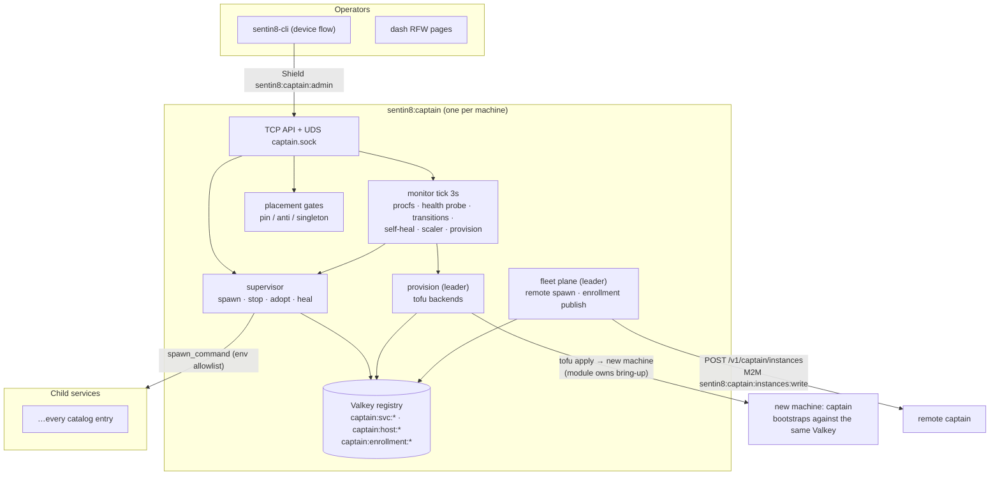
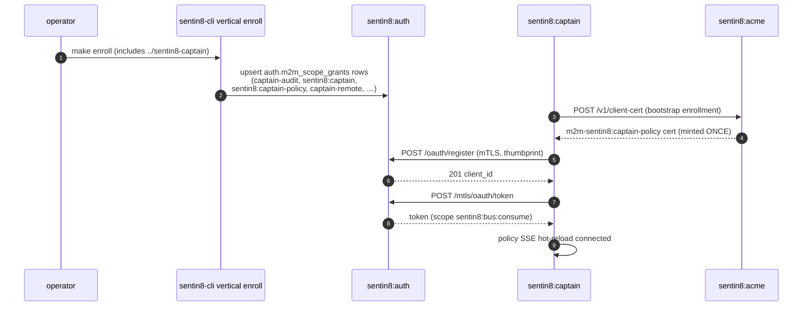
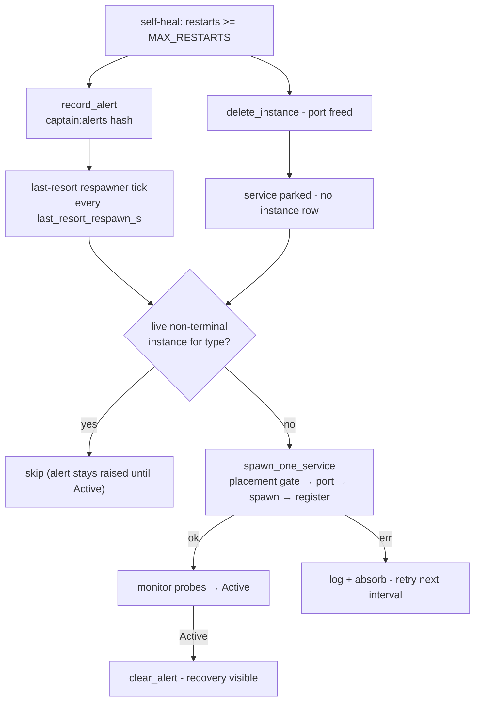
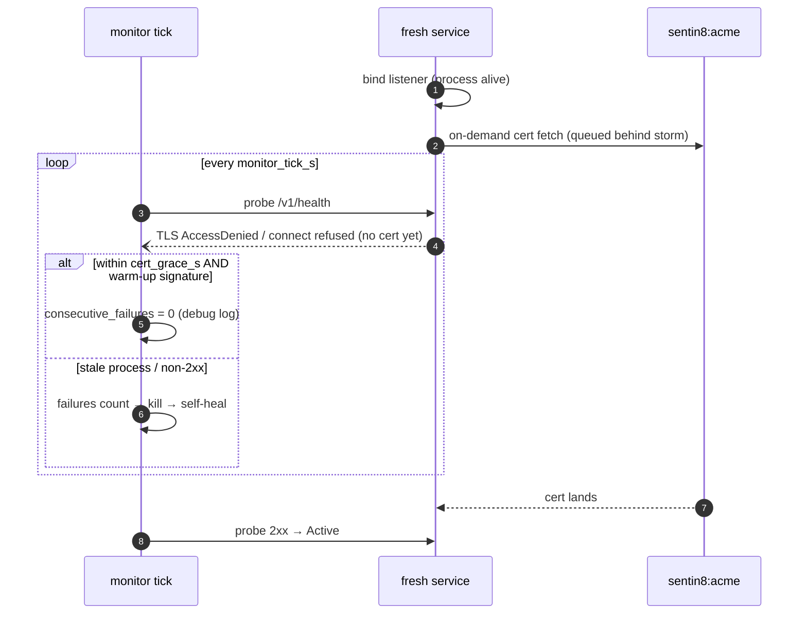
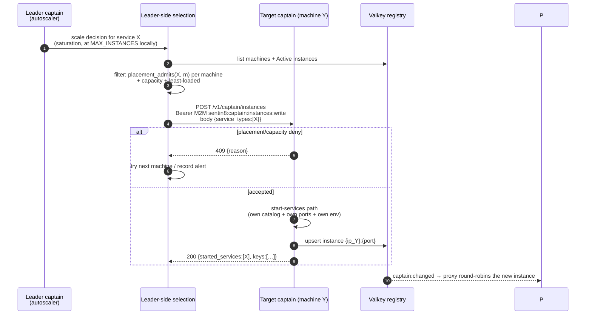
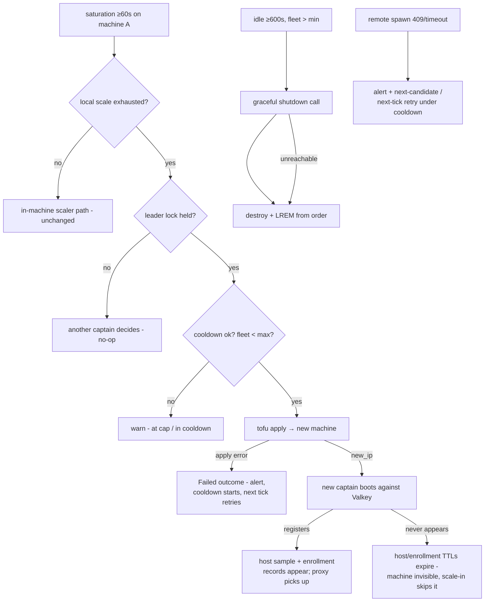

# DESIGN.md: Sentin8:Captain - Detailed Design Document

> **Status**: The supervisor/monitor/scaler/upgrade internals are documented
> at the same depth in the upstream monorepo's
> `services/captain/DESIGN.md` (the split's source of truth, RS §4.3). This
> repo-level DDD carries that design forward and adds the **multi-host fleet
> plane (§11)** - machine provisioning, fleet enrollment, placement, and
> remote spawn - which is designed here first and implemented in this repo.

## 1. Scope & Context

Sentin8:Captain is the fleet's process supervisor and cluster autoscaler:
it spawns every service as a child process (own process group), registers
each instance in the Valkey registry, samples CPU/memory/latency per tick,
probes health, self-heals dead instances, runs rolling zero-downtime
upgrades, brokers the first-boot bootstrap enrollment secret, and - on the
fleet plane (§11) - provisions machines through OpenTofu, enforces
per-service placement constraints, and spawns services on remote machines.
There is exactly one captain per machine.

- **Owns**: the Valkey registry (`captain:svc:*`), the machine lock, the
  rolling-upgrade keys, the port pool + reservations, the autoscaler
  leader lock + pending queue + provision order, the bootstrap enrollment
  record (`{run_dir}/bootstrap-enrollment.json.enc`) and its fleet
  publication (`captain:enrollment:{ip}`), the UDS control channel, and
  the PID file. **No PostgreSQL tables of its own** - the DB is used only
  for the Shield policy substrate (boot + hot reload).
- **Does NOT own**: the services' runtime behavior, their M2M identities
  (children self-register via DCR), TLS termination (in-process per
  service), the app registry, or event routing.



Trust boundaries: the TCP API is Shield-gated (step-5 Shield decision, or
UDS `SO_PEERCRED`); the inter-captain spawn channel is a cert-bound M2M
workload with a single granular scope (`sentin8:captain:instances:write`) -
never the operator `sentin8:captain:admin` scope; children inherit only
the deliberate env allowlist.

## 2. Runtime Architecture

| Module | Role |
|---|---|
| `server.rs` | Boot reconcile (binary-identity adoption), advisory machine lock + PID file, health-gated tiered spawn (D6), monitor start, graceful shutdown, TCP + UDS routers. |
| `catalog.rs` | `ServiceCatalogEntry` spawn definitions (static catalog + external `catalog.json`); `spawn_command()` env propagation; placement parsing (`pin:`/`anti:`); provision thresholds. |
| `placement.rs` | Placement decision seams: `placement_admits`, `singleton_violation`, fleet-wide co-location checks. Pure functions over registry rows - testable without Valkey. |
| `store.rs` | Valkey registry: upsert/status marks/metrics/counters, pub/sub `captain:changed`, advisory lock, terminal-state cleanup, daily reset. |
| `handlers.rs` | Management API, Shield gate, upgrade/status SSE streams, catalog merge, start-services, **remote-spawn endpoint**, autoscaler approval. |
| `monitor.rs` | 3s tick: procfs → probes → transitions → self-heal → scaler → host sample (+ cgroup mode) → provision eval → enrollment re-stamp + fleet publication. |
| `supervisor.rs` | Spawn (register + reaper), stop, adoption, self-heal backoff, drain. |
| `scaler.rs` | In-machine scale evaluation (placement-gated); free-port scan + atomic reservation. |
| `provision.rs` | Leader lock, saturation/idle evaluation, OpenTofu backends (`docker`, `cloud`, `hypervisor`, `bare-metal`), pending queue + approval, graceful-leave deprovision. |
| `bootstrap.rs` | Enrollment secret lifecycle (generate → seal 0600 → TTL re-stamp → clear on shutdown → publish to fleet key). |
| `procfs.rs` | Per-pid CPU%, RSS, host samples (`/proc` or cgroup v2 under `SENTIN8_CAPTAIN_TELEMETRY=cgroup`), zombie-aware liveness. |

Boot order (D6): tiers spawn in `start_priority` order and each tier waits
for the previous tier's `Active` (bounded by
`SENTIN8_CAPTAIN_TIER_GATE_TIMEOUT`, warn-degrade on timeout).

**Tier ordering encodes the platform's startup dependency ledger**
(AGENTS rule 3 - every edge declared, one-way, never per-request):

| Tier | Services | Why it starts here |
|---|---|---|
| 0 | captain | self - the supervisor itself |
| 2 | acme | CA plane - every service's cert fetch needs it Active |
| 10 | auth | identity plane - the only issuer; domain-truth boot verifies through it |
| 15 | **sys** | **domain-truth BEFORE the ingress**: the proxy resolves tenant hostnames via Sys's owner API (`GET /v1/resolve/hostname`, M2M `sentin8-proxy-tls`), and the embedded `sentin8-tls` resolver inside EVERY service dials Sys through the proxy on cache miss - a tenant resolve against a not-yet-started sys leaves every tenant SNI unresolvable in the boot window. Sys's own boot is fail-open (MemBus warm-up spawned, DCR loaded from the credential store, SSE consumer retries), so starting it while proxy/bus are still down is safe. One-way edge: sys never calls back into proxy at boot. |
| 20 | proxy, bus | ingress transport (tenant-resolve misses now hit a LIVE sys) + durable change-signals - everything downstream boots through a fully armed ingress |
| 30 | storage, db, post, cron, stat, func, flow, ai, secrets | middleware |
| 40 | app | business |
| 50 | bff, web | gateway + web apps |

The proxy itself boots fail-open (static platform-SNI routing, resolver
seed riding the declared `sys.vertical_services` SELECT + 30s safety
poll), so the ordering is about FULL tenant routing being armed - not a
liveness requirement; the gate is the fast-path guarantee.

**The gate reads the registry through the hash shape it wrote** (D6 gate
correctness): the Valkey registry stores each instance as HASH
`captain:svc:{service_type}` → FIELD `{ip}:{port}` - the exact shape
`store::upsert_instance` writes and `list_for_ip`/`list_all` read. The
gate consults `store::get_instance` (HGET on that pair). A bare
`GET "{ip}:{port}"` - the field string treated as a standalone string
key - reads a key that never exists, so the gate polled `nil` every
second: it could NEVER pass, and every boot degraded to its full
`SENTIN8_CAPTAIN_TIER_GATE_TIMEOUT` per tier (five tiers × 60s of pure
waiting on a healthy fleet - `make start` at ~5 minutes while the
services were all `Active` within seconds, plus the "degraded mode"
warning for a gate that was structurally blind).

### 2.1 Captain as a registered service (policy hot-reload plane)

Captain is a **starter** (builds and boots before any service) but it is
NOT exempt from the platform's identity/authorization architecture: it
boots the SAME Shield pipeline every shell service boots
(`sentin8::shield::runtime::boot_full` - engine load, live role
resolution, hot-reload consumer, decision telemetry). Two consequences:

1. **Captain's admin API is Shield-gated** - `/v1/captain/*` mutations
   evaluate the enforced `scope-mirror` policy set (step 5), so an
   operator's role/scope changes must reach captain WITHOUT a restart.
2. **Policy hot-reload rides Sentin8:Bus** - `sentin8:sys:policy:*` events
   flow over the `policy` SSE stream, consumed by the M2M workload
   `sentin8:captain-policy` (scope `sentin8:bus:consume`; the
   `captain-policy` alias covers the short-form spelling). The M2M/Bus
   dependency exists ONLY for this hot-reload plane (plus decision
   telemetry to Stat via `sentin8:stat:measure`) - never on the
   per-request path, and never for fleet control.

**Enrollment is therefore mandatory**: captain self-describes its six M2M
workloads via `--print-registration --section=m2m_grants`
(`registration.rs`), and the platform group's `enroll` target MUST
include `../sentin8-captain` so `vertical enroll` upserts those grants
into `auth.m2m_scope_grants`. Without enrollment, auth's DCR scope gate
fail-closed 400s every `sentin8:captain-policy` registration
(`workload is not granted M2M scope registration`), the background DCR
task retries every 3s forever, and each retry mints a FRESH bootstrap
client certificate from Acme before the doomed registration attempt -
producing a cert-mint storm at Acme and an unhealable `DCR pending`
token source (policy changes then never reach a running captain).

Boot-order independence is preserved: `build_with_dcr` returns
immediately (captain serves with a fail-closed admin gate while auth is
still cold) and the background DCR task heals the token source once auth
is reachable. The one-time operator duty is running `make enroll` after
`make start` (the same duty every other service carries).



Failure branches: auth unreachable → background DCR retries every 3s
(captain keeps serving, admin gate fail-closed); auth reachable but grant
rows missing → 400 per attempt AND a fresh cert mint per attempt
(the mint-stability guard in `sentin8::identity::m2m` limits re-issuance
to one mint per boot + probe-verified reuse after that, so the retry
loop can no longer churn certificates while the enrollment gap is being
fixed).

## 3. Data Model

Captain owns **no tables** - the durable state is Valkey:

**Catalog and the boot-spawn filter.** Captain's catalog is always the FULL
union: the built-in platform entries plus every external
`SENTIN8_CAPTAIN_CATALOG_PATHS` entry. `SENTIN8_SERVICES` (comma-separated,
colon-canonical) is a **boot-spawn allow-list, not a catalog prune**: it
filters which tiers `start_and_register_all` spawns at boot ONLY. The live
catalog stays complete, so `POST /start-services`, per-instance actions
(against the live catalog), placement, and remote spawn can name ANY
registered service type at any time - a second repo's `start` after a
trimmed boot works without restarting the captain. When the variable is
unset, boot spawns everything (the full-fleet entry remains the default).

| Key | Type | Contents |
|---|---|---|
| `captain:svc:{service_type}` | HASH (field `{ip}:{port}`) | `ServiceInstance` JSON. Union-keyed by `(service_type, port)`. |
| `captain:lock:{ip}` | string (pid, `SET NX EX 30`) | one-captain-per-machine lock. |
| `captain:upgrade:{key}` | string JSON (TTL 600s) | upgrade progress, published under old + new keys. |
| `captain:host:{ip}` | string JSON (TTL 120) | host sample `{cpu_pct, mem_pct, used_mb, saturated, saturated_service}` - cgroup-scoped when `SENTIN8_CAPTAIN_TELEMETRY=cgroup`. |
| `captain:port:reserve:{ip}:{port}` | string (TTL 60) | upgrade port reservation. |
| `captain:alerts` | HASH (`{service_type}` → `ServiceAlert` JSON) | **warn-10 crash-loop alerts**: `{service_type, restarts, reason, log_path, at}` - recorded at give-up (supervisor), cleared when the service reaches `Active` (monitor) or via the operator surfaces. |
| `captain:autoscaler:lock` | string (pid, TTL 30) | provision leader lock. |
| `captain:provision:last`, `captain:deprovision:{ip}` | strings | cooldown anchors (shared by scale-out + scale-in - the flap guard). |
| `captain:provision:order` | list | machine provision order (LIFO scale-in; head = base, never retired). |
| `captain:provision:pending` | hash (`{kind}:{ip}`, EXPIRE 3600) | manual-approval requests. |
| `captain:enrollment:{ip}` | string JSON (TTL 120) | **fleet enrollment record (§11.2)**: `{secret, generated_at, ip}` - the sealed local record published per tick so any machine's acme can verify any machine's first-boot claim. |
| `captain:changed` | pub/sub | registry change notifications (proxy/TLS resolvers). |

## 4. API Surface

| Endpoint | Method | Gate | Notes |
|---|---|---|---|
| `/v1/health` | GET | none | liveness. |
| `/v1/captain/readiness` | GET | **ungated** | 200 when every catalog type has ≥`MIN_INSTANCES` Active. |
| `/v1/captain/services` (list/get/post-action) | GET/POST | Shield `sentin8:captain:admin` | instance lifecycle: `restart|stop|start|upgrade`; captain-self → 409. |
| `/v1/captain/upgrade-status|upgrade-stream|startup-stream|shutdown-stream` | GET | gate | 2s polls; terminal `complete/aborted/rolled_back`. The **startup-stream** additionally emits a first-class `alert` SSE event per crash-looped service (give-up after `MAX_RESTARTS`): `{service, restarts, reason, log_path}` - read from the `captain:alerts` HASH, cleared when the service next reaches `Active` (supervisor records on give-up, monitor clears on recovery; a failed boot is an operator-visible event, never a bare "waiting on" loop ending in timeout). |
| `/v1/captain/machines` | GET | gate | `captain:host:*` scan. |
| `/v1/captain/alerts` | GET | gate | **WARN-10 give-up alert list** - every service captain gave up on (`MAX_RESTARTS`) and that has not recovered yet; consumed by `captain services` (the ❌ MANUAL INTERVENTION REQUIRED block after the instance table) and the RFW surfaces. Cleared when the service reaches `Active`. |
| `/v1/captain/catalog` · `POST /merge-catalog` · `POST /start-services` | GET/POST | gate | runtime catalog + local start (RCE boundary - catalog-resolved only). |
| `/v1/captain/instances` | POST | **M2M `sentin8:captain:instances:write`** (remote-spawn workload) or `sentin8:captain:admin` | **§11.4 remote spawn**: body `{service_types:[…]}`; the local start-services path restricted to the caller's own catalog + placement gates. A leader calling this on another machine places services there. |
| `/v1/captain/shutdown` | POST | gate (or UDS peer) | graceful leave of self + children. |
| `/v1/captain/autoscaler` · `/autoscaler/approve` | GET/POST | gate | pending queue decisions. |
| `/v1/admin/ui/{page}`, `/v1/admin/{resource}` | GET/POST | gate | RFW overview + machines + pending actions. |
| UDS `{run_dir}/captain.sock` | same minus admin/autoscaler | `SO_PEERCRED` uid 0/owner | local control plane. |

Captain emits no Bus domain events; its publish surface is
`captain:changed` + structured tracing alerts.

## 5–10. Supervisor, upgrade, failure, concurrency, invariants, testing

Carried unchanged from the upstream design of record
(`services/captain/DESIGN.md` in the monorepo source of truth - RS §4.3):
8-step authorization gate, rolling-upgrade state machine, self-heal
backoff (`MAX_RESTARTS=3`), BindFailed termination, carried-`restarts`
rule, `{ip}:{port}` union-key identity, port reservations, never-scale pin
retune procedure (§8.1 there), and the pure-unit + Valkey-gated live test
layering.

### 5.10.1 Crash-loop give-up: alert + last-resort respawn (CAPT-ALERT-2)

When self-heal exhausts `MAX_RESTARTS` (3), the give-up is a FIRST-CLASS
operator event AND a self-recovery contract - never a permanent park:

1. **Alert (WARN-10, unchanged)**: `store::record_alert` upserts
   `captain:alerts` → the hash field `{service_type}`; the SSE
   startup-stream emits a first-class `alert` event; the CLI surfaces it.
2. **Give-up terminal state (unchanged)**: the dead instance row is
   DELETED (port freed) - the monitor's `pid == 0` path never sees it
   again, so the last-resort respawner (below) is the ONLY mechanism
   that re-attempts.
3. **Last-resort respawner (CAPT-ALERT-2)**: a background ticker wakes
   every `last_resort_respawn_s` seconds (default 300, `0` disables -
   restoring the manual-intervention-parked semantics when explicitly
   requested) and, for EVERY alerted service with no live instance row,
   re-spawns ONE instance through the SAME seam every operator start
   uses (`handlers::spawn_one_service`: placement gate → port pick →
   spawn → register → `captain:changed`). The respawn is paced - one
   attempt per interval, errors logged and absorbed (retried at the next
   interval), never hot-looped. The alert STAYS RAISED throughout: it is
   cleared by the regular monitor path only when the respawned instance
   reaches `Active` - a give-up that self-heals never silently hides its
   crash-loop history.



**Shared spawn seam.** `spawn_one_service` is the ONE local spawn body:
placement gate, fixed-port/auto-assign, spawn + `register_child`
(reaper), registry row (`Starting`, `restarts: 0`), `captain:changed`
publish. Its call sites: the operator `POST /start-services` API (a
placement refusal maps to structured 409; spawn/upsert errors to 500;
skip conditions to silent skips in the response summary) and the
last-resort respawner (captain-internal, errors absorbed). The boot
spawn (`server.rs`) keeps its own body - it additionally holds port
adoption, tier gating, and the semaphore, which are boot-only concerns.

**Invariant (new)**: an alerted service is never left with neither a
live instance nor a pending re-attempt (while the respawner is enabled) -
give-up means "slow, capped-pacing recovery", not "parked forever".

### 5.10.2 TLS warm-up grace on probe failures (CAPT-PROBE-3)

A freshly-spawned service binds its listener FIRST but accepts TLS
handshakes only once its on-demand server cert has landed from acme.
Under a fleet-wide cold start / upgrade retry storm, acme's mint path
can stay saturated LONGER than the raw probe-failure kill threshold, and
killing on warm-up mass-murders just-started installs (observed: every
freshly-spawned service killed at 3 probes while `timed out waiting for
in-progress cert fetch` saturated acme; each respawn re-entered the
storm until give-up).

- **Config**: `cert_grace_s` (env `SENTIN8_CAPTAIN_CERT_GRACE_S`, default
  120, `0` disables) - measured from the instance's `started_at`.
- **Classification** (`monitor::probe_error_signature`, pure seam): the
  warm-up shapes are (a) `WarmRejected` - the listener answered the TCP
  connect but the TLS layer refused until the cert lands (error text
  carries `AccessDenied` / certificate / handshake) - and (b)
  `NeverConnected` - nothing answered at all yet (connect refusal /
  timeout on a transport error, no HTTP layer reached). A **non-2xx
  status is an HTTP-layer answer** and is NEVER masked (`NonTls`) - a
  broken-but-listening service counts toward the kill exactly as before.
- **Grace behavior**: within the window, a warm-up-classified failure
  RESETS the consecutive-failure counter instead of counting toward the
  kill (the failure is logged at debug with the error string, so the
  grace remains auditable). Past the window, failures count normally -
  a permanent TLS misconfig is killed exactly like the old behavior.
- **Scope note**: the grace applies ONLY to live processes (the failure
  branch runs after the pid-alive check) - a dead pid always self-heals.



---

## 11. The fleet plane - multi-host placement & provisioning (FLEET)

### 11.1 Scope & problem

The autoscaler decision loop (leader lock, sustained saturation, cooldowns,
one-machine-per-window, LIFO scale-in, manual queue) is complete and
correct in `provision.rs`. What was missing to make multi-host real:

- **G1** `SENTIN8_CAPTAIN_MAX_MACHINES` defaulted to 1 - the headroom
  gate never passed.
- **G2** the backend defaulted to `noop` (dry-run).
- **G3** no OpenTofu modules existed - `tofu apply` bailed on an empty dir.
- **G4** bootstrap enrollment was machine-local: acme (pinned to the base
  machine) could not verify a first-boot claim minted on machine B.
- **G5** no remote spawn: placement keys parsed but never enforced; a
  leader could not put service X on machine Y.
- **G6** the tofu bootstrap vars carried only `valkey_url` +
  `catalog_paths` - DSNs, master keys, domain never reached the new
  machine.
- **G7** `/proc/stat` is not namespaced - every docker backend container
  reported host-level telemetry, so all siblings "saturated" together.
- **G8** deprovision destroyed the machine without a graceful leave.
- **G9** no operator-facing dev flow to drive the whole path.

### 11.2 Fleet enrollment (closes G4)

The enrollment record stays exactly as it is - generated locally, sealed
0600, TTL re-stamped (never rotated). The **fix is publication**, not a
new trust root:

1. On every monitor tick, captain publishes its current `(secret, ts)` to
   `captain:enrollment:{local_ip}` with a 120s TTL - the same freshness
   window as `captain:host:{ip}`, so a dead machine's record expires with
   its host sample.
2. Acme's `current_enrollment_claim()` verification order becomes:
   **(a)** the local sealed file (unchanged - machine-local first-boot
   mints keep working with zero Valkey dependency), then **(b)** on miss,
   a fleet scan over `captain:enrollment:*` - any live record whose
   secret matches the caller's claim admits the mint.
3. The freshness anchor stays the record's `generated_at` (captain
   re-stamps fleet-published records with the same TTL rotation), and the
   mint stays scoped: `m2m-*` client certs only, warn-logged.

Trust model: the enrollment secret's threat boundary was "processes on
this machine" (captain's env distribution). Fleet publication widens the
*verification* reach, not the *distribution* reach - the secret still
exists only in captain processes' env + sealed records on machines that
run one. A captain on any machine can publish; only machines the operator
provisioned (via the tofu module, which installs the sentin8 package) run
one. The compromise cost is unchanged: a holder can mint `m2m-*` certs for
names the DCR scope gate already bounds.

### 11.3 Placement (closes G5, enforcement half)

One pure module, four call sites. `placement.rs`:

- `placement_admits(entry, local_ip, local_instances) -> Result<(), Reason>`
  - a catalog entry admits spawning on this machine iff:
  - `pin:{ip}`: `ip == local_ip`, else `Err(PinMismatch)`;
  - `anti:{svc}`: no instance of `svc` runs on this machine, else
    `Err(AntiViolation)`;
  - no `singleton` violation: `entry.singleton` is true and an instance
    of this type is Active anywhere in the fleet (checked by the caller
    over the registry) → `Err(SingletonViolation)`;
  - unconstrained → `Ok(())`.
- Malformed keys stay fail-safe unconstrained (existing parse contract).

Call sites (all four, no exceptions):
1. **Boot spawn** (`start_and_register_all`) - a local pin mismatch skips
   the spawn (another machine owns it); `anti`/singleton violations warn +
   skip. This is how machine B boots its correct subset without a
   per-machine `SENTIN8_SERVICES` list.
2. **`POST /start-services`** - placement gate before the spawn; a
   violation returns 409 with the reason.
3. **Scaler scale-up** - the existing placement skip now consults the
   real gate (pin mismatch on this machine = never scale here).
4. **Remote spawn (§11.4)** - the leader filters candidate machines by
   the same gate before choosing one.

Catalog placement values (platform, this change):
`sentin8:acme → singleton` (one CA for the fleet - the cert plane must
never fork), `sentin8:proxy → pin:edge` + `singleton` (fixed :443 ingress;
an operator-pinned edge machine), `sentin8:captain → singleton` (one per
machine is the machine lock's job, the catalog entry mirrors it).
`singleton` is a new boolean `ServiceCatalogEntry` field - parsed from
catalog JSON, defaulted false; `pin:edge` is a special pin value resolved
at spawn time via `SENTIN8_CAPTAIN_EDGE_IP` (unset = the machine is not
the edge; the operator sets it on the edge host only, like any other
placement).

**Single-machine self-election (CPT-2).** When `SENTIN8_CAPTAIN_EDGE_IP`
is unset AND the fleet observed in the registry is one machine or empty,
`pin:edge` admits on that machine - the sole machine self-elects as the
edge (the single-machine dev fleet has no other honest choice; refusing
would make the :443 ingress unspawnable everywhere). With a multi-machine
fleet the unset refusal stands: the operator must pin the edge, fail-safe
- never a wrong-machine :443. The election re-decides every spawn (it is
not sticky): a second machine registering flips unset-edge spawns to the
refusal, and the proxy keeps running where it self-elected until
drained/upgraded.', 'old_collapse': False

### 11.4 Remote spawn (closes G5, spawn half)



Contracts:

- **Body carries service_types only.** The target resolves binary,
  ports, env, DSNs from its own catalog + operator env - identical to
  the local `start-services` RCE boundary; the wire adds no
  machine-controlled parameters.
- **Auth**: the `captain-remote` M2M workload (DCR-declared in this
  repo's registration, `--section=m2m_grants`), cert-bound, scope
  `sentin8:captain:instances:write`. The endpoint ALSO accepts the
  operator path (`sentin8:captain:admin` bearer) so the CLI can place
  services by hand. Shield step-5 evaluates `EvalTarget::new(
  "sentin8:captain:instances:write")` for the M2M path; the
  scope-mirror policy set gains the matching permit row.
- **No leader-tries-leader deadlock**: the leader calls the endpoint on
  OTHER machines only; its own machine's placement happens through the
  normal local path.
- **Failure isolation**: a refused/timeout spawn is a structured alert -
  the leader never crash-loops on a bad machine (it just retried next
  tick under the existing cooldown rules).

### 11.5 Tofu module kit (closes G3, G6, G8)

`tofu/` in this repo, one directory per backend - the operator sets
`SENTIN8_CAPTAIN_TOFU_DIR` to the shipped module (or their own):

```
tofu/
├── docker/          # dev/test backend (first-class)
│   ├── main.tf      # kreuzwerker/docker, macvlan network (own LAN IP),
│   │                # sentin8 image (built from packaging deb),
│   │                # entrypoint: install deb → captain bootstrap,
│   │                # SENTIN8_CAPTAIN_TELEMETRY=cgroup
│   └── variables.tf # backend, action, trigger_ip, busy_service,
│                    # target_ip, valkey_url, catalog_paths,
│                    # sentin8_env_file, edge_ip
├── cloud/           # AWS reference (EC2 instance + user-data bring-up)
├── hypervisor/      # Proxmox VE reference (clone template + cloud-init)
└── README.md        # the module contract (outputs new_ip, env delivery)
```

The var set grows by two:

- `sentin8_env_file` - a file var whose content is the operator's
  machine-scoped env (DSNs, master keys, domain, PG OAuth config).
  Provider-native secret handling (`sensitive = true`); never logged by
  tofu or captain; the module materializes it as the machine's
  `/etc/sentin8/sentin8.env` (the packaging layout's env file -
  `sentin8-captain.service` already sources it).
- `edge_ip` - set by the operator ONLY when provisioning the edge
  machine, so the proxy placement pin (`pin:edge`) resolves there.

**Deprovision = graceful leave (G8)**: before `tofu destroy`, the
provisioner calls the target captain's `/v1/captain/shutdown` (best-effort,
10s timeout) - services stop, registry rows delete, the machine leaves the
fleet cleanly - then destroys the resource. A machine that cannot be
reached is destroyed anyway (its rows age out via host-sample TTL + the
existing cleanup paths).

### 11.6 Telemetry mode (closes G7)

`SENTIN8_CAPTAIN_TELEMETRY=procfs|cgroup` (default `procfs`).
`cgroup` reads `cpu.stat`/`memory.current` from
`/sys/fs/cgroup` (the container's own cgroup namespace) - the docker
module sets it in the entrypoint. Saturation signals then reflect the
container, not the host; sibling containers no longer saturate in
lockstep. The `procfs` default keeps bare-metal/cloud behavior unchanged.

### 11.7 Defaults & operator flow (closes G1, G2, G9)

`.env.example` gains the active fleet defaults:

```
SENTIN8_CAPTAIN_PROVISION_PROFILE=auto
SENTIN8_CAPTAIN_PROVISION_BACKEND=docker
SENTIN8_CAPTAIN_MAX_MACHINES=3
SENTIN8_CAPTAIN_MIN_MACHINES=1
```

and the group Makefile ships `make fleet-up` (compose infra + base fleet +
`SENTIN8_SERVICES` boot-spawn filter - see §3's catalog note: the filter
gates only the boot spawn, the catalog itself stays complete) -
the standard dev entry into a
multi-machine run. Saturation stays the honest signal: the
`PROVISION_*_CAP` thresholds are already reachable (every service sits at
`MAX_INSTANCES=1`, so the in-machine-exhaustion gate passes trivially);
nothing in the never-scale pin set changes - the retune procedure
(upstream §8.1) governs those and this design does not touch them.

### 11.8 Failure modes & recovery (fleet plane)



### 11.9 Invariants (fleet plane)

1. One captain per machine; one autoscaler leader per fleet (lock TTL 30).
2. At most one machine provisioned per cooldown window; scale-out and
   scale-in share the cooldown family (flap guard); LIFO scale-in never
   retires the base machine.
3. Placement is enforced at every spawn site - there is no spawn path
   that bypasses `placement_admits` (boot, start-services, scaler,
   remote spawn all call it).
4. `sentin8:acme` and `sentin8:proxy` are fleet singletons; their spawn
   refuses (409/skip) anywhere a live twin exists.
5. The enrollment secret is never rotated mid-fleet (re-stamp only); the
   fleet key is a *read model* of the sealed local record - the file
   remains authoritative for the machine that owns it.
6. Remote spawn body carries service types only; no binary path, port,
   env, or command crosses the wire.
7. Deprovision is graceful-leave-first (best-effort) - destroy always
   proceeds; a machine's records age out by TTL even if it cannot be
   reached.

### 11.10 Testing strategy (fleet plane)

- **Pure unit**: `placement_admits` matrix (pin match/mismatch, anti
  violation, singleton violation, malformed → unconstrained, `pin:edge`
  resolution); selection ranking (least-loaded + admits); deprovision
  candidate picking; enrollment-record JSON shape; cgroup telemetry parse
  (fixture strings).
- **Valkey-gated live**: enrollment publish/expiry; remote-spawn auth
  (401/403/200 paths against a real M2M token); leader selection
  filtering with a fake fleet registry.
- **Deliberately NOT tested here**: real `tofu apply` against a cloud
  (docker-macvlan covered by the E2E story FLEET-6), operator env file
  materialization (module-owned).

---

**Design attribution:** sentin8:captain and its underlying concepts were designed by Hamid Jahanzad <Hamid@Jahanzad.com>.

