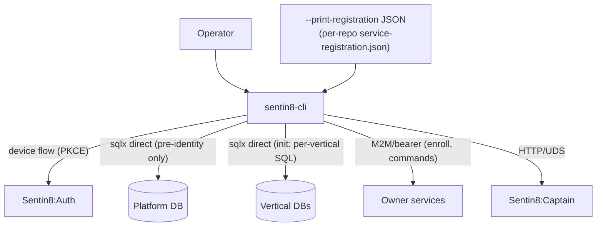
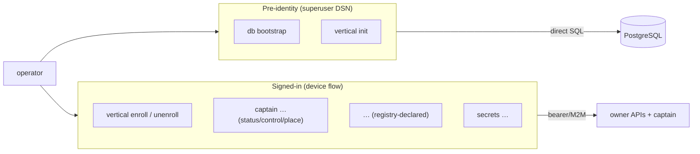

# DESIGN.md: Sentin8:CLI — Detailed Design Document

> Wire-level construction of `sentin8-cli`. The overview lives in
> `README.md`; the operator capability list in `BUSINESS.md`.

## 1. Scope & Context

The CLI is the **bootstrap + enrollment + control** starter. It links
ONLY the SDK plane (invariant RS-2 — starters never link services) and
executes two kinds of authority:

- **Database-plane authority** (pre-identity): `db bootstrap` and
  `vertical init` run SQL directly as the DDL superuser — the only
  credential available before Sentin8:Auth exists. `db bootstrap` is the
  ONLY command that applies platform SQL; it refuses when the
  `sys.platform_bootstrap` scout exists (BOOTSTRAP-1: the database has
  exactly two states).
- **Identity-plane authority** (post-identity): every other command
  (enroll, captain control, secrets, service commands) requires a
  signed-in operator (device-flow bearer) and calls owner APIs / the
  captain API — never direct SQL.

## 2. Runtime Architecture

| Module | Role |
|---|---|
| `main.rs` / `lib.rs` | Command tree (clap); boot-time helpers. |
| `auth.rs` | Device-flow operator sign-in (PKCE, token persistence + refresh); `get_valid_token_blocking`. |
| `db.rs` | `db bootstrap` (`migrations/platform.sql` + `public_helpers.sql`, scout-gated), `db migrate` (`--sql-dir` service SQL), `db seed-listings`. |
| `vertical_registry.rs` | Composable enrollment: read `--print-registration --section=…` JSON from each repo, merge fragments per vertical, upsert registry tables (`sentin8_vertical_services`, admin scopes, policies, relations, **schedules** (SDD §2.4), error codes, consent providers, app store listings, captain catalog entries, Valkey keys) — idempotent. |
| `captain.rs` | Fleet control: start/stop/restart, per-instance restart/stop/start/upgrade (+ UDS transport), status tables, autoscaler view + approve/reject, **`captain place`** (FLEET-4 hand placement). |
| `transport.rs` | Captain transport resolution: local UDS (`SO_PEERCRED`) when on the same machine; HTTP for remote hosts. |
| `commands.rs` | Declarative service commands — subcommands resolved from the registry (`service_commands` table), no hardcoded per-service command list. |
| `secrets.rs`, `func.rs`, `infra.rs` | Secret-reference management, func tooling, infra helpers. |
| `call.rs` | Generic authenticated HTTP call plumbing. |

## 3. Data Model — what the CLI writes

The CLI owns **no tables of its own**; it is the provisioning WRITER for:

| Target | Written by | Idempotency |
|---|---|---|
| `sys.platform_bootstrap` | `db bootstrap` (scout — written ONCE) | refuses re-run |
| Platform roles/schemas/grants | `platform.sql` (bootstrap, DO-block guarded) | converges (re-run safe) |
| Vertical databases + schemas + RLS | `vertical init` from per-repo `sql/` | converge-on-apply |
| `sentin8_vertical_services` + friends | `vertical enroll` | upsert per (vertical, service) |
| `cron.schedules` | `vertical enroll --section=schedules` | upsert idempotent (SDD §2.4) |
| Valkey `captain:*` catalog keys | `vertical enroll` | upsert |
| Operator device tokens | local credential store (user-scoped) | rotate on refresh |

## 4. API/Command Surface

Command families (see `README.md` §4): `db`, `vertical`, `captain`,
per-service registry-declared commands, `secrets`.

## 5. Cross-Cutting Concerns

- **Auth states**: BOOTSTRAP-1's two-state contract — pre-identity
  commands work only with the DDL superuser; post-identity, every CLI
  action requires the signed-in operator. `db bootstrap` refuses to run
  on an initialized platform (the scout + table-presence guard also
  catches half-finished bootstraps).
- **SQL loading**: platform SQL is embedded (`include_str!`); service SQL
  is runtime-loaded from `--sql-dir` paths (the CLI binary stays
  decoupled from any service's schema).
- **Registration consumption**: the CLI never hardcodes a service's
  surface — every service self-describes via `--print-registration`
  sections (`service`, `admin_scopes`, `policies`, `relations`,
  `m2m_grants`, `schedules`, `admin_ui`, `error_codes`, `consent`,
  `pg_roles`, `commands`).
- **Captain control channel**: UDS with kernel-proven `SO_PEERCRED` for
  same-machine control; Shield-gated HTTP for remote; `captain place`
  builds a per-machine HTTP call (FLEET-4).
- **Secrets posture**: the CLI never stores DSNs or secrets it provisions
  — they live in the operator env (`.env`) and flow via `database_env_vars`
  declarations at spawn; the device-flow token store is user-scoped.
- **Operator env loading**: every CLI subcommand loads the tree-root
  operator `.env` via `dotenvy::dotenv()` — and `scripts/dev-destroy.sh`
  (the destructive local reset, DEVRESET-1) sources the SAME file
  explicitly before its first step, refusing loudly when absent: the
  script's maintenance connection (certificate identity, `postgres-ops`
  pair) and its `captain stop` precondition must behave identically from
  a fresh shell and an operator session, and a half-destroyed workspace
  (fleet stopped, databases untouched) must never result from a missing
  environment.

## 6. Failure Modes & Recovery

| Failure | Behavior |
|---|---|
| `db bootstrap` on an initialized platform | Refuse (scout exists) — never a second window |
| Half-finished bootstrap (tables present, scout absent) | Treated as initialized; recovery = repo `dev-destroy.sh` (dev-guarded), never a destructive CLI command |
| Enroll against an unreachable Auth/DB | Clear error; upserts are idempotent — re-run converges |
| Captain unreachable over UDS | Transport falls back / errors distinctly (401/403 surface as auth, not transport) |
| Device token expired | Refresh; on refresh failure, re-run device flow |

## 7. Concurrency & Performance Model

Single-process, request-scoped — no daemons. sqlx pools created per
command run; enrollment merges fragments in memory before upserting
(one connection per target database).

## 8. Invariants

1. `db bootstrap` is the only platform-SQL applier and refuses
   re-initialization.
2. No destructive command exists in the shipped CLI (dev reset is the
   guarded repo script).
3. Starters link no service binary (RS-2); every service surface is
   registry-declared.
4. All enrollment upserts are idempotent — convergence on re-run.
5. The operator token never leaves the local store; secrets flow
   by-reference.

## 9. Testing Strategy

- Unit: enrollment fragment merging, schedule upsert SQL shapes,
  transport resolution, bootstrap scout logic.
- Integration (DB/Valkey-gated): bootstrap convergence on a fresh
  database; enroll upsert idempotency (run twice → same rows).
- Deliberately NOT tested here: cloud provisioning modules, real device
  flows.

## 10. Open Questions

- Packaged-install enrollment (the vendored-registry path) tracks with
  the packaging backlog (SD-7).
- A `captain enroll-remote` convenience (drive a fresh machine's enroll
  from the CLI) may follow the FLEET E2E story.

---

**Design attribution:** sentin8:cli and its underlying concepts were designed by Hamid Jahanzad <Hamid@Jahanzad.com>.

