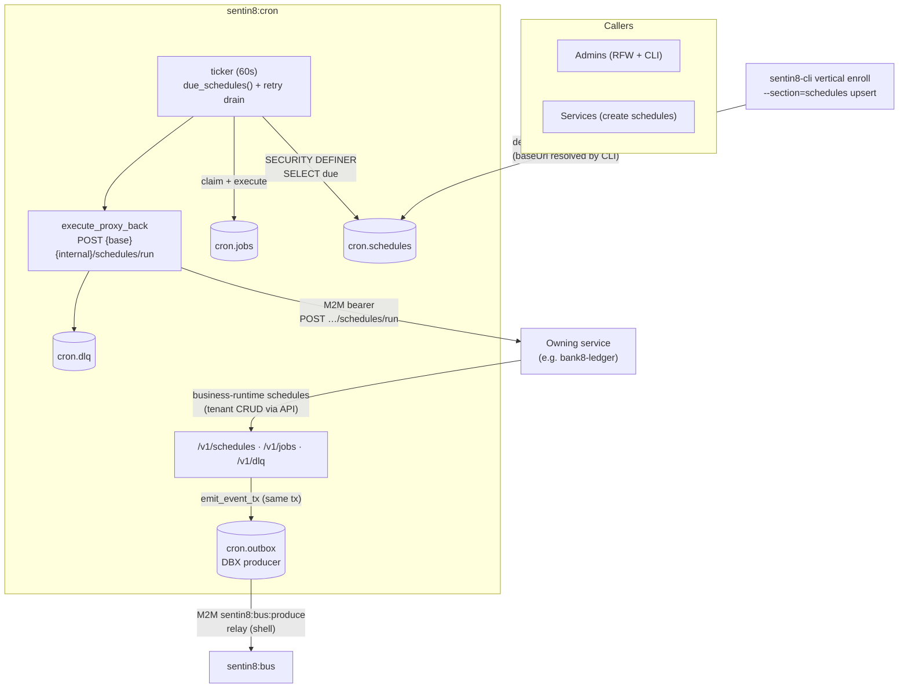
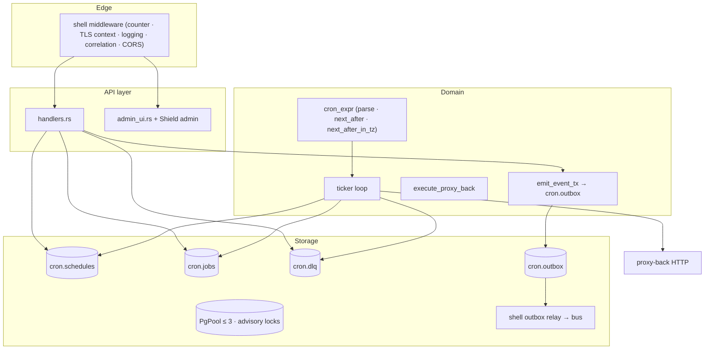
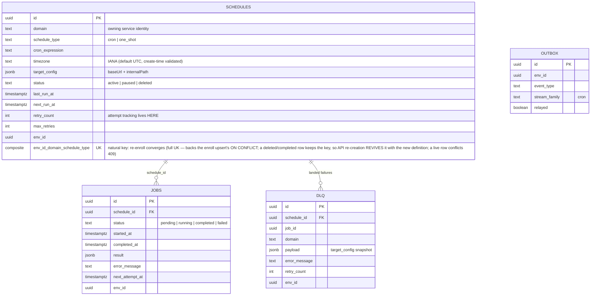
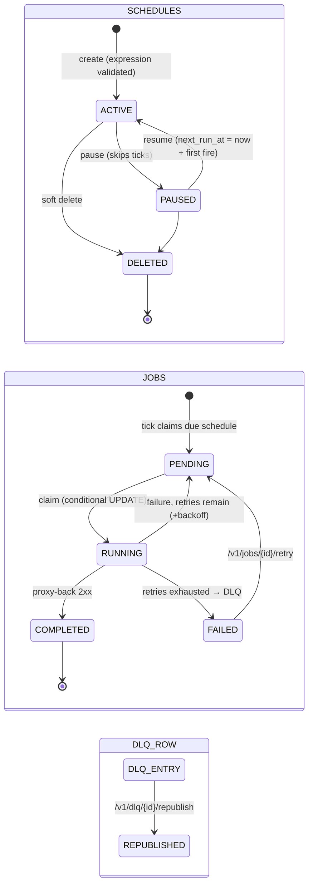
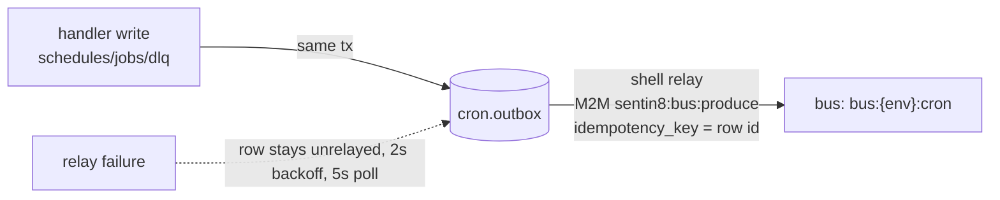
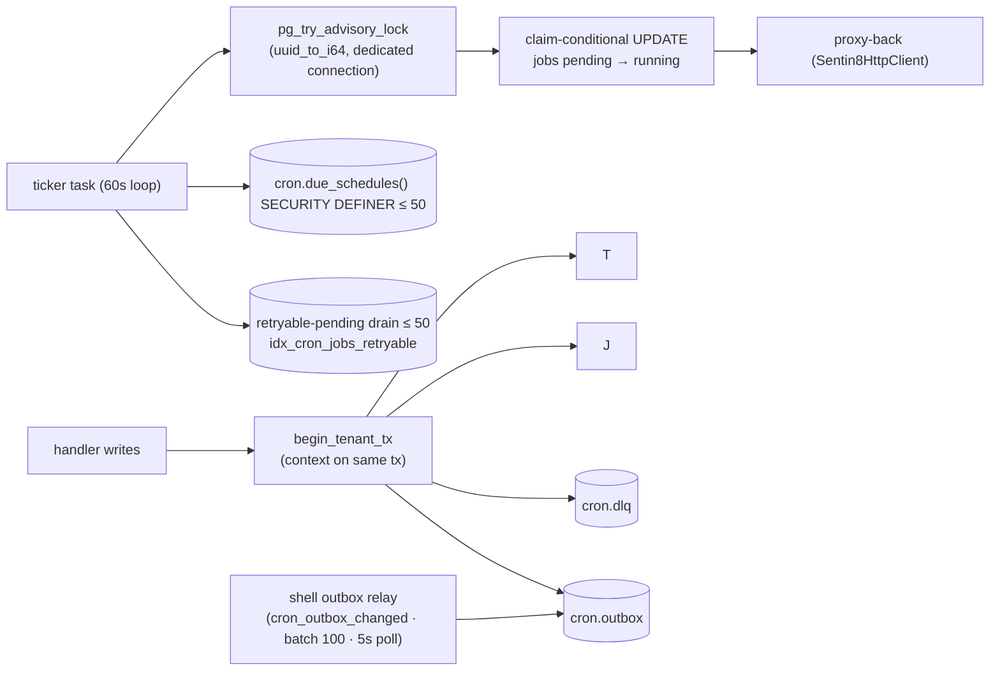
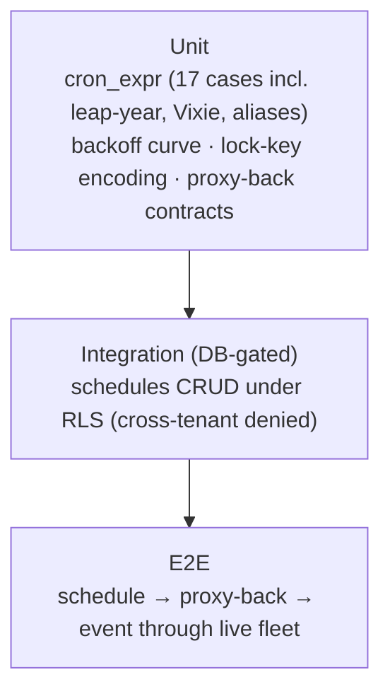

# DESIGN.md: Sentin8:Cron — Detailed Design Document

## 1. Scope & Context

Sentin8:Cron is the platform's standalone scheduler: declarative cron and
one-shot schedules whose execution is delegated to the owning service via
an authenticated proxy-back call (`POST {base}{internal}/schedules/run`).
Cron owns the schedule + job execution records and the DLQ; it delegates
all event publication to its local outbox (Bus produce path) and never
runs domain logic itself.

- **Owns** (schema `cron`): `schedules` (definition + retry state),
  `jobs` (execution records), `dlq` (dead-letter), `outbox` (DBX
  producer table), `audit_journal`, and the `cron.due_schedules()`
  SECURITY DEFINER read helper.
- **Provisions** (does not author): recurring internal schedules declared
  by services in their registration (`schedules` section — `ScheduleDecl`,
  SDD §2.4). `sentin8-cli vertical enroll` reads
  `--print-registration --section=schedules` and upserts `cron.schedules`
  rows idempotently (`schedule_type` unique per (env, domain)); the CLI
  resolves `target_config.baseUrl` from the platform domain. Services
  make no boot-time cron registration calls (SDD D2/D3).
- **Does NOT own**: the scheduled work itself (proxy-back to the owning
  service's internal API), leader election (single in-process ticker —
  no Valkey lease), policy evaluation of targets, or retries' business
  semantics (mechanical backoff only).



Trust boundary: cron holds an M2M identity for the proxy-back bearer; the
target service enforces its own authorization on
`/v1/internal/schedules/run`. Tenant data stays in the owning service's
schema — cron's rows are execution bookkeeping only.

## 2. Runtime Architecture

| Module | Role |
|---|---|
| `handlers.rs` | Schedule/job/DLQ CRUD + pause/resume/retry/republish; `begin_tenant_tx` (RLS on the same tx); `resolve_env_id` (target_env_id REQUIRED); `emit_event_tx` (outbox in the domain tx; failure aborts the domain write). |
| `ticker.rs` | One spawned loop (default 60s): `cron.due_schedules()` (≤50) → process each under an advisory lock; retryable-pending drain (≤50) with claim-conditional UPDATE; backoff `60s × 2^retry` capped 3600s. |
| `cron_expr.rs` | 5-field parser/evaluator: aliases (`@hourly`…), Vixie dom/dow OR semantics, strictly-after `next_after` with month fast-path and 4-year horizon, timezone-aware `next_after_in_tz` (chrono-tz: scans local wall time, maps back to UTC DST-safe earliest fold), `validate()`. |
| `admin_ui.rs` | RFW pages (overview, jobs, schedules with row actions, schedules/new form) + data endpoints (RLS-contexted, `target_env_id` required). |
| `config.rs` | Ticker interval, job timeout (parsed), per-process M2M settings + dev token fallback. |
| `policy.rs` / `auth.rs` / `registration.rs` | Shield bridge; thin bearer verify; self-description. |



**Tick lifecycle (the sole background family):**

```mermaid
sequenceDiagram
    autonumber
    participant T as ticker (60s)
    participant DB as cron.due_schedules()
    participant S as schedules row
    participant J as cron.jobs
    participant OW as Owning service
    participant OB as cron.outbox

    T->>DB: SELECT ≤ 50 due (status active, next_run_at ≤ now)
    loop each due schedule
        T->>T: pg_try_advisory_lock(uuid → i64) on a dedicated connection
        alt lock acquired
            T->>J: claim: UPDATE jobs SET status='running' WHERE status='pending'
            alt claim 0 rows (open job exists)
                T->>T: unlock; skip
            else claimed
                T->>OW: POST {base}{internal}/schedules/run<br/>(M2M bearer, envelope + idempotency_key)
                alt 2xx
                    T->>J: completed (result, completed_at)
                    T->>S: retry_count=0, next_run_at=next_after(expr)
                    T->>OB: outbox sentin8:cron:schedule:completed
                else failure
                    alt retries exhausted
                        T->>DLQ: INSERT dlq row + job → failed
                        T->>S: retry_count=0, next_run_at=next_after(expr)
                        T->>OB: outbox sentin8:cron:schedule:failed
                    else retries remain
                        T->>J: pending, next_attempt_at = now + backoff(2^retry cap 1h)
                        T->>S: retry_count++, next_run_at = now + delay
                    end
                end
            end
            T->>T: pg_advisory_unlock
        end
    end
```

## 3. Data Model



- `schedules` — RLS FORCE (policies match `env_id`); partial indexes for
  due selection (`next_run_at WHERE status='active'`) and per-domain
  listing. Soft delete (`status='deleted'`) retains rows so audit/DLQ
  references resolve.
- `jobs` — unique partial index `sentin8_cron_jobs_open_per_schedule ON
  (schedule_id) WHERE status IN ('pending','running')` — exactly one open
  job per schedule (mutual-exclusion backstop to the advisory lock). No
  DELETE policy (rows retained).
- `dlq` — landed after retry exhaustion; `republish_dlq` inserts a fresh
  pending job and deletes the DLQ row in one transaction.
- `cron.due_schedules()` — SECURITY DEFINER (the service role is
  NOBYPASSRLS): the only cross-tenant read; returns ≤50 due active
  schedules ordered by `next_run_at`.



## 4. API Surface

| Endpoint | Method | Gate | Notes |
|---|---|---|---|
| `/v1/schedules` | POST | Shield `sentin8:cron:write` | Expression validated (400 on invalid / no future fire). |
| `/v1/schedules` | GET | verify_token | list (excludes deleted). |
| `/v1/schedules/{id}` | GET | verify_token | single row. |
| `/v1/schedules/{id}` | DELETE | Shield `sentin8:cron:write` | soft delete. |
| `/v1/schedules/{id}` | PATCH | Shield `sentin8:cron:write` | `{status: "paused" | "active"}` — pause/resume via status; resume recomputes `next_run_at` from now. |
| `/v1/schedules/{id}/pause` · `/resume` | POST | verify_token | resume recomputes `next_run_at` from now. |
| `/v1/schedules/{id}/delete` | POST | Shield `sentin8:cron:write` | RFW row-action alias. |
| `/v1/jobs`, `/v1/jobs/{id}` | GET | verify_token | filters `schedule_id`/`status`, LIMIT 100. |
| `/v1/jobs/{id}/retry` | POST | verify_token | failed → pending, immediate attempt. |
| `/v1/dlq`, `/v1/dlq/{id}` | GET | verify_token | filter by `domain`. |
| `/v1/dlq/{id}/republish` | POST | verify_token | fresh pending job + DLQ row removed (same tx). |
| `/v1/health` | GET | none | ticker liveness (`LAST_TICK` within 3×interval) + counts. |
| `/v1/admin/ui/{page}`, `/v1/admin/{resource}` | GET | `has_any_scope(cron:write|cron:read|sys:admin|sys:org:admin|sys:env:admin)` | `target_env_id` required. |
| Shield admin API | mixed | Shield policy-admin surface | shared bridge. |

Event flow (producer-only; family `cron`):



Event types: `sentin8:cron:schedule:created|deleted|paused|resumed|completed|failed`,
`sentin8:cron:job:retried`, `sentin8:cron:dlq:republished` — payload-complete
(schedule_id, job_id, domain, schedule_type, env_id, result/error,
retry_count, `correlation_id = schedule_id`, `idempotency_key =
"schedule:{schedule_id}:{job_id}"` for proxy-back).

## 5. Cross-Cutting Concerns

- **Authentication**: bearer verify via the shared Auth SDK client
  (JWKS); no local jti/audience logic (thin wrapper over
  `sentin8::auth::client::verify_bearer_token`); proxy-back authenticates
  with the service's own M2M token (DCR TokenSource when wired; dev
  fallback `SENTIN8_CRON_TOKEN`).
- **Tenant resolution + RLS**: `target_env_id` is REQUIRED on env-scoped
  handlers and admin data (400 when missing — never a token-env
  fallback); all tenant reads/writes set the transaction-local context on
  the same connection; ticker reads ride the SECURITY DEFINER
  `cron.due_schedules()` because the role is NOBYPASSRLS.
  Transaction-locality rule (§5, applies to the ticker too):
  `sentin8_set_tenant_context` and every statement that must see/check
  that context run inside ONE transaction — sqlx statements outside
  `begin()` are autocommit, and `set_config(..., true)` evaporates at
  the context-set statement's own commit. The ticker's job record
  (context + `INSERT INTO cron.jobs`) is a single transaction on the
  advisory-lock connection; a contextless INSERT would trip the jobs
  INSERT policy on every due schedule.
- **Idempotency & exactly-once**: proxy-back envelope carries
  `idempotency_key = "schedule:{schedule_id}:{job_id}"` (the owner
  dedupes); the open-job unique index plus the advisory lock plus the
  claim-conditional UPDATE make a schedule unable to run concurrently.
- **Audit journaling**: `cron.audit_journal` (generated) for the shared
  journal pusher; domain events carry the audit context in their payloads.
- **Graceful drain**: shell TLS serve; the ticker sleeps between ticks and
  holds no long-lived claims (lock released in the same request scope).
- **TLS posture**: PQ provider installed at shell boot; proxy-back rides
  the shared `Sentin8HttpClient` (platform CA).

## 6. Failure Modes & Recovery

```mermaid
flowchart TD
    A[tick: due + retry drain ≤ 50 each] --> B{advisory lock free?}
    B -->|no| SKIP[unlock; skip this pass]
    B -->|yes| C[claim open job]
    C -->|0 rows| SKIP
    C --> D[proxy-back POST]
    D -->|2xx| OK[job completed<br/>retry_count=0 · next_run_at=next fire · event completed]
    D -->|fail| E{retries < max_retries?}
    E -->|yes| R[job pending + next_attempt_at = now + 2^retry × 60s cap 1h<br/>schedule delay + retry_count++ · event job:retried]
    E -->|no| F[DLQ insert + job failed<br/>retry_count=0 · schedule continues at next fire<br/>event schedule:failed]
    R --> A
    F --> A
    G[tick error] --> W[warn; next tick after interval]
    H[Bus outage] --> I[outbox rows unrelayed; relay retries 2s/5s]
    J[Service outage] --> K[retries → DLQ → manual /v1/dlq/{id}/republish]
```

- **Proxy-back failures** map to precise errors (`missing baseUrl in
  target_config`, `proxy-back status {n}`, `proxy-back decode: …`,
  `no M2M token source configured (set SENTIN8_CRON_TOKEN for dev)`).
- **Misfire semantics**: missed ticks are skipped, never hot-looped —
  `next_fire` is strictly after the reference time; unparseable stored
  expressions fall back to `now + 1h`.
- **Ticker error** logs and continues (next interval); a per-schedule
  failure never aborts the batch.
- **Relay failure**: Bus outage leaves rows unrelayed in `cron.outbox`
  (2s push backoff, 5s safety poll) — the event survives and retries.

## 7. Concurrency & Performance Model



- **Single ticker task** (default 60s interval) — no leader election: the
  advisory lock + claim-conditional UPDATE make concurrent multi-instance
  deployment safe, but today only one loop exists per process.
- **Pool cap 3**; each schedule processing takes a dedicated pooled
  connection for the advisory lock (unlock always on the same connection,
  warning if the lock was not held).
- **Hot paths**: the due-index and retryable-index queries (partial
  indexes), one claim UPDATE, one HTTP call per schedule — O(due) per
  tick, batched at 50.
- **No Valkey dependency** at all: no lease, no metrics channel beyond the
  shell-owned middleware publishers.

## 8. Invariants, Insecure-Defaults Rejected, Unsafe Rationale

1. Every tenant write sets the RLS context in the same transaction; the
   ticker's cross-tenant read goes only through `cron.due_schedules()`
   (SECURITY DEFINER, env ids only implied by row selection).
2. `target_env_id` is required everywhere an env is addressed (400 when
   missing; no silent fallback).
3. Exactly one open job per schedule (unique partial index) + advisory
   lock + claim-conditional UPDATE — a schedule never runs concurrently
   with itself.
4. `next_run_at` advances on success, retry, and DLQ — no hot-looping;
   `retry_count` resets on success and DLQ landing.
5. Events are outbox-first: the event + domain change commit atomically;
   a failed emission aborts the domain write (fail-closed).
6. Soft-delete retention: DLQ and audit references always resolve.
7. Cron math is UTC-based (`next_run_at` is always a UTC instant) with
   Vixie dow semantics (`7` == Sunday; dom/dow OR when both restricted);
   create/resume validate expressions. A schedule's optional IANA
   `timezone` (default `'UTC'`, validated at create time) is evaluated by
   `next_after_in_tz`: the wall-clock fields match LOCAL time in the zone
   and the result maps back to the earliest UTC fold (DST-safe); the
   ticker (`next_fire_in_tz`) and both resume paths use it. Bad zones are
   400s at create; stored fallback is UTC evaluation.
8. DLQ landing never stops the schedule — the schedule advances to its
   next fire; republish is manual.
9. No `unsafe` code; no static auth tokens in `target_config` (the M2M
   token source is the only bearer for proxy-back; the dev static token
   is a fallback that real deployments must not rely on).

## 9. Testing Strategy



- Pure tests pin the cron evaluator (every-minute, monthly fast-path,
  day-of-week, `@hourly` aliases, Feb-29, rejects), the lock-key
  derivation (first 8 UUID bytes → i64), and the proxy-back HTTP contract
  (raw listener asserting path, envelope, status mapping).
- DB-backed tests connect as `sentin8_cron_service` and self-skip without
  PostgreSQL.
- **Deliberately NOT tested here**: multi-instance advisory-lock races
  (covered by the unique index semantics), relay behavior (bus suite),
  TLS (platform suite).

## 10. Open Questions

- The M2M token source is wired in `build_state` via
  `register_or_load_m2m_client` (the canonical wiring).
- `execute_proxy_back` is wrapped in
  `tokio::time::timeout(config.job_timeout)`; on timeout the job records a
  failure and returns to the retry path.
- `SENTIN8_CRON_MAX_RETRIES` is removed (per-schedule `max_retries` is the
  authoritative per-row control).
- The DSN naming standardizes on the propagated `SENTIN8_CRON_DATABASE_URL`
  (captain propagates that form); the alias is dropped.
- The single in-process ticker is the documented concurrency contract
  (advisory locks plus the open question of a distributed lease if
  multi-instance cron arrives).

---

**Design attribution:** sentin8:cron and its underlying concepts were designed by Hamid Jahanzad <Hamid@Jahanzad.com>.

