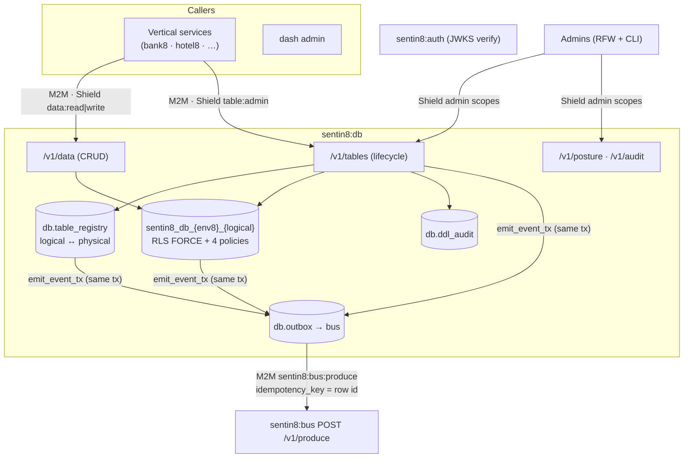
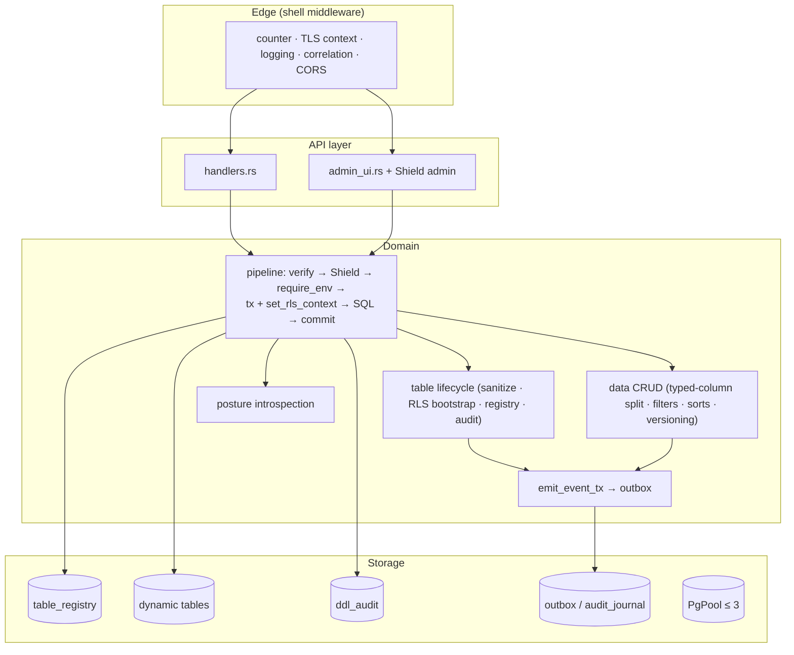
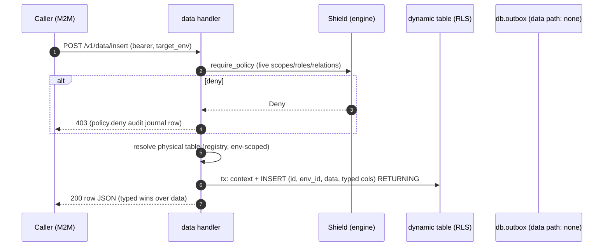
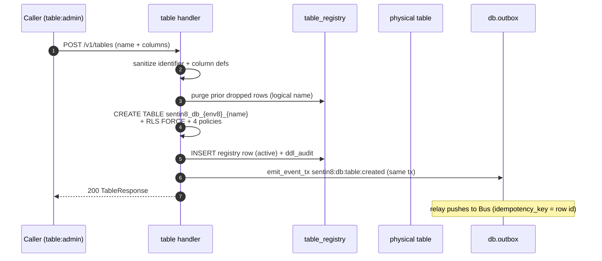
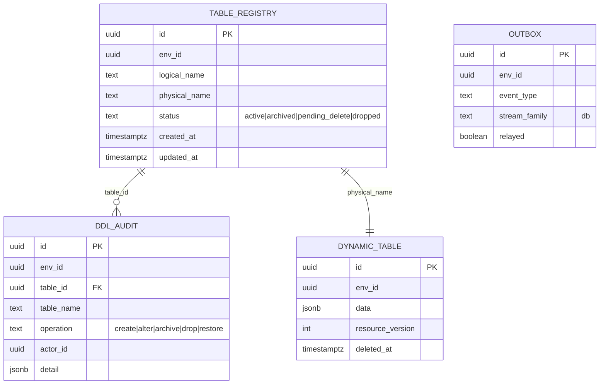
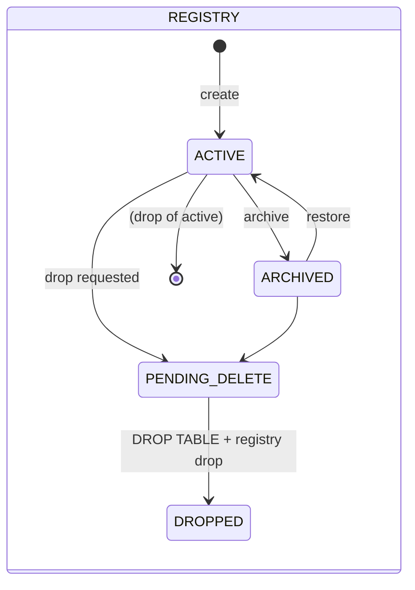
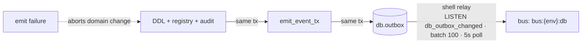
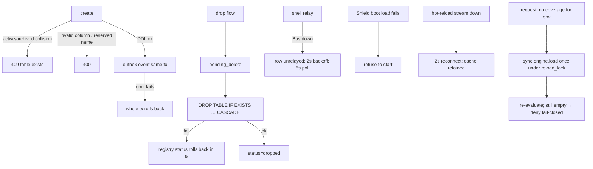
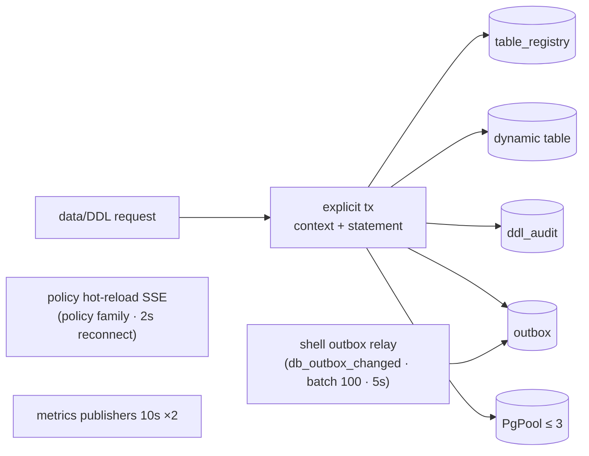
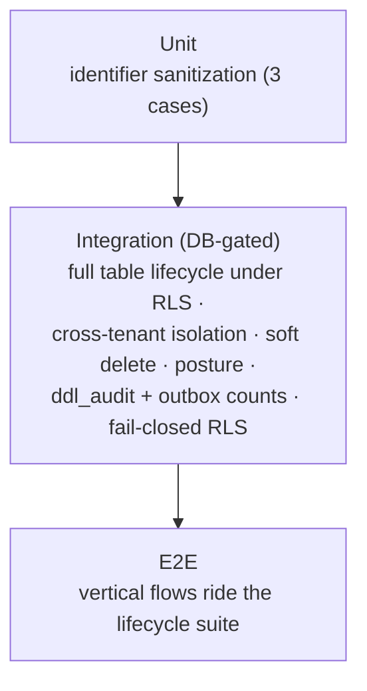

# Sentin8:DB - Detailed Design Document

## 1. Scope & Context

Sentin8:DB is the platform's structured-persistence service: dynamic
tenant tables with a logical/physical registry, a JSON-document data API
with optimistic concurrency and soft deletes, an RLS-drift posture
surface, and a DDL audit trail. Tenant tables are created per environment
(`sentin8_db_{env8}_{logical}`) with mandatory row-level security; the
service role is NOBYPASSRLS and every statement runs under a
transaction-local tenant context.

- **Owns** (schema `db`): `table_registry` (logical ↔ physical mapping +
  lifecycle status), `ddl_audit` (DDL history), `outbox` (DBX producer),
  `audit_journal` (local spill journal), plus every dynamic tenant table
  it creates (system columns + user-typed columns, RLS + 4 policies).
- **Does NOT own**: business schema design (callers define tables and
  rows), identity (bearer verify via the shared Auth SDK), Shield policy
  storage (sys's `policy_sets` substrate; an engine runs on it), and raw
  SQL access (there is no free-form SQL endpoint - the surface is
  tables + data CRUD + posture).

Trust boundary: the service role holds `CREATE` on schema `db` (dynamic
DDL) but never BYPASSRLS; every tenant read/write is RLS-gated and the
context must be set inside the caller's transaction.

## 2. Runtime Architecture

| Module | Role |
|---|---|
| `handlers.rs` | Table lifecycle (create/alter/archive/drop/restore), data CRUD (query/insert/update/delete), posture, audit log, health; `emit_event_tx` (outbox inside the domain tx); `sanitize_identifier`, `resolve_physical_table`, `row_to_json`. |
| `rls.rs` | `set_rls_context(_ext)` - tenant context setters (6-arg and 8-arg forms) run inside the caller's transaction. |
| `admin_ui.rs` | RFW pages (overview, tables/new form, posture, audit, settings) + admin data + POST aliases delegating to the domain handlers. |
| `server.rs` / `config.rs` / `policy.rs` / `registration.rs` / `openapi.rs` | Router; env config; Shield bridge; self-description. |

**Data mutation lifecycle (dominant family):**

**Table lifecycle (DDL family):**

## 3. Data Model

- `table_registry` - `UNIQUE (env_id, physical_name)` and
  `UNIQUE (env_id, logical_name, status)`; RLS FORCE with 4 env-scoped
  policies. Lifecycle state machine below; prior `dropped` rows for a
  logical name are purged on reuse.
- `ddl_audit` - append-only (select + insert policies); one row per DDL
  operation with actor + detail.
- **Dynamic tenant tables** - system columns (`id`, `env_id`, `data`
  JSONB, `created_at`, `updated_at`, `resource_version`,
  `deleted_at`) plus user-typed columns; every table gets `ENABLE +
  FORCE RLS` and exactly four policies
  (`{physical}_select|insert|update|delete`) gated on
  `(sentin8_context_initialized(), env_id)`. Posture flags drift
  (`rls_not_enabled`, `rls_not_forced`, `missing_policies` < 4).
- `db.outbox` / `db.audit_journal` - generated DBX tables; the shell
  relay drains `db.outbox` to Bus produce (idempotency = row id);
  `audit_journal` is the Sys spill journal (pusher not yet wired in this
  service).

## 4. API Surface

| Endpoint | Method | Gate | Notes |
|---|---|---|---|
| `/v1/health` | GET | none | build hash payload. |
| `/v1/tables` | POST / GET | `sentin8:db:table:admin` / `data:read` | create vs list. |
| `/v1/tables/{id}` | GET | `data:read` | env-scoped (foreign env → 404). |
| `/v1/tables/{id}/alter` · `/archive` · `/drop` | POST | `table:admin` | alter adds columns; drop = `pending_delete` → physical DROP. |
| `/v1/data/query` | POST | `data:read` | scalar filters, declared-column sorts, limit ≤ 1000; keyset pagination - `pagination.after` (a UUID cursor on `id`) takes precedence over `offset` and pins the order to `(sort, id)`, with `next_cursor` in the response. The binder supplies exactly what the chosen SQL form declares (filter binds → limit → keyset cursor or an explicit offset 0) - a bind/SQL mismatch aborts the statement. |
| `/v1/data/insert` · `/update` · `/delete` | POST | `data:write` | soft-delete only; `resource_version` optimistic predicate. |
| `/v1/posture` | GET | `posture:read` | RLS enable/force + policy count drift per table. |
| `/v1/audit` | GET | `audit:read` | DDL audit trail. |
| `/v1/admin/ui/{page}`, `/v1/admin/{resource}`, `/v1/admin/tables[/{id}/archive|drop]` | GET/POST | `has_any_scope(db:data:read|db:data:write|db:table:admin|db:posture:read)` (admin bypass) | admin aliases delegate to domain handlers. |
| Shield admin API (`/v1/admin/policy-sets|relations|attributes…`) | mixed | `sentin8:db:policy:read|write` | shared generic bridge. |
| `/openapi.json` | GET | shell | 12 paths. |

Event flow (producer; family `db`):

Event types: `sentin8:db:table:created|altered|archived|dropped`
(payloads `{id, table_name}` / `{id, columns_added}`).

## 5. Cross-Cutting Concerns

- **Authentication**: shared `verify_bearer_token` (JWKS, issuer);
  token-tp/user context rides the RLS context (subject, token_tp,
  scopes, admin flags).
- **Tenant resolution + RLS**: `target_env_id` resolved explicitly
  (`resolve_admin_env` - 400 when missing); cross-env targeting requires
  platform admin or RBAC membership checked under `SYSTEM_ENV_ID`;
  context always inside the same explicit transaction (pinned by the
  fail-closed test).
- **Idempotency**: registry uniqueness (409 on collision); produce
  idempotency by outbox row id; insert path is idempotent only by
  client-supplied id (not enforced server-side).
- **Injection safety**: identifiers sanitized to `[A-Za-z0-9_]` (empty →
  `_invalid_`); reserved columns (`id, env_id, data, created_at,
  updated_at, resource_version, deleted_at, usr_id, visibility`) never
  writable/filterable; only sanitized names interpolate - values are
  always bound parameters.
- **Audit journaling**: `ddl_audit` for every DDL (actor + scope +
  detail); Shield denies land in `audit_journal` (fire-and-forget,
  context set first).
- **Graceful drain / TLS posture**: shell-owned (TLS serve, PQ provider,
  pool cap, PG18 check).

## 6. Failure Modes & Recovery

- **Registry consistency**: the DDL, registry row, audit row, and event
  commit atomically; a failed drop rolls the registry status back.
- **Cross-tenant isolation** is tested end-to-end (env B sees 0 rows;
  registry reads are RLS-scoped too; a context-less transaction sees 0
  rows).
- **Journal push**: `db.audit_journal` rows stay `pushed=false` until a
  pusher runs (the shared `push_journal_to_sys` helper is not wired here
  yet).

## 7. Concurrency & Performance Model

- One explicit transaction per request; DDL + registry + audit + event
  are atomic.
- Hot paths: registry lookup (unique index), data CRUD (PK/env indexes on
  the dynamic table), posture (catalog introspection).
- Query caps: `limit` default 100, max 1000; relation slice cap 10,000
  tuples on the Shield side (over-cap evaluation fails closed).
- Tasks: outbox relay (shell), policy hot-reload SSE (2s reconnect),
  two metrics publishers (10s), request-time sync-reload on empty
  coverage (single-flight under the engine reload lock).

## 8. Invariants, Insecure-Defaults Rejected, Unsafe Rationale

1. RLS context must be set inside the same explicit transaction as the
   statement - a bare-pool statement filters to 0 rows (fail-closed,
   test-pinned).
2. Every dynamic tenant table ships `ENABLE + FORCE RLS` + exactly 4
   env policies; posture endpoints detect drift.
3. Explicit `WHERE env_id = $N` on every query in addition to RLS;
   foreign-env ids 404 (never 403 leaking existence).
4. Soft-delete only: data delete sets `deleted_at`; physical removal is
   only via the drop flow; queries exclude deleted rows.
5. Reserved columns are never writable or filterable through the data
   API; identifiers are sanitized before any interpolation; filter
   values are scalar-only.
6. Optimistic concurrency via optional `resource_version` predicate and
   automatic increment on update/soft-delete.
7. Registry + audit + event commit atomically with the DDL; event-emit
   failure aborts the domain change.
8. `env_id` on the wire is never trusted for identity filters - the RLS
   context and the token env are authoritative.
9. No `unsafe` code; all dynamic SQL interpolation is limited to
   sanitized identifiers.

## 9. Testing Strategy

- The DB-backed lifecycle test creates a table with RLS + registry +
  audit + outbox in one transaction, exercises typed/data split, both
  isolation directions, soft delete, posture flags, the exact DDL-audit
  and event counts, and verifies the physical drop.
- **Deliberately NOT tested here**: Shield engine semantics (policy
  crate suite), relay mechanics (bus/outbox suite), TLS (platform).

## 10. Open Questions

- The README's §3/§4 is aligned to the implemented surface (table lifecycle +
  data CRUD + posture); no new endpoint - arbitrary SQL is prohibited by
  design and the prohibition is documented as the security posture it is.
- `emit_event_tx` uses the `DB_STREAM_FAMILY` config value (default `"db"`
  unchanged); the dead config is removed.
- `main.rs`'s module doc is completed with the DESIGN.md reference (principles
  §9 doc hygiene).

---

**Architecture & Design:** sentin8:db and its underlying concepts were designed by [Hamid Jahanzad](https://www.linkedin.com/in/hamidjahanzad/).

