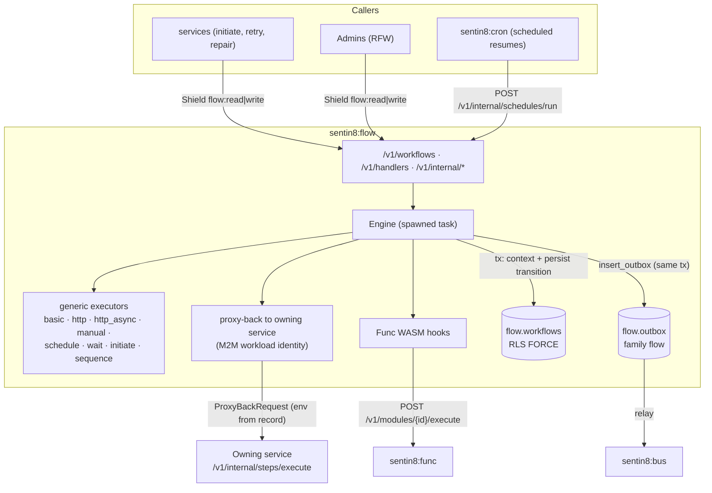
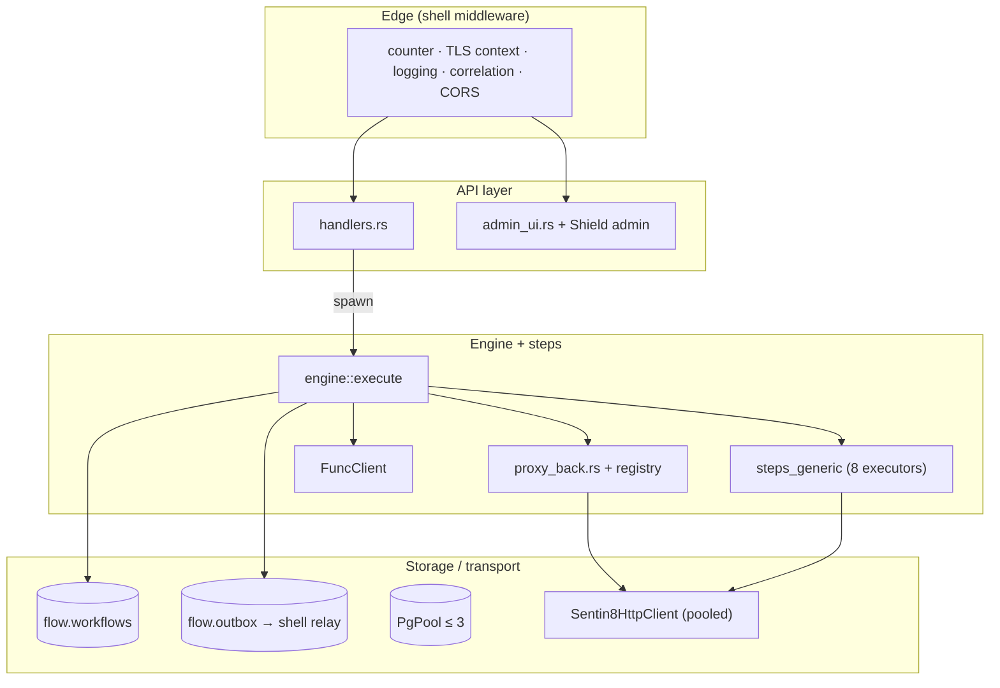
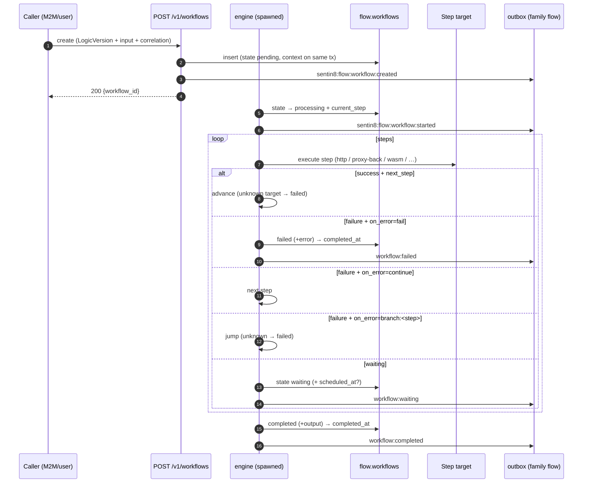
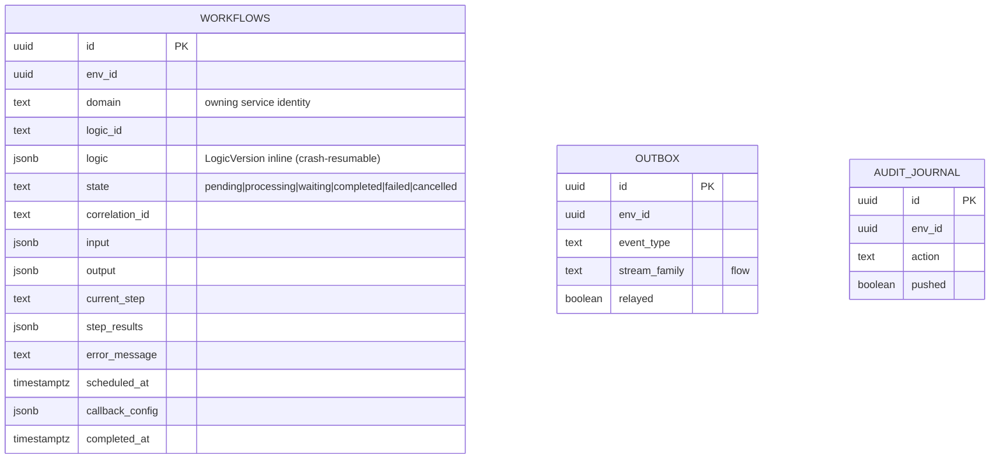
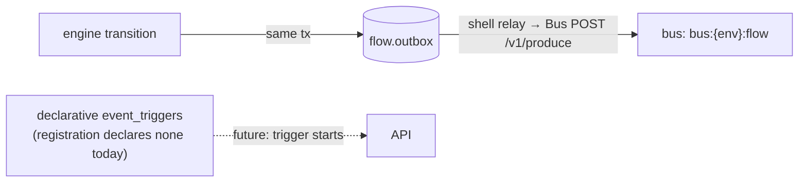
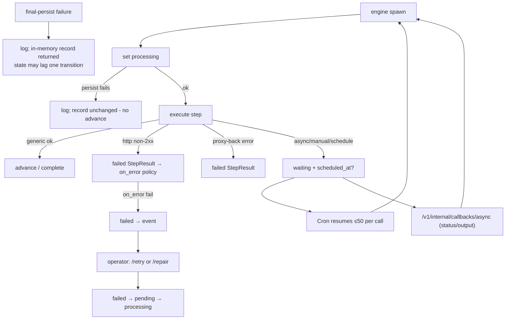
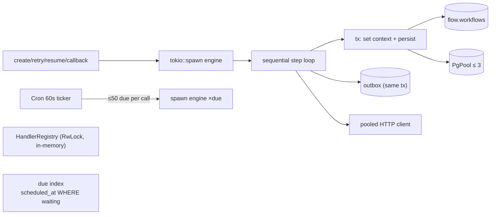
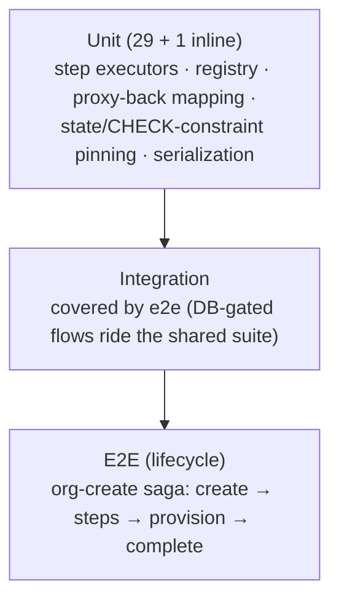

# DESIGN.md: Sentin8:Flow - Detailed Design Document

## 1. Scope & Context

Sentin8:Flow is the platform's workflow/step engine: it executes
declarative step sequences (generic executors + domain proxy-back steps +
WASM hooks), persists every transition, parks on async decisions, resumes
scheduled workflows when Sentin8:Cron calls the internal run endpoint,
and publishes lifecycle events through the DBX outbox path.

- **Owns** (schema `flow`): `workflows` (definition + state + step
  results + correlation), `outbox` (DBX producer table - the runtime
  event write goes here; the shell-spawned relay drains it to Bus),
  `audit_journal`, and the PG sequences created by `SequenceStep`
  (`sentin8_flow_seq_{key}`).
- **Does NOT own**: the domain logic inside steps (proxy-back to owning
  services), schedule due-ness (driven externally by Sentin8:Cron), the
  WASM modules (Sentin8:Func executes them), and event-triggered starts
  (`event_triggers` is declared empty - starts are API-triggered).

Trust boundary: proxy-back requests carry the workflow's `env_id` (the
tenant carrier - the M2M bearer identifies the service); the owning
service re-verifies the caller and enforces its own Shield gate.

## 2. Runtime Architecture

| Module | Role |
|---|---|
| `engine.rs` | Sequential step loop: set `processing` → execute current step → honor `on_error`/`next_step`/branch → persist final state; emits lifecycle events on the way. |
| `types.rs` | Wire types (`StepDef`, `LogicVersion`, `StepResult`, `CallbackConfig`, `ProxyBackRequest/Response`, `WorkflowRecord`) with string-tolerant deserializers (RFW forms). |
| `steps_generic.rs` | The 8 built-in executors and `StepOutcome::{Proceed, Waiting}`; `state_waiting()` parks with optional `scheduled_at`. |
| `proxy_back.rs` | Domain-step proxy-back + in-memory `HandlerRegistry` (env profiles at boot + `POST /v1/handlers/register`). |
| `func_integration.rs` | WASM hook execution via the Func client. |
| `store.rs` | Persistence: insert/get/list/update with context-on-same-tx; outbox inserts; logic reload. |
| `handlers.rs` | Lifecycle verbs (create/list/get/retry/repair/cancel/resume/register), internal schedule-run + async-callback, health. |
| `admin_ui.rs` | RFW overview/workflows/new/steps pages + shared policy pages; data endpoints require `target_env_id`. |

**Workflow execution lifecycle:**

## 3. Data Model

- `flow.workflows` - RLS FORCE
  (`sentin8_context_initialized() AND (sentin8_bypass_rls() OR env_id =
  sentin8_current_env_id())`); indexes by env/domain/state/correlation;
  the due index covers `scheduled_at WHERE state='waiting' AND
  scheduled_at IS NOT NULL` (Cron resumes ≤50 per call). `logic` is
  stored inline so retry/resume/schedule/callback can re-load the
  remaining steps without a second source of truth. No `org_id` column
  (pinned by test).
- `flow.outbox` - generated DBX table (`sentin8-outbox::
  outbox_table_sql("flow")`) with NOTIFY trigger (`flow_outbox_changed`)
  and FORCE-RLS; the shell-spawned relay (shell boot step 8b) drains it
  env-by-env via `sentin8_outbox_unrelayed_envs()` and pushes rows to Bus
  `POST /v1/produce` (M2M, scope `sentin8:bus:produce`).
- `flow.audit_journal` - shared journal shape (unpushed index).

```mermaid
stateDiagram-v2
    direction LR
    [*] --> pending: create
    pending --> processing: engine entry (workflow:started)
    processing --> completed: final step success
    processing --> failed: step failed (on_error=fail / bad branch)
    processing --> waiting: async / manual / schedule step
    processing --> cancelled: /cancel
    waiting --> processing: /resume (decision) or Cron due or async callback
    failed --> pending: /retry (resumes from current_step)
    pending --> pending: /repair (truncate results; engine NOT spawned)
    completed --> [*]
    failed --> [*]
    cancelled --> [*]
```

Step-result statuses: `success | failed | waiting`; a failed step is a
*data* outcome governed by `on_error` - engine transport errors become
failed results, not exceptions.

## 4. API Surface

| Endpoint | Method | Gate | Notes |
|---|---|---|---|
| `/v1/health` | GET | none | liveness. |
| `/v1/workflows` | POST | Shield `sentin8:flow:write` (+ optional `?target_env_id`) | inserts + spawns the engine. |
| `/v1/workflows` | GET | Shield `sentin8:flow:read` | filters domain/state/correlation, LIMIT 100. |
| `/v1/workflows/{id}` | GET | Shield `sentin8:flow:read` | full record. |
| `/v1/workflows/{id}/retry` | POST | Shield `sentin8:flow:write` | only `failed`; resumes from `current_step`. |
| `/v1/workflows/{id}/repair` | POST | Shield `sentin8:flow:write` | truncates `step_results` to `rewind_to` (+ new input); does NOT spawn the engine. |
| `/v1/workflows/{id}/cancel` | POST | Shield `sentin8:flow:write` | terminal cancel. |
| `/v1/workflows/{id}/resume` | POST | Shield `sentin8:flow:write` | only `waiting`; decision becomes the last step's output. |
| `/v1/handlers/register` | POST | Shield `sentin8:flow:write` | in-memory registry (domain-keyed). |
| `/v1/internal/schedules/run` | POST | token (Cron's M2M) | resumes ≤50 due waiting workflows. |
| `/v1/internal/callbacks/async` | POST | token | completes a waiting async step. |
| `/v1/admin/ui/{page}`, `/v1/admin/{resource}` | GET | `has_any_scope(flow:read|flow:write|sys:admin|sys:org:admin|sys:env:admin)` | `target_env_id` required. |
| Shield admin API | mixed | policy-admin surface | shared bridge. |

Env addressing (uniform across the workflow surface): every handler accepts
`?target_env_id` and resolves the tenant as query param -> token env claim ->
system default (user tokens carry no env claim - without the param they
address the system env, the platform plane). Transitions are
optimistic-concurrency guarded: the UPDATE only lands on pending/processing/
waiting rows matching what the caller read; a raced transition (the engine
completing a run between a caller's read and its cancel) is a 409 Conflict -
terminal states (completed/failed/cancelled) reject cancel/retry/resume with
409, never a surfaced RowNotFound 500.

Event flow (producer; family `flow`):

Event types: `sentin8:flow:workflow:created|started|completed|failed|waiting|updated|retried|repaired|cancelled|schedule:resumed`
(payloads: `{workflow_id, logic_id, domain}` / `{workflow_id, state}` /
`{workflow_id, current_step}` / `{workflow_id, rewind_to}`).

## 5. Cross-Cutting Concerns

- **Authentication**: certificate-first `verify_cert_or_token` for
  lifecycle verbs - an enrolled platform workload presents its Acme
  client certificate in the TLS handshake (the TLS layer CA-verifies
  and injects `X-Sentin8-Client-Cert-Subject/-Thumbprint`; the
  boot-loaded registry map is the authorization record - scopes,
  vertical, `enabled`). Bearer tokens remain the fallback for
  user/delegated callers. Shield gates on the API surface; platform
  admins bypass scope checks on internal verbs; proxy-back
  authenticates with the owning service's own certificate identity
  (`sentin8-flow-proxy-back`-style per-service workloads; the owning service
  declares the gate scope).
- **Tenant resolution + RLS**: every persistence call opens a
  transaction, awaits `sentin8_set_tenant_context($1)` on the same
  connection, then queries; the proxy-back tenant context comes from the
  workflow record (`ProxyBackRequest.env_id`), never from the caller.
- **Idempotency**: create/retry/resume re-run the engine unconditionally
  (no idempotency keys plumbed today); the owner-side step endpoints are
  the dedupe point (e.g. sys's steps use `ON CONFLICT` semantics).
- **Audit journaling**: `flow.audit_journal` for the shared pusher;
  workflow lifecycle events carry the audit trail (step_results are kept
  on failure/cancel).
- **Graceful drain**: shell TLS serve; engine tasks are fire-and-forget -
  a crash resumes from `current_step` + inline `logic` on the next
  retry/resume.
- **TLS posture**: PQ provider at shell boot; proxy-back + HTTP steps ride
  the shared pooled client with the platform CA.

## 6. Failure Modes & Recovery

- **No in-service DLQ**: failure is an operator path (retry from the
  failed step; repair rewinds to an earlier step with optional new
  input). Cancelled/failed records retain all step results.
- **Waiting without a deadline parks indefinitely** (no expiry path
  implemented).
- **Proxy-back auth fallback**: M2M token fetch failure → warn + static
  profile token fallback (scope-verifying owners reject it - surfaced as
  a failed step).
- **Scheduled resumes** rely on Cron's `/v1/internal/schedules/run`
  (≤50 per call); a Cron outage delays, never loses (rows stay
  `waiting`).

## 7. Concurrency & Performance Model

- One engine task per workflow run; steps run sequentially (no
  parallelism inside a logic version); persistence per transition.
- Registry (handler profiles) is process-local RwLock - not durable;
  env profiles re-seed at boot.
- Pool cap 3; engine persistence is short transactions (state +
  step-result append), so throughput is bounded by persistence latency,
  not by step execution.
- Waiting workflows are only active in the due index; no polling loops
  inside flow.

## 8. Invariants, Insecure-Defaults Rejected, Unsafe Rationale

1. Every state transition is persisted in its own transaction with the
   tenant context set transaction-local on the same connection; a crash
   resumes from `current_step` (`logic` stored inline).
2. The proxy-back tenant context comes from the workflow record's
   `env_id` - never from the caller's token (the bearer identifies the
   service only).
3. `WorkflowRecord` has no `org_id`; state wire values match the SQL
   CHECK constraint (both test-pinned).
4. `completed_at` is stamped once (`COALESCE`) for terminal states.
5. Failed/cancelled workflows keep their `step_results` (audit trail);
   repair truncates deliberately and records `workflow:repaired`.
6. Branch targets must exist (`branch target not found` → Failed) - no
   silent skips; `next_step` from the step def or the result may jump.
7. `SequenceStep` takes the PG sequence after tenant context -
   sequence names are per-env keys but the sequences themselves are
   schema-global (`sentin8_flow_seq_{key}`).
8. Waiting is durable: `scheduled_at` + the due index mean a parked
   workflow survives restarts and is resumed by Cron's run call.
9. No `unsafe` code; proxy-back and HTTP steps ride the shared client
   (TLS + platform CA); no static auth tokens in production paths (the
   static profile token is a fallback that scope-verifying owners
   reject).

## 9. Testing Strategy

- The pure suite pins every generic executor's waiting/failure contract,
  the registry overwrite semantics, the proxy-back URL assembly, and the
  wire-state ↔ SQL CHECK consistency.
- **Deliberately NOT tested here**: live Func execution (func suite),
  proxy-back against real owners (owner service tests + e2e), persistence
  races (single-writer per workflow via the engine task).

## 10. Open Questions

- Workflow create accepts an `idempotency_key` enforced by a unique partial
  index (`(env_id, logic_id, correlation_id) WHERE state='pending'` = create
  dedupe); the outbox produce rides the shared relay's row-id key.
- `update_workflow` gains an optimistic-concurrency guard (`WHERE state =
  $expected AND updated_at = $last_seen`).
- Undated `waiting` workflows are stamped with a default deadline from the
  step definition (the config default covers it).
- The `flow.outbox` drain surface is wired to the standard DBX path:
  `store::insert_outbox` writes `flow.outbox` via the shared crate helper,
  and the shell-spawned relay (shell boot step 8b) drains it - matching
  the producer path every shell service uses (principles §6.7).
- `SENTIN8_FLOW_STREAM_FAMILY` is removed - events are family `flow` by
  convention.
- `InitiateInstructionStep` spawns the child via the store's insert path
  (`store::insert_workflow`) - the child's `domain` comes from the step
  config (`domain`, defaulting to the parent's), and the child inherits
  the parent's `correlation_id` so the create-dedupe index covers replays
  of the parent create.

---

**Design attribution:** sentin8:flow and its underlying concepts were designed by Hamid Jahanzad <Hamid@Jahanzad.com>.

