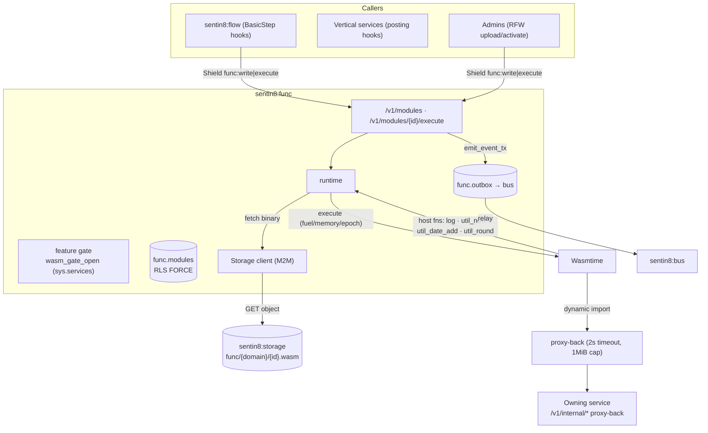
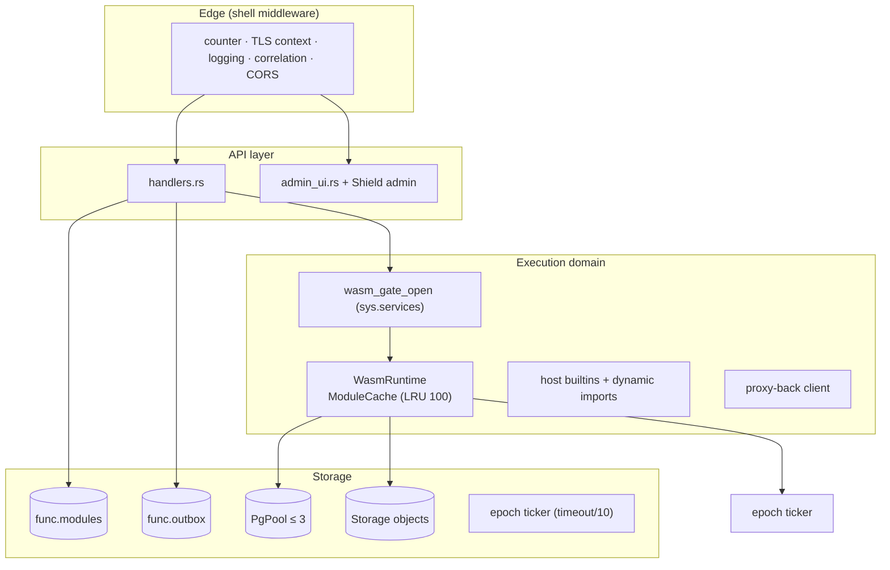
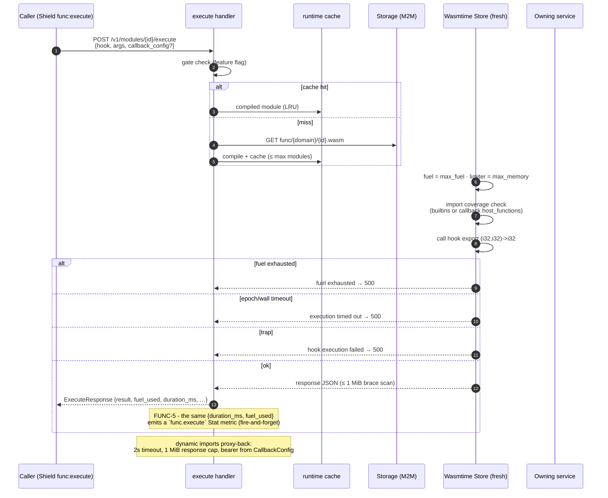
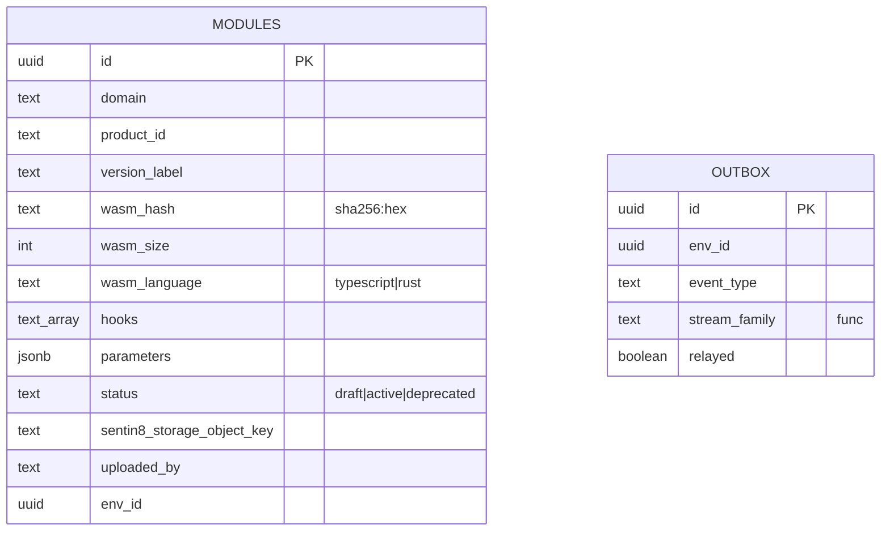
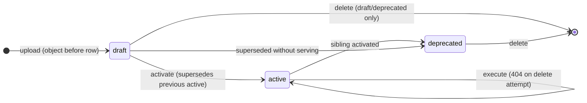
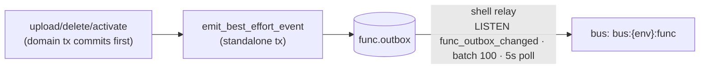
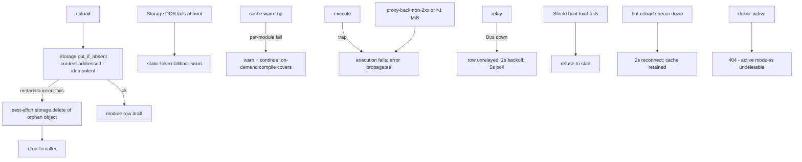
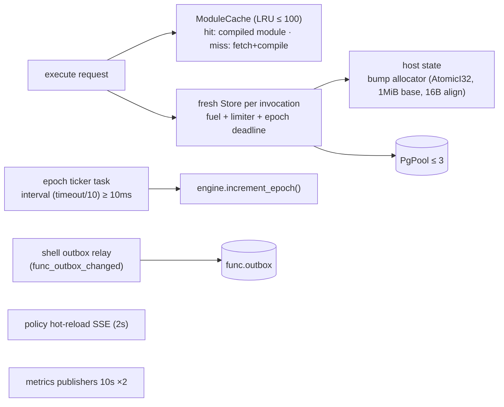
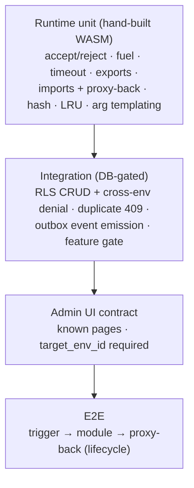

# Sentin8:Func - Detailed Design Document

## 1. Scope & Context

Sentin8:Func is the platform's standalone WASM execution service:
user-authored and service-authored modules are uploaded to Storage,
validated (imports/hooks), activated per (domain, product, environment),
and executed per hook under hard resource bounds - fuel, memory limiter,
epoch/wall-clock timeout, 1 MiB response caps - with host functions
proxy-calling back to owning services for domain data.

- **Owns** (schema `func`): `modules` (metadata + lifecycle +
  content-addressed Storage key), `outbox` (DBX producer), and
  `audit_journal`. Module binaries live in Sentin8:Storage
  (`func/{domain}/{id}.wasm`, content-addressed by sha256).
- **Does NOT own**: the WASM source/toolchain (uploads are compiled
  binaries), the hooks' business semantics (proxy-back to the owner), and
  trigger registration (declared empty - execution is API-triggered
  today, e.g. by Flow's `BasicStep`).

Trust boundary: a module can never escape the sandbox - linear memory
only, no WASI, imports restricted to the builtin namespace or
declared host functions, all host calls go through explicit
`CallbackConfig` URLs owned by the registering service.

## 2. Runtime Architecture

| Module | Role |
|---|---|
| `runtime.rs` | Wasmtime engine: fresh `Store` per invocation, fuel accounting, `ResourceLimiter` (memory), epoch deadline + ticker, LRU module cache, host builtins (`malloc`, `free`, `log`, `util_now`, `util_date_add`, `util_round`), dynamic-import proxy-back, `substitute_args` templating. |
| `handlers.rs` | Upload (Storage `put_if_absent` before row), list/get/delete/activate/validate/execute, feature gate, event emission, health. |
| `store.rs` | Module metadata CRUD - every op = explicit tx + `set_rls` on the same connection; duplicate checks + unique indexes. |
| `admin_ui.rs` | RFW overview/versions pages + data endpoints (`target_env_id` required). |
| `server.rs` / `config.rs` / `registration.rs` | State (runtime + Storage M2M client + cache warm-up), routes, self-description. |

**Execution lifecycle:**

## 3. Data Model

- `func.modules` - `UNIQUE (domain, product_id, version_label, env_id)`
  (409 on duplicates) + unique partial `func_modules_active_idx`
  `(domain, product_id, env_id) WHERE status='active'` - exactly one
  active version per product. Version identity is CONTENT-addressed:
  `wasm_hash` (sha256) is verified server-side at upload, and a
  re-upload of identical content for the same (env, domain, product)
  returns the existing row instead of storing duplicate content. RLS
  FORCE with 4 env policies; binary content lives in Storage
  (`sentin8_storage_object_key`).
- `func.outbox` / `func.audit_journal` - generated DBX tables; the shell
  relay drains the outbox; the journal is best-effort (note: audit rows
  are currently written with a hardcoded `action='policy.decision'`).

## 4. API Surface

| Endpoint | Method | Gate | Notes |
|---|---|---|---|
| `/v1/health` | GET | none | status/version/build/runtime/cache_size. |
| `/v1/modules` | POST / GET | Shield `func:write` / verify only | upload (Storage `put_if_absent` → row) vs list. |
| `/v1/modules/{id}` | GET | verify only | metadata. |
| `/v1/modules/{id}/wasm` | GET | Shield `func:write` | raw binary (write-holders only). |
| `/v1/modules/{id}` | DELETE (+`/delete` alias) | Shield `func:write` | draft/deprecated only; row + cache + object cleanup. |
| `/v1/modules/{id}/validate` | POST | verify only | compile + import/hook checks (no status change). |
| `/v1/modules/{id}/activate` | POST | Shield `func:write` | draft → active; supersedes. |
| `/v1/modules/{id}/execute` | POST | Shield `func:execute` | fresh Store per invocation. |
| `/v1/admin/ui/{page}`, `/v1/admin/{resource}` | GET | `has_any_scope(func:write|func:execute|sys:admin|sys:org:admin|sys:env:admin)` | `target_env_id` required. |
| Shield admin API | mixed | policy-admin surface | shared bridge. |
| `/openapi.json` | GET | shell | 8 paths. |

Event flow (producer; family `func`):

Event types: `sentin8:func:module:created` (`{module_id, language,
hash}`), `:deleted` (`{module_id}`), `:activated` (`{module_id}`).

## 5. Cross-Cutting Concerns

- **Authentication**: bearer verify via the shared client; Shield
  enforced scope-mirror (write / execute / admin-read); the feature gate
  (`wasm_gate_open` on `sys.services`) can disable execution
  env-independent of Shield.
- **Tenant resolution + RLS**: transaction-local context on the same
  connection as every `modules` query; explicit `WHERE env_id = $1`
  defense-in-depth; cross-env via `target_env_id` (malformed → 400).
- **Sandbox caps**: fuel (default 100M instructions, `fuel_used`
  returned), memory limiter (16 MiB default; table growth always
  allowed), epoch deadline + wall-clock timeout (default 5s), 1 MiB
  response caps (module JSON + proxy-back bodies).
- **Idempotency**: content-addressed Storage objects (same hash → same
  key, `put_if_absent`); Bus produce idempotency by outbox row id;
  execute itself is not idempotent (no dedupe keys plumbed).
- **Audit journaling**: lifecycle actions write journal rows
  (best-effort; currently hardcoded action label); `audit_journal` for
  the shared pusher.
- **Graceful drain / TLS posture**: shell-owned (PQ provider, pool cap,
  PG18 check, TLS serve); the epoch ticker dies with the process.

## 6. Failure Modes & Recovery

- **Object-before-row**: an orphaned Storage object is harmless (deleted
  best-effort); an orphaned metadata row pointing at a missing object is
  prevented by ordering.
- **Cache misses** compile on demand at execute (validation catches
  malformed modules first).
- **Outbox relay** shares the platform relay semantics (batch 100, 5s
  poll, 2s backoff, LISTEN fallback to poll-only, idempotent re-push).

## 7. Concurrency & Performance Model

- **Per-invocation isolation**: a fresh `Store` (and fuel/memory/epoch
  budget) per call; the bump allocator is process-global but safe because
  stores never outlive the invocation.
- **Compile cost** paid on first use (or at warm-up); the LRU cache
  (default 100 modules) bounds memory; cache eviction is passive.
- **Epoch ticker** drives cooperative cancellation at `timeout_ms/10`
  granularity (min 10ms).
- Pool cap 3; Storage access rides a DCR-registered M2M client
  (static-token fallback at boot on DCR failure).

## 8. Invariants, Insecure-Defaults Rejected, Unsafe Rationale

1. **Sandbox hard caps**: fuel, memory limiter, epoch + wall timeout, and
   1 MiB response caps - a module cannot loop forever, exhaust memory, or
   return unbounded data.
2. **No WASI**: `wasi_snapshot_preview1|wasi|wasi_unstable` imports are
   rejected at validate - no filesystem/network escape.
3. **Hook vocabulary closed**: uploads reject hooks outside
   `KNOWN_HOOKS = [pre_posting, post_posting, scheduled_event,
   activation, deactivation]`; execution requires the exact
   `(i32,i32) -> i32` export.
4. **Import coverage enforced**: non-builtin `env` imports must be
   declared in `callback_config.host_functions` (validate-time when the
   map is present; execute-time error otherwise).
5. **Object-before-row**: Storage put is idempotent and precedes the
   metadata row; orphans are cleaned best-effort.
6. **Lifecycle integrity**: one active version per (domain, product,
   env) - enforced by the partial unique index; active modules cannot be
   deleted (no traffic teardown); deletes clean row + cache + object.
7. **RLS discipline**: context on the same transaction; gate reads
   (`sys.services`) are schema-qualified because the role's search_path
   is `func, public`.
8. **Bounded responses**: both module JSON and proxy-back responses are
   brace-scanned with a 1 MiB ceiling before parse.
9. No `unsafe` code; sandboxing is Wasmtime's (fuel + limiter + epochs);
   host functions are the only bridge to platform data.

## 9. Testing Strategy

- Runtime tests hand-assemble WASM modules (accept/reject/proxy-back/
  infinite-loop bodies) to pin fuel, timeout, export, import-coverage,
  and proxy-back behavior end-to-end against a mock server.
- DB tests run as `sentin8_func_service` (RLS real) and self-skip.
- **Deliberately NOT tested here**: Storage object lifecycle (storage
  suite), Bus relay (bus suite), TLS (platform).

## 10. Open Questions

- Execute gains idempotency key plumbing: `ExecuteRequest` accepts an optional
  `idempotency_key` and a `(module_id, hook, idempotency_key)` dedupe table
  (TTL window) returns the cached `ExecuteResponse` on replay.
- Audit rows pass the real action through the audit emit (mechanical fix in
  the emit helper).
- The directive contract is defined in the README as a versioned union (`kind`
  + payload).

---

**Architecture & Design:** sentin8:func and its underlying concepts were designed by [Hamid Jahanzad](https://www.linkedin.com/in/hamidjahanzad/).

