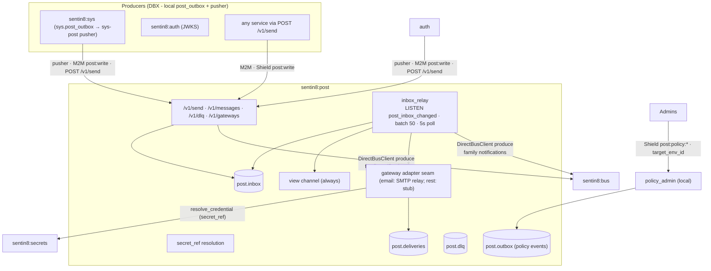
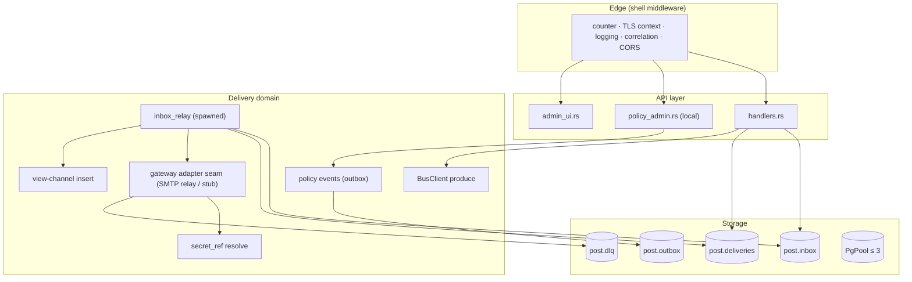
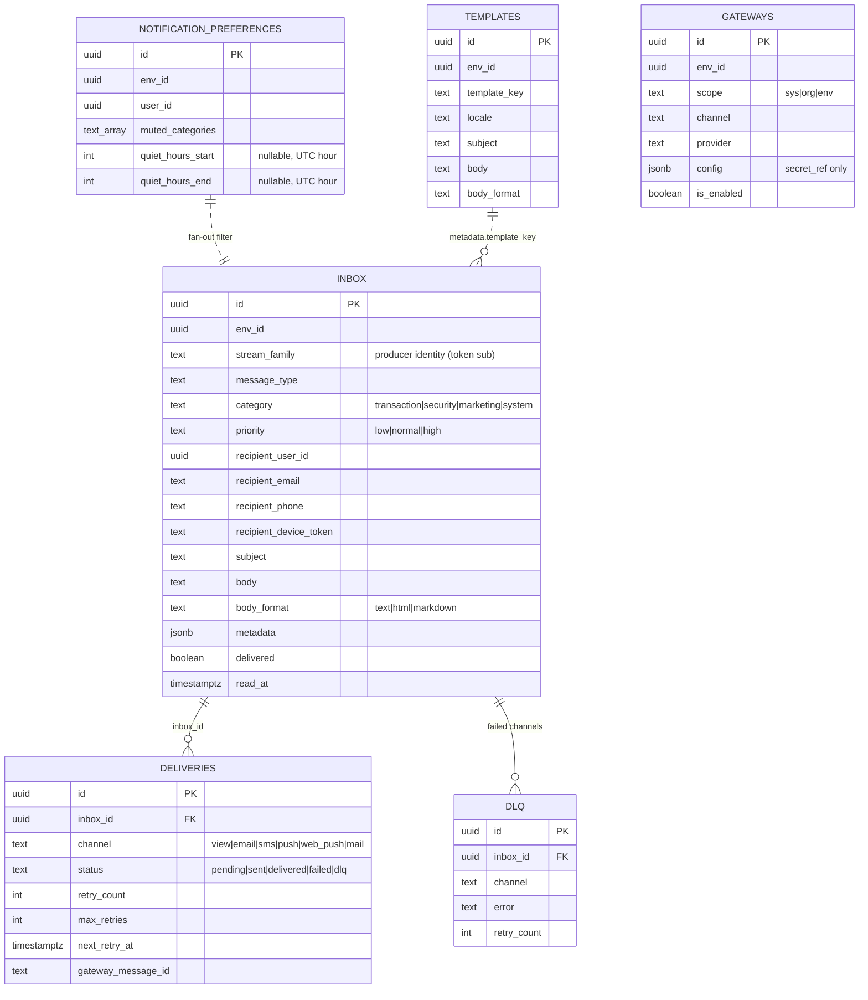
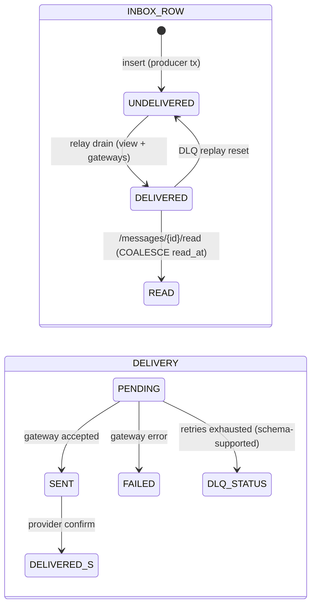
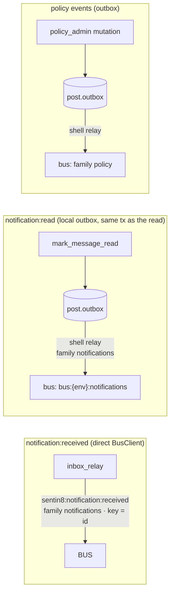
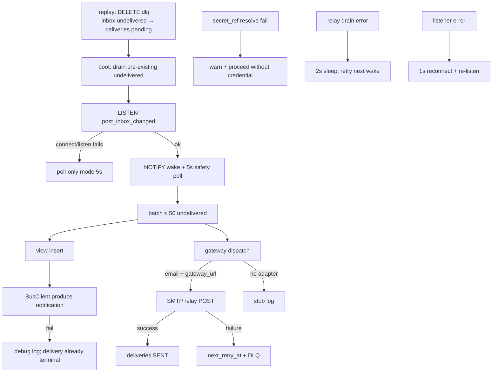
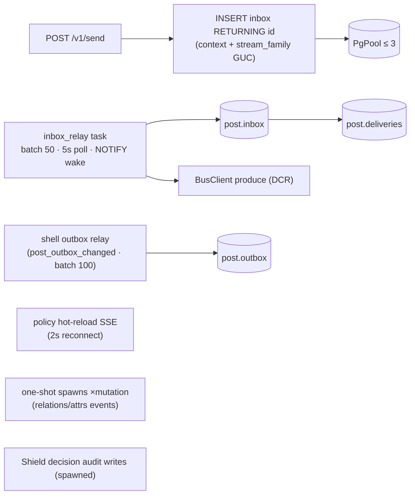
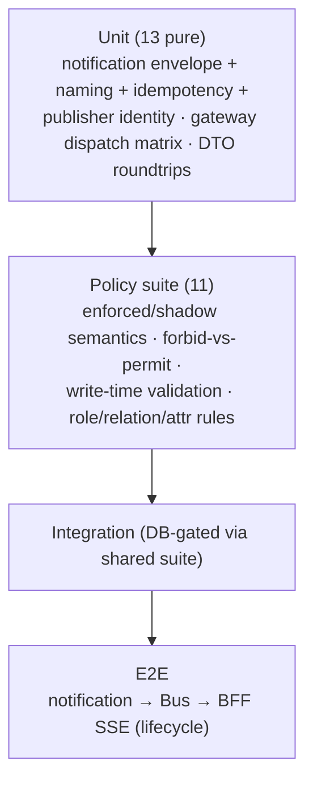

# DESIGN.md: Sentin8:Post - Detailed Design Document

## 1. Scope & Context

Sentin8:Post is the multi-channel notification service: producers enqueue
into their OWN local `post_outbox` queue (DBX - same transaction as
their domain change), a per-service pusher drains it to Post's
`POST /v1/send` (M2M, Shield-gated), the relay drains `post.inbox`, the
View channel always delivers (in-app messages), external gateways
(email/sms/push/web_push/mail) are additive, and every delivered message
produces `sentin8:notification:*` events on the Bus. Post also carries a
**local** Shield admin surface (policy sets, relations, attributes,
decisions) rather than mounting the shared generic one.

- **Owns** (schema `post`): `inbox` (message queue - the domain record),
  `deliveries` (per-channel delivery records + retry state), `gateways`
  (provider config by scope, secret-reference-only credentials),
  `dlq` (failed external deliveries), `outbox` (DBX producer for policy
  events), `audit_journal`.
- **Does NOT own**: the sending services' domain changes (they write the
  inbox in their own transactions), gateway providers' credentials
  (referenced via `secret_ref`, resolved at delivery time), and the
  Shield substrate (`sys.policy_sets` - post stores tenant sets there
  through its admin surface and reads for evaluation).



Trust boundary: gateway credentials never live in `gateways.config` as
plaintext - only secret references; the producer identity of an inbox
row is derived from the verified token (`stream_family = claims.sub`),
never from caller-supplied fields.

## 2. Runtime Architecture

| Module | Role |
|---|---|
| `handlers.rs` | Send/list/get/content/read, DLQ list/replay, gateway CRUD + test; `SendMessageRequest/Response` DTOs; unread-count computation. |
| `inbox_relay.rs` | The delivery engine: PgListener (`post_inbox_changed`) + 5s safety poll; batch 50 undelivered rows ordered by created_at; view-channel first; terminal mark-delivered. |
| `policy_admin.rs` | Local Shield admin surface (sets/relations/attributes/decisions) with target_env_id enforcement, write-time validation, 64 KiB caps, policy-family event emission. |
| `auth.rs` / `policy.rs` | Verify wrappers; Shield bridge (full live evaluation). |
| `admin_ui.rs` | RFW pages (messages, gateways/new, dlq, relations, attributes) + data endpoints. |
| `server.rs` | State build (shell pool, DCR bus client, relay spawn) + routes. |



**Delivery lifecycle (the core family):**

```mermaid
sequenceDiagram
    autonumber
    participant P as Producer
    participant I as post.inbox
    participant R as inbox_relay
    participant D as post.deliveries
    participant B as BusClient
    participant G as Gateway (SMTP relay / stub)

    P->>I: INSERT (same tx as domain change)<br/>stream_family = token sub
    Note over I: AFTER INSERT → pg_notify post_inbox_changed
    R->>I: drain ≤ 50 undelivered (created_at order)
    R->>D: deliveries (view, delivered) - source of truth
    R->>G: dispatch per channel matrix
    G->>G: resolve secret_ref (zeroize-on-drop)
    alt gateway failure (retry curve → DLQ)
        Note over G: log only - no retry enqueue yet
    end
    R->>I: UPDATE delivered = true, delivered_at
    R->>B2["bus: POST /v1/produce"] 
    R->>B: sentin8:notification:received<br/>family notifications · idempotency_key = id
    alt produce fails
        Note over R: debug log; delivery already terminal
    end
```

## 3. Data Model



- `post.inbox` - the domain queue: category/priority/body_format CHECKs,
  undelivered + unread partial indexes, env + recipient indexes, INSERT
  NOTIFY trigger. RLS FORCE with select/insert/update (no delete policy).
- `post.deliveries` - one row per channel attempt with the retry
  machinery (`retry_count`, `max_retries` 3, `next_retry_at` partial
  index), driven by the relay: the first attempt stamps the in-flight
  count, the failure path schedules the backoff curve
  (1s → 5s → 30s → 2m → 10m) and lands the row in DLQ when the budget
  is spent.
- `post.gateways` - scope-tiered (`sys`/`org`/`env`); the handler's
  sys/org 403 gate is mirrored in RLS: every row is env-pinned (sys/org
  rows live in the system env), and platform-tier mutations additionally
  require the `sentin8:sys:admin` scope stamp on the writing context
  (`sentin8_has_scope`) - the former `sentin8_bypass_rls()` branches are
  dead (§6.7) and removed. Gateway delete is row-aware: read the row's
  env/scope, re-stamp the ROW's env as the deleting context, delete with
  the explicit predicate.
  explicit WHERE is the primary filter (sys/org forced to
  `SYSTEM_ENV_ID`; sys/org writes are platform-admin-gated).
- `post.dlq` - landed external failures; replay resets the inbox row to
  undelivered and re-pends the delivery.
- `post.outbox` / `post.audit_journal` - generated DBX tables (policy
  events + journal).



## 4. API Surface

| Endpoint | Method | Gate | Notes |
|---|---|---|---|
| `/v1/health` | GET | none | liveness. |
| `/v1/send` | POST | Shield `sentin8:post:write` | inbox-first insert; `stream_family` from the token. |
| `/v1/messages` · `/v1/messages/{id}` · `/content` | GET | Shield `sentin8:post:read` | list/get + deliveries join + body. |
| `/v1/messages/{id}/read` | POST | Shield `sentin8:post:read` | idempotent; emits the read receipt `sentin8:post:notification:read` via the local outbox in the SAME transaction. |
| `/v1/dlq` · `/v1/dlq/{id}/replay` (alias `/v1/messages/{id}/replay`) | GET/POST | read / `post:write` | replay re-pends the delivery. |
| `/v1/gateways` | GET/POST | read / `post:write` | sys/org creation requires `sentin8:sys:admin`; env forced to `SYSTEM_ENV_ID`. |
| `/v1/gateways/{id}` (+ `/delete` alias) | DELETE/POST | `post:write` | RFW alias. |
| `/v1/gateways/test` | POST | `post:write` | dispatch smoke through the adapter seam. |
| `/v1/admin/ui/{page}`, `/v1/admin/{resource}` | GET | `has_any_scope(post:read|post:write|sys:admin|sys:org:admin|sys:env:admin)` | `target_env_id` required. |
| `/v1/admin/policy-*`, `/v1/admin/relations*`, `/v1/admin/attributes*` | mixed | `sentin8:post:policy:read|write` + Shield | local admin surface (not the shared generic). |
| `/openapi.json` | GET | shell | 11 paths. |

Event flow:



Emitted notification events:

- **`sentin8:notification:received`** - produced directly by the inbox
  relay on View delivery (fire-and-forget). Payload is complete:
  `{user_id, title, body, category, resource_type, resource_id, metadata, unread_count}`
  with `publisher_subject: "sentin8:post"`.
- **`sentin8:post:notification:read`** - the read receipt:
  `mark_message_read` inserts a local `post.outbox` row in the SAME
  transaction as the `read_at` update (outbox-first §6.7 - exactly once
  with the domain change; the shell relay produces it to the
  `notifications` family). Payload is complete:
  `{user_id, notification_id, env_id, read_at, unread_count}` with
  `publisher_subject` = the caller's token subject. ENV CONTRACT: the
  outbox row carries `SYSTEM_ENV_ID` (the relay produces with post's
  system-env M2M token; a caller-env row is rejected 403 cross-tenant)
  - the target env rides the payload, the same discipline as sys's
  `audit_tx` fan-out. The BFF's SSE consumer filters on `user_id` and
  reads `unread_count`, so a device badge updates within one hop.

## 5. Cross-Cutting Concerns

- **Authentication**: shared bearer verify; the Shield enforced
  scope-mirror set is the only gate (no per-handler scope check); admin
  surfaces add the explicit 5-scope list.
- **Tenant resolution + RLS**: context set on the same pooled connection
  as every query (send also passes the `stream_family` GUC); policy
  admin requires `target_env_id` (400 when missing).
- **Idempotency**: mark-read is idempotent (`read_at = COALESCE`); Bus
  produces carry idempotency keys (`{id}`, `read-{id}`) for
  effectively-once badge counting; the view-channel insert dedupes by
  `(inbox_id, channel)` semantics (single insert per drain).
- **Secrets**: gateway credentials only by `{"secret_ref": "backend://…"}`
  in `gateways.config`, resolved at delivery time via
  `sentin8::secrets::resolve_credential` (zeroize-on-drop, never logged);
  the SMTP relay endpoint itself is declared in
  `config.gateway_url` (non-secret, self-hosted bridge).
- **Audit journaling**: `post.audit_journal` for Shield decisions +
  policy-admin writes (fire-and-forget, context-first); the Sys pusher
  is not wired here yet.
- **Graceful drain / TLS posture**: shell-owned.

## 6. Failure Modes & Recovery



- **Crash recovery**: the relay drains pre-existing undelivered rows at
  startup before entering the listen loop.
- **External-channel failures** ride the adapter seam: the email
  channel dispatches through the SMTP HTTP relay when the gateway row
  declares `config.gateway_url` (rendered subject/body from templates,
  row literals as fallback); `simulate_failure` in the gateway config
  turns every attempt into a failure so the retry curve (1s → 5s →
  30s → 2m → 10m) and DLQ landing are exercisable without a provider.
  Channels without a real adapter keep the stub dispatch. The View
  record is the source of truth and delivery stays terminal.
- **Replay**: resets the inbox row to undelivered + re-pends the
  delivery rows so the relay re-drains (missing ids currently return OK
  without a 404).
- **Policy admin failures**: invalid Shield text → 422 at write time;
  platform-origin overwrite → 409; size caps → 413; event-emit failure →
  warn (hot-reload delay only).
- **Unread count** degrades to 0 on error (badge understates, never
  fails the read).

## 7. Concurrency & Performance Model



- The relay is the only background consumer; batch 50 keeps per-connection
  work short; view-channel first keeps the record authoritative.
- Hot paths: unread/unread-count queries (partial indexes), the relay
  drain (undelivered partial index), policy evaluation (relation slice
  capped at 10,000 tuples - over-cap fails closed).
- No Valkey dependency in post itself (metrics channels are shell-owned);
  `PostConfig.valkey_url` is parsed but unused.

## 8. Invariants, Insecure-Defaults Rejected, Unsafe Rationale

1. **Inbox-first**: a producer's domain change and the inbox row commit
   atomically (post outage never loses a notification); producer identity
   rides the verified token (`stream_family = sub`), never caller input.
2. The View channel always delivers (record of truth) before any
   external gateway attempt; delivered rows are terminal.
3. Gateway credentials are secret references only - plaintext provider
   tokens never touch the database; resolution failures proceed without
   credentials rather than failing the notification.
4. RLS context is set on the same connection as every query; event names
   are colon-only and envelopes self-contained (test-pinned).
5. `target_env_id` is required on policy admin + admin data (400 when
   missing); platform-origin policy rows are enroll-managed (PUT → 409,
   tenant-only delete) with mode-flip as the ops lever.
6. Policy writes validate at write time (422), cap text/schema at 64 KiB
   (413), start tenant sets in `shadow`, and bump `version` on upsert.
7. Gateway credentials never appear in responses or logs.
8. Sys/org gateway scope changes require platform admin before any
   tenant mapping happens.
9. No `unsafe` code; credential material is zeroize-on-drop via the
   shared secrets crate.

## 9. Testing Strategy



- Pure tests pin the produce contract (envelope completeness, colon
  naming, idempotency keys, publisher identity), the gateway dispatch
  matrix, and the Shield engine behavior through `load_from_rows`.
- **Deliberately NOT tested here**: real provider delivery (gateways are
  stubs), relay timing (covered by relay integration), TLS (platform).

## 10. Open Questions

- The design already specifies the full retry curve (post design §4.6); the
  gateway adapters implement it when real providers land.
- `replay_dlq` returns 404 when the DELETE returns no row (mechanical).
- `delete_gateway` gains `AND env_id = $caller_env` (platform-admin bypass via
  `has_scope("sys:admin")`).
- The README's transport-tier wording is fixed to SSE (the code and design
  already agree).
- The audit-journal → Sys push loop rides the shared `push_journal_to_sys`
  shell task.

---

**Design attribution:** sentin8:post and its underlying concepts were designed by Hamid Jahanzad <Hamid@Jahanzad.com>.

