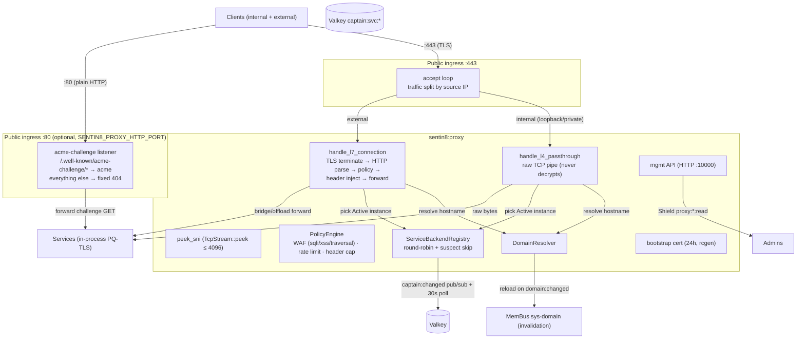
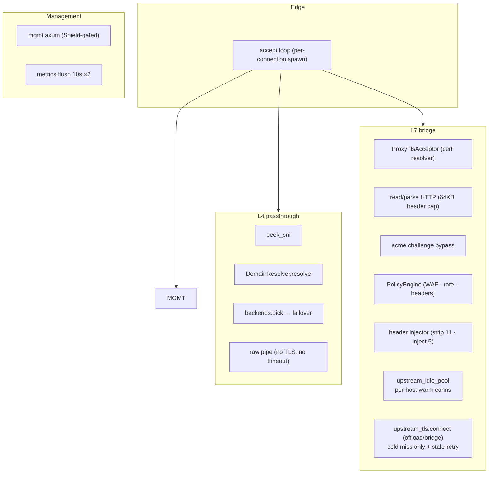
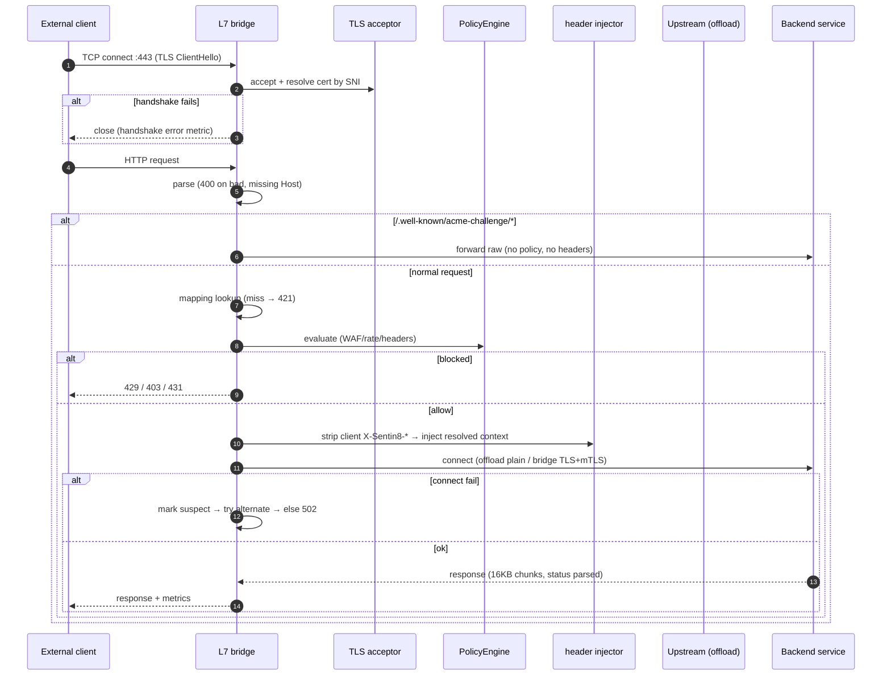
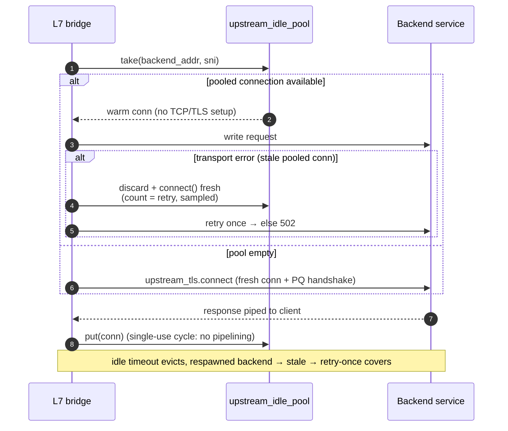
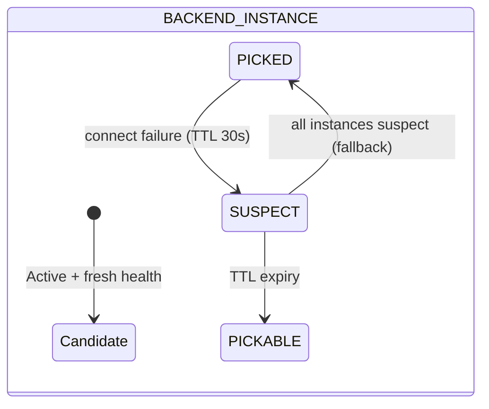
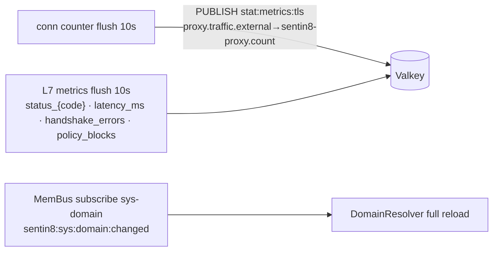
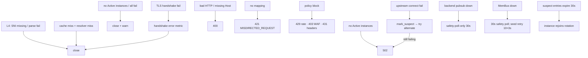
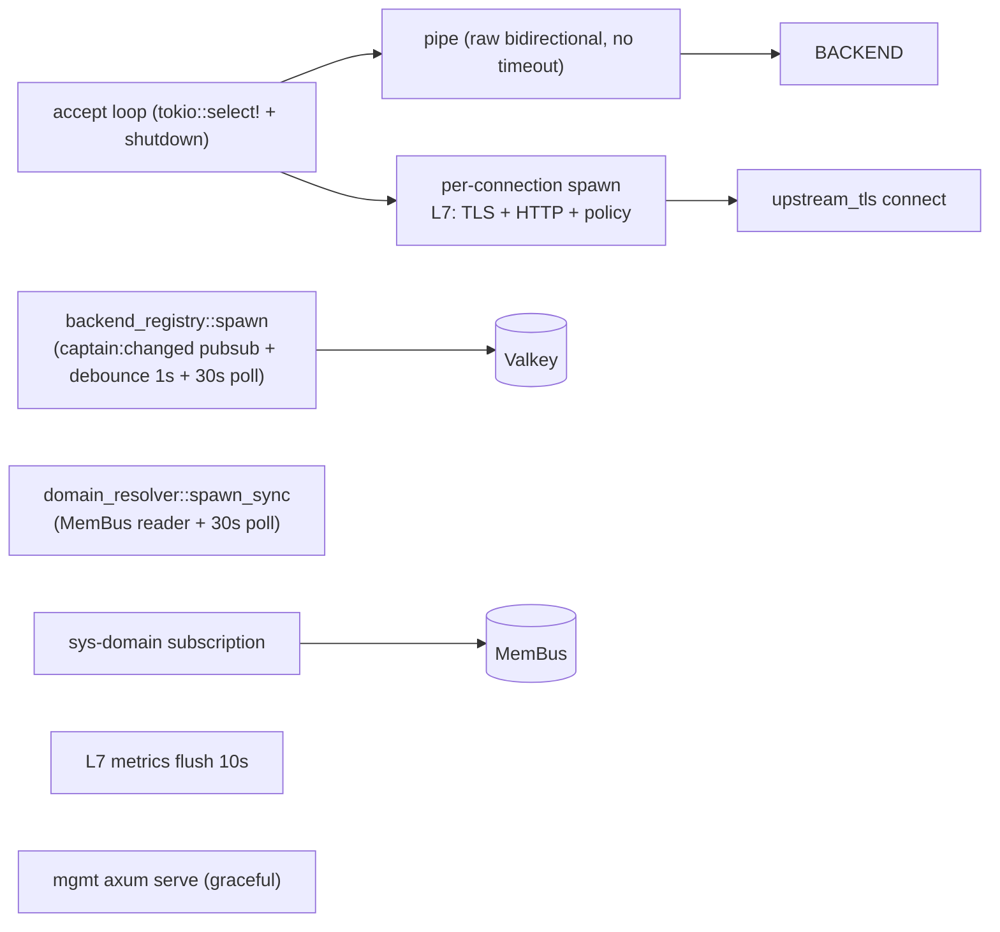
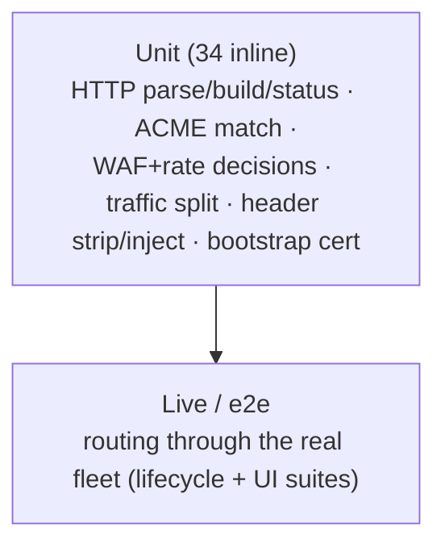

# Sentin8:Proxy - Detailed Design Document

## 1. Scope & Context

Sentin8:Proxy is the platform's **single ingress**: an L4 SNI router on
port 443 with an optional L7 TLS-bridging path. Internal (private) traffic
pipes raw TLS bytes to the backend (byte-piping - the backend terminates
PQ-TLS in-process); external traffic is bridged (TLS terminated at the
edge, HTTP parsed, WAF/rate-limit evaluated, tenant headers injected,
forwarded). The proxy holds no domain state - routing data comes from
sys's lifecycle tables (deduced from orgs/envs/app instances) and the
Valkey instance registry.

- **Owns**: nothing persistent - no tables, no outbox, no Bus producer.
  Runtime state is the backend registry (from `captain:svc:*`), the
  domain resolver caches, the in-memory rate limiter, L7 metrics, and
  the optional plain-HTTP `:80` listener that exists solely to hand
  `/.well-known/acme-challenge/*` requests to acme (everything else a
  fixed 404 - DEVDOM-2, acme DESIGN §4.3).
- **Does NOT own**: tenant data (read-only `sys.*` caches), TLS
  certificates (resolved per-SNI via `sentin8-tls`; a self-signed 24h
  bootstrap cert breaks the first-boot chicken-and-egg), and
  authorization of the data plane (transport only - Shield gates only
  the management API).
- **Startup dependency on Sentin8:Sys (domain-truth plane, one-way)**:
  the ingress arms FULLY only once Sys is Active - the boot tier order
  starts sys (15) before proxy (20) so the two sys-backed resolve paths
  are live before the ingress takes traffic: (1) the resolver seed /
  30s-poll reload reads `sys.vertical_services` (the one declared
  SELECT - table rows come from `vertical enroll`, so the seeding is
  fail-open and never blocks liveness, but a fresh bootstrap boots
  tenant-blind until seeded), and (2) tenant-SNI resolve misses call
  Sys's owner API `GET /v1/resolve/hostname` (M2M `sentin8-proxy-tls`)
  - a per-miss call, sanctioned as the cold-start/cache-miss edge
  (AGENTS rule 3), never a per-request hot-path dependency. Platform-
  plane SNIs (`{label}.ops.sys.{domain}`) resolve statically regardless.

Trust boundary: the edge strips all eleven client-supplied
`X-Sentin8-*` headers before injecting the resolved context - clients
can never spoof tenant identity. The L4 path never decrypts anything.

## 2. Runtime Architecture

| Module | Role |
|---|---|
| `server.rs` | Dual-mode accept loop (`tokio::select!` + shutdown signal), mgmt router, L7 state build, `connect_with_failover`, connection counter flush. |
| `sni.rs` | Non-destructive `TcpStream::peek` of the ClientHello (record `0x16`, handshake `0x01`, ext `0x0000`). |
| `domain_resolver.rs` | Hostname → `DomainMapping` deduction (org suffix match, `ops` platform rules, `bff` label rules) from sys tables; MemBus subscription + 30s safety poll; seed 10×3s. |
| `backend_registry.rs` | Per-service instance lists from `captain:svc:*` (only `status == Active` + `last_health_check < 30s`); `captain:changed` pub/sub + debounce + 30s poll; round-robin with suspect skip (TTL 30s). |
| `tls_proxy.rs` | L7 bridging: HTTP parse (64KB header cap), ACME challenge bypass, policy, header injection, upstream forward, response pipe; `L7ConnectionGauge` in-flight counter (drain signal, §5). |
| `tls_acceptor.rs` | Edge TLS acceptor (Graviola PQ provider, platform cert resolver, no client auth). |
| `header_injector.rs` | Strip client `X-Sentin8-*` (11 headers) → inject `env-id`, `app-id`, `service`, `hostname`, `correlation-id`, `caller-service: proxy`. |
| `policy_engine.rs` | WAF (SQLi/XSS/path-traversal), per-IP token-bucket rate limit, header-count cap. |
| `upstream_tls.rs` | Backend connect: `Offload` (plain TCP) / `Bridge` (rustls + optional mTLS + native root store incl. Acme Root CA). |
| `upstream_idle_pool.rs` | Per-`(backend_addr, sni)` idle-connection pool for L7 upstreams (PROXY-5): warmed TLS/TCP sessions reused across requests; stale pooled connections fail transport once and the request **retries once on a fresh connection** - a handoff-warm pool, not a per-request handshake. |
| `bootstrap_cert.rs` | Self-signed 24h leaf for `proxy.ops.sys.{domain}` (SAN = local IP) until Acme is healthy. |
| `l7_metrics.rs` / `mapping_cache.rs` / `pipe.rs` / `traffic_split.rs` | Counters + flush; always-empty mapping stats; bidirectional copy; internal/external decision. |

**External (L7) request lifecycle:**

The upstream-connect step is pool-first (PROXY-5):

## 3. Data Model

The proxy owns no tables; its working state is caches:

| Cache | Source | Contents |
|---|---|---|
| `DomainResolver` (apps/known_services/subdomain_map, `RwLock`) | `sys.vertical_services` (declared SELECT); platform-plane handled statically | reload on `sentin8:sys:domain:changed` + 30s poll. Tenant hostnames are **deduced** - the former `sentin8_domains` table is retired. |
| `ServiceBackendRegistry` | `captain:svc:*` hashes | addr per `{ip}:{port}` for Active + fresh instances; suspect marks with TTL 30s. |
| `MappingCache` | resolver | always empty (stats surface for the mgmt API only). |
| Rate limiter | in-memory | per-IP token bucket (`rate_limit_rps`, default 100). |

**Platform-plane SNIs resolve statically - no domain-model read (TLS-RLS-4
parity, story D7-PXY).** A `{label}.ops.sys.{domain}` hostname resolves
in-process from well-known constants: `SYSTEM_ORG_ID` / `SYSTEM_ENV_ID`
(sentin8-config) + the `SENTIN8_TLS_PLATFORM_LABELS` label→service map
(captain-propagated from the runtime registry). No orgs/envs caches, no
sys network call, no SQL: the single-machine dev boot has no sys-domain
runtime dependency for ROUTING the platform plane, and an RLS-blind
cross-schema SELECT (the retired `organizations`/`environments`/`
app_instances` reads) is deleted rather than worked around. Tenant SNIs
(`{service}.{env}.{org}.{domain}`) still walk the Sys owner API
(`GET /v1/resolve/hostname`, M2M `sentin8:sys:instances:read` via the
existing `sentin8-proxy-tls` workload) on cache miss - the sanctioned
D7 owner-API path, same as every service's embedded sentin8-tls resolver.

Cert lifecycle: bootstrap (self-signed 24h, SAN = local IP) → hot-swapped
Acme cert once Acme is healthy.

**Sanctioned cross-schema read.** The ONE remaining `sys.*` read is
DECLARED in `registration.rs` `cross_schema_grants`:
`vertical_services` (SELECT) - it feeds the subdomain map read by
`sentin8_config::load_subdomain_map` on domain-event reload + the 30s
poll, and by the tls crate's `resolve_service_name_in_tx` on the
first-label lookup. The retired `organizations`/`environments`/
`app_instances` SELECTs are DELETED (D7-PXY): tenant hostnames resolve
via Sys's owner API (`GET /v1/resolve/hostname`), never a direct SQL
grant.

## 4. API Surface

Management plane only (plain HTTP on `mgmt_port`, Shield-gated);
the data plane is a raw TCP accept loop with no routes.

| Endpoint | Method | Gate |
|---|---|---|
| `/v1/health` | GET | none (status, version, build, mapping stats, service counts, `active_connections` L7 gauge - drain signal). |
| `/v1/prox/backends` | GET | Shield `sentin8:proxy:backends:read`. |
| `/v1/prox/mappings` | GET | Shield `sentin8:proxy:mappings:read`. |
| `/v1/admin/policy-sets|relations|attributes…` | mixed | shared Shield admin surface. |
| `/openapi.json` | GET | shell (`openapi_url` declared; spec closure → null - the proxy carries no utoipa spec). |

Event/metric flow (transport-level only - the proxy produces no domain
events):

## 5. Cross-Cutting Concerns

- **Authentication**: only the mgmt API is authenticated (bearer +
  Shield); the data plane is transport. TLS identity of backends is
  machine identity; tenant identity rides the injected headers, which
  the backend re-verifies (bearer verification is each service's job).
- **Tenant resolution**: SNI/Host → `DomainResolver` (deduction rules
  over the sys caches; `web`/`bff` fallbacks; subdomain map from
  `sys.vertical_services`). Unresolvable → L4 close / L7 421.
- **Anti-spoofing**: eleven `X-Sentin8-*` header names stripped from the
  client before injection (test-pinned); correlation id propagated or
  minted (`proxy-{uuid}`).
- **Rate limiting / bot protection**: token bucket per source IP
  (default off), WAF detections (SQLi/XSS/path traversal, default off),
  hard header-count cap (431 at >100 headers).
- **Idempotency**: N/A (transport); backend failover is suspect-marked
  and retried within the request.
- **TLS posture**: PQ-exclusive (X25519MLKEM768 / ML-DSA-65, Graviola
  provider installed before any outbound call); the L4 path never
  decrypts; bridge mode presents mTLS to bridge-mode backends when
  configured.
- **Graceful drain**: `shutdown_signal("proxy")` on the accept loop;
  mgmt API shuts down with its own signal; in-flight pipes complete
  naturally. The L7 bridge counts in-flight connections
  (`L7ConnectionGauge` - RAII guard per accepted connection, decremented
  on every exit path) and exposes the count as `active_connections` in
  the mgmt `/v1/health` payload - captain's rolling-upgrade
  drain polls this gauge (captain README §7): the drain ends when the gauge hits 0
  or the 30s cap hits. L4 passthrough connections are opaque TLS pipes
  and carry no gauge.

## 6. Failure Modes & Recovery

- **Failover**: `connect_with_failover` marks suspects on failure and
  tries remaining instances; when every instance is suspect it falls
  back to plain round-robin rather than failing.
- **Resolver degradation**: MemBus loss degrades to the 30s poll -
  routing continues (stale mappings) instead of failing closed.
- **Bootstrap certificates**: Acme outage at first boot is bridged by the
  self-signed 24h leaf (management-plane reachability for enrollment);
  swapped to the real cert when available.
- **ACME challenges bypass everything** (no policy, no header injection)
  so the CA can complete validation even when other surfaces are
  degraded.

## 7. Concurrency & Performance Model

- Per-connection tasks; the hot path is `peek` + cache hit + `pick` +
  byte copy (L4) or terminate-parse-inject-forward (L7) - no queuing
  infrastructure, backpressure is inherent to TCP.
- **Upstream connection pooling (PROXY-5)**: L7 upstreams are served
  from a per-`(backend_addr, sni_hostname)` idle pool before a fresh
  `upstream_tls::connect` - a warm pooled session removes the ~40 ms
  PQ-handshake (X25519MLKEM768 + ML-DSA-65) from every proxied request
  (the L4 path never pays it - it never terminates). One pooled
  connection serves ONE request per take (the L7 pipe closes the
  upstream after the response, connection-per-request HTTP/1.0-style);
  the pool refills as fresh connects complete. A stale pooled send
  (backend respawned) fails once and the request retries on a fresh
  connection - identical stale-conn semantics to the captain probe
  retry, so respawns cannot surface as repeated 502s.
- L4 pipe is timeout-free by design (SSE/WebSocket safe).
- Metrics are drained (snapshot) every 10s to `stat:metrics:tls`;
  connection counters flush on the same cadence.
- Boot: resolver seed retries (10×3s) before routing starts; backend
  registry refreshes on `captain:changed` (debounced 1s, min 100ms).

## 8. Invariants, Insecure-Defaults Rejected, Unsafe Rationale

1. **Single ingress**: backends never bind public ports; port 443 is the
   only data-plane entry; SNI is the routing key.
2. **Client-supplied `X-Sentin8-*` headers are always stripped** before
   any injection (anti-spoofing boundary - test-pinned for the 3 core
   cases).
3. Only `Active` + health-fresh (<30s) instances receive traffic; the L4
   path never decrypts (backend terminates in-process).
4. **PQ-exclusive TLS**; the bootstrap cert is a deliberate, time-boxed
   (24h) bridge for management-plane reachability only.
5. ACME challenge passthrough bypasses policy and header injection by
   contract (CA requirement).
6. Metrics carry counts/statuses/latency only - never payload bytes.
7. The data plane performs no authorization (transport, not policy);
   Shield gates the management API only.
8. Fail-closed tenant resolution - an unresolvable hostname is rejected,
   never defaulted to a system mapping.
9. `internal_port` is config-only today (no second listener bound);
   internal traffic is detected by source IP on the single listener.
10. No `unsafe` code; SNI peek is non-destructive (`TcpStream::peek`).

## 9. Testing Strategy

- Inline tests pin HTTP parsing, WAF detections, source-IP
  classification, header stripping/injection, and bootstrap-cert
  generation.
- **Gaps (no tests today)**: `sni.rs` parsing, `backend_registry`,
  `domain_resolver` deduction rules, the accept loop, and L7 end-to-end
  bridging - all exercised only via the live fleet.
- **Deliberately NOT tested here**: TLS crypto (platform suite), backend
  service behavior (owner suites).

## 10. Open Questions

- WAF and rate limiting defaulting off is the deliberate v1 posture (design §9
  table); cluster-wide defaults close it.
- The internal second listener is designed as a future enhancement (design
  §4.0: `:8443` guaranteed-L4; source-IP detection is the stated acceptable
  alternative); keep config-only.
- The pure in-process components (SNI record parsing, registry pick/failover
  with an injected Valkey double, resolver deduction) gain `#[cfg(test)]`
  suites; the accept loop's end-to-end behavior belongs to lifecycle e2e.

---

**Design attribution:** sentin8:proxy and its underlying concepts were designed by Hamid Jahanzad <Hamid@Jahanzad.com>.

