# Sentin8:Push - Detailed Design Document

Sentin8:Push is the platform's push delivery adapter. It owns the device
registry, the live delivery of a notification over the platform's own stream, and
the device-provider delivery that reaches a client the platform cannot reach live.

It is a captain-managed `sentin8:*` service like every other platform service. It
runs no external sidecar and needs no third-party account for its primary path.

## 1. Scope & Context

### 1.1 What this service owns

- **Device registrations.** One row per `(env_id, user_id, device_id)` in
  `push.devices`, expiring after `SENTIN8_PUSH_DEVICE_TTL_DAYS`.
- **Live delivery.** `GET /subscribe`, a Server-Sent Events stream per connected
  client, held in-process and fanned out over a broadcast channel.
- **Device push.** The `PushProvider` trait with two adapters, `apns` and `fcm`,
  reached through Sentin8:Secrets for the credential.
- **Backlog replay.** A delivery that could not be sent live is retained and
  replayed when the device next opens its stream.
- **Delivery records.** `push.deliveries`, one row per delivery attempt, carrying
  status, attempt count and retry schedule.
- **The delivery API.** `POST /v1/deliver`, called by Sentin8:Post's `push`
  channel adapter.

### 1.2 What this service does NOT own

| Concern | Owner | Why not here |
|---|---|---|
| Message content, templates, preferences, the in-app `view` channel | Sentin8:Post | Post is the multi-channel message service; push is one channel it fans out to |
| Deciding that a notification should be sent | The producing service, via Post | Push is a transport, not a policy engine |
| User identity and tokens | Sentin8:Auth | Single identity plane |
| Provider credentials | Sentin8:Secrets | Secret-reference-only rule |
| Domain truth for hostnames | Sentin8:Sys | Never resolve tenancy from a hostname locally |
| Provider account provisioning | The operator | Push consumes a credential; it does not obtain one |

### 1.3 Transport selection - the three cases

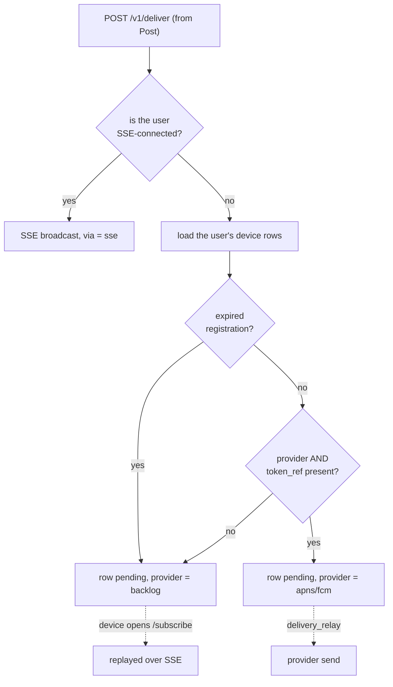

Three cases, in order:

1. **Connected.** At least one client for `(env_id, user_id)` holds an SSE
   stream, so delivery is one in-memory broadcast: no device row is read, no
   provider is called, no third party is involved. The response is
   `{delivered: n, pending: 0, via: "sse"}`.
2. **Disconnected, with a provider and a token reference.** A `pending` row is
   recorded with that provider and the delivery relay attempts the send. This is
   what makes **iOS background delivery** work, because iOS suspends the app and
   will not keep an SSE connection alive. APNs is therefore mandatory for iOS;
   FCM is its Android counterpart.
3. **Disconnected, with no usable provider path.** A `pending` row is recorded
   with `provider = backlog` and replayed over SSE when the device next opens a
   stream. This is the "offline now, online later" path, and it is why the
   platform works with no provider credential configured at all. An **expired
   registration** takes this branch too: the device will re-register, and
   treating it as backlog keeps the delivery recoverable.

### 1.4 System context

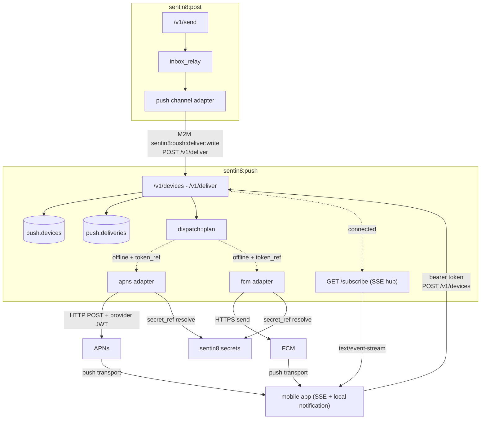

Trust boundaries: Post and Push are separate processes with separate credentials;
the only edge between them is the M2M `POST /v1/deliver` call. Push holds no
provider credential in a table - only a reference into Sentin8:Secrets.

## 2. Runtime Architecture

### 2.1 Components

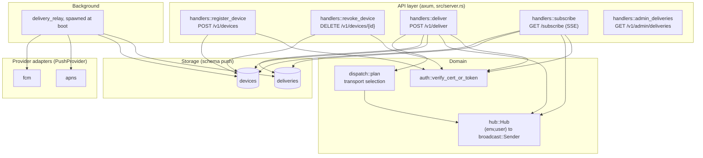

### 2.2 Request lifecycle - register a device

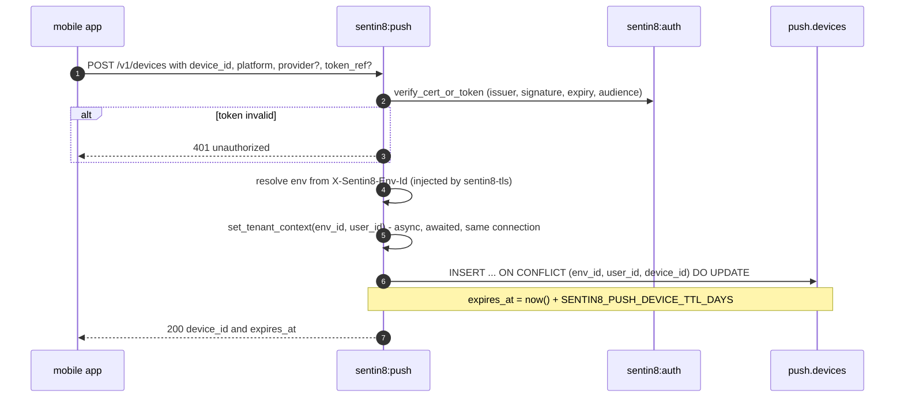

### 2.3 Request lifecycle - delivery

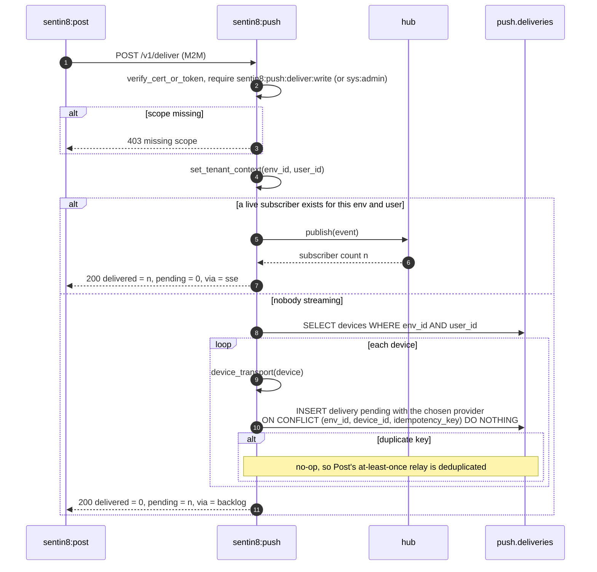

The live path deliberately writes **no delivery row**: the broadcast is
synchronous and its subscriber count is the result, so there is nothing to retry.

### 2.4 SSE stream lifecycle and backlog replay

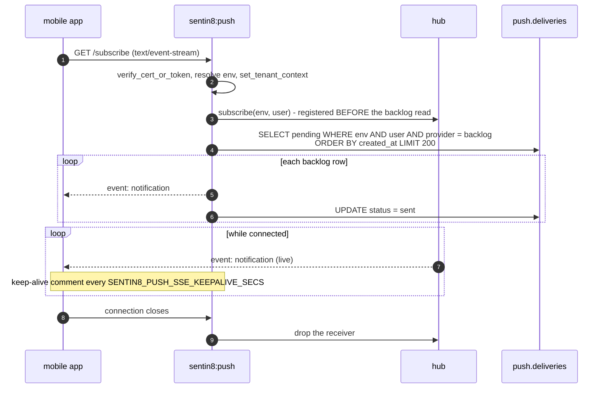

The receiver is registered **before** the backlog is read, so a live event can
never overtake the backlog and arrive out of order. The hub drops a key when its
last receiver goes away, plus a periodic sweep for keys whose subscribers all
vanished, so a stale entry cannot leak for the process lifetime.

The hub is process-local, so a client connected to replica A does not receive a
broadcast made on replica B. `/v1/deliver` therefore records a row for every
disconnected device and the relay retries it; delivery stays correct because the
idempotency key is unique per `(env_id, device_id, idempotency_key)`.

### 2.5 Delivery relay

Spawned at boot (`delivery_relay::spawn`). The relay is the only component that
performs a provider send - `POST /v1/deliver` never calls a provider, so a slow
provider cannot hold a request open.

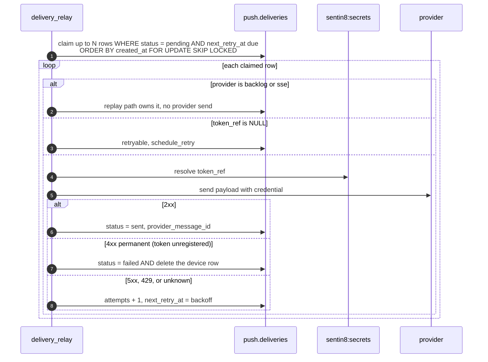

Backoff curve: 1s, 5s, 30s, 2min, 10min, then the final step repeats. It matches
Sentin8:Post's, so a notification that fails at both layers has one predictable
schedule. When `attempts` reaches `max_attempts` the row becomes `dlq`, and a
payload that cannot be decoded is marked `dlq` rather than retried forever.

## 3. Data Model

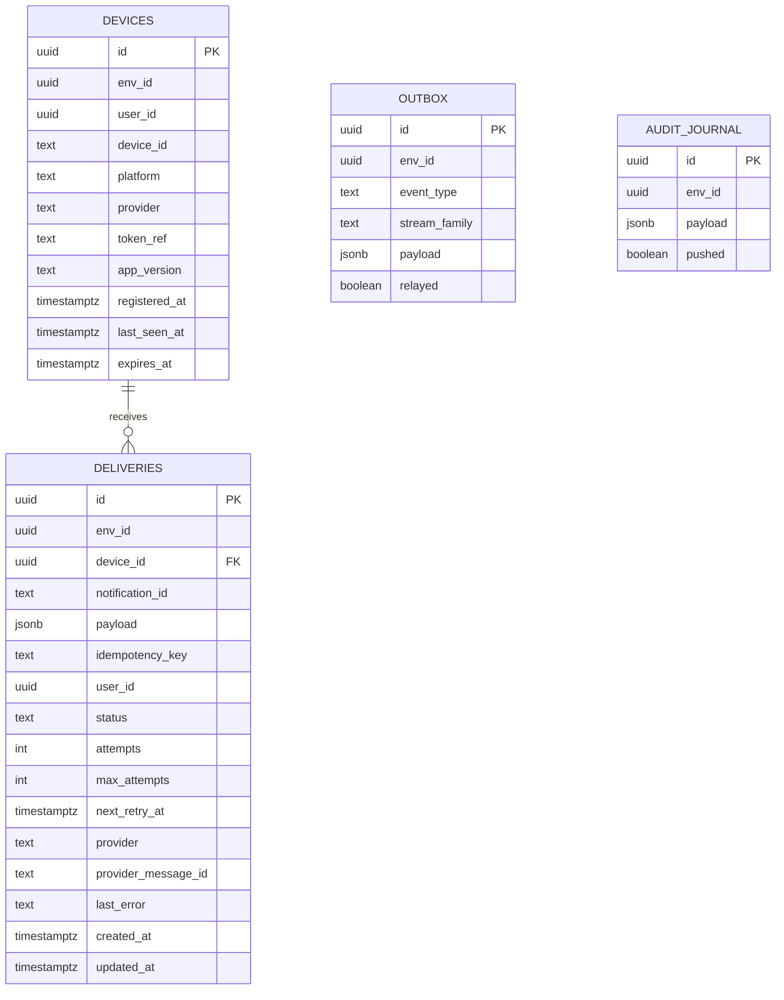

Ownership notes:

- `devices` and `deliveries` are **env-scoped** (`env_id`), with RLS `ENABLE` +
  `FORCE`. `devices` carries a holder-scoped policy (a client sees and mutates
  only its own registrations); `deliveries` carries an env-scoped DML policy.
- `devices.user_id` and `deliveries.user_id` are **`UUID`**, not `TEXT`: the
  holder-match RLS helper returns `UUID`, and comparing a text column against it
  is a type error the migration rejects.
- `devices.token_ref` is a **secret reference**, never the token, and **may be
  NULL**: an SSE-only client needs no provider token.
- `devices` has `UNIQUE (env_id, user_id, device_id)`, so a re-registration
  replaces the row and a device cannot be claimed by a second user.
- `deliveries.device_id` is `ON DELETE SET NULL`, so a delivery stays auditable
  after its device row is gone. `deliveries.user_id` is denormalised for the same
  reason.
- `deliveries.payload` is stored, not re-fetched. Replay can happen long after
  Post's message row is pruned, so a replay that had to re-read Post could deliver
  a notification whose source no longer exists; storing it also keeps the replay
  path free of a cross-service call.
- `deliveries.provider` doubles as the **transport** for the attempt: `sse`,
  `apns`, `fcm`, or `backlog`.
- `deliveries` has `UNIQUE (env_id, device_id, idempotency_key)`, which is what
  makes Post's at-least-once relay safe.

Device lifecycle:

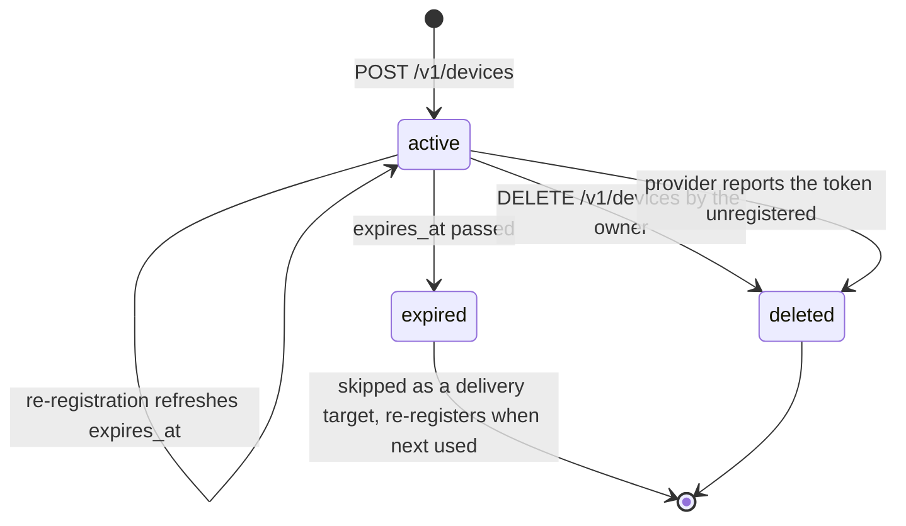

An expired registration is **not** reaped by a background job: it is skipped as a
delivery target (`device_transport` returns backlog) and the client re-registers.
Only an owner revoke or a permanent provider rejection deletes a row.

Delivery lifecycle:

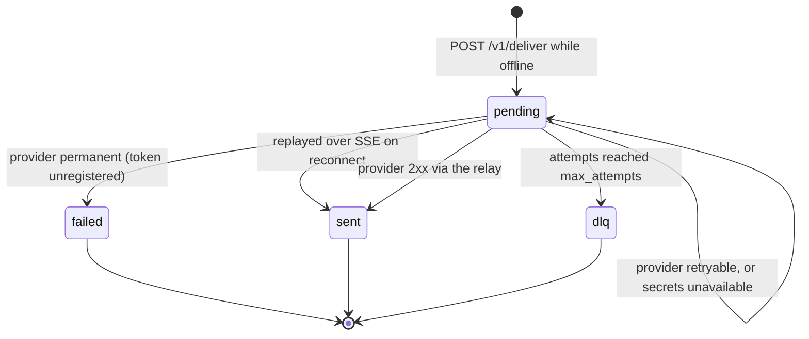

## 4. API Surface

| Endpoint | Audience | Authorization | Notes |
|---|---|---|---|
| `GET /v1/health` | platform | none | liveness and readiness |
| `POST /v1/devices` | client | bearer token; identity from the session | upsert on `(env, user, device)` |
| `DELETE /v1/devices/{id}` | client | bearer token; owner-match | deletes only the caller's row |
| `GET /subscribe` | client | bearer token; owner-match | SSE stream plus backlog replay |
| `POST /v1/deliver` | Post only | M2M `sentin8:push:deliver:write` or `sentin8:sys:admin` | the only cross-service edge |
| `GET /v1/admin/deliveries?limit=` | admin | Shield admin scope | recent deliveries for the tenant |

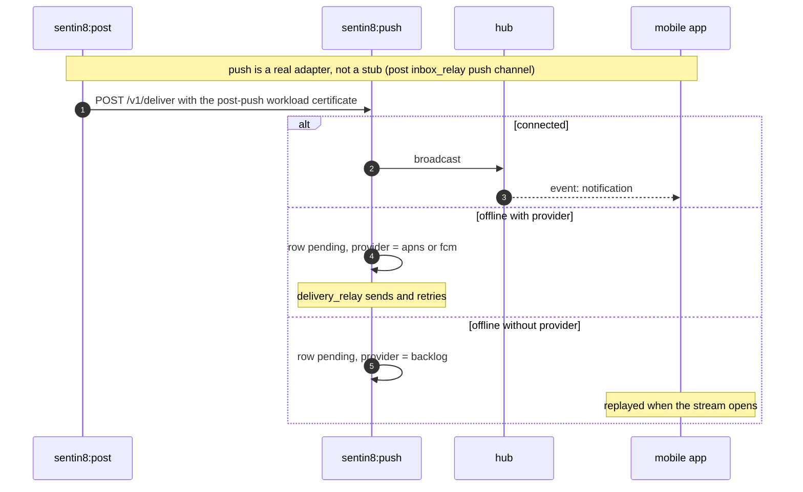

## 5. Cross-Cutting Concerns

**Authentication.** Every handler calls `auth::verify_cert_or_token`, which accepts
either a bearer JWT verified against Auth or a workload certificate presented over
the TLS plane. `/v1/deliver` additionally requires the
`sentin8:push:deliver:write` scope (or `sentin8:sys:admin`).

**Tenant resolution + RLS.** `env_id` comes only from the `X-Sentin8-Env-Id`
header that `sentin8-tls` injects. Handlers never parse a hostname.
`set_tenant_context` is async, awaited, and executed on the same connection as the
query that follows it.

**Idempotency.** `POST /v1/deliver` dedupes on
`(env_id, device_id, idempotency_key)`: a replay inserts nothing and the response
counts no new work. The live SSE path writes no row, so it has nothing to dedupe.

**Rate limiting.** Client endpoints are per-user limited by the shell's limiter.
`/v1/deliver` is M2M and limited per workload.

**Provider credentials.** Resolved from Sentin8:Secrets by `token_ref` at send
time, per delivery. Never cached in a table, never logged.

**Graceful drain.** Shell-owned. Live SSE streams are closed on drain so clients
reconnect to another replica and replay their backlog.

**TLS posture.** PQ-only, terminated in-process by `sentin8-tls` through the
shared shell. No classical fallback and no `danger_accept_invalid_certs`.

## 6. Failure Modes & Recovery

| Failure | Behaviour | Recovery |
|---|---|---|
| Client offline, no provider token | row `pending`, `provider = backlog` | replayed on the next `GET /subscribe` |
| Client offline, provider 5xx | `pending`, `next_retry_at` set | relay retries on the backoff curve |
| Provider 4xx permanent (token unregistered) | `failed`, device row deleted | client re-registers; SSE keeps working |
| Sentin8:Secrets unreachable | row stays `pending` | relay retries until the budget is exhausted |
| Push process crash mid-delivery | rows left `pending` | relay claims them with `FOR UPDATE SKIP LOCKED` |
| Undecodable stored payload | row marked `dlq` | visible for admin inspection; never looped on |
| Post retries a 5xx from Push | Post's own retry record covers it | two independent bounded layers, both idempotent |
| Replica A delivers, client is on B | A's broadcast finds no subscriber | A writes rows; the relay and replay path deliver |

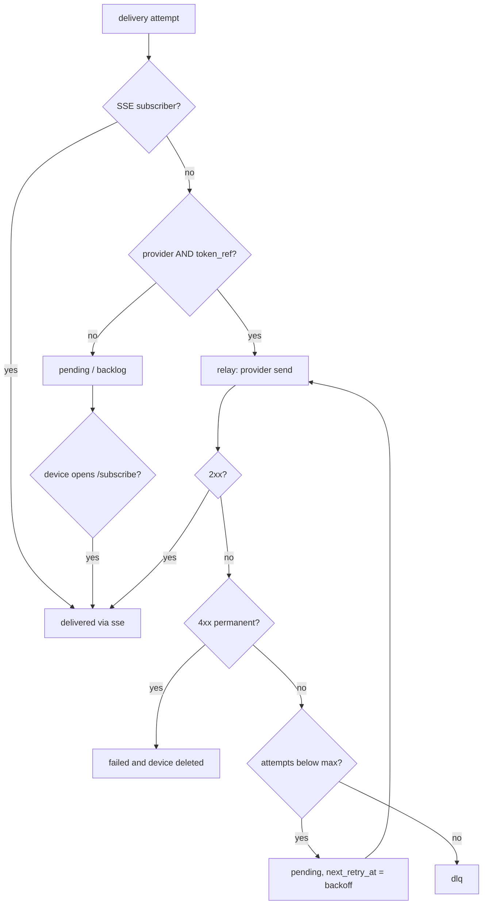

## 7. Concurrency & Performance Model

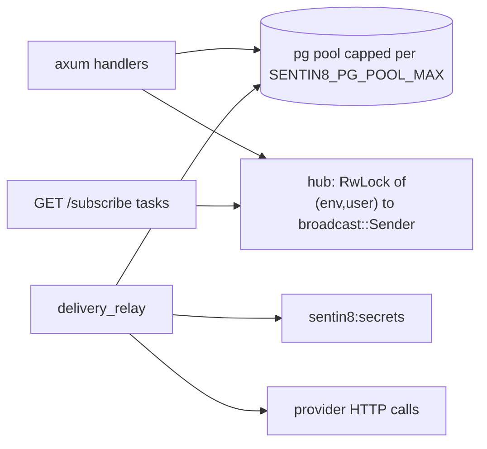

- The pool goes through `sentin8_config::pg_pool::connect`, which caps each
  service (default 3, overridable with `SENTIN8_PG_POOL_MAX`).
- The hub is a `RwLock<HashMap<(env, user), broadcast::Sender>>`. A sender is
  dropped when its last receiver disconnects, and a periodic sweep clears keys
  whose subscribers all vanished, so the map cannot grow for the process lifetime.
- `POST /v1/deliver` never calls a provider, so provider latency cannot pin a
  request handler.
- The relay claims with `FOR UPDATE SKIP LOCKED`, so replicas never contend over
  the same row and never double-send.

## 8. Invariants, Insecure-Defaults Rejected, Unsafe Rationale

**Invariants.**

1. A `devices` row is owned by exactly one `(env_id, user_id, device_id)`.
2. `token_ref` is either NULL or a reference; it never contains a token.
3. A delivery row survives its device row (`ON DELETE SET NULL`).
4. `env_id` on every row equals the tenant context of the transaction.
5. At most one delivery per `(env_id, device_id, idempotency_key)`.
6. A hub key always contains `env_id`, so a broadcast can never cross tenants.
7. The SSE receiver is registered before the backlog is read, so ordering is
   preserved.
8. A `pending` row's `provider` records which path owns it (`backlog`, `sse`,
   `apns`, `fcm`), so the replay and relay paths never claim each other's work.

**Insecure defaults rejected.**

- Storing a provider token in `devices`.
- A shared provider credential in config.
- Trusting a client-supplied `user_id` on registration or on `/subscribe`.
- Trusting a hostname for tenant resolution.
- Broadcasting on a key that is not tenant-qualified.
- Calling a provider from a request handler.

**Unsafe.** None.

## 9. Testing Strategy

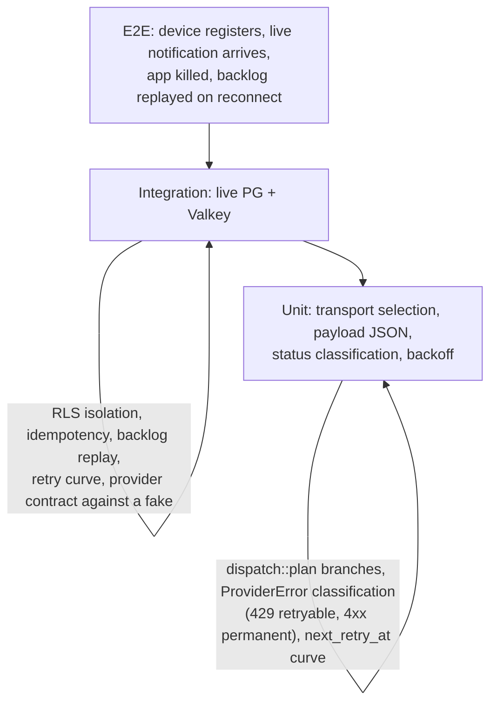

Deliberately NOT tested in CI: an actual APNs or FCM delivery. Both need an
operator-provisioned credential and a physical device, so the adapters are covered
by a fake transport plus a documented operator verification step.

## 10. Open Questions

- **Multi-replica hub correctness.** A broadcast on replica A is invisible to a
  client on replica B. The row is still written and the relay re-attempts it, so
  delivery is eventually correct, bounded by the retry curve. A Valkey pub/sub
  fan-out between replicas would tighten this; not needed at the current fleet
  size.
- **Expired-registration reaping.** Expired rows are skipped as delivery targets
  but nothing sweeps them. A retention job, or a dedicated retention window,
  would keep `push.devices` bounded in a long-lived tenant.
- **Per-tenant provider mandate.** Whether an environment may forbid a third-party
  provider is a Sentin8:Sys policy question, not a gap here.

