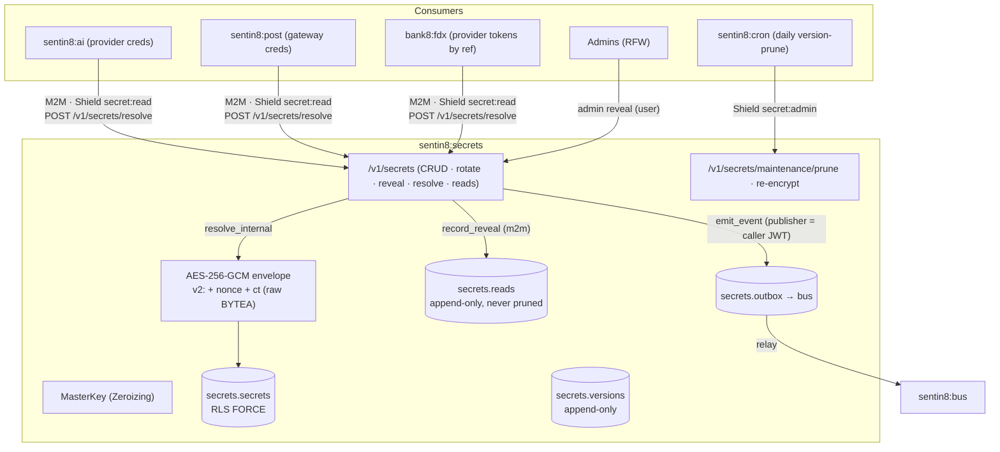
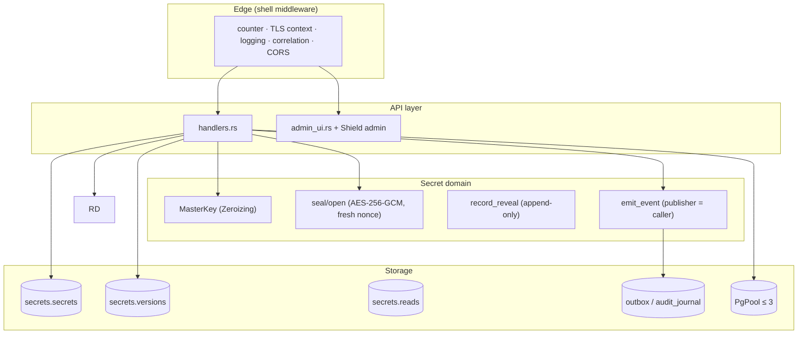
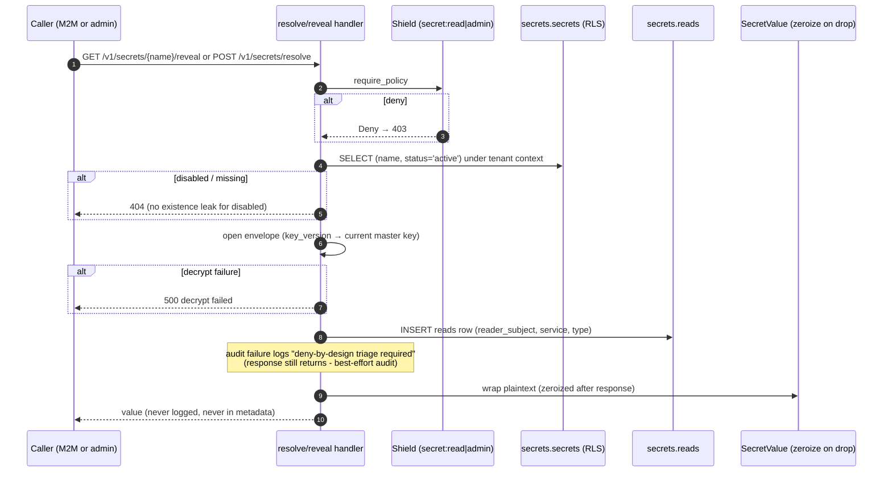
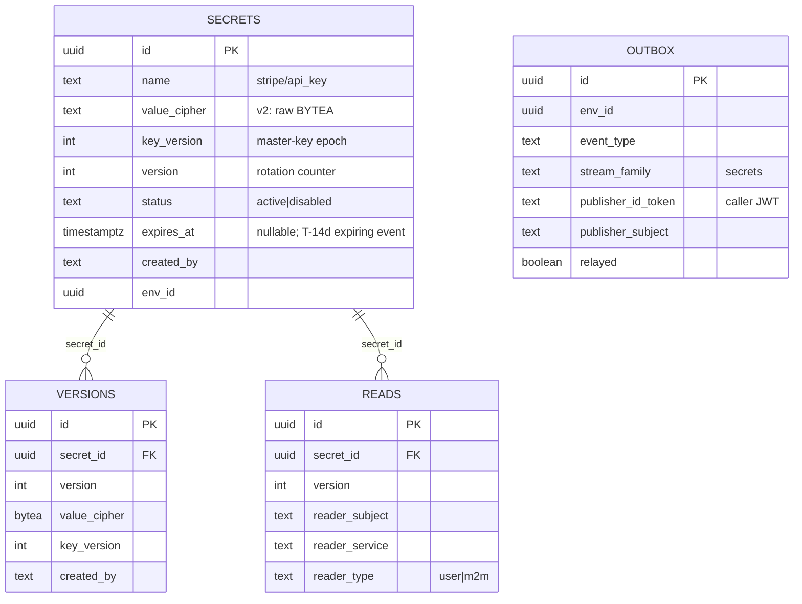
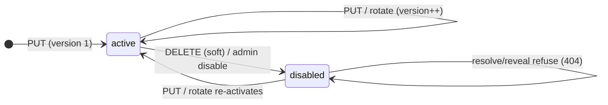
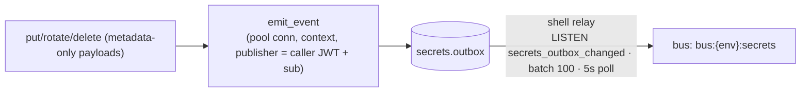
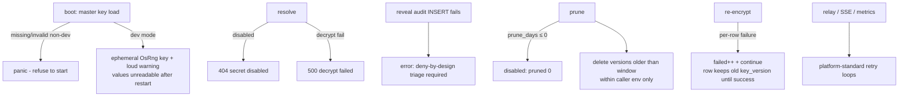
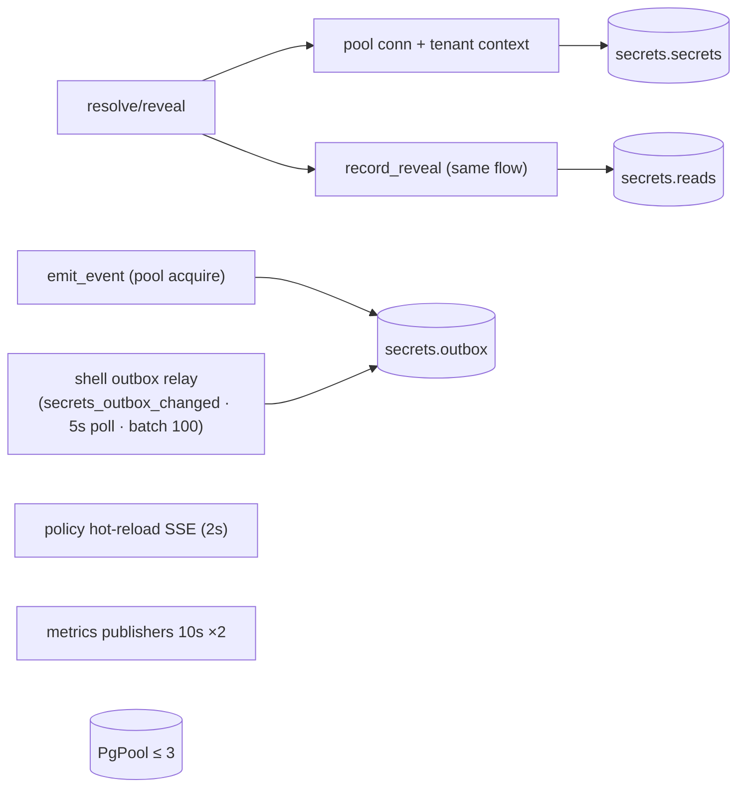
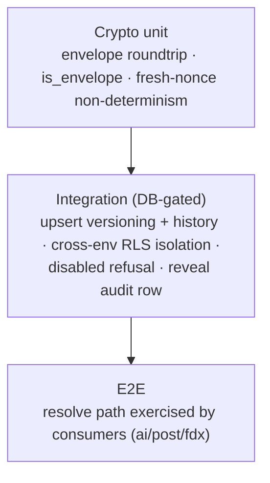

# DESIGN.md: Sentin8:Secrets - Detailed Design Document

## 1. Scope & Context

Sentin8:Secrets is the platform's secret-reference store: provider
credentials, API keys, and webhook signing secrets are envelope-encrypted
at rest (AES-256-GCM under a 32-byte master key), addressed by name
(`stripe/api_key`), versioned on rotation, and revealed only through two
audited paths - the programmatic `POST /v1/secrets/resolve` and the
admin `reveal` - with an append-only reveal audit trail that is never
pruned.

- **Owns** (schema `secrets`): `secrets` (current values), `versions`
  (append-only rotation history), `reads` (reveal audit), `outbox`
  (DBX producer), `audit_journal`.
- **Does NOT own**: the secrets' lifecycle decisions (callers rotate and
  disable), provider connectivity, or key rotation scheduling (the daily
  version-prune sweep is a Sentin8:Cron schedule; re-encrypt stays
  manual).

Trust boundary: plaintext exists only inside a request's scope -
`SecretValue` zeroizes on drop, the master key is a `Zeroizing` wrapper
that never prints, logs, or persists, and metadata surfaces are
value-free by construction.

## 2. Runtime Architecture

| Module | Role |
|---|---|
| `handlers.rs` | Secret CRUD (`PUT/GET/DELETE`), rotate, history, reveal, resolve (`secrets://` / `sentin8-secrets://` / bare name), reads audit, maintenance (prune/re-encrypt), cron proxy-back (`/v1/internal/schedules/run`: expiry-scan + version-prune); `emit_event` (outbox with the caller's publisher identity); inline SQL (no separate store module). |
| `admin_ui.rs` | RFW pages + admin CRUD + cross-env reveal/rotate (`resolve_env_id` requires admin roles for foreign envs). |
| `config.rs` | Master key load (fail-closed panic; dev-mode ephemeral key with loud warning), prune window, dev mode flag. |
| `auth.rs` / `policy.rs` / `server.rs` / `registration.rs` | Verify + raw-bearer extraction (publisher identity); Shield bridge; routes; self-description. |

**Reveal lifecycle (the security-critical family):**

## 3. Data Model

- `secrets.secrets` - `UNIQUE (env_id, name)`; RLS FORCE with 4
  env-scoped policies; no plaintext column - `value_cipher` only.
- `secrets.versions` - append-only (`UNIQUE (secret_id, version)`; select
  + insert + delete policies, no update); previous versions survive the
  prune window so consumers mid-rotation keep resolving.
- `secrets.reads` - append-only and **never pruned**: every reveal (m2m
  resolve, user reveal, admin reveal) lands here with the reader's
  subject/service/type.
- `secrets.outbox` / `secrets.audit_journal` - generated DBX tables.

## 4. API Surface

| Endpoint | Method | Gate | Notes |
|---|---|---|---|
| `/v1/health` | GET | none | liveness. |
| `/v1/secrets/{name}` | PUT | Shield `secret:write` + name validation | create/upsert (version++; history row). |
| `/v1/secrets` · `/v1/secrets/{name}` · `/history` | GET | Shield `secret:read` | metadata only (`?status=active|all`). |
| `/v1/secrets/{name}/rotate` | POST | Shield `secret:write` | 404 if absent; version++ + history. |
| `/v1/secrets/{name}` | DELETE | Shield `secret:admin` | soft-disable (404-equivalent at resolve). |
| `/v1/secrets/{name}/reveal` | GET | Shield `secret:admin` | audited reveal. |
| `/v1/secrets/resolve` | POST | Shield `secret:read` | audited resolve; accepts `secrets://`, `sentin8-secrets://`, bare name. |
| `/v1/secrets/{name}/reads` | GET | Shield `secret:admin` | reveal audit trail (LIMIT 100). |
| `/v1/secrets/maintenance/prune` · `/re-encrypt` | POST | Shield `secret:admin` | Cron proxy-back targets (idempotent, per-env). |
| `/v1/internal/schedules/run` | POST | cron M2M + Shield `secret:admin` | Sentin8:Cron proxy-back: `schedule_type` `expiry-scan` / `version-prune` (the version-prune sweep is registered at boot, 05:30). |
| `/v1/admin/ui/{page}`, `/v1/admin/{resource}` | GET/POST | `READ_SCOPES` / `WRITE_SCOPES` (+admin subset for reveal) | cross-env via `resolve_env_id` (admin roles required). |
| Shield admin API | mixed | policy-admin surface | shared bridge. |
| `/openapi.json` | GET | shell | 12 paths. |

Event flow (producer; family `secrets`):

Event types: `sentin8:secrets:secret:created` (`{secret_id, name,
version}`), `:updated` / `:rotated` (`{secret_id, name, version,
previous_version}`), `:disabled` (`{secret_id, name}`) - values never.

## 5. Cross-Cutting Concerns

- **Authentication**: bearer verify (JWKS); Shield enforced scope-mirror
  (`secret:read|write|admin`); admin reveal narrows to the admin subset.
- **Tenant resolution + RLS**: RLS context must accompany every tenant
  query; cross-env admin paths check platform/env-admin roles before
  addressing the foreign env (403 otherwise).
- **Idempotency**: PUT is a natural idempotent upsert (version++ on
  repeat); produce idempotency by outbox row id.
- **Audit journaling**: reveal audit (`secrets.reads`, never pruned) +
  `audit_journal` for shared decisions.
- **Graceful drain / TLS posture**: shell-owned; the master key lives
  only in process memory (Zeroizing) - a restart re-loads it from env.

## 6. Failure Modes & Recovery

- **Key rotation never bricks readers**: rows carry `key_version`;
  `maintenance/re-encrypt` lazily re-wraps old-key rows (per-row
  continue-on-failure, resumable); the previous-version history row is
  re-wrapped when it is the current version.
- **Version rotation keeps previous values** through the prune window -
  consumers mid-upgrade keep resolving.
- **Event emission failure** only warns (metadata-only events are
  re-derivable from the row).
- **Master key absence** fails closed (panic) in production; dev mode is
  an explicit, loud escape hatch.

## 7. Concurrency & Performance Model

- No service-owned background tasks - the daily version-prune sweep is
  a Sentin8:Cron schedule registered at boot next to the expiry scan;
  outbox relay, policy hot-reload, and metrics publishers
  are shell-owned.
- Hot path: resolve (one SELECT by `(env_id, name)` + one envelope open);
  reveal adds one audit INSERT.
- Pool cap 3; no caching of decrypted values (zeroize-on-drop; each
  resolve decrypts once).

## 8. Invariants, Insecure-Defaults Rejected, Unsafe Rationale

1. **Plaintext only in request scope**: decrypted values live in
   `SecretValue` (zeroize-on-drop); the master key is `Zeroizing` and its
   Debug never prints material.
2. **Metadata is value-free by construction**: `SecretRow::metadata()`
   serializes id/name/description/version/key_version/status/created_by/
   env_id/timestamps/ref - `value_cipher` never leaves the resolve path.
3. **Every reveal is audited** (m2m / user / admin) into the append-only
   `reads` table, which is never pruned.
4. **Envelope discipline**: `v2:` prefix + fresh 12-byte nonce per seal +
   AES-256-GCM; raw BYTEA form at rest; fresh nonce per seal means
   non-deterministic ciphertext.
5. **Names fail closed**: non-empty, ≤256 chars, `[a-zA-Z0-9/_-]`, no
   empty segments (traversal refused).
6. **Disabled refusal**: disabled secrets resolve/reveal as 404 -
   disabled state cannot be distinguished from absence by callers.
7. **Rotation via versioning, not overwrite**: history rows + version
   counters are append-only; delete is soft-disable only (hard delete is
   not exposed).
8. **Key-version epochs**: rotation re-encrypts lazily; rows keep their
   `key_version` until success (idempotent, resumable).
9. **Master key fail-closed**: absent/invalid key panics in production;
   dev mode is explicit and loudly warned.
10. No `unsafe` code; crypto is the shared envelope crate; the master
    key env var is `SENTIN8_SECRETS_MASTER_KEY` (the README's reference
    to `SENTIN8_AUTH_MASTER_KEY` is drift).

## 9. Testing Strategy

- The DB-backed suite connects with the service role (RLS real),
  provisions the schema, and pins versioning, history, isolation,
  refusal, and audit behavior; runtime-skip without PostgreSQL.
- **Deliberately NOT tested here**: key-rotation re-encrypt sweep
  (manual ops path), relay mechanics (platform), TLS.

## 10. Open Questions

- The RLS context hardening gap is closed by wiring the
  `begin_tenant_tx`-style helper (explicit tx + context on the same
  connection, transaction-local `set_config`) into every handler, plus a
  `sec_`-prefixed fail-closed test mirroring db's pinned test
  (testing-strategy §3.3 reserves `sec_` for exactly this class).
- Audit-before-response is enforced: the `{service}.audit_journal` INSERT
  (reveal row) runs inside the same transaction as the value SELECT;
  audit-INSERT failure → 500, the value is never returned unaudited.
- The README adopts `SENTIN8_SECRETS_MASTER_KEY` (the design §4.3 name is
  authoritative).

---

**Design attribution:** sentin8:secrets and its underlying concepts were designed by Hamid Jahanzad <Hamid@Jahanzad.com>.

