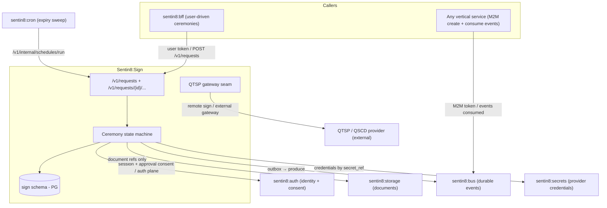
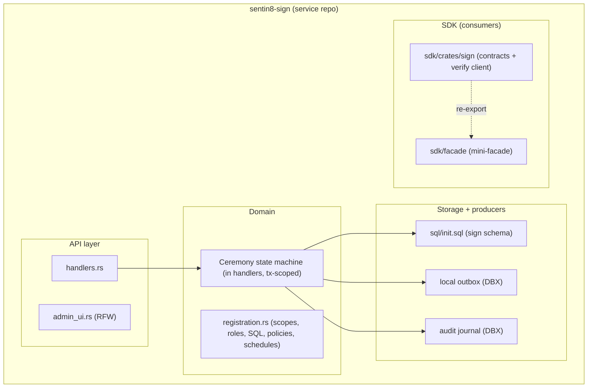
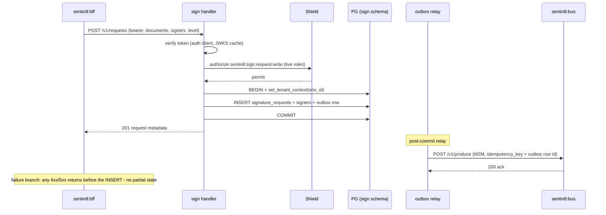
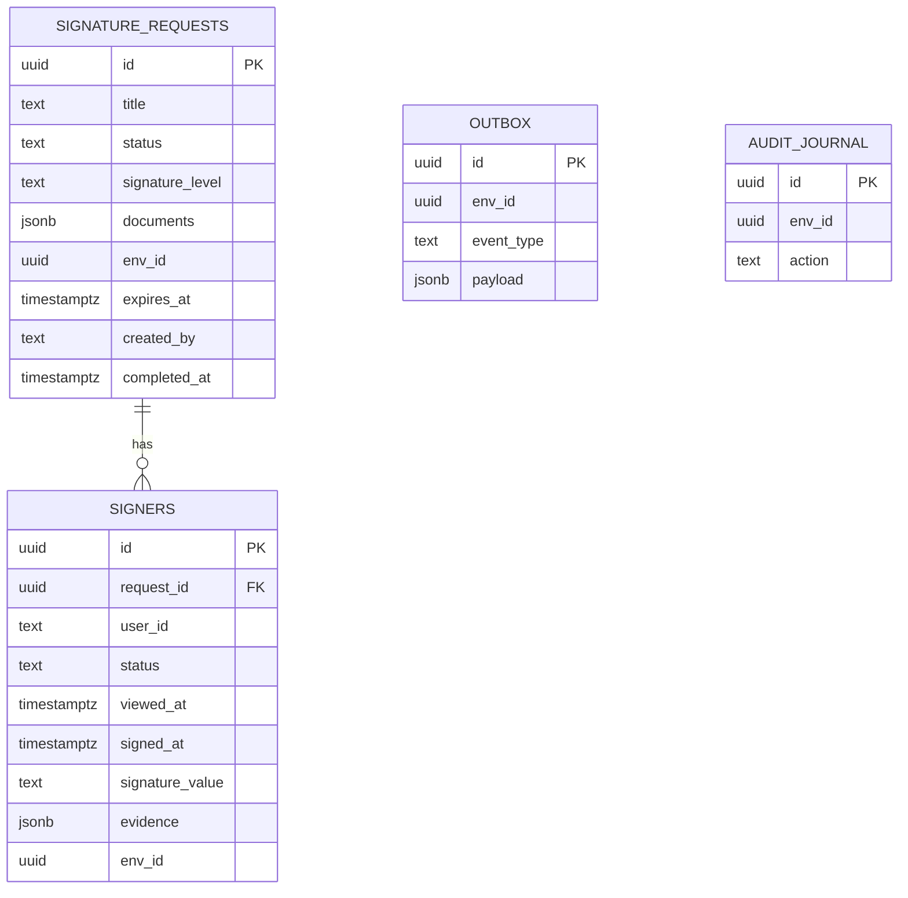
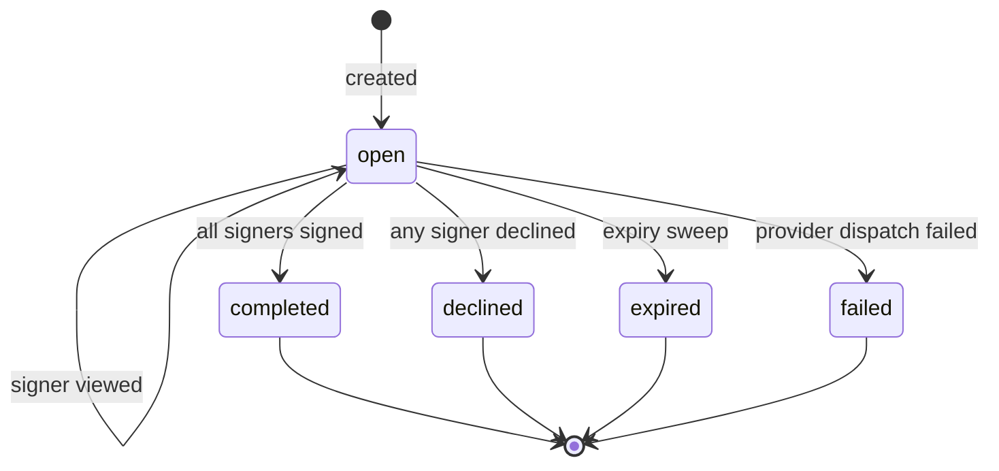
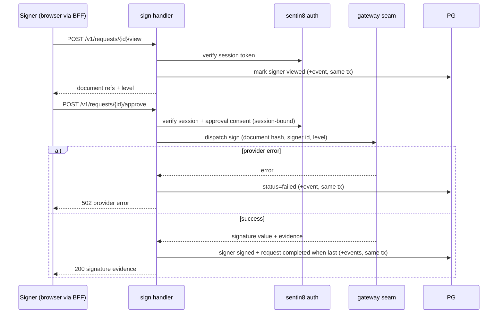
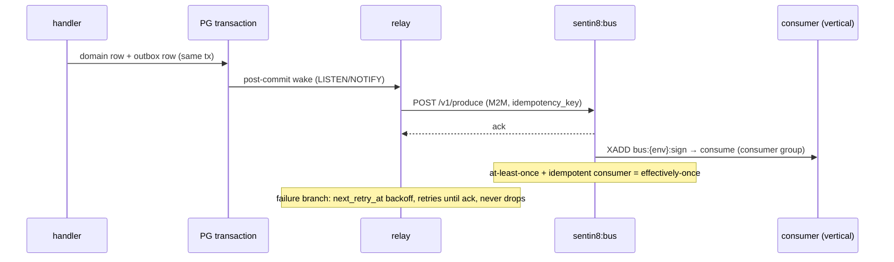
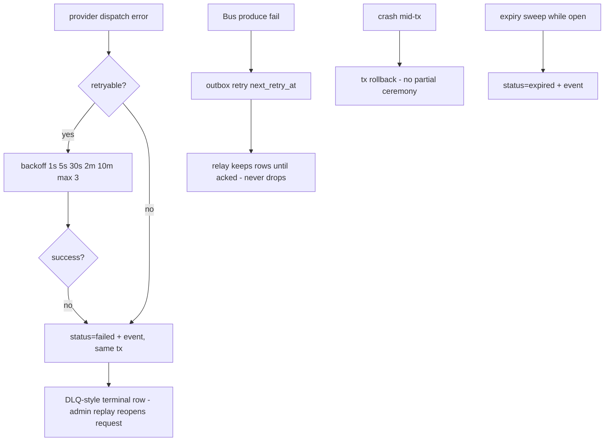
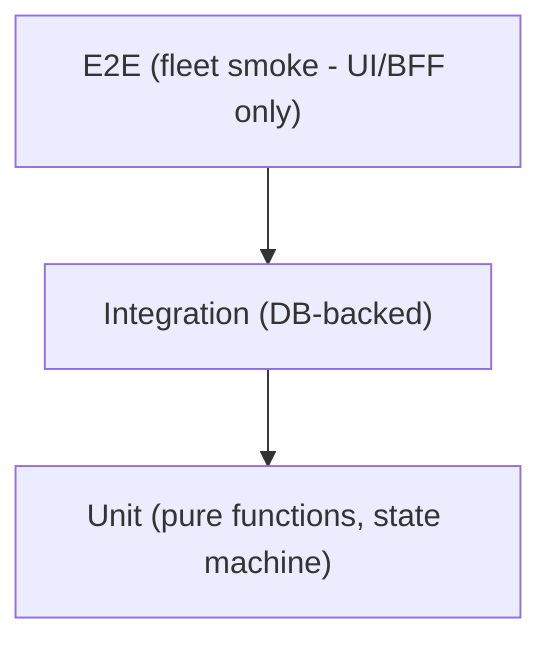

# DESIGN: Sentin8:Sign - Detailed Design Document

> Audience: maintainers, reviewers, and architects modifying the
> service. For the overview read `README.md`; for the business
> functionality read `BUSINESS.md`.

## 1. Scope & Context

Sentin8:Sign owns the **electronic signature ceremony**: request
lifecycle, signer ceremonies, provider dispatch, evidence retention,
and the `sentin8:sign:*` event family. It does NOT own identity
assurance (auth does), document bytes (storage does), message delivery
(post does), or authorization decisions (Shield does).

Container view (internal modules):

## 2. Runtime Architecture

The service boots on the platform `sentin8-shell` crate (registration
flag, PQ provider, config, capped pool, state binding, OpenAPI merge,
middleware stack, PQ-TLS listener are shell-owned). This repo supplies
only its registration data, state, and routes - identical to every
other platform service.

Components:
- **Router** (`server.rs`): request CRUD + ceremony endpoints + admin
  (RFW) + Shield policy-admin surface.
- **Handlers** (`handlers.rs`): the ceremony state machine, executed
  inside explicit tenant transactions; events ride the outbox in the
  same transaction.
- **Gateway dispatch** (in `handlers.rs`): trait-object seam - stub
  dispatch by default; QTSP adapters behind the same interface,
  credentials by `secret_ref`.
- **Registration** (`registration.rs`): scopes, admin roles, RLS
  policy set, SQL migrations, Cron schedule declarations, M2M grants.
- **Relays** (shell-owned DBX): outbox pusher → Bus, audit journal
  pusher → Sys.

Request lifecycle (request creation - the 8-step pipeline):

## 3. Data Model

Tables (all RLS env-scoped, `FORCE ROW LEVEL SECURITY`, standard
tenant-match policy):
- `sign.signature_requests` - the request: title, status, level
  (`ades`|`qes`), documents (JSON array of storage refs + names +
  hashes), expiry, evidence snapshot at completion.
- `sign.signers` - per-signer ceremony: user id, status
  (`pending`|`viewed`|`signed`|`declined`), viewed/signed timestamps,
  signature value + provider evidence, session binding recorded at
  approval time.
- `sign.outbox`, `sign.audit_journal` - the standard DBX producer
  tables (generated from the SDK helpers).

State machine (`signature_requests.status` + per-signer `status`):

## 4. API Surface

| Endpoint | Audience | Gate | Events |
|---|---|---|---|
| `POST /v1/requests` | public (BFF/M2M) | `sentin8:sign:request:write` | `sentin8:sign:request:created` |
| `GET /v1/requests` | public | `sentin8:sign:request:read` | - |
| `GET /v1/requests/{id}` | public | `sentin8:sign:request:read` | - |
| `POST /v1/requests/{id}/view` | public (signer) | `sentin8:sign:signer:read` | `sentin8:sign:request:viewed` |
| `POST /v1/requests/{id}/approve` | public (signer, session-bound) | `sentin8:sign:signer:write` | `sentin8:sign:request:signed` / `:declined` / `:completed` |
| `GET /v1/requests/{id}/evidence` | public | `sentin8:sign:request:read` | - |
| `POST /v1/admin/sign/...` | admin (RFW) | `sentin8:sign:admin` | - |
| `GET /v1/admin/ui/{page}` | admin (RFW) | `sentin8:sign:admin` | - |
| `POST /v1/internal/schedules/run` | cron proxy-back | internal (M2M) | `sentin8:sign:request:expired` |
| Shield policy-admin (`/v1/admin/policy-sets/...`) | admin | `sentin8:sign:policy:*` | - |

The signer approval sequence (multi-party):

Event flow (outbox → Bus → consumer):

## 5. Cross-Cutting Concerns

- **Auth**: bearer verification via the shared auth-client (JWKS
  cache); M2M callers verify with the platform token pipeline; scope
  pre-filter + Shield decision (live roles).
- **Tenant resolution + RLS**: `env_id` from the token; explicit
  `WHERE env_id = $N` on every query + the RLS backstop; context set on
  the same transaction as the query.
- **Idempotency**: create carries an optional client idempotency key
  (stored on the request row, unique per env); Bus events carry the
  outbox row id as the idempotency key.
- **Rate limiting**: platform middleware (bot protection rides the
  shell defaults).
- **Audit**: every state transition writes the local journal + spills
  to Sys (`sentin8:sys:audit:write`); signature evidence is
  business-audit-grade (who/when/what seen).
- **Graceful drain**: shell-owned upgrade drain (10s) - in-flight
  ceremonies commit or roll back atomically.
- **TLS**: platform PQ-TLS in-process termination via `sentin8-tls`
  (X25519MLKEM768 / ML-DSA-65; no classical fallback).

## 6. Failure Modes & Recovery

- **Crash mid-transaction**: the ceremony row + event row commit or
  roll back together (single tx) - no half-signed state.
- **Provider outage**: retry curve mirrors Post (1s→5s→30s→2m→10m, max
  3); terminal `failed` state is admin-replayable (reopen).
- **Bus outage**: outbox rows accumulate; relay drains post-recovery -
  events never lost (durable outbox rule).
- **Credential rotation**: provider credentials resolve at dispatch
  time through Secrets; rotation needs no restart.

## 7. Concurrency & Performance Model

- Tokio multi-thread runtime (shell-owned); handler concurrency =
  axum's default; no custom task spawning in this service.
- Pool capped at 3 (`sentin8::config::pg_pool::connect`).
- Hot path: request read + evidence fetch are single-query; ceremony
  transitions are single-tx; JWKS and discovery cached (auth-client
  5-min TTL).
- Backpressure: the gateway seam awaits the provider call inside the
  request - provider latency is the ceremony's latency, bounded by
  the HTTP client timeout.

## 8. Invariants

1. A signature request and its signers are only visible inside their
   `env_id` (RLS + explicit WHERE).
2. Signer approval binds to the approving session; replayed or
   cross-session approvals are rejected.
3. Completed evidence is append-only - no mutation after completion.
4. Documents are storage refs, never inline bytes.
5. Provider credentials exist only as `secret_ref` values.
6. Every state transition emits its event in the same transaction.
7. No `unsafe` code; signing keys/tokens never logged.

## 9. Testing Strategy

- Unit: state transitions, session binding, payload shapes, level
  validation.
- Integration: ceremony round-trip, RLS isolation, outbox emission
  shape, expiry sweep effect.
- Drift: OpenAPI covers every served route.
- NOT tested here: provider-format specifics (per-adapter concern),
  BFF routing (bff's own suite), fleet boot (nightly).

## 10. Open Questions

- Deep AdES container verification (PAdES/XAdES) rides the gateway
  seam behind provider adapters; the SDK client verifies the service's
  evidence record.
- Multi-document package semantics (sign once over N docs) - model
  supports it; single-signature-per-package semantics TBD.
- Callback push to requester apps on completion (today: Bus events
  only).

---

**Architecture & Design:** Sentin8:Sign and its underlying concepts were
designed by [Hamid Jahanzad](https://www.linkedin.com/in/hamidjahanzad/).
