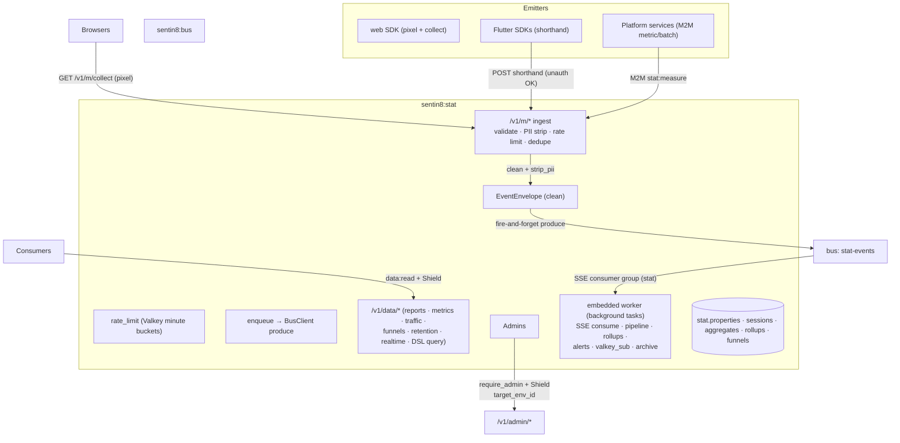
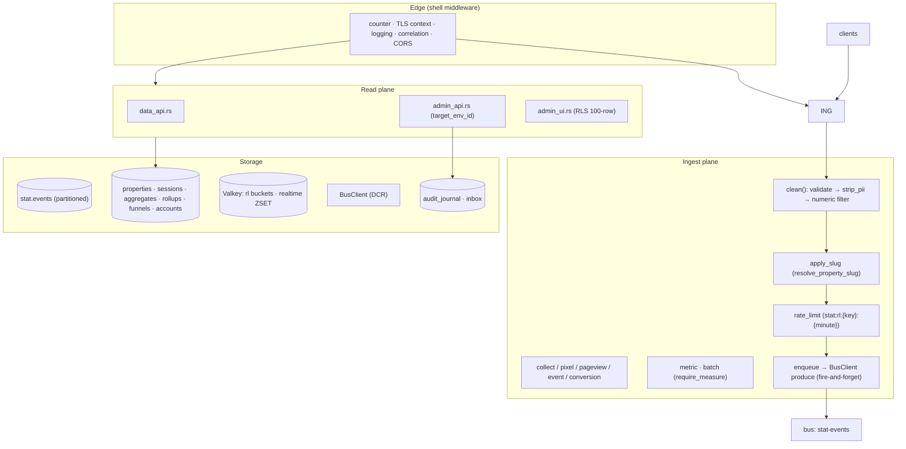
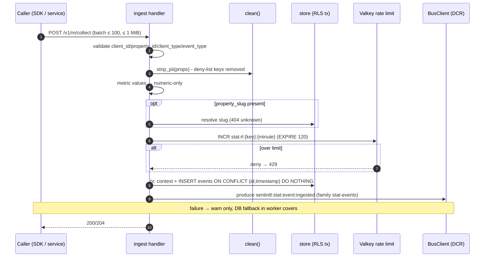
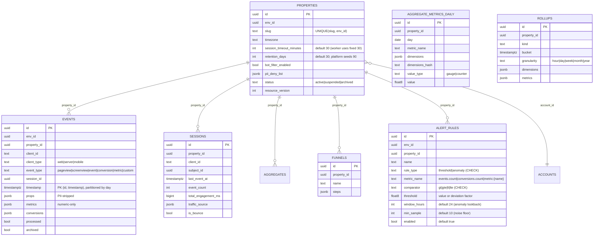
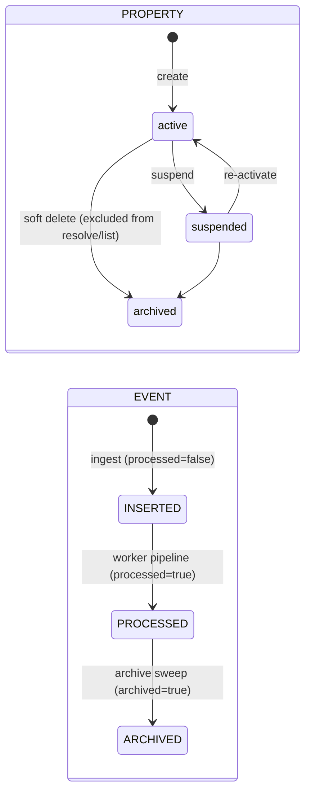
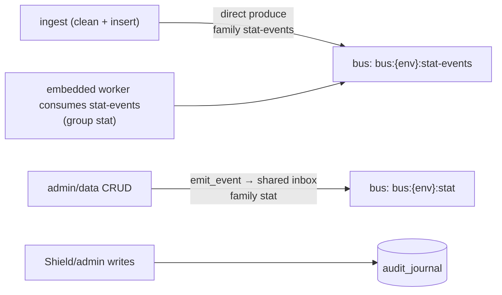
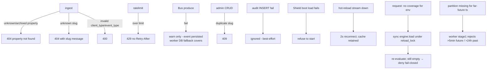
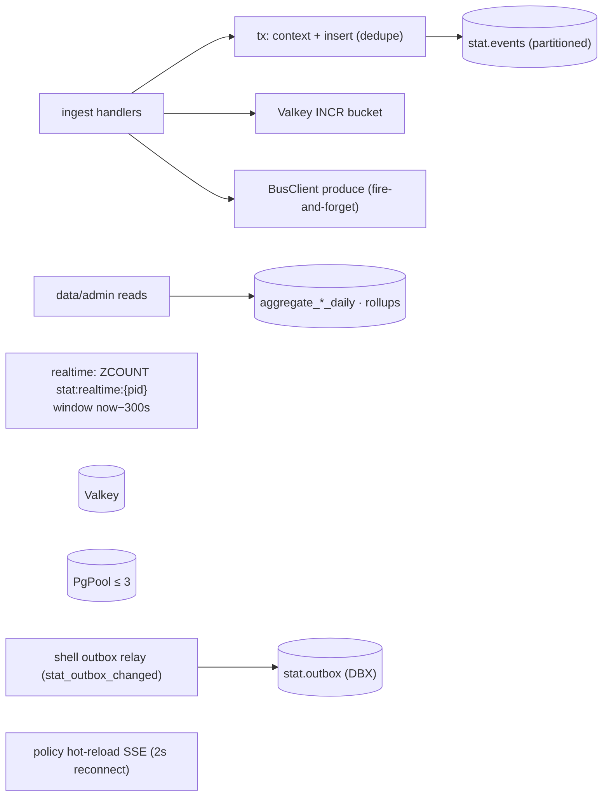
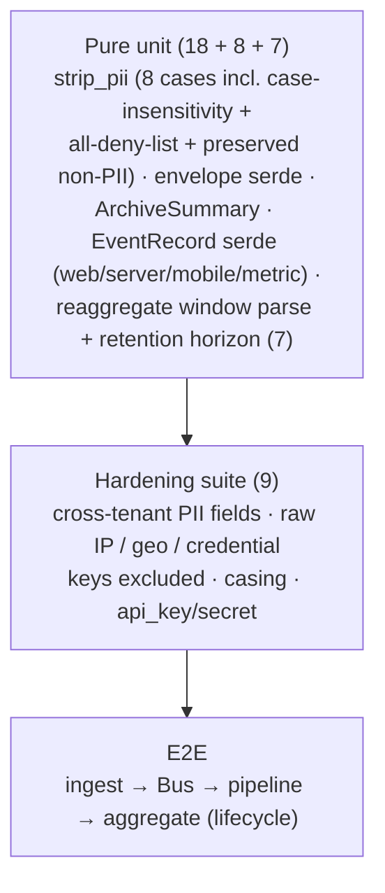

# DESIGN.md: Sentin8:Stat - Detailed Design Document

## 1. Scope & Context

Sentin8:Stat is the platform's analytics and telemetry collection
service: it validates and PII-strips every inbound event, rate-limits by
identity, enqueues accepted events onto the Bus (`stat-events` family),
and owns the property/account/funnel registry plus the read APIs (traffic
summaries, daily metrics, funnels, retention, realtime). An embedded
worker (background tasks in the same process) consumes the ingested
events, runs the 7-stage pipeline, maintains the rollup hierarchy,
evaluates spike/drop alerts, republishes Valkey-side metrics as rollup
snapshots, and archives processed events to Storage.

- **Owns** (schema `stat`): `properties` (the tenant measurement
  registry with session/retention/bot/PII settings), `events`
  (range-partitioned raw event log), `sessions`, the seven daily
  aggregate tables (`aggregate_metrics|events|sessions|conversions|
  engagement|geo|device_daily`), `rollups` (hour→year hierarchy),
  `funnels`, `accounts`, `outbox` (generated, provisioned but not
  written by stat code), and `audit_journal`.
- **Does NOT own**: TLS traffic metrics (arrive via the shared Valkey
  pub/sub channels), the Bus (consumes via SSE + ACK), and dashboard
  rendering (BFF consumes the data API).

Trust boundaries: the web ingest path is deliberately unauthenticated
(pixels cannot carry tokens) but rate-limited and PII-stripped; the
metric/batch paths and every read/admin surface require bearer scopes
with Shield evaluation; admin endpoints additionally require
`target_env_id`.

## 2. Runtime Architecture

| Module | Role |
|---|---|
| `ingest.rs` | `clean()` (validate + PII strip + numeric-metric filter), `apply_slug` (server-side slug→id+env resolution, 404 unknown), `rate_limit` (Valkey `INCR` minute bucket, TTL 120), `enqueue` (fire-and-forget Bus produce, publisher = caller), the 7 ingest endpoints + pixel fallback (43-byte GIF). |
| `store.rs` | Property/account/funnel CRUD (RLS context on the same connection), `resolve_property` (public active-only lookup), `insert_event` (`ON CONFLICT (id, timestamp) DO NOTHING`), traffic-summary parsing (`tls.traffic.{from}→{to}.{count|latency_ms|errors}`), daily aggregates, DSL query over an 8-table allow-list. |
| `data_api.rs` | Canned reports, metrics/traffic/sessions, funnels, retention, realtime (`ZCOUNT stat:realtime:{id}` over a 5-min window), DSL query (`400 QueryRequiresRawScan` for unsupported operations). |
| `admin_api.rs` | Property/account CRUD with `target_env_id` REQUIRED; `emit_audit` (journal) + `emit_event` (inbox, family `stat`). |
| `admin_ui.rs` | RFW pages (overview, properties/new, accounts/new, events, metrics + policy pages); RLS-scoped 100-row data queries. |
| `auth.rs` / `policy.rs` / `server.rs` / `types.rs` / `config.rs` | Gate helpers (`require_measure`, `require_data_read`, `require_admin`); Shield bridge; routes/state; wire types + `PII_DENY_LIST` + `strip_pii`. |
| `worker/mod.rs` | The embedded pipeline worker (background tasks spawned at state build): `run()` spawns the Bus SSE consume loop, the 30s DB fallback poll, the 60s rollup loop, the 60s alert evaluator, the Valkey pub/sub subscriber, and the hourly archive sweep. `sse_consume_loop` (SSE parse, `message_id` from JSON, `event_id` fallback, invalid-UUID skip+ACK), `process_one` (load → pipeline), `nack_with_retry` (nack ×`max_retries` at 1s, then ACK → DLQ owns poison). |
| `worker/pipeline.rs` | `EventRecord::load`; `run_pipeline` stages 1–5+7; `upsert_metric` (counter=SUM / gauge=last-write via `infer_metric_type`), `upsert_aggregate`, `sha256_hash` (non-crypto), `run_archive_sweep` (retention spill to Storage, scheduled hourly). |
| `worker/rollups.rs` | 60s pass: hour (last 2d) → day (400d) → week (2y, ISO) → month (10y) → year; `upsert_rollup` on `(property_id, kind, granularity, bucket, md5(dims))`; counter=SUM / gauge=AVG. The day pass ALSO emits `sentin8:stat:aggregate:updated` per updated day-bucket (family `stat-pipeline`, fire-and-forget - a Bus outage degrades to the next pass re-emitting, the DB rollup is the durable source). |
| `worker/alerts.rs` | 60s evaluator: event spikes (`SPIKE_MULTIPLIER=3.0`, `MIN_EVENT_VOLUME=100`), conversion drops (`CONVERSION_DROP_RATIO=0.5`); dedup keys in payloads; fire-and-forget produce. Each pass also evaluates the per-property custom rules in `stat.alert_rules` (stat README §7): `threshold` rules (metric value vs comparator/threshold) and `anomaly` rules (moving-average deviation factor `anomaly_deviation(current, avg)` over `ceil(window_hours/24)` daily buckets, compared against the threshold). Rule metric vocabulary (`events.count`, `conversions.count`, `metric:{name}`) resolves through a static allowlist (`MetricSource`) to the aggregate tables - create-time validation 400s unknown keys, so no caller input reaches the SQL outside the allowlist. Custom-rule evaluation runs per-env: distinct envs discovered by a bare read, then ONE context-set transaction per env (audit-consumer pattern, §5) loads the rules and reads the aggregates on the same connection; produce happens after commit. Fires emit `sentin8:stat:alert:rule_triggered` on the same alert → Post path with the curated envelope plus `rule_id`/`rule_type`, deduped per rule per day bucket via the payload `dedup_key` (the curated rules' consumer-side dedupe contract). |
| `worker/valkey_sub.rs` | Pub/sub consumer (`stat:metrics:tls|log`) + 3 per-granularity publishers at 10s tick (minute 60s window, hour 3600s, day midnight-UTC drain). |
| `worker/audit_consumer.rs` | SSE consumer of `sentin8:sys:audit:recorded` (family `sys`, group `stat-audit`): per audit event, increments the per-service audit-volume metric into `aggregate_metrics_daily` (`audit.events` counter, dimensions `{service, severity, env_id}`) in ONE explicit transaction (context-set + property resolve + upsert share the tx - `set_config(..., true)` is transaction-local). The payload's service name is normalized to the bare property slug. A processing failure does NOT ack - Bus at-least-once redelivers; a redelivered event may double-increment within the same day-bucket - accepted for volume analytics. |

**Ingest lifecycle (the hot family):**

## 3. Data Model

- `stat.events` - `PARTITION BY RANGE (timestamp)` with daily partitions
  (`stat_events_YYYY_MM_DD`, today + 7 seeded); the pipeline reads
  `processed=false` via the partial index; dedupe by event id.
- Daily aggregates (`_metrics|events|sessions|conversions|engagement|geo|
  device_daily`) - one row per event (no unique constraint; summed at
  query time) except `aggregate_metrics_daily`, which upserts on
  `UNIQUE (property_id, day, metric_name, dimensions_hash)`.
- `stat.alert_rules` - per-property custom alert rules (stat README §7):
  `rule_type` CHECK `threshold|anomaly`, `comparator` CHECK
  `gt|gte|lt|lte`. `metric_name` is the evaluator's vocabulary -
  `events.count` (`aggregate_events_daily.count`), `conversions.count`
  (`aggregate_conversions_daily.count`), or `metric:{name}`
  (`aggregate_metrics_daily.value`) - validated at create time (400 on
  unknown) and mapped through a static allowlist in the evaluator.
  Partial index `(property_id) WHERE enabled` serves the 60s pass.
- `stat.rollups` - unique on `(property_id, kind, granularity, bucket,
  md5(dimensions::text))`; written by the embedded worker's rollup loop.
- `stat.outbox` - the DBX producer path: admin CRUD mutations
  (property create/update/delete, account create) append a
  `sentin8:stat:{resource}:{operation}` row inside an explicit
  transaction (context-set + INSERT share the tx - `set_config(...,
  true)` is transaction-local); the shell's outbox relay
  (`stat_outbox_changed` LISTEN + 5s safety poll) pushes the row to
  Bus `POST /v1/produce` with stat's M2M token. The FORCE-RLS insert
  policy bounds the row to the caller's env. The pipeline's stage-7
  `sentin8:stat:event:ingested` notice still rides the shared `inbox`
  (MemBus domain-changed fan-out, not a Bus domain event).

## 4. API Surface

| Endpoint | Method | Gate | Notes |
|---|---|---|---|
| `GET /v1/m/collect` | GET | none (pixel) | 1×1 GIF response; query-string envelope; best-effort. |
| `POST /v1/m/collect` | POST | optional bearer (Shield evaluated when present) + rate limit | batch ≤ 100 events / 1 MiB body. |
| `POST /v1/m/pageview|event|conversion` | POST | optional bearer + rate limit | web shorthands. |
| `POST /v1/m/metric` | POST | **M2M scope `sentin8:stat:measure`** | strict gate. |
| `POST /v1/m/batch` | POST | **M2M scope `sentin8:stat:measure`** | limits 2× collect (200 events, 4 MiB). |
| `GET /v1/data/{reports|reports/{id}|metrics|traffic|sessions|retention|realtime}` | GET | Shield `sentin8:stat:data:read` + bearer | canned reports, daily aggregates, 5-min realtime. |
| `POST /v1/data/funnels`, `GET /v1/data/funnels/{id}` | POST/GET | Shield `data:read` | funnel CRUD/read. |
| `POST /v1/data/query` | POST | Shield `data:read` | DSL over 8 daily tables; unsupported ops → `400 QueryRequiresRawScan`. |
| `/v1/admin/properties|accounts` (+delete/retention/settings) | GET/POST/PUT/DELETE | `require_admin` + Shield + `target_env_id` REQUIRED (400) | RFW-backed CRUD. |
| `POST/GET /v1/admin/properties/{id}/alert-rules`, `DELETE .../alert-rules/{rule_id}` | POST/GET/DELETE | `require_admin` + Shield + `target_env_id` REQUIRED (400) | Per-property custom alert rules (stat README §7). Create validates `rule_type`, `comparator`, and `metric_name` against the known aggregates (400 on unknown); property-not-in-env is a 404. Reads/writes via one explicit tenant tx (context-set + statement on the same connection, §5). |
| `POST /v1/admin/properties/{id}/reaggregate` | POST | `require_admin` + Shield + `target_env_id` REQUIRED (400) | Delete + rebuild the property's day-`metrics` rollups over a raw-events window (`{from,to}` RFC 3339, default last 30d, max 400 day buckets). Source: `stat.events` ONLY - a window past the property's retention horizon is a 400 citing §4.3.6 (archive spill boundary; Storage-archive replay is a separate raw-replay surface). One tx: context → delete buckets → set-based recompute (counter=SUM / gauge=last-write); audit row carries the window. |
| `/v1/admin/ui/{page}`, `/v1/admin/{resource}` | GET | `require_admin` + `target_env_id` | RFW pages + data. |
| Shield admin API (`/v1/admin/policy-sets|relations|attributes…`) | mixed | policy-admin scopes | shared bridge. |
| `/v1/health`, `/v1/readiness`, `/openapi.json` | GET | none | liveness / PG ping / spec. |

Event flow:

Emitted event types: ingest
`sentin8:stat:event:ingested` (family `stat-events`, fire-and-forget);
CRUD `sentin8:stat:property:created|updated|deleted`,
`sentin8:stat:account:created`, `sentin8:stat:funnel:created`,
`sentin8:stat:alert_rule:created|deleted`
(family `stat` via the shared `inbox`); pipeline lifecycle
`sentin8:stat:event:ingested` (family `stat-pipeline`, via the shared
`inbox`, payload `{event_id, session_id}`); aggregates
`sentin8:stat:aggregate:updated` per updated day-bucket (family
`stat-pipeline`, direct produce, payload-complete - `property_id,
aggregate, window, bucket_start, value, dimensions` - so downstream
listeners apply their metrics from the payload alone); alerts
`sentin8:stat:alert:event_spike` / `sentin8:stat:alert:conversion_drop`
(family `stat-pipeline`, direct produce, payloads carry
`property_id, env_id, today_count|ratio, dedup_key, severity, title,
body`, `publisher_subject: "sentin8:stat"`); custom alert rules
`sentin8:stat:alert:rule_triggered` (same family, same envelope plus
`rule_id, rule_name, rule_type, metric_name, comparator, threshold,
current_value, baseline_value, deviation_factor, window_hours`,
dedup_key `rule:{id}:{day}`); admin CRUD `sentin8:stat:alert_rule:created|deleted`
(family `stat` via the shared `inbox`).

## 5. Cross-Cutting Concerns

- **Authentication**: three postures on one service - unauthenticated web
  ingest (pixel/shorthand, rate-limited), bearer ingest with Shield
  evaluation when a token is present, and strict M2M scope gates on
  `metric`/`batch`. Data + admin planes require scopes; admin additionally
  requires `target_env_id` (400 when missing, never a token-env
  fallback). The embedded worker is M2M-only (DCR consume + produce
  clients); no user-bearer path anywhere in the pipeline.
- **Tenant resolution + RLS**: every tenant query sets
  `sentin8_set_tenant_context(...)` on the same connection;
  `resolve_property` is the sanctioned public lookup
  (active-only, by design for ingest). The worker's stage7 emit and the
  archive-sweep property query set the context on the same connection
  (SYSTEM env for the cross-property sweep); rollup/alert passes run
  under the service role's `search_path = stat, public`.
- **Idempotency**: events dedupe on `event_id` via
  `ON CONFLICT (id, timestamp) DO NOTHING`; realtime windows are 5-minute
  ZSET counts; rate-limit buckets are 1-minute Valkey keys (TTL 120);
  worker metric upserts keyed `(property_id, day, metric_name,
  dimensions_hash)` and rollups keyed `(property_id, kind, granularity,
  bucket, md5(dims))` - daily aggregate INSERTs are not deduped (summed
  at query time) and event processing is at-least-once (SSE + DB
  fallback), so aggregate INSERTs may duplicate (documented trade-off).
- **PII protection**: `PII_DENY_LIST` (13 keys: `email, phone, pan, pin,
  cvv, ssn, password, token, secret, apikey, api_key, iban,
  account_number, card_number`) stripped at ingest - lowercase exact
  top-level key match in `props`; non-numeric metric values dropped;
  raw IPs never persisted. The worker strips nothing (ingest already
  cleaned); archive JSONL contains only already-cleaned rows.
- **Audit journaling**: admin writes (properties, accounts, alert
  rules, reaggregate) land in `audit_journal`
  (best-effort) + `inbox` events for CRUD.
- **Graceful drain / TLS posture**: shell-owned (PQ provider, pool cap,
  PG18 check, TLS serve).

## 6. Failure Modes & Recovery

- **No local retry** - the ingest produce is fire-and-forget; the
  embedded worker's 30s DB fallback loop picks up anything the Bus missed.
- **Poison handling**: after `max_retries` nacks the message is ACKed so
  the Bus DLQ owns it (never silently dropped, never hot-looped).
- **Archive**: `run_archive_sweep` runs hourly (batches ≤1000 per property,
  JSONL PUT to Storage, `archived=true`); a failed pass leaves rows
  queued (never deleted before archive verification).
- **Metrics loss**: Valkey pub/sub is lossy by design (no ACK) - the next
  10s publish refreshes; rollup DB rows are the durable layer.
- **Audit-journal spill**: the shared journal is the only durable spill
  for admin paths; the journal → Sys push loop is not spawned here yet.
- **Partition maintenance**: initial partitions cover today + 7 days;
  creating later partitions is an operational concern (no auto-partition
  loop in stat).

## 7. Concurrency & Performance Model

- Batch limits: collect ≤ 100 events / 1 MiB; batch ≤ 200 events / 4 MiB.
- Rate limits: web 1000/min, server 10000/min (Valkey minute buckets,
  key `m2m:{sub}` or `client:{client_id}`).
- Hot paths: the `(property_id, timestamp)` partition index, the
  `(property_id, created_at) WHERE archived=false` index for unprocessed
  sweeps, the unique property slug index.
- Tasks: the shell owns the outbox relay, policy hot-reload, and
  error-metrics publisher; stat spawns the embedded worker's background
  tasks at state build - SSE consume loop, 30s DB fallback poll, 60s
  rollup loop, 60s alert evaluator, Valkey pub/sub subscriber, hourly
  archive sweep.
- Single SSE consumer loop - throughput bounded by pipeline latency;
  batches of 25 per consume pass. The rollup pass rewrites the last
  48h (hour), 400d (day), 2y (week), 10y (month), all (year) each
  cycle - idempotent upserts make reruns safe. Valkey aggregation
  buffers are per-`(source, org, env, metric)` keys in an in-memory
  `Arc<Mutex<HashMap>>` - single-process aggregation only.

## 8. Invariants, Insecure-Defaults Rejected, Unsafe Rationale

1. **PII never stored**: the 13-key deny-list is stripped at ingest
   before persistence; non-numeric metric values are dropped; raw IPs are
   never persisted (the geo/device hints are classification-only).
2. **Dedupe by event id** (`ON CONFLICT (id, timestamp) DO NOTHING`) -
   replays are idempotent; there is no separate idempotency-key field
   (README divergence).
3. **Rate limiting per identity bucket** with 120s key expiry - a
   compromised client cannot exhaust the ingest plane.
4. **Env from the token, org via lookup** - a body `env_id` mismatch is
   a 403; admin reads require explicit `target_env_id`.
5. **Property slugs resolve server-side** (emitters never need a UUID
   lookup); unknown slugs 404 exactly like unknown ids.
6. **Aggregates are additive**: daily rows are inserted per event and
   summed at query time; metric tables upsert idempotently
   (gauge = last-write, counter = sum).
7. **Partitioned raw log**: events are range-partitioned by day; queries
   name the partition explicitly; archive sweeps mark `archived=true`
   and never delete (retention is enforced by the worker's storage
   spill + prune).
8. **Session timeout is a fixed 30-minute constant** in the attribute
   stage (the per-property `session_timeout_minutes` setting is not
   honored in code).
9. **Future/past event rejection** at pipeline stage1: >5 min future,
   >24 h old - no partition misses.
10. **Metric type stability**: `.issued/.created/.completed` suffixes make
    a name a counter (SUM on conflict); everything else is a gauge
    (last-write-wins) - determined once at first upsert.
11. **Poison messages reach the Bus DLQ** (nack ×3 then ACK) - never
    silently dropped, never hot-looped.
12. **Rollups are idempotent upserts** - the 60s pass can rerun safely;
    dimensions hash uses a non-cryptographic 128-bit hash (bucketing only).
13. **Alerts carry dedup keys** (`event_spike:{pid}:{day}` /
    `conversion_drop:{pid}:{day}` / `rule:{id}:{day}`) for consumer-side
    dedupe; the worker itself re-fires while the condition holds
    (documented contract).
14. **Custom rule metrics are allowlisted twice**: create-time validation
    400s unknown `metric_name` keys, and the evaluator resolves every key
    through a static `MetricSource` allowlist - caller input never reaches
    the SQL outside the allowlist; unknown keys are skipped defensively.
15. **Custom rules below the noise floor never fire** (`min_sample`,
    default 10 - the current-bucket floor mirroring the spike rule's
    `MIN_EVENT_VOLUME`); `anomaly` rules additionally need at least one
    non-empty baseline bucket in the window.
16. **Minute-granularity rollups stay Valkey-only** (the DB `rollups`
    table holds hour→year) - BFF subscribes `stat:rollups:minute`
    directly; minute DB rows would double-write with no consumer.
17. No `unsafe` code; the pixel response is a constant 43-byte GIF.

## 9. Testing Strategy

- The pure suites pin serialization and summary shapes (PII stripping,
  serde, `ArchiveSummary`, `EventRecord`); the pipeline itself needs
  live PG + Valkey + Bus and is covered by the lifecycle e2e.
- **Deliberately NOT tested here**: partition maintenance, Bus relay
  (platform suite), rollup SQL windows (live), alert thresholds against
  real traffic, TLS, archive storage writes.

## 10. Open Questions

- `enqueue` uses the `SENTIN8_STAT_STREAM_FAMILY` config value (default
  unchanged); the dead config is removed.
- The stripped-PII flag is persisted: `events.props_pii_stripped BOOLEAN
  DEFAULT false` on the insert so dashboards can filter.
- The README's ingest posture is rewritten to the design-doc carve-out (the
  web pixel is the sole unauthenticated path, scoped by public `propertyId`;
  `metric`/`batch` are strictly gated).
- Rate-limit rejections set `Retry-After: 60` (the bucket window) in the 429
  response so consumers back off deterministically.
- The `sentin8:stat:aggregate:updated` rollup emit gives the
  app listener's `app-listing-metrics` consumer group a producer -
  the ingest surface for the listener's metric application is
  `POST /v1/m/metric` (scope `sentin8:stat:measure`). The event is
  payload-complete (property_id, aggregate, window, bucket_start,
  value, dimensions) and fire-and-forget: a failed produce is retried
  by the next 60s pass because the DB upsert is idempotent and the
  pass re-reads the bucket. No dedicated internal endpoint was added
  - the event carries everything the consumer needs.

---

**Design attribution:** sentin8:stat and its underlying concepts were designed by Hamid Jahanzad <Hamid@Jahanzad.com>.

