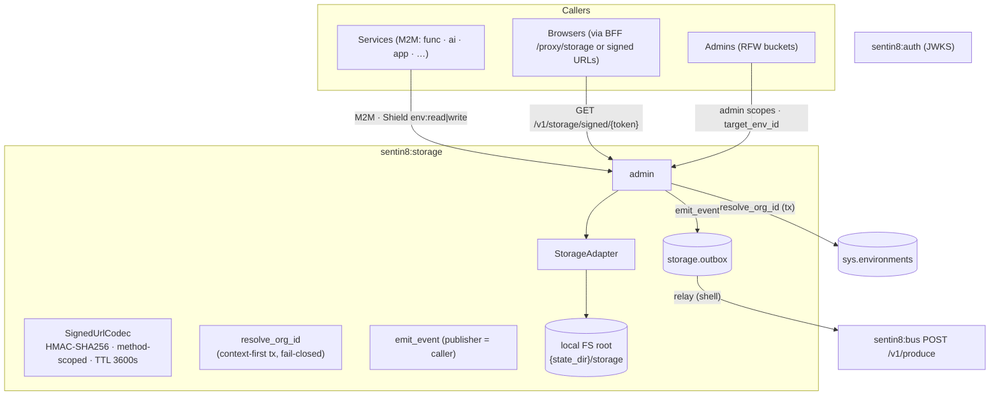
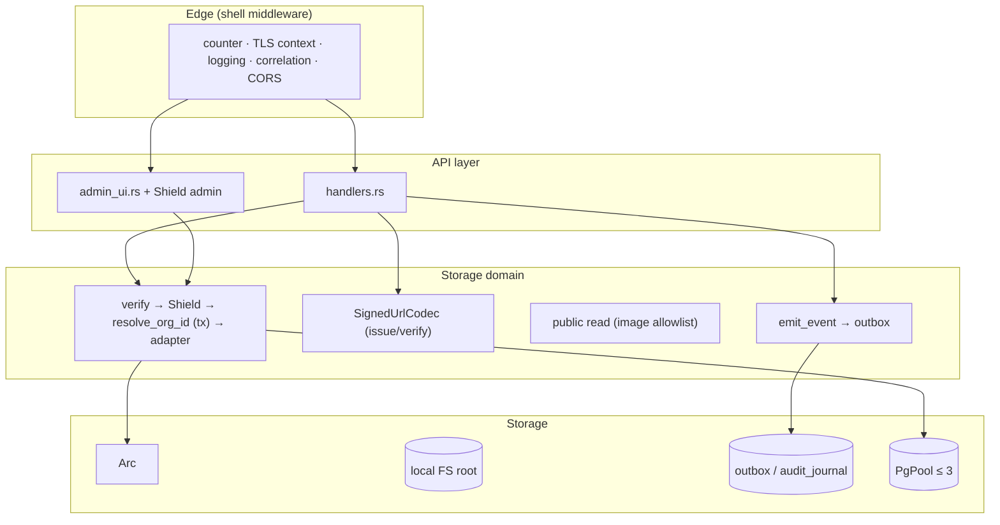
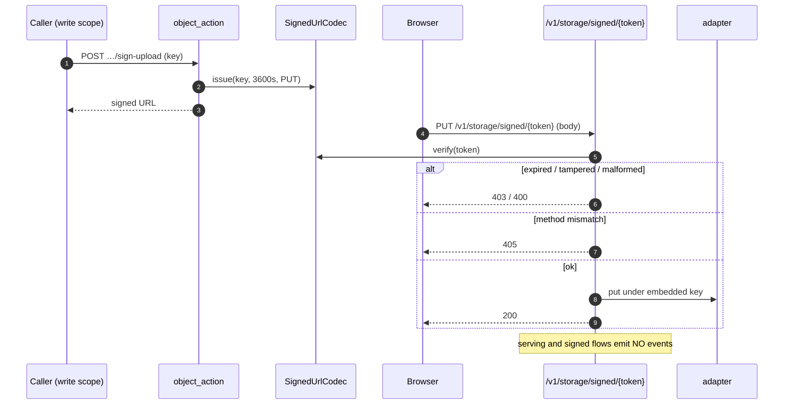
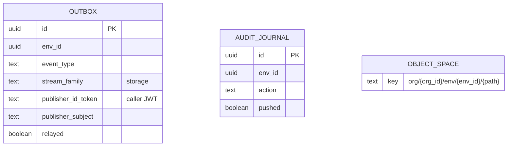
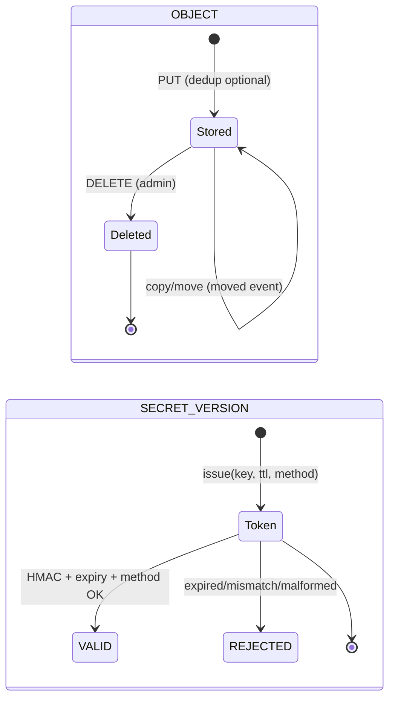
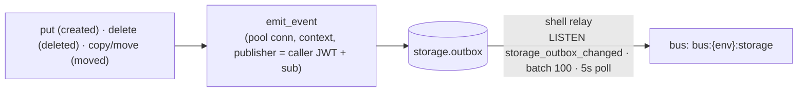
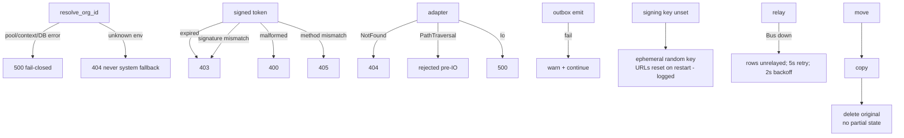
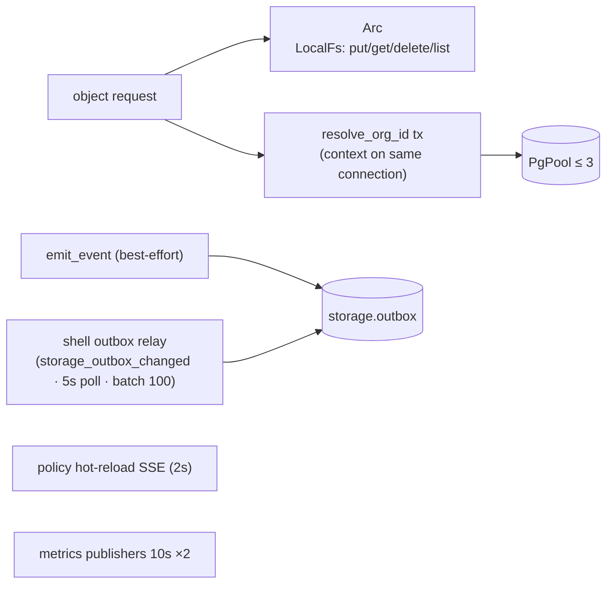
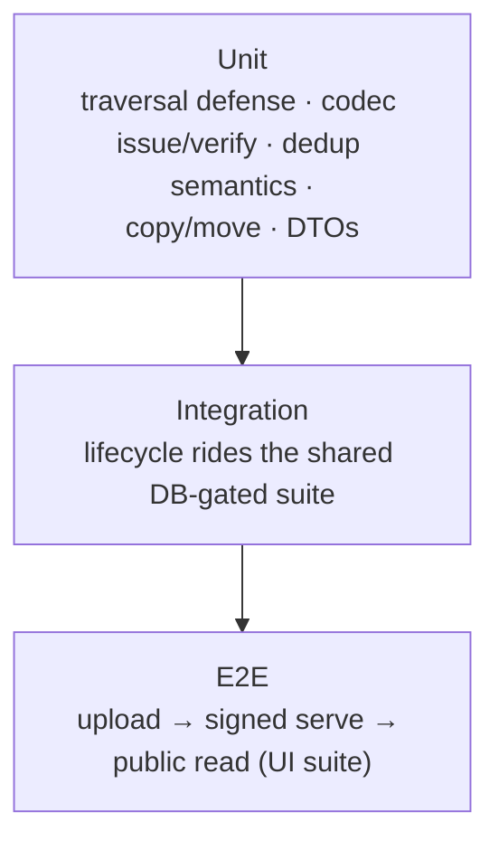

# DESIGN.md: Sentin8:Storage - Detailed Design Document

## 1. Scope & Context

Sentin8:Storage is the platform's object storage service: all file/blob
persistence for every vertical flows through it. It owns the adapter
abstraction (local FS today, pluggable backends), the HMAC signed-URL
codec for browser-direct transfers, the public read surface (images for
branding/logos), and the DBX event emission for object lifecycle. The
service holds no object metadata of its own - owning services store
references (keys) in their schemas.

- **Owns** (schema `storage`): `outbox` (DBX producer), `audit_journal`
  (generated; no code path writes it today), plus every physical object
  under the adapter root (`org/{org_id}/env/{env_id}/{object_path}`).
- **Does NOT own**: object semantics (callers decide what a key means),
  the bucket registry (admin buckets are marker-based - `.keep`), and
  tenant identity (env from the verified token; org resolved server-side).

Trust boundary: keys never embed tenant segments in URLs (env from the
token, org resolved server-side); signed URLs are tamper-proof HMAC
tokens scoped to one method with expiry checked before any IO.

## 2. Runtime Architecture

| Module | Role |
|---|---|
| `storage.rs` | `StorageAdapter` trait (put/get/delete/list + defaulted exists/size/copy/move), `LocalFsAdapter` (traversal defense: component-level `ParentDir` rejection + canonicalize-deepest-existing + containment), `SignedUrlCodec` (issue/verify, GET/PUT methods). |
| `handlers.rs` | Object CRUD (PUT/HEAD/GET/DELETE/list), signed dispatch (serve/upload), copy/move, public reads (platform + per-env), health; `emit_event` with the caller's publisher identity. |
| `admin_ui.rs` | RFW overview/buckets pages + bucket admin (create/delete/upload/download/link) with cross-env authority checks. |
| `server.rs` / `config.rs` / `registration.rs` / `openapi.rs` | State (adapter + codec + pool), routes, self-description (9 admin scopes, 10-permit scope-mirror set). |
| `auth.rs` / `policy.rs` | Verify wrappers + raw-bearer extraction (publisher context); Shield bridge. |

**Signed-URL upload/download lifecycle:**

## 3. Data Model

- No domain tables - objects live in the adapter; the two shared-helper
  tables are the DBX surfaces (`outbox` with NOTIFY trigger
  `storage_outbox_changed`; `audit_journal`, unwired).
- **Key layout**: `org/{org_id}/env/{env_id}/{object_path}`;
  admin-UI buckets add `{bucket}/{object}` (buckets are `.keep` marker
  objects, name sanitized to `[alnum_-]`).
- **Signed tokens**: `base64url("{key}|{expiry}|{METHOD}")` +
  `.` + `base64url(HMAC-SHA256)`; TTL 3600s; method-scoped; expired or
  mismatched tokens rejected before IO; unsigned legacy tokens rejected.

## 4. API Surface

**Object API** (tenant routes: verify → Shield):

| Endpoint | Method | Gate | Notes |
|---|---|---|---|
| `/v1/storage/objects/{*path}` | PUT / HEAD / GET / DELETE / POST | `env:write` / `env:read` / `env:read` / `env:admin` / dispatch | dedup via `X-If-Absent` → `X-Storage-Deduped: true`; POST dispatches sign-read/sign-upload/copy/move (405 otherwise). |
| `/v1/storage/objects` | GET | `env:read` | `?prefix=`; 403 propagates (never masked as empty). |
| `/v1/storage/signed/{token}` | GET / PUT | HMAC token (no bearer) | method-scoped; expired → 403; wrong method → 405. |
| `/v1/public/objects/{*path}` | GET | none | image extensions only (svg/png/jpg/jpeg/gif/webp/ico); platform org/env; `Cache-Control: public, max-age=3600`. |
| `/v1/public/env/{env_id}/objects/{*path}` | GET | none | per-env variant; org resolved from env_id. |

**Admin/RFW** (cross-env requires `sentin8:sys:admin|sys:env:admin|sys:org:admin`):

| Endpoint | Method | Gate |
|---|---|---|
| `/v1/admin/ui/{page}`, `/v1/admin/{resource}` | GET | read set. |
| `/v1/admin/buckets` (GET/POST), `/upload`, `/objects`, `/{id}/delete`, `/{id}/objects/{o}/delete`, `/{id}/download`, `/{id}/link` | mixed | read/write sets. |
| `/v1/admin/policy-sets|relations|attributes…` | mixed | shared Shield admin. |
| `/v1/health`, `/openapi.json` | GET | none/shell. |

Event flow (producer; family `storage`):

Event types: `sentin8:storage:object:created` (`{key, content_type,
size}`), `:deleted` (`{key}`), `:moved` (`{from_key, to_key}`) - copy and
move both emit `moved`.

## 5. Cross-Cutting Concerns

- **Authentication**: Bearer-first, certificate fallback. Tenant routes
  verify the bearer (JWKS) + Shield enforced scope-mirror; when no
  Authorization header is present, the TLS-injected client-certificate
  workload identity (`x-sentin8-client-cert-subject`, CA-verified by the
  TLS layer, client-supplied copies stripped) resolves against the
  boot-loaded registry map (`m2m:workloads`) - the certificate IS the
  authentication and the map IS the authorization record (auth DESIGN
  §4.3f). The `func-storage` workload (func's WASM-binary PUT, cert-
  presenting `StorageClient::with_workload_identity`, no bearer) rides
  this path; signed-URL and public routes remain bearer-free by
  contract (token-authenticated / image-allowlist).
- **Tenant resolution + RLS**: `resolve_org_id` runs inside one explicit
  transaction with the context set on the same connection
  (fail-closed: 500/404 - never a system-org fallback, test-pinned);
  `org_id` never appears in client-facing paths.
- **Idempotency**: `X-If-Absent: true` / `If-None-Match: *` dedup hit
  returns 200 + `X-Storage-Deduped: true` without byte verification
  (caller opted in; content-addressing makes collisions negligible).
- **Path safety**: component-level traversal rejection pre-IO +
  canonicalize-deepest-existing + `starts_with(root)` containment -
  symlink escapes rejected.
- **Audit journaling**: lifecycle events carry the publisher token +
  subject; `audit_journal` exists but is unwired in this service.
- **Graceful drain / TLS posture**: shell-owned (PQ provider, pool cap,
  PG18 check, TLS serve).

## 6. Failure Modes & Recovery

- **Tenant resolution failure** never defaults (system-org fallback
  explicitly rejected).
- **Signed-URL validation** happens before any IO (expiry, signature,
  method, body presence).
- **Signing key reset**: an ephemeral key on restart invalidates issued
  URLs (deliberately loud in logs); production sets
  `SENTIN8_STORAGE_SIGNING_KEY`.
- **Copy/move** is copy-then-delete - no partial state; both emit
  `object:moved`.

## 7. Concurrency & Performance Model

- All spawned tasks are shell-owned (relay, hot-reload, two metrics
  publishers) - storage spawns none itself.
- Hot path: adapter get/put (streamed), one `sys.environments` lookup per
  request (short tx), one outbox insert per lifecycle mutation.
- Local FS root: `{SENTIN8_STATE_DIR:-/var/lib/sentin8}/storage`;
  `LocalFsAdapter` validates the path pre-IO (component scan +
  canonicalized containment).
- No caching layer: signed-URL verification is O(1) HMAC; public reads
  rely on `Cache-Control` for browser-side caching.

## 8. Invariants, Insecure-Defaults Rejected, Unsafe Rationale

1. **Key containment validated pre-IO** (component-level + canonicalized
   existing base + `starts_with(root)`) - traversal and symlink escapes
   are rejected before any filesystem IO.
2. **Fail-closed tenant resolution** - unknown env → 404 (never the
   system org), pool/context errors → 500; context and lookup share one
   transaction on one connection.
3. **Signed URLs are token-embedded** (not path-embedded), HMAC-tamper-
   proof, method-scoped, expiry-checked before IO; unsigned legacy
   tokens rejected.
4. **Dedup semantics opt-in**: a dedup hit never verifies bytes - safe
   because keys are content-addressed by callers who opt in.
5. **Public reads are image-only** (extension allowlist) - arbitrary
   object leakage through the public route is impossible; the platform
   variant is pinned to the system org/env.
6. Move is copy-then-delete (no partial state); copy/move require the
   admin scope.
7. `org_id` never appears in URL paths - resolved server-side from
   `env_id`.
8. Step 5 (Shield `require_policy`) is the only access gate; the
   `require_*_scope` JWT re-checks are trivially `Ok(())` (kept for
   call-site stability).
9. No `unsafe` code; the FS adapter is the only IO surface (adapter
   trait isolates future backends).

## 9. Testing Strategy

- Module tests pin the adapter (path safety), codec (issue/verify/expiry/
  method), and handler contracts.
- **Deliberately NOT tested here**: S3-compatible backends (only the
  local adapter ships), relay mechanics (platform), TLS.

## 10. Open Questions

- Only the `LocalFsAdapter` backend exists by design (storage design §7 lists
  S3-compatible as future); the trait is the seam.
- `storage.audit_journal` is wired: journal Shield-decision audits + admin
  actions (the write sites exist in the design).
- The ephemeral signing key fallback fails fast in production (require the var
  at boot when `SENTIN8_ENV=production`).
- Dedup trusts the caller's key content-addressing; the `X-Content-Sha256`
  header contract verifies a dedup hit when the header is present.

---

**Design attribution:** sentin8:storage and its underlying concepts were designed by Hamid Jahanzad <Hamid@Jahanzad.com>.

