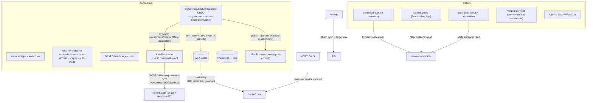
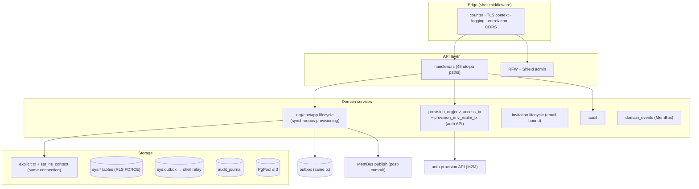
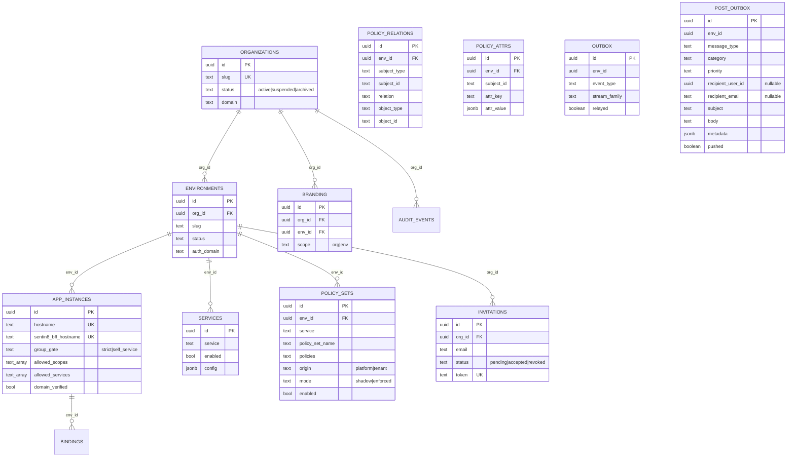
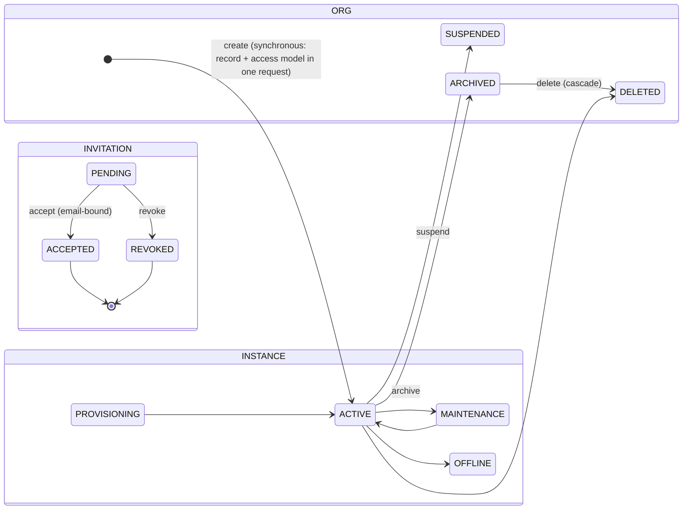
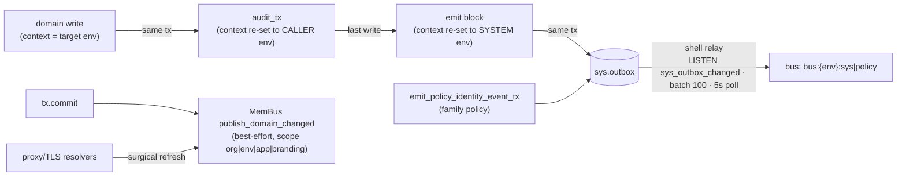
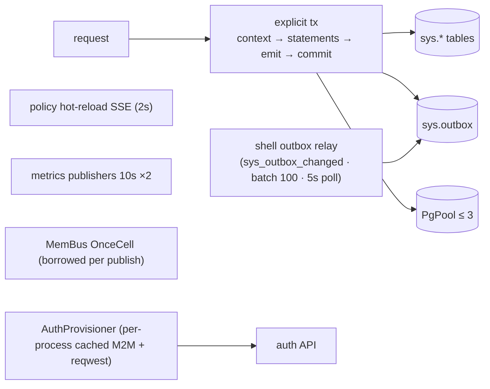
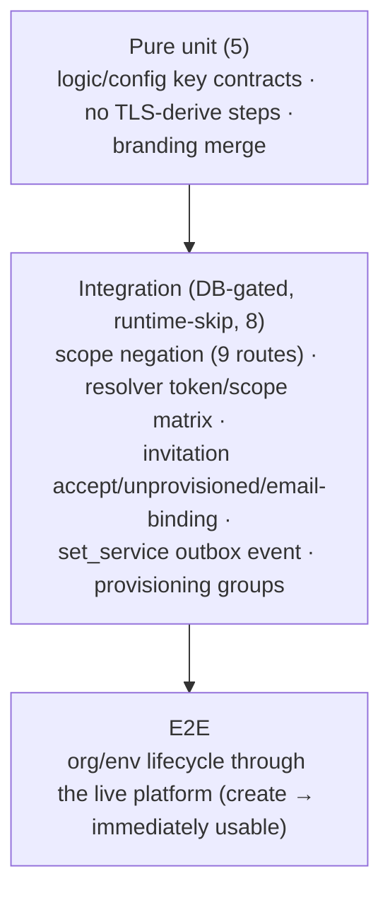

# DESIGN.md: Sentin8:Sys — Detailed Design Document

## 1. Scope & Context

Sentin8:Sys is the platform control plane: organizations, environments,
app instances and bindings, service enablement, memberships and
invitations, branding, the hostname resolver, the bootstrap surface, the
canonical audit trail, and the Shield substrate (`policy_sets`,
policy_relations`, `policy_principal_attrs`. Org/env creation is a
**synchronous, in-process lifecycle**: the handler writes the record,
provisions the access model through auth's membership API, seeds the
env's platform policy sets, and returns 200 only when the org/env is
fully usable — a success response means the caller's next request
already carries its new membership. The access model is provisioned
through auth's membership API — sys never touches another service's
tables, and the sys→Flow delegation edge does not exist.

- **Owns** (schema `sys`): `organizations`, `environments`,
  `app_instances`, `app_environment_bindings`, `services`,
  `invitations`, `branding`, `audit_events` (canonical),
  `audit_journal`, `policy_sets`, `policy_relations`,
  `policy_principal_attrs`, `outbox` (DBX), `post_outbox` (DBX-POST-3, drained
  to Post's send API by the `sys-post` pusher), plus the runtime-registered
  `vertical_admin_scopes` (created by `vertical enroll`, read by sys
  provisioning).
- **Does NOT own**: identity (auth issues/verifies), roles/groups
  (auth's membership API is the writer), MemBus transport (Valkey), and
  vertical domain records (runtime-registered). Sentin8:Flow is NOT a
  sys dependency — no sys lifecycle rides a workflow engine (a
  fundamental service's org/env lifecycle is synchronous by design).



Trust boundaries: the audit ingest stamps `service` from the verified
M2M client_id (never caller-supplied); provisioning rides auth's API
with the target-env header; every tenant-context set rides an explicit
in-handler transaction (never a proxy-back envelope).

## 2. Runtime Architecture

| Module | Role |
|---|---|
| `handlers.rs` (~4900 lines) | All domain handlers (lifecycle, enablement, applications, bindings, memberships, invitations, branding, resolver, bootstrap, catalog, verticals, audit ingest/list); `emit_sentin8_sys_event_tx` / `emit_policy_identity_event_tx` (outbox-first, best-effort); `emit_post_notification_tx` (local `post_outbox` queue, same tx); `audit_tx` (audit row env = caller env); `authorize_org` (platform-admin / delegated / live role closure via auth API). |
| `post_pusher.rs` | `sys-post` pusher task (10 s loop): drains `sys.post_outbox` to Post `POST /v1/send` with the process-lifetime `sys-post` M2M token source (`sentin8:post:write`); unpushed rows retry on the next pass — a Post outage never drops notifications. |
| `server.rs` | State build (`SysConfig`, MemBus warm, workload registry), routes, Shield admin impl. |
| `auth_provision.rs` | M2M provisioning client (`sentin8:sys` workload, dual admin scopes), provision verbs + live group reads, target-env transport rule. |
| `domain_events.rs` | MemBus `sentin8:sys:domain:changed` post-commit publisher (best-effort, once-connected handle). |
| `policy.rs` / `auth.rs` / `config.rs` / `registration.rs` / `openapi.rs` | Shield bridge; bearer verify; env config; self-description (5 M2M grants, enforced scope-mirror); OpenAPI (43 paths). |



**Org creation lifecycle (the flagship family) — synchronous, in-process:**

```mermaid
sequenceDiagram
    autonumber
    participant C as Caller (org:admin)
    participant H as POST /v1/o
    participant A as auth provision API
    participant DB as sys tables
    participant OB as sys.outbox

    C->>H: create org (slug, display_name, domain)
    H->>H: Shield org:admin
    H->>DB: tx1: context(SYSTEM) + INSERT organizations
    H->>DB: outbox org:created (same tx) + COMMIT
    H->>A: provision roles/nesting/groups/creator (idempotent ON CONFLICT upserts)
    alt provision failure
        H->>DB: compensate: DELETE org row
        H-->>C: 500 (provisioning failed — org rolled back)
    else success
        H->>DB: tx2: context(SYSTEM) + identity:updated outbox (family policy) + COMMIT
        H->>H: invalidate_local_identity_caches (SYSTEM_ENV sweep)
        H-->>C: 200 OrgResponse — fully provisioned (+audit)
    end
    Note over H,A: 200 means DONE: the caller's next request<br/>already carries its membership (read-your-writes)
    Note over H,H: The bus event is the FLEET-WIDE channel<br/>(other services' resolver caches); the local sweep closes<br/>THIS process's window — sys's own RoleResolver was primed<br/>with the creator's pre-grant identity during the request's<br/>own Shield evaluation, and until the SSE event lands<br/>(outbox→relay→bus→SSE, seconds) every read would<br/>evaluate against the stale 30s-TTL entry and 403.
```

## 3. Data Model



- **RLS**: every tenant table is `ENABLE`+`FORCE`-RLS'd. Select policies
  admit the caller's own org/env plus the SYSTEM-env clause
  (`00000000-…-0002`) for the platform plane; write policies require
  `sentin8_context_initialized()`. `sys_environments_select` needs the
  SYSTEM clause so `INSERT … RETURNING` re-checks the SELECT policy.
- **Gap**: `sys.app_environment_bindings` has no RLS statements in
  init.sql (single-role server reads today; the mandatory-RLS rule
  requires the policy).
- **`sys.audit_events`** — canonical audit: `service` stamped from the
  verified M2M `client_id` (never caller-supplied); indexes by
  `(service, timestamp DESC)`, `(env_id, timestamp DESC)`, correlation.
- **`public.sentin8_boot_policy_load(service)`** — SECURITY DEFINER
  (search_path `sys, public`) — the sanctioned cold-start read for
  NOBYPASSRLS engines; `EXECUTE` granted to every `*_service` role via a
  dynamic `DO` loop.
- `sys.vertical_admin_scopes` — created by `vertical enroll`; sys
  provisioning merges vertical admin roles into every realm.
- Seed: System Org `…0001` (`sys`), System Env `…0002` (`ops`), dash
  instance `…000a` (self_service gate, allow_signup false) with auth
  group + role + bootstrap admin membership.



## 4. API Surface

| Family | Endpoints | Gate actions |
|---|---|---|
| **Lifecycle** | `POST/GET /v1/o`, `GET/PUT/DELETE /v1/org/{id}`, `POST /v1/org/{id}/archive`; `POST/GET /v1/e`, `GET/PUT/DELETE /v1/env/{env_id}`, `POST …/archive` | `sys:org:admin` / `sys:env:admin` / `sys:read` (+ `authorize_org`). |
| **Enablement** | `GET/PUT /v1/env/{env_id}/services` | `sys:services:admin` (emits `service:updated`). |
| **Applications** | CRUD under `/v1/env/{env_id}/applications`, bindings `/bindings`, custom domain | `sys:app:admin` / `sys:read`. |
| **Memberships** | `GET/DELETE /v1/org/{org_id}/memberships` | `sys:read` / `sys:memberships:admin`. |
| **Invitations** | list/create/accept/revoke under `/v1/org/{org_id}/invitations…` | `sys:memberships:admin`. |
| **Branding** | org base, env override, `/merged` | `sys:read` / org+env admin. |
| **Resolver (BFF/TLS)** | `/v1/resolve/hostname`, `/v1/app-instance/scopes`, `/v1/app-instance/auth-mode`, `/v1/env/{id}/auth-domain`, `/v1/env/{id}/app-custom-domain` | `sys:instances:read`. |
| **Bootstrap** | `GET /v1/bootstrap` | `sys:read`. |
| **Catalog** | `GET /v1/scopes/catalog`, `GET /v1/verticals/services` | open / `sys:read`. |
| **Audit** | `GET /v1/audit` (`audit:read`; non-admins forced to own env; keyset pagination `after_ts`/`after_id` over `limit`/`offset`), `POST /v1/audit` (`audit:write`, **M2M-only**; `service` = DCR client_id). |
| **Tenant snapshot** | `GET /v1/tenants/{env_id}` (`tenants:read`, **M2M-only**, cert-bound; scoped discovery: answers only for envs where the caller's own service is enabled — see VDC §VDC.5). |
| **Shield admin** | `/v1/admin/policy-sets|relations|attributes…` | policy-admin surface. |
| `/v1/health`, `/v1/readiness`, `/openapi.json` | GET | none. |

Event flow (DBX outbox + MemBus):



Family `sys` events: `org:created|updated|archived|deleted`,
`env:created|updated|archived|deleted`, `service:updated`,
`app:created|updated|archived`, `binding:created|deleted`,
`membership:removed`, `invitation:sent|revoked|accepted`,
`audit:recorded` — emitted from BOTH the `POST /v1/audit` ingest AND
every internal `audit_tx` write (same transaction, best-effort), so
Stat's audit-volume aggregate sees the platform's full audit volume.
All `audit:recorded` rows carry SYSTEM_ENV_ID with the target env in
the payload (`env_id`) — the shell relay produces with sys's
system-env-bound M2M token, so a caller-env row would be rejected 403
by Bus (cross-tenant) and hot-loop the relay.
**Org/env creation is synchronous** — the org/env lifecycle handler:
(1) commits the record with its `org:created`/`env:created` outbox row,
(2) provisions the access model through auth's API (idempotent),
(3) commits the `identity:updated` outbox row (policy family),
(4) sweeps its own `RoleResolver` cache for every realm just granted
(`invalidate_local_identity_caches` — org creation: SYSTEM_ENV; env
creation: SYSTEM_ENV + the new env; invitation acceptance:
SYSTEM_ENV), and only then returns 200. The caller's next request is
already authorized: `authorize_org` reads the creator's live group
closure from auth, and the group rows exist before the response leaves
sys. The bus event remains the fleet-wide invalidation channel (other
services' caches); the local sweep exists because THIS process's
resolver was primed with the pre-grant identity during the create's own
Shield evaluation, and the bus event reaches sys's own SSE consumer
only after the outbox→relay→bus→SSE hop — without the sweep, the
read-your-writes contract would hold for every process except the one
that granted.
**VDC (design/sentin8-vertical-data-plane-contract.md §VDC.4)**: the
`org:created|updated` and `env:created|updated` envelopes are
**payload-complete tenant snapshots** —
`{env_id, env_slug, env_display_name, org_id, org_slug, org_domain,
org_display_name, auth_domain, status}` (+ the org fields on org
lifecycle events) — so a consumer never needs a lookup to act. All
other lifecycle payloads remain id-only (no consumer reaction depends
on their content).
Family `policy` events: `identity:updated`
(`{env_id, subject_ids}`), `policy:updated` (payload-complete envelope:
service `*`, scope-mirror, version, mode, `seeded: true`).

## 5. Cross-Cutting Concerns

- **Authentication**: bearer verify (shared Auth SDK); Shield enforced
  scope-mirror per action; resolver endpoints gated by
  `sys:instances:read` (the BFF/TLS vocabulary). The request
  authentication order is **Bearer-first, certificate fallback**: a
  Bearer JWT (user/delegated/actor token) always wins and the client
  certificate is consulted only when no Authorization header is
  present. A delegated token carries the acting user in `act.sub`
  (RFC 8693) — the certificate-first order would resolve the
  hop's `auth-sys` workload instead of the delegated JWT and lose the
  acting user entirely (the `authorize_org` membership probe would then
  query auth with the nil UUID and fail with 403 "not a member of this
  organization" — the e2e invite-form incident). The mTLS-transported
  proxy hop presents BOTH; the Bearer names who acts.
- **Tenant resolution + RLS**: `set_rls_context(conn, env_id)` awaited
  inside every explicit transaction; the emit block re-sets context to
  `SYSTEM_ENV_ID` (platform-family outbox rows live there) as the last
  write; `audit_tx` re-sets to the CALLER's env before its INSERT (the
  audit row's env IS the caller's env); invitation post-mail writes ride
  the local `post_outbox` queue (DBX-POST-3) in the SAME domain
  transaction as the invitation change — the row carries the ORG's env
  under the caller's (already set) context, so the same-context INSERT
  passes RLS and the exactly-once coupling with the domain change is
  preserved. The `sys-post` pusher task (10 s loop) drains `post_outbox`
  to Post `POST /v1/send` with the `sys-post` M2M identity
  (`sentin8:post:write`); sys never writes `post.inbox` directly and
  holds no INSERT grant on Post's internal tables. The queued rows carry
  category `system` (Post's `inbox_category_check` vocabulary:
  `transaction|security|marketing|system`) — the pusher forwards it
  verbatim, so an out-of-vocabulary value would 500 at the send API and
  retry forever. The helper re-sets the tenant context to the row's env
  (transaction-local) because the preceding platform-plane outbox emit
  needs the SYSTEM context on the same transaction.
- **Idempotency**: provisioning verbs are auth-side-idempotent
  (`ON CONFLICT` upserts end-to-end) — a caller retrying a create that
  failed mid-provisioning converges to the same access model without
  duplicates. The slug/env uniqueness constraints remain the
  create-level dedupe point.
- **Audit journaling**: `audit_events` (canonical, service-stamped) +
  `audit_journal` spill (unpushed index) for the shared pusher.
- **Graceful drain / TLS posture**: shell-owned (PQ provider, pool cap,
  PG18 check, PQ-TLS serve; callbacks use the derived platform hostname
  because the SNI-routed listener refuses plain connects).

## 6. Failure Modes & Recovery

```mermaid
flowchart TD
    A[invitation accept] -->|status != pending| R409[409 invitation is {status}]
    A -->|expired| R410[410 GONE]
    A -->|no email claim or mismatch| R403[403 email binding enforced]
    A -->|group_member written == 0| R409B[409 org access model not provisioned]
    CO[create org/env] -->|provisioning API error| COMP[compensate: DELETE just-created record] --> S500C[500 provisioning failed — org rolled back]
    CO -->|success| OK200[200 fully provisioned]
    CRASH[process crash between record commit and provision] --> ORPHAN[orphan record without access model<br/>operator archives/deletes; next retry reuses slug conflict → 409]
    OUTX[outbox emit failure] --> ERRLOG[error log; tx still commits<br/>heals via TTL/safety-poll backstops]
    MB[MemBus down] --> DEGRADE[warnings; 30s resolver poll covers]
    B[boot: port/policy/PG] --> FAILFAST[panic / refuse-to-start]
    ACCEPT2[accept group write] --> ONETX[status + group + audit + emit in ONE tx]
```

- **Provisioning failure compensation**: the create handlers delete
  the just-created record and return 500 — a caller retry starts clean
  (no half-provisioned orgs; auth-side upserts are idempotent so a
  retry that raced with the compensating delete converges).
- **Crash window** (record committed, provisioning not done): a
  narrow, documented operator-recovery case — the record exists
  without its access model. The operator archives/deletes the orphan
  (platform-admin path); a same-slug retry 409s until then. The
  window is two HTTP calls wide and a saga engine would not remove
  it (the engine itself would need the same compensation).
- **Outbox emit failure** logs and commits (downstream heals via the
  30s resolver poll / 30s identity TTL backstops).
- **MemBus** is fail-soft: notifications disabled/degraded never fail a
  mutation.

## 7. Concurrency & Performance Model



- No service-owned background tasks; shell spawns the outbox relay,
  policy hot-reload consumer, and metrics publishers; `domain_events::init()`
  is an awaited OnceCell warm-up (no task).
- Hot paths: resolver endpoints (hostname lookups under RLS context),
  audit ingest (per-event context + insert), bootstrap (groups via
  auth's API).
- Pool cap 3; provisioning calls are HTTP (auth API) — the DB holds no
  auth state.

## 8. Invariants, Insecure-Defaults Rejected, Unsafe Rationale

1. **Same-transaction context rule**: `set_config(…, true)` is
   transaction-local — the context set and every statement of the write
   path share one explicit transaction; any statement needing a different
   env re-sets it inline (emit blocks end on the system env).
2. **Outbox-first**: event rows insert in the SAME transaction as the
   domain change; a failed emit never blocks the request (heals via
   backstops).
3. **No cross-service DML**: sys holds no grants on `auth.*`;
   provisioning rides auth's provision API (target-env header), reads
   ride `GET /v1/admin/users/{id}/roles|groups`; the direct DML helpers
   are deleted.
4. **Audit row env = caller env** (`audit_tx` re-sets context before its
   INSERT); audit ingest stamps `service` from the verified M2M
   client_id only (user tokens 403).
5. **Org/env lifecycle is synchronous in-process**: the create handler
   provisions the access model through auth's API before responding —
   200 means fully provisioned (record + access model + events); a
   provisioning failure compensates by deleting the record and
   returning 500. No workflow engine, no background steps, no
   settle-window on the caller's side. Read-your-writes holds for the
   granting process itself: the handler sweeps its own `RoleResolver`
   cache (whole-env, the same granularity the bus consumer uses) for
   every realm just granted, in the same request as the 200 — the bus
   `identity:updated` event remains the fleet-wide channel but is
   asynchronous (outbox→relay→bus→SSE) and cannot be read-your-writes
   for the process that granted.
6. **Invitation acceptance is email-bound** (proof-of-possession);
   acceptance never fabricates groups (missing access model → 409).
7. **Branding merge**: env override → org base, non-empty wins;
   `merged` is read-only.
8. **Resolver endpoints are read-only** and scoped to
   `sys:instances:read` — tenant resolution data cannot be mutated
   through them.
9. **`authorize_org` reads group names** (auth's
   `GET /v1/admin/users/{id}/groups`): provisioning assigns the creator
   to the group `sentin8:org:{org_id}:owners` — the UUID-embedded
   GROUP name proves membership in THIS org (a foreign org's group
   names never embed this org_id). The role names carried by those
   groups (`sentin8:org:owner|admin|viewer`) are realm-static and do
   NOT embed the org id — matching on them would admit every org's
   members to every org.
10. No `unsafe` code; outbound calls ride the platform CA + DCR
    cert-bound identities (static tokens are dev-bootstrap only).

## 9. Testing Strategy



- The integration harness runs a local issuer (discovery/JWKS/userinfo),
  connects as `sentin8_sys_service` (NOBYPASSRLS — unqualified `outbox`
  resolves correctly), seeds the enforced scope-mirror engine for both
  the SYSTEM env and `ENV_A`, and cleans up in reverse order.
- **Deliberately NOT tested here**: relay mechanics (platform), MemBus
  delivery (membus suite), TLS.

## 10. Open Questions

- `sys.app_environment_bindings` gains the standard ENABLE/FORCE RLS policy
  set on `env_id` in init.sql, generated the same way the outbox tables'
  policies are.
- `GET /v1/scopes/catalog` stays open (a pre-login surface consumed by app
  bootstraps; the design's "no unauthenticated endpoints" rule names its
  exceptions). If exposure concerns grow, gate it with `sys:read` and have the
  BFF's runtime-context response embed the catalog slice; the chosen posture
  is documented in the README.
- The audit-journal → Sys push loop rides the shared `push_journal_to_sys`
  shell task (sys journals its own admin/lifecycle actions; the loop pushes
  them to the ingest API).

---

**Design attribution:** sentin8:sys and its underlying concepts were designed by Hamid Jahanzad <Hamid@Jahanzad.com>.

