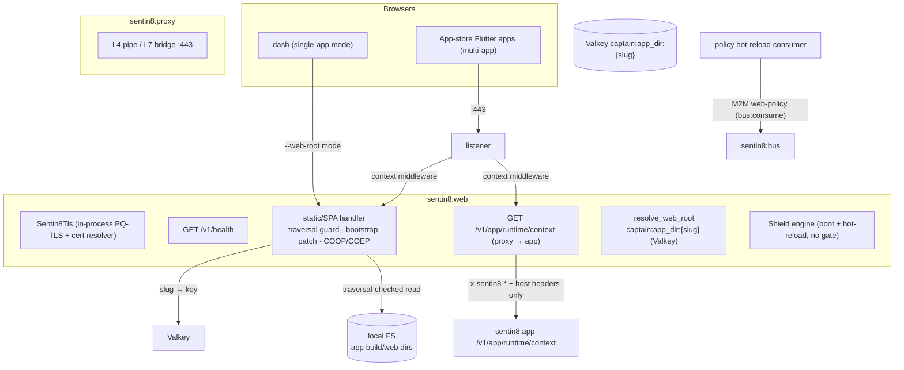
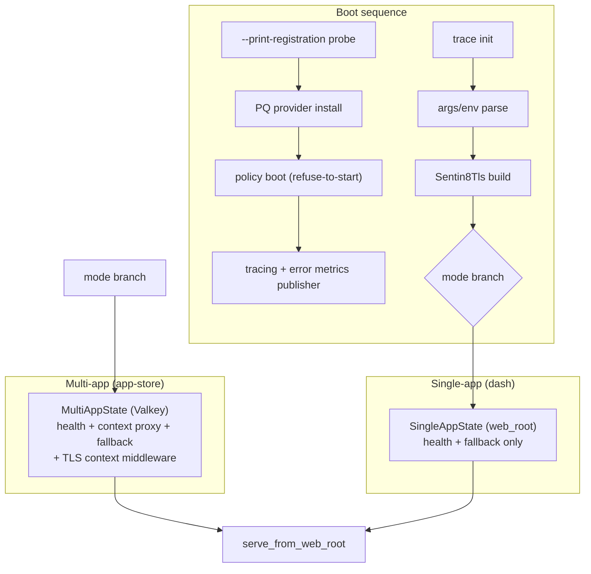
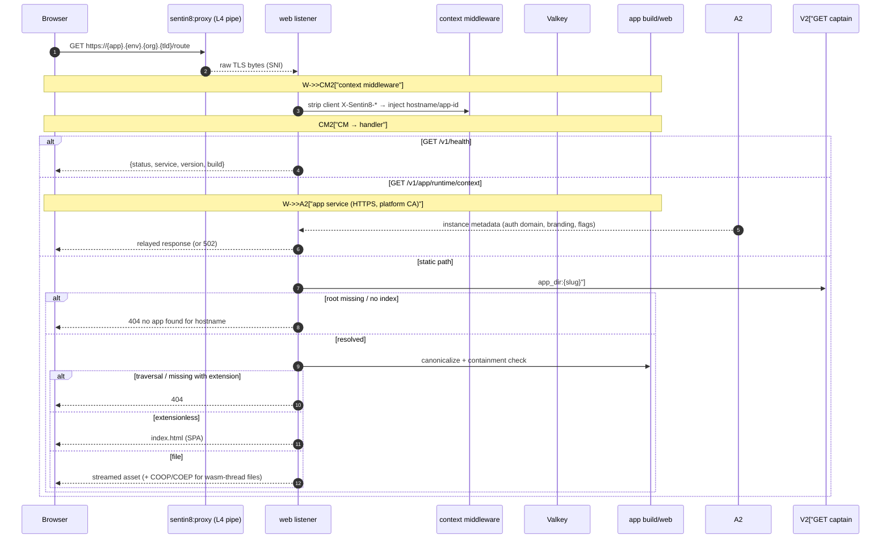
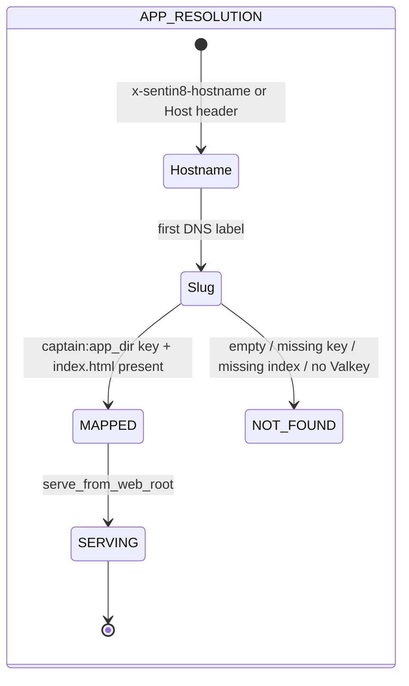
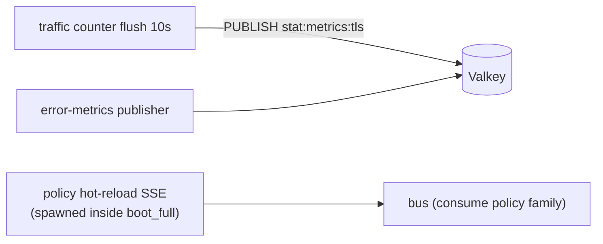
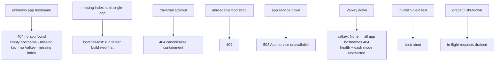
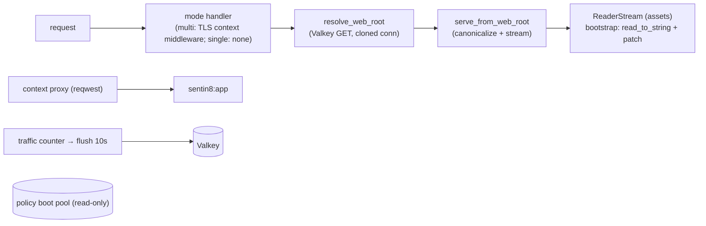
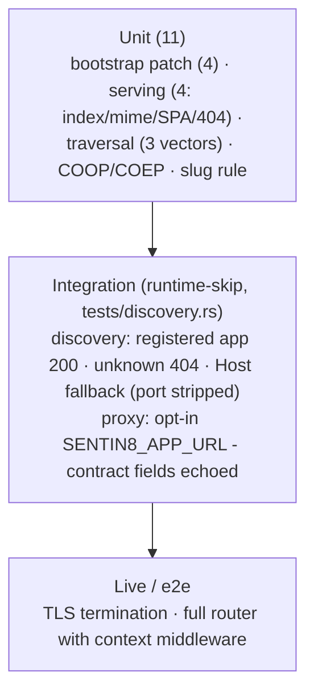

# Sentin8:Web - Detailed Design Document

## 1. Scope & Context

Sentin8:Web is the single-instance static host for every Flutter web
app in the platform: one process, one TLS listener, apps discovered at
request time from runtime-registered Valkey keys. It serves the app
shell (SPA fallback + asset streaming), patches Flutter's bootstrap
script for in-app webviews, sets cross-origin isolation headers for
multi-threaded WASM, and proxies the pre-login runtime-context call to
Sentin8:App on the app's own origin.

- **Owns**: nothing persistent - no tables, no outbox, no Bus events.
  Runtime state is the Valkey app-dir mapping (read-only) and the
  Shield engine (booted, hot-reloaded, never evaluated - no
  token-bearing handler).
- **Does NOT own**: app binaries (built by each vertical's app),
  the app registry (`captain:app_dir:{slug}` keys written by
  `vertical enroll`), runtime context data (app service), and TLS
  certificates (resolved per-SNI via `sentin8-tls`).

Trust boundaries: browsers hold no tokens; the app instance is
established by the TLS-injected `X-Sentin8-*` headers (which the context
middleware strips from clients before injecting); the runtime-context
proxy forwards only those headers + `host`.

## 2. Runtime Architecture

| Component | Role |
|---|---|
| Boot (`main.rs`) | `--print-registration` probe → PQ provider → dotenv → **policy boot** (`init_web_policy`: refuse-to-start on invalid text) → tracing + error-metrics publisher → arg/env parse → TLS build → traffic counter + flush loop → mode branch → `tls.serve`. |
| Single-app mode (dash) | `SENTIN8_WEB_ROOT`/`--web-root` → canonicalized root, fail-fast when `index.html` missing; router = health + fallback (traffic counter only, no TLS context middleware). |
| Multi-app mode | Valkey `ConnectionManager` (failure → `None`); hostname → slug (first label) → `captain:app_dir:{slug}` → root accepted only when `index.html` exists; context middleware active. |
| `serve_from_web_root` | The single file path for both modes: decode → canonicalize → containment → file? stream : SPA fallback → 404. |
| `serve_file` | Bootstrap read → `strip_service_worker_settings` → `no-store` + COOP/COEP; others → `mime_guess` + `ReaderStream` (content-length from metadata). |
| `strip_service_worker_settings` | Brace-depth scanner (string-safe) replacing `serviceWorkerSettings: {…}` with `{}` in memory. |
| `proxy_to_app_service` | Forwards only `x-sentin8-*` + `host` headers to app's runtime-context endpoint; relays status/content-type/body; 502 on transport error. |
| `policy.rs` / `registration.rs` | Shield bridge (uniform enforced posture); self-description (one M2M workload). |

**Multi-app request lifecycle:**

## 3. Data Model

Web owns no tables. Its runtime state:

| Surface | Source | Contents |
|---|---|---|
| `captain:app_dir:{slug}` | `vertical enroll` | absolute path to the app's built web directory (on-the-fly discovery; no restart). |
| `SingleAppState` | `--web-root` | one fixed directory (dash mode), `index.html` required at boot. |
| `WEB_POLICY` | Shield boot | engine + hot-reload consumer (M2M `sentin8:web-policy`, `bus:consume`). |

### DB identity

Web owns no tables and writes nothing, but its policy boot still opens a
DB connection (read-only Shield policy load via
`public.sentin8_boot_policy_load`). That connection uses web's **own
per-service DSN identity**, not the shared dev role:

- PG role: `sentin8_web_service`, declared in web's own
  `--print-registration --section=pg_roles` (created with the bootstrap-
  tier SCRAM password `sentin8` by `platform.sql`).
- DSN source: `SENTIN8_WEB_DATABASE_URL` (operator env), falling back to
  the shared `sentin8_app` dev DSN only when the per-service variable is
  unset - the shared-fallback keeps local test harnesses working but the
  deployed posture is the dedicated role.
- Privileges: USAGE + EXECUTE on `public` (the helper function) - read
  only, no tables, no outbox.

## 4. API Surface

| Endpoint | Method | Gate | Notes |
|---|---|---|---|
| `/v1/health` | GET | none | `{status, service, version, build}`; bypasses the traffic counter. |
| `/v1/app/runtime/context` | GET | **public, pre-login** | proxies to app with `x-sentin8-*` + `host` headers only; instance metadata only (auth domain, branding, feature flags); 502 on app outage. |
| `fallback(any)` | any | none | static/SPA handler (multi- or single-app). |
| `/openapi.json` | - | - | registration spec closure → null (no utoipa surface). |

Event/metric flow (transport-level only - web emits no domain events):

## 5. Cross-Cutting Concerns

- **Authentication**: none on any surface - static assets are the app
  shell; the runtime-context proxy is public pre-login (the caller
  identity is the TLS-injected app instance, not a bearer principal; a
  bearer/Shield gate would 401 every app bootstrap). The Shield engine
  boots + hot-reloads in the uniform enforced posture but has no
  token-bearing handler to gate.
- **Tenant resolution**: TLS context middleware injects
  `X-Sentin8-Hostname`/`X-Sentin8-App-Id` (client copies stripped); the
  HTTP `Host` header is the fallback under the L4 proxy (which injects
  no headers).
- **Path safety**: canonicalize-based containment (`requested` must stay
  under the resolved web root) - encoded `..%2F` sequences are decoded
  first, so canonicalization is the enforcement point, not string
  matching (test-pinned).
- **SPA + browser constraints**: extensionless paths → `index.html`;
  missing files with an extension → 404; `flutter_bootstrap.js` is
  patched in memory (service-worker object → `{}`) and served
  `no-store, must-revalidate`; `main.dart.js` and `.wasm` carry
  `COOP: same-origin` + `COEP: require-corp` (multi-threaded WASM).
- **Idempotency**: static reads are naturally idempotent; the proxy
  forwards GETs only.
- **Graceful drain / TLS posture**: `Sentin8Tls::serve` handles shutdown
  (in-flight requests drain); PQ provider installed before any outbound
  HTTPS call (the app proxy).

## 6. Failure Modes & Recovery

- **Fail-fast boot**: single-app mode refuses to start without
  `index.html`; policy boot refuses invalid text; a failed/unreachable
  policy-boot connection aborts boot (the engine cannot authorize
  anything without its policy rows). A missing or password-drifted PG
  role resurfaces exactly here - web exits with
  `password authentication failed for user …` rather than starting
  policy-less.
- **Discovery degradation**: a Valkey outage degrades to 404s for
  app-hostname requests only (the dash mode and health keep serving).
- **No background tasks owned**: everything (metrics, hot-reload) is
  spawned at boot inside the policy helper; in-flight requests drain
  naturally on shutdown.

## 7. Concurrency & Performance Model

- Per-request work: one Valkey GET (multi-app), one canonicalize +
  stream; the bootstrap is read fully (small) and patched in memory;
  large assets stream with content-length from metadata (never fully
  buffered).
- No caching layer: static reads hit the FS; `Cache-Control` on the
  bootstrap is `no-store` so a rebuilt app is never shadowed.
- Tasks: traffic-counter flush (10s), error-metrics publisher, policy
  hot-reload consumer - all shell/policy-owned.

## 8. Invariants, Insecure-Defaults Rejected, Unsafe Rationale

1. **Zero compile-time vertical knowledge** - app directories resolve
   from Valkey keys at request time; a newly enrolled app is served
   without a restart.
2. **Canonicalize-based traversal protection** - component-level decode +
   `starts_with(web_root)` containment; escapes are 404s, never served
   (test-pinned incl. percent-encoded).
3. **Tokens never to the client** - web holds no tokens and forwards
   none; the runtime-context proxy forwards only `x-sentin8-*` + `host`
   headers (arbitrary client headers are not re-emitted by construction).
4. **The context proxy stays public** by contract (pre-login bootstrap);
   its response carries only instance metadata - same trust basis as the
   app shell.
5. **Bootstrap patch is string-safe** (brace-depth counter - a literal
   `}` inside a string cannot end the object) and served `no-store`.
6. **WASM-thread headers** on the bootstrap, `main.dart.js`, and `.wasm`
   (COOP/COEP) - required for multi-threaded WASM.
7. **Single-app mode fails fast** without `index.html`; multi-app
   requests without a resolvable app are 404 (never a wrong app's
   content).
8. **No tables, no migrations, no outbox** - the policy boot pool is
   read-only. The pool's DSN is the per-service `SENTIN8_WEB_DATABASE_URL`
   when set (backed by the `sentin8_web_service` role); the shared dev DSN
   (`sentin8_app`) is a local-harness fallback only, never the deployed
   identity.
9. No `unsafe` code; TLS termination and cert resolution ride the
   platform TLS crate.

## 9. Testing Strategy

- The pure suite pins the four no-op/stripping cases, the four serving
  cases, three traversal vectors, the bootstrap patch + isolation
  headers, and the slug rule.
- The integration target (`tests/discovery.rs`, binary-only crate -
  `src/main.rs` included via `#[path]`, cron test-crate pattern) drives
  the REAL multi-app handler with a `MultiAppState` over live Valkey:
  `captain:app_dir:{slug}` is SET to a tempdir root (unique slug per
  test, key DELeted in teardown), requests go through a router with the
  handler attached via state - Host header `{slug}.test` → 200 fixture
  content; unregistered slug → 404 naming the hostname; the L4-proxy
  Host fallback resolves with the port stripped. Skip gating uses hard
  connect timeouts (3s Valkey / 5s PostgreSQL): `ConnectionManager::new`
  retries refused connects internally (up to a 60s per-delay cap) and
  would otherwise stall the skip path for minutes. The proxy test is
  opt-in (`SENTIN8_APP_URL`); it re-aims `SENTIN8_DOMAIN` at the provided
  base and asserts the relayed instance metadata (default probe hostname
  `dash.ops.sys.local.sentin8.dev`, override `SENTIN8_APP_TEST_HOSTNAME`).
- **Deliberately NOT tested here**: TLS termination / context-middleware
  header injection (live stack + e2e), the app proxy under outage (502
  path pinned by contract, exercised in e2e).

## 10. Open Questions

- Multi-app discovery and the runtime-context proxy integration tests are
  written (`tests/discovery.rs`, testing-strategy §3 runtime-skip gating
  with hard connect timeouts) - remaining uncovered: TLS/context-middleware
  wiring (live stack) and the proxy 502 outage path (e2e).
- Only the local serving mode exists by design (the web design defines only
  the two local modes); the adapter pattern from storage is the seam when a
  CDN/object-store backend is needed - a recorded non-goal.

---

**Architecture & Design:** sentin8:web and its underlying concepts were designed by [Hamid Jahanzad](https://www.linkedin.com/in/hamidjahanzad/).

